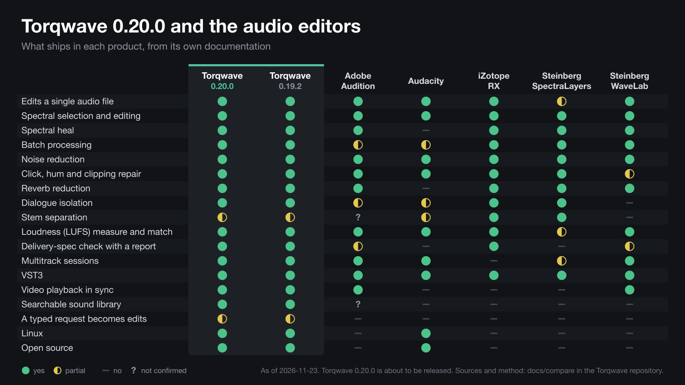
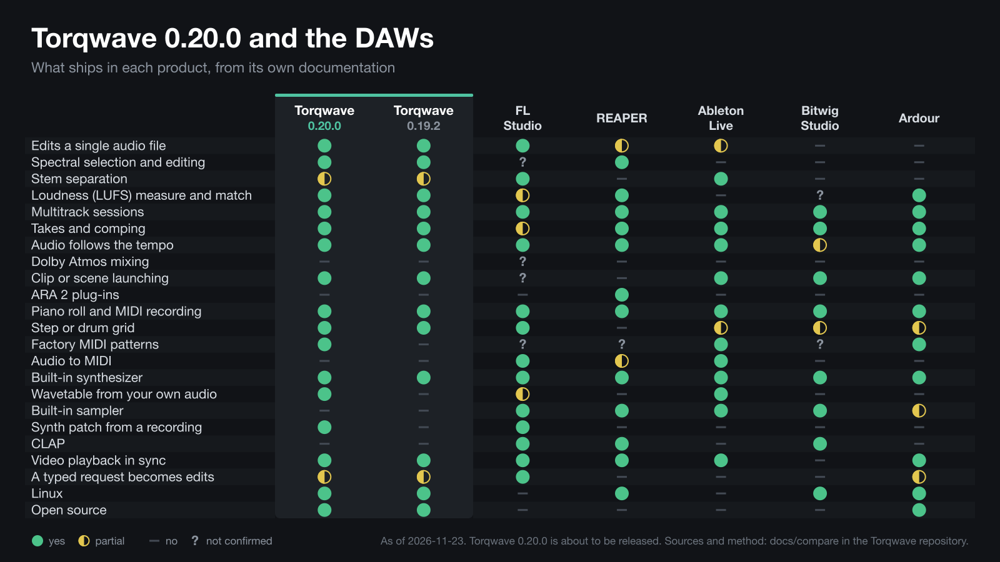
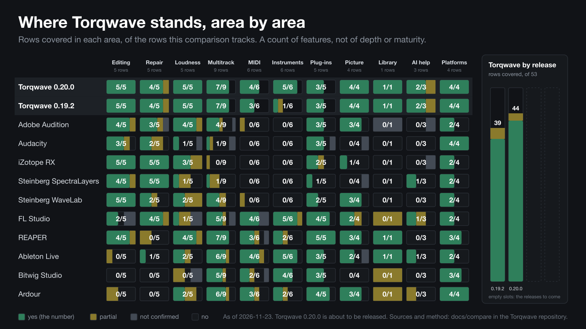

# Torqwave against the alternatives

Generated by `generate.py` from `data/`. Do not edit by hand: change the data and run the script.

**As of 2026-11-23.** Torqwave 0.20.0 is about to be released; its column describes this repository before the release tag. The 0.19.2 column is the release before it.

## How to read it

- **Yes:** Built into the product at the edition assessed, and documented.
- **Partial:** A limited form; the note says how.
- **No:** The product's own documentation shows it absent, or its scope excludes it and its documentation has no mention.
- **Not confirmed:** No first-party page was found that settles it. Counted as neither yes nor no.
- **Info:** A fact, not a yes or no (price, licence, dates). Never counted.

- Every competitor cell was read from the product's own documentation, manual, feature or pricing page on the date in its snapshot, and keeps the page's address and a short quotation or a note of what was checked. Where no first-party page settled a cell it says 'not confirmed'.
- Torqwave's cells come from this repository's README, guide, roadmap and changelog at the commit the snapshot names.
- Only what ships in the product counts. Third-party plug-ins do not, and neither do separate downloads unless the note says so (those are 'partial').
- Each product is assessed at the edition its snapshot names, usually the largest, so a cheaper edition may have less than its column shows.
- Coverage of an area is a count: how many of the area's rows are yes, and how many partial. Rows are not weighted, and no single score or rank is computed across areas, because any weighting would be arbitrary.
- The rows were chosen for what Torqwave aims at (sound design, writing music, work to picture, game audio), so they favour a product that is both an editor and a DAW. A product built for one job covers few rows outside it by design, which says nothing about how well it does that job.
- A yes says a feature exists. It says nothing of its depth, its quality or how long it has been in use. Torqwave's features are new and mostly tested by its own suite, not by years of users; the 'maturity' facts under the matrix are there to keep that in view.

## Products

| Product | Version assessed | Edition | Looked up | Why it is here |
|---|---|---|---|---|
| Torqwave 0.20.0 | 0.20.0 (about to be released) | the only edition | 2026-11-23 | The product this set tracks. The current column is the release the snapshot is made for. |
| Torqwave 0.19.2 | 0.19.2 (2026-11-21) | the only edition | 2026-11-23 | The release before, as its own column, so each release's gains show. |
| Adobe Audition | 27.0 (2026-11-10) | Standalone Audition subscription (Creative Cloud), desktop | 2026-11-23 | The commercial reference for a waveform and spectral editor with a multitrack; named in the brief, and Torqwave ships an Audition-style key set. |
| Audacity | 4.0.2 (2 November (the page gives no year)) | Free open-source desktop app; Audacity 4.0.2 is current stable; no separate 4.x preview is needed. | 2026-11-23 | The free, open-source editor most people try first; named in the brief, and the README offers Torqwave as an alternative to it. |
| iZotope RX | 12.1.0 (2026-10-15) | RX 12 Advanced (standalone RX Audio Editor + plug-ins) | 2026-11-23 | The reference for spectral repair and restoration, the job of Torqwave's repair suite. |
| Steinberg SpectraLayers | 13.0.30 | Pro (Elements gaps noted in cells) | 2026-11-23 | The reference for spectral editing by layers and for unmixing. |
| Steinberg WaveLab | 13.0.30 (2026-07-22) | Pro (Elements 13 differences noted in cells) | 2026-11-23 | The reference for mastering, loudness and delivery, the job of Torqwave's mastering suite. |
| FL Studio | 2026.1.7 (2026-09-28 (FL Studio 2026 released 2026-07-07)) | All Plugins Edition | 2026-11-23 | Named in the brief; pattern-based writing with many built-in instruments, the area 0.20.0 moves into. |
| REAPER | 7.86 (2026-11-13) | REAPER with bundled ReaPlugs/ReaSynth (single edition; discounted $60 or commercial $225 licence, same software) | 2026-11-23 | A low-cost DAW on all three systems, widely used for sound design and game audio. |
| Ableton Live | 12.4.16 (2026-10-30) | Suite (Max for Live devices included; Standard gaps noted in cells). Live 13 was announced on 2026-11-10 for early 2027 and is not assessed; the compare-editions page already describes it. | 2026-11-23 | The reference for clip launching and electronic music, the ground the Idea Board and the built-in instruments move into. |
| Bitwig Studio | 6.1.7 (2026-11-05) | Bitwig Studio (full; Producer/Essentials differences noted per cell) | 2026-11-23 | A DAW on all three systems, Linux included, with a large set of built-in instruments. |
| Ardour | 9.10 (2026-11-10) | Ardour (open source, official ready-to-run build, pay-what-you-want) | 2026-11-23 | The open-source DAW: the other free-software route to multitrack work on Linux, macOS and Windows. |

Left out, and why:

- **ocenaudio:** A free editor for quick edits; without spectral editing or a multitrack it overlaps the Audacity column and adds no row where it differs.
- **Sound Forge:** Windows only in its current Pro edition; WaveLab covers the mastering-editor place on more systems.
- **Logic Pro, Cubase/Nuendo, Pro Tools, Studio One:** Each would add a column much like Live's or REAPER's; Logic is Mac only. Add one when a release moves into its ground (Nuendo or Pro Tools for picture work).

## Graphics

## Coverage by area

Rows that are yes, with partial rows after a plus sign and rows not confirmed after a question mark. Counts, not a score.

| Area | Rows | Torqwave 0.20.0 | Torqwave 0.19.2 | Adobe Audition | Audacity | iZotope RX | Steinberg SpectraLayers | Steinberg WaveLab | FL Studio | REAPER | Ableton Live | Bitwig Studio | Ardour |
|---|---|---|---|---|---|---|---|---|---|---|---|---|---|
| Editing a file | 5 | 5 | 5 | 4 +1 | 3 +1 | 5 | 4 +1 | 5 | 2 ?2 | 4 +1 | 0 +1 | 0 | 0 +2 |
| Repair | 5 | 4 +1 | 4 +1 | 3 +1 ?1 | 2 +2 | 5 | 5 | 2 +1 | 4 +1 | 0 +2 | 1 | 0 | 0 |
| Loudness and analysis | 5 | 5 | 5 | 4 +1 | 1 ?1 | 3 +2 | 1 +2 | 2 +3 | 1 +2 ?2 | 4 +1 | 2 +1 | 0 +2 ?2 | 2 +2 |
| Multitrack and mixing | 9 | 7 | 7 | 4 +1 ?1 | 1 +1 ?2 | 0 +1 | 1 +3 | 4 +2 | 5 +1 ?2 | 7 | 6 +1 | 5 +1 | 6 +1 |
| MIDI and writing music | 6 | 4 | 3 | 0 +1 | 0 | 0 | 0 | 0 +1 | 4 ?2 | 3 +1 ?1 | 4 +1 | 2 +1 ?1 | 3 +1 |
| Built-in instruments | 6 | 5 | 1 +1 | 0 | 0 | 0 | 0 | 0 | 5 +1 | 2 +1 | 5 | 4 | 2 +1 |
| Plug-in hosting | 5 | 3 | 3 | 3 | 3 ?1 | 2 +1 | 1 | 2 | 4 | 5 | 3 | 3 | 4 |
| Working to picture | 4 | 4 | 4 | 3 | 0 ?1 | 1 | 0 ?1 | 3 | 2 +1 | 3 | 2 ?1 | 0 | 3 |
| Sound library | 1 | 1 | 1 | 0 ?1 | 0 | 0 | 0 | 0 | 0 +1 | 1 | 1 | 0 +1 | 0 +1 |
| AI help | 3 | 2 +1 | 2 +1 | 0 ?1 | 0 | 0 ?1 | 1 | 0 | 1 +1 | 0 | 1 | 0 | 0 +1 |
| Platforms and licence | 4 | 4 | 4 | 2 | 4 | 2 | 2 | 2 | 2 | 3 | 2 | 3 | 4 |
| **All rows** | 53 | 44 +2 | 39 +3 | 23 +5 ?4 | 14 +4 ?5 | 18 +4 ?1 | 15 +6 ?1 | 20 +7 | 30 +8 ?8 | 32 +6 ?1 | 27 +4 ?1 | 17 +5 ?3 | 24 +9 |

## Torqwave by release

| Release | Yes | Partial | No | Rows |
|---|---|---|---|---|
| 0.19.2 | 39 | 3 | 11 | 53 |
| 0.20.0 | 44 | 2 | 7 | 53 |

## Where Torqwave is behind

Rows where Torqwave 0.20.0 is no or partial and at least two of the 10 other products are yes.

| Row | Torqwave | Others that are yes |
|---|---|---|
| Stem separation | Partial | 4: iZotope RX, Steinberg SpectraLayers, FL Studio, Ableton Live |
| ARA 2 plug-ins | No | 2: Steinberg SpectraLayers, REAPER |
| Audio to MIDI | No | 2: FL Studio, Ableton Live |
| Built-in sampler | No | 4: FL Studio, REAPER, Ableton Live, Bitwig Studio |
| CLAP | No | 3: FL Studio, REAPER, Bitwig Studio |
| VST2 | No | 7: Adobe Audition, Steinberg WaveLab, FL Studio, REAPER, Ableton Live, Bitwig Studio, Ardour |

The facts under [Maturity and terms](#maturity-and-terms) belong here too: Torqwave is new (see First public release), its installers are not signed or notarized, it has no scripting API, and its release notes say which parts of a release were not tried by hand.

## Where Torqwave is ahead

Rows where Torqwave 0.20.0 is yes and at most two of the 10 other products are yes.

| Row | Others that are yes | Others partial | Not confirmed |
|---|---|---|---|
| Dialogue isolation | iZotope RX, Steinberg SpectraLayers | Adobe Audition, Audacity, FL Studio | none |
| Delivery-spec check with a report | iZotope RX, Ardour | Adobe Audition, Steinberg WaveLab, REAPER | FL Studio |
| Step or drum grid | FL Studio | Ableton Live, Bitwig Studio, Ardour | none |
| Factory MIDI patterns | Ableton Live, Ardour | none | FL Studio, REAPER, Bitwig Studio |
| Wavetable from your own audio | Ableton Live | FL Studio | none |
| Synth patch from a recording | FL Studio | none | none |
| Scene-cut detection | none | none | none |
| Searchable sound library | REAPER, Ableton Live | FL Studio, Bitwig Studio, Ardour | Adobe Audition |
| Machine learning runs locally | Steinberg SpectraLayers, Ableton Live | FL Studio | Adobe Audition, iZotope RX |
| Uses a model server you choose | none | none | none |
| Open source | Audacity, Ardour | none | none |

## What 0.20.0 changes against 0.19.2

| Row | 0.19.2 | 0.20.0 |
|---|---|---|
| Factory MIDI patterns | No: The Sequence Library shipped empty: no factory sequences. | Yes: 1,018 factory sequence presets and 116 starter kits in 37 styles. |
| Built-in synthesizer | Yes: Basic Synth: one waveform, an envelope and a filter. | Yes: Torqwave Synth (wavetable, three oscillators) and StringSwarm. |
| Wavetable from your own audio | No: Basic Synth has no wavetables. | Yes: A sound dropped on an oscillator of Torqwave Synth becomes its wavetable. |
| Built-in drum instrument | No: No drum instrument. | Yes: Basic Drums: 30 synthesised sounds on pads covering the 47 General MIDI drum notes, seven kits. |
| Built-in sampler | No: No sampler instrument. | No: No sampler instrument. Torqwave Synth reads a sound as a wavetable, which is not sample playback. |
| Factory instrument sounds | Partial: 1 instrument, Basic Synth, with a short presets menu; the docs give no count. | Yes: 3 instruments: Torqwave Synth with 3,743 patches in 29 categories, StringSwarm with 296 presets, Basic Drums with seven kits. |
| Synth patch from a recording | No: Not in 0.19.2. | Yes: Decrypt searches for a Torqwave Synth patch that plays like a recording of one note. Close for sounds the synth made; loose for voices, drums and samples; one note, effects off. |

| Number | 0.19.2 | 0.20.0 | |
|---|---|---|---|
| Synth patches | 0 | 3,743 | Torqwave Synth, in 29 categories; 1,280 hand-made |
| Built-in instruments | 1 | 3 | Torqwave Synth, StringSwarm, Basic Drums (Basic Synth before) |
| Sequence presets | 0 | 1,018 | in 37 styles, with 116 starter kits |
| StringSwarm presets | 0 | 296 | strings on one note, or a swarm of oscillators |
| Drum sounds | 0 | 30 | Basic Drums: every General MIDI drum note, seven kits |
| Audition patterns | 0 | 85 | each sound plays as it is chosen |

## The matrix

### Editing a file

| | Torqwave 0.20.0 | Torqwave 0.19.2 | Adobe Audition | Audacity | iZotope RX | Steinberg SpectraLayers | Steinberg WaveLab | FL Studio | REAPER | Ableton Live | Bitwig Studio | Ardour |
|---|---|---|---|---|---|---|---|---|---|---|---|---|
| Edits a single audio file | Yes | Yes | Yes | Yes | Yes | Partial | Yes | Yes | Partial | Partial | No | No |
| Spectrogram view | Yes | Yes | Yes | Yes | Yes | Yes | Yes | Yes | Yes | No | No | Partial |
| Spectral selection and editing | Yes | Yes | Yes | Yes | Yes | Yes | Yes | Not confirmed | Yes | No | No | No |
| Spectral heal | Yes | Yes | Yes | No | Yes | Yes | Yes | Not confirmed | Yes | No | No | No |
| Batch processing | Yes | Yes | Partial | Partial | Yes | Yes | Yes | No | Yes | No | No | Partial |

### Repair

| | Torqwave 0.20.0 | Torqwave 0.19.2 | Adobe Audition | Audacity | iZotope RX | Steinberg SpectraLayers | Steinberg WaveLab | FL Studio | REAPER | Ableton Live | Bitwig Studio | Ardour |
|---|---|---|---|---|---|---|---|---|---|---|---|---|
| Noise reduction | Yes | Yes | Yes | Yes | Yes | Yes | Yes | Yes | Partial | No | No | No |
| Click, hum and clipping repair | Yes | Yes | Yes | Yes | Yes | Yes | Partial | Yes | Partial | No | No | No |
| Reverb reduction | Yes | Yes | Yes | No | Yes | Yes | Yes | Yes | No | No | No | No |
| Dialogue isolation | Yes | Yes | Partial | Partial | Yes | Yes | No | Partial | No | No | No | No |
| Stem separation | Partial | Partial | Not confirmed | Partial | Yes | Yes | No | Yes | No | Yes | No | No |

### Loudness and analysis

| | Torqwave 0.20.0 | Torqwave 0.19.2 | Adobe Audition | Audacity | iZotope RX | Steinberg SpectraLayers | Steinberg WaveLab | FL Studio | REAPER | Ableton Live | Bitwig Studio | Ardour |
|---|---|---|---|---|---|---|---|---|---|---|---|---|
| Loudness (LUFS) measure and match | Yes | Yes | Yes | Yes | Yes | Partial | Yes | Partial | Yes | No | Not confirmed | Yes |
| True-peak limiting or metering | Yes | Yes | Yes | No | Yes | Yes | Partial | Not confirmed | Yes | Yes | Not confirmed | Partial |
| Delivery-spec check with a report | Yes | Yes | Partial | No | Yes | No | Partial | Not confirmed | Partial | No | No | Yes |
| Spectrum analyzer and phase meter | Yes | Yes | Yes | Not confirmed | Partial | Partial | Yes | Partial | Yes | Partial | Partial | Partial |
| Pitch correction | Yes | Yes | Yes | No | Partial | No | Partial | Yes | Yes | Yes | Partial | No |

### Multitrack and mixing

| | Torqwave 0.20.0 | Torqwave 0.19.2 | Adobe Audition | Audacity | iZotope RX | Steinberg SpectraLayers | Steinberg WaveLab | FL Studio | REAPER | Ableton Live | Bitwig Studio | Ardour |
|---|---|---|---|---|---|---|---|---|---|---|---|---|
| Multitrack sessions | Yes | Yes | Yes | Yes | No | Partial | Yes | Yes | Yes | Yes | Yes | Yes |
| Buses and sends | Yes | Yes | Yes | No | No | No | Partial | Yes | Yes | Yes | Yes | Yes |
| Automation | Yes | Yes | Yes | Partial | No | Partial | Yes | Yes | Yes | Yes | Yes | Yes |
| Takes and comping | Yes | Yes | Partial | No | No | No | No | Partial | Yes | Yes | Yes | Yes |
| Audio follows the tempo | Yes | Yes | Not confirmed | Not confirmed | No | No | No | Yes | Yes | Yes | Partial | Yes |
| Surround mixing (5.1 or more) | Yes | Yes | Yes | Not confirmed | No | Partial | Yes | Yes | Yes | Partial | No | Partial |
| Dolby Atmos mixing | No | No | No | No | No | No | Yes | Not confirmed | No | No | No | No |
| Clip or scene launching | Yes | Yes | No | No | No | No | No | Not confirmed | No | Yes | Yes | Yes |
| ARA 2 plug-ins | No | No | No | No | Partial | Yes | Partial | No | Yes | No | No | No |

### MIDI and writing music

| | Torqwave 0.20.0 | Torqwave 0.19.2 | Adobe Audition | Audacity | iZotope RX | Steinberg SpectraLayers | Steinberg WaveLab | FL Studio | REAPER | Ableton Live | Bitwig Studio | Ardour |
|---|---|---|---|---|---|---|---|---|---|---|---|---|
| Piano roll and MIDI recording | Yes | Yes | No | No | No | No | No | Yes | Yes | Yes | Yes | Yes |
| Step or drum grid | Yes | Yes | No | No | No | No | No | Yes | No | Partial | Partial | Partial |
| Factory MIDI patterns | Yes | No | No | No | No | No | No | Not confirmed | Not confirmed | Yes | Not confirmed | Yes |
| MIDI out and control surfaces | Yes | Yes | Partial | No | No | No | Partial | Yes | Yes | Yes | Yes | Yes |
| Audio to MIDI | No | No | No | No | No | No | No | Yes | Partial | Yes | No | No |
| Notation editor | No | No | No | No | No | No | No | Not confirmed | Yes | No | No | No |

### Built-in instruments

| | Torqwave 0.20.0 | Torqwave 0.19.2 | Adobe Audition | Audacity | iZotope RX | Steinberg SpectraLayers | Steinberg WaveLab | FL Studio | REAPER | Ableton Live | Bitwig Studio | Ardour |
|---|---|---|---|---|---|---|---|---|---|---|---|---|
| Built-in synthesizer | Yes | Yes | No | No | No | No | No | Yes | Yes | Yes | Yes | Yes |
| Wavetable from your own audio | Yes | No | No | No | No | No | No | Partial | No | Yes | No | No |
| Built-in drum instrument | Yes | No | No | No | No | No | No | Yes | Partial | Yes | Yes | No |
| Built-in sampler | No | No | No | No | No | No | No | Yes | Yes | Yes | Yes | Partial |
| Factory instrument sounds | Yes | Partial | No | No | No | No | No | Yes | No | Yes | Yes | Yes |
| Synth patch from a recording | Yes | No | No | No | No | No | No | Yes | No | No | No | No |

### Plug-in hosting

| | Torqwave 0.20.0 | Torqwave 0.19.2 | Adobe Audition | Audacity | iZotope RX | Steinberg SpectraLayers | Steinberg WaveLab | FL Studio | REAPER | Ableton Live | Bitwig Studio | Ardour |
|---|---|---|---|---|---|---|---|---|---|---|---|---|
| VST3 | Yes | Yes | Yes | Yes | Yes | Yes | Yes | Yes | Yes | Yes | Yes | Yes |
| Audio Units (Mac) | Yes | Yes | Yes | Yes | Yes | No | No | Yes | Yes | Yes | No | Yes |
| LV2 | Yes | Yes | No | Yes | No | No | No | No | Yes | No | No | Yes |
| CLAP | No | No | No | No | No | No | No | Yes | Yes | No | Yes | No |
| VST2 | No | No | Yes | Not confirmed | Partial | No | Yes | Yes | Yes | Yes | Yes | Yes |

### Working to picture

| | Torqwave 0.20.0 | Torqwave 0.19.2 | Adobe Audition | Audacity | iZotope RX | Steinberg SpectraLayers | Steinberg WaveLab | FL Studio | REAPER | Ableton Live | Bitwig Studio | Ardour |
|---|---|---|---|---|---|---|---|---|---|---|---|---|
| Video playback in sync | Yes | Yes | Yes | No | No | No | Yes | Yes | Yes | Yes | No | Yes |
| Sound written back into video | Yes | Yes | Yes | No | No | No | Yes | Partial | Yes | Yes | No | Yes |
| SMPTE timecode | Yes | Yes | Yes | Not confirmed | Yes | Not confirmed | Yes | Yes | Yes | Not confirmed | No | Yes |
| Scene-cut detection | Yes | Yes | No | No | No | No | No | No | No | No | No | No |

### Sound library

| | Torqwave 0.20.0 | Torqwave 0.19.2 | Adobe Audition | Audacity | iZotope RX | Steinberg SpectraLayers | Steinberg WaveLab | FL Studio | REAPER | Ableton Live | Bitwig Studio | Ardour |
|---|---|---|---|---|---|---|---|---|---|---|---|---|
| Searchable sound library | Yes | Yes | Not confirmed | No | No | No | No | Partial | Yes | Yes | Partial | Partial |

### AI help

| | Torqwave 0.20.0 | Torqwave 0.19.2 | Adobe Audition | Audacity | iZotope RX | Steinberg SpectraLayers | Steinberg WaveLab | FL Studio | REAPER | Ableton Live | Bitwig Studio | Ardour |
|---|---|---|---|---|---|---|---|---|---|---|---|---|
| A typed request becomes edits | Partial | Partial | No | No | No | No | No | Yes | No | No | No | Partial |
| Machine learning runs locally | Yes | Yes | Not confirmed | No | Not confirmed | Yes | No | Partial | No | Yes | No | No |
| Uses a model server you choose | Yes | Yes | No | No | No | No | No | No | No | No | No | No |

### Platforms and licence

| | Torqwave 0.20.0 | Torqwave 0.19.2 | Adobe Audition | Audacity | iZotope RX | Steinberg SpectraLayers | Steinberg WaveLab | FL Studio | REAPER | Ableton Live | Bitwig Studio | Ardour |
|---|---|---|---|---|---|---|---|---|---|---|---|---|
| macOS | Yes | Yes | Yes | Yes | Yes | Yes | Yes | Yes | Yes | Yes | Yes | Yes |
| Windows | Yes | Yes | Yes | Yes | Yes | Yes | Yes | Yes | Yes | Yes | Yes | Yes |
| Linux | Yes | Yes | No | Yes | No | No | No | No | Yes | No | Yes | Yes |
| Open source | Yes | Yes | No | Yes | No | No | No | No | No | No | No | Yes |

## Maturity and terms

Facts, not counted in any coverage figure. Prices are list prices on the date looked up, in the currency the vendor's page showed.

### Price

- **Torqwave 0.20.0:** Free. (`README.md`)
- **Torqwave 0.19.2:** Free. (`README.md`)
- **Adobe Audition:** US region: Audition single app US$22.99/mo (annual, billed monthly); Creative Cloud Pro US$29.99/mo first year then US$69.99/mo; students US$15.99/mo first year. All subscriptions. Looked up 2026-11-23. ([source](https://www.adobe.com/products/audition.html))
- **Audacity:** Free, no price. Optional MuseHub plug-in bundles are sold separately, no prices listed (checked 2026-11-23). ([source](https://www.audacityteam.org/))
- **iZotope RX:** USD list, single purchase price on the store page (no sale price shown): Elements $99.00, Standard $399.00, Advanced $1,399.00 (assessed), RX Post Production Suite 9 $1,799.00. Looked up 2026-11-23. ([source](https://www.izotope.com/en/products/rx/compare))
- **Steinberg SpectraLayers:** US store (USD) list prices shown struck through with a -50% promotion on 2026-11-23: Pro 13 $359.99, now $179.99; Elements 13 $89.99, now $44.99; Pro 13 upgrades from $289.99, now $144.99. Full-version licences; page does not say subscription. ([source](https://www.steinberg.net/spectralayers/))
- **Steinberg WaveLab:** US store, USD, full versions, read in a browser on 2026-11-23: WaveLab Pro 13 list $499.99, on sale at $249.99 (50% off, no end date shown); WaveLab Elements 13 list $99.99, on sale at $49.99. The Pro edition is the one assessed. ([source](https://www.steinberg.net/wavelab/))
- **FL Studio:** Shop, USD list price, one-time purchase with Lifetime Free Updates (download only): Fruity $99; Producer $179 (sale $139); Signature Bundle $269 (sale $199); All Plugins $449 (sale $224, the assessed edition). Sale prices seen 2026-11-23; Rent-to-Own Plus is 12 monthly payments. FL Cloud is a separate subscription. ([source](https://support.image-line.com/jshop/shop.php))
- **REAPER:** USD, perpetual, excl. tax: discounted licence $60 (personal, or under $20,000 yearly revenue, or education/non-profit); commercial licence $225; 60-day free evaluation; looked up 2026-11-23. Assessed edition costs $60 or $225 by use. ([source](https://www.reaper.fm/purchase.php))
- **Ableton Live:** Live 12, USD, one-off purchase (Suite also rent-to-own USD 31.21/month). Suite list $749, sale $599; Standard $349/$279; Intro $99/$79. 20% sale from Nov 10, 2026 until Live 13 release; upgrade prices need login. Looked up 2026-11-23. ([source](https://www.ableton.com/en/shop/live/))
- **Bitwig Studio:** Shop (USD, list/limited-time sale price until 7 Jan 2027): Essentials 99/75, Producer 199/149, Bitwig Studio 399/299. Full Studio edition assessed: USD 399 list, USD 299 on sale. Looked up 2026-11-23. ([source](https://www.bitwig.com/buy))
- **Ardour:** Official ready-to-run builds: pay what you want, minimum US$1 per download; US$45 or more gets all updates to that version and the next major version; subscription also offered. Source code free. Looked up 2026-11-23; the download page itself showed no price figures, amounts are from the FAQ. ([source](https://ardour.org/faq.html))

### Licence model

- **Torqwave 0.20.0:** Free software under the AGPL-3.0; no paid edition. (`README.md`)
- **Torqwave 0.19.2:** Free software under the AGPL-3.0; no paid edition. (`README.md`)
- **Adobe Audition:** Subscription only (Creative Cloud); no perpetual licence listed. ([source](https://www.adobe.com/products/audition.html))
- **Audacity:** Free, GPL v3, no upgrade fee stated. ([source](https://www.audacityteam.org/about/))
- **iZotope RX:** Store page shows one price with immediate download and no subscription or perpetual wording; discounted prices for existing owners are shown after login. Perpetual vs subscription not stated on the pages read. ([source](https://www.izotope.com/en/products/rx/compare))
- **Steinberg SpectraLayers:** Full-version (non-subscription) licences with discounted Upgrade prices from earlier versions and Cubase/Nuendo; one installer, licence decides edition (per search summary of vendor page). ([source](https://www.steinberg.net/spectralayers/))
- **Steinberg WaveLab:** Full versions sold with update, upgrade and crossgrade offers; cart strings also mention rent-to-own. Edition set by licence (Pro 13 assessed). ([source](https://www.steinberg.net/wavelab/compare-editions/))
- **FL Studio:** Perpetual licence per edition with Lifetime Free Updates; upgrade to a higher edition by paying the difference; FL Cloud is subscription; Rent-to-Own option. ([source](https://www.image-line.com/fl-studio/pricing))
- **REAPER:** Perpetual, two tiers; includes free upgrades through version 8.99; discounted-to-commercial upgrade by contacting licensing@cockos.com. ([source](https://www.reaper.fm/purchase.php))
- **Ableton Live:** One-off purchase (or rent-to-own that ends in ownership); the page contrasts it with subscription. Live 12 buyers get a free Live 13 upgrade. ([source](https://www.ableton.com/en/shop/live/))
- **Bitwig Studio:** Perpetual licence, not a subscription; 12-month Upgrade Plan (renewable) gives major releases; after expiry the licence keeps working with the latest version already received plus minor fixes. ([source](https://www.bitwig.com/support/shop_license_activation/how-does-the-12-month-upgrade-plan-work-5/))
- **Ardour:** Mixed: source free (GPL v2); pre-built builds pay-what-you-want or subscription; US$45+ one-time covers next major version. ([source](https://ardour.org/faq.html))

### First public release

- **Torqwave 0.20.0:** 2026. The first release under the Torqwave name, 0.16.0, is dated 2026-11-18; earlier builds had another name and their dates are not in the repository. (`CHANGELOG.md`)
- **Torqwave 0.19.2:** 2026. The first release under the Torqwave name, 0.16.0, is dated 2026-11-18; earlier builds had another name and their dates are not in the repository. (`CHANGELOG.md`)
- **Adobe Audition:** Not confirmed. No first-party page read states the first release year. ([source](https://helpx.adobe.com/audition/desktop/introduction/audition-releasenotes.html))
- **Audacity:** Not confirmed. About page does not state a first release date. ([source](https://www.audacityteam.org/about/))
- **iZotope RX:** 2010: vendor legacy-downloads page lists RX 1 as released June 30, 2010. ([source](https://www.izotope.com/pages/legacy-products))
- **Steinberg SpectraLayers:** Not confirmed. No first-party page fetched states the first release year of SpectraLayers. ([source](https://www.steinberg.net/spectralayers/))
- **Steinberg WaveLab:** Not confirmed. No first-party page read states the first release year. ([source](https://www.steinberg.net/wavelab/compare-editions/))
- **FL Studio:** 1997 (FruityLoops, launched 18 December 1997). ([source](https://www.image-line.com/fl-studio-news/fl-studio-25-years-x-lfu))
- **REAPER:** 2005; changelog's earliest entry v0.20 dated 12/18/05 is described as a first installer, private release. ([source](https://www.reaper.fm/whatsnew.txt))
- **Ableton Live:** 2001 (October); Ableton press release. ([source](https://www.ableton.com/en/pages/press/releases/2002_01_10/))
- **Bitwig Studio:** 2014 (Bitwig Studio 1.0, 26 March 2014). ([source](https://www.bitwig.com/stories/10-years-of-bitwig-studio-305/))
- **Ardour:** Not confirmed. No first-party page read states the first public release year. ([source](https://community.ardour.org/download))

### Version assessed

- **Torqwave 0.20.0:** 0.20.0, about to be released (not yet tagged on the snapshot date). (`CHANGELOG.md`)
- **Torqwave 0.19.2:** 0.19.2, released 2026-11-21. (`CHANGELOG.md`)
- **Adobe Audition:** Version 27.0 (November 2026), released Nov 10, 2026; bug fixes only. ([source](https://helpx.adobe.com/audition/desktop/introduction/audition-releasenotes.html))
- **Audacity:** 4.0.2, released 02 Nov (year not shown on page); 4.0.0 on 03 Sep; 4.1 in progress. ([source](https://github.com/audacity/audacity/releases/tag/Audacity-4.0.2))
- **iZotope RX:** RX 12 Advanced 12.1.0 released October 15, 2026 (12.0.0 on April 28, 2026). ([source](https://www.izotope.com/en/products/release-notes/rx-advanced-release-notes))
- **Steinberg SpectraLayers:** Manual is for 13.0.30; 13.0.10 and 13.0.20 preceded it; release date of 13.0.30 not stated on pages read (13.0 launched July 2026 per press coverage, third-party source). ([source](https://download.steinberg.net/downloads_software/SpectraLayers_13/help/Pro/_new_features.html))
- **Steinberg WaveLab:** WaveLab Pro and Elements 13.0.30, announced 2026-07-22 (13.0 first released 2026-01-28 per forum announcement via search). ([source](https://forums.steinberg.net/t/wavelab-13-0-30-maintenance-update/1037474))
- **FL Studio:** FL Studio 2026.1.7 Maintenance Update, 28 September 2026 (builds 26.1.7.x); FL Studio 2026 itself released 7 July 2026. ([source](https://www.image-line.com/fl-studio-learning/fl-studio-online-manual/html/basics_new.htm))
- **REAPER:** 7.86, released November 13, 2026. ([source](https://www.reaper.fm/download.php))
- **Ableton Live:** Live 12.4.16, released Oct 30, 2026 (bugfix). Live 13 announced Nov 2026 for early 2027, not released. ([source](https://www.ableton.com/en/release-notes/live-12/))
- **Bitwig Studio:** 6.1.7, 5 Nov 2026 (6.1 released 26 Aug 2026). ([source](https://www.bitwig.com/previous_releases/))
- **Ardour:** Ardour 9.10 released November 10, 2026. ([source](https://ardour.org/whatsnew.html))

### Signed or notarized installers

- **Torqwave 0.20.0:** No. The Mac app is signed ad hoc and not notarized; the Windows program is not signed. A Developer ID is on the roadmap. (`ROADMAP.md`)
- **Torqwave 0.19.2:** No. The Mac app is signed ad hoc and not notarized; the Windows program is not signed. A Developer ID is on the roadmap. (`ROADMAP.md`)
- **Adobe Audition:** Not confirmed. No first-party page read states signing or notarization. ([source](https://helpx.adobe.com/audition/desktop/introduction/system-requirements.html))
- **Audacity:** Not confirmed. No first-party page found on code signing or notarization. ([source](https://github.com/audacity/audacity))
- **iZotope RX:** Not confirmed. No page read mentions code signing or notarization. ([source](https://docs.izotope.com/rx12/en/index-en.html))
- **Steinberg SpectraLayers:** Not confirmed. No first-party page read mentions code signing or notarization. ([source](https://download.steinberg.net/downloads_software/SpectraLayers_13/help/Pro/_system_requirements.html))
- **Steinberg WaveLab:** Not confirmed. No first-party page read mentions code signing or notarization. ([source](https://www.steinberg.net/wavelab/compare-editions/))
- **FL Studio:** Yes. Download page says the macOS app is signed and notarized. ([source](https://www.image-line.com/fl-studio/download))
- **REAPER:** Not confirmed. Download page does not mention code signing or notarization. ([source](https://www.reaper.fm/download.php))
- **Ableton Live:** Not confirmed. No first-party page read mentions code signing or notarization. ([source](https://www.ableton.com/en/release-notes/live-12/))
- **Bitwig Studio:** Not confirmed. No first-party page read mentions code signing or notarization; not settled. ([source](https://www.bitwig.com/feature-list/))
- **Ardour:** Not confirmed. No first-party page read mentions code signing or notarization. ([source](https://community.ardour.org/download))

### Scripting or extension API

- **Torqwave 0.20.0:** No. No scripting API. Recorded effect sequences and Batch Process repeat steps. (`README.md`)
- **Torqwave 0.19.2:** No. No scripting API. Recorded effect sequences and Batch Process repeat steps. (`README.md`)
- **Adobe Audition:** Yes. CEP extensions for integrated panels; macOS .jsx script files are opened. ([source](https://helpx.adobe.com/audition/desktop/applying-effects/enabling-cep-extensions.html))
- **Audacity:** Partial. Nyquist is a documented plug-in language; the scripting pipe and Macro Manager are not yet in 4.0 (one guide also lists Nyquist as missing). ([source](https://www.audacityteam.org/manual/tools/nyquist))
- **iZotope RX:** Not confirmed. Manual contents list no scripting or extension API. ([source](https://docs.izotope.com/rx12/en/index-en.html))
- **Steinberg SpectraLayers:** No. Only command-line launch/session options are documented; no scripting or extension API. ([source](https://download.steinberg.net/downloads_software/SpectraLayers_13/help/Pro/_command_line_options.html))
- **Steinberg WaveLab:** Yes. Script Editor with 'Writing and Executing a Script' topic; scripting reference is a separate manual. ([source](https://www.steinberg.help/r/wavelab-pro/13.0/en))
- **FL Studio:** Yes. Piano roll Scripting API (Python, flpianoroll), MIDI Scripting (Python), VFX Script. ([source](https://www.image-line.com/fl-studio-learning/fl-studio-online-manual/html/pianoroll_scripting_api.htm))
- **REAPER:** Yes. ReaScript (EEL2, Lua 5.4, Python), JSFX, Extensions SDK, OSC. ([source](https://www.reaper.fm/sdk/reascript/reascript.php))
- **Ableton Live:** Yes. Max for Live (bundled in Suite) with Live API access to Live Sets; Standard needs the add-on. ([source](https://www.ableton.com/en/manual/max-for-live/))
- **Bitwig Studio:** Yes. Controller API in Java/JavaScript; users can customize or write controller scripts; API docs in Dashboard Help tab. ([source](https://www.bitwig.com/userguide/latest/midi_controllers/))
- **Ardour:** Yes. Lua scripting API with a documented class reference; also OSC. ([source](https://manual.ardour.org/lua-scripting/))

### Manual and interface languages

- **Torqwave 0.20.0:** English only. (`docs/guide/README.md`)
- **Torqwave 0.19.2:** English only. (`docs/guide/README.md`)
- **Adobe Audition:** UI languages: Deutsch, English, Espanol, Francais, Italiano, Portugues (Brasil), Russian, Japanese, Korean, Simplified Chinese. ([source](https://helpx.adobe.com/audition/desktop/introduction/system-requirements.html))
- **Audacity:** Not confirmed. Pages say translation guides exist; no language list found. ([source](https://support.audacityteam.org/community/contributing/translating.md))
- **iZotope RX:** Not confirmed. Online manual path is /en/; no page read lists other languages. ([source](https://docs.izotope.com/rx12/en/index-en.html))
- **Steinberg SpectraLayers:** Vendor page lists UI languages English, German, French, Spanish, Japanese, Chinese; documentation language English only. ([source](https://www.steinberg.net/spectralayers/))
- **Steinberg WaveLab:** Not confirmed. Help reader URLs show en; compare page has language fields but no per-product list was read. ([source](https://www.steinberg.net/wavelab/compare-editions/))
- **FL Studio:** Not confirmed. Manual index page lists no languages. ([source](https://www.image-line.com/fl-studio-learning/fl-studio-online-manual))
- **REAPER:** Current user guide is English (7.86); older v4 guides in Polish, German, Spanish; UI language packs downloadable, list not given. ([source](https://dlx.reaper.fm/userguide/ReaperUserGuide786c.pdf))
- **Ableton Live:** English, Deutsch, Francais, Japanese, Simplified Chinese, Espanol, Italiano (Italiano missing from header selector). ([source](https://www.ableton.com/en/manual/welcome-to-live/))
- **Bitwig Studio:** Guide page fetched offers English and Deutsch; support page 'Which languages are supported' not read; overview says full localization in five languages and multilingual support in seven (Chinese, English, French, German, Japanese, Korean, Spanish). ([source](https://www.bitwig.com/overview/))
- **Ardour:** Not confirmed. Manual is in English; no first-party page read lists manual or UI languages. ([source](https://manual.ardour.org/welcome-to-ardour/about-ardour-documentation/))

## Cells not confirmed

- **Adobe Audition** (6): Stem separation; Audio follows the tempo; Searchable sound library; Machine learning runs locally; First public release; Signed or notarized installers
- **Audacity** (8): Spectrum analyzer and phase meter; Audio follows the tempo; Surround mixing (5.1 or more); VST2; SMPTE timecode; First public release; Signed or notarized installers; Manual and interface languages
- **iZotope RX** (4): Machine learning runs locally; Signed or notarized installers; Scripting or extension API; Manual and interface languages
- **Steinberg SpectraLayers** (3): SMPTE timecode; First public release; Signed or notarized installers
- **Steinberg WaveLab** (3): First public release; Signed or notarized installers; Manual and interface languages
- **FL Studio** (9): Spectral selection and editing; Spectral heal; True-peak limiting or metering; Delivery-spec check with a report; Dolby Atmos mixing; Clip or scene launching; Factory MIDI patterns; Notation editor; Manual and interface languages
- **REAPER** (2): Factory MIDI patterns; Signed or notarized installers
- **Ableton Live** (2): SMPTE timecode; Signed or notarized installers
- **Bitwig Studio** (4): Loudness (LUFS) measure and match; True-peak limiting or metering; Factory MIDI patterns; Signed or notarized installers
- **Ardour** (3): First public release; Signed or notarized installers; Manual and interface languages

## Notes and sources

Every cell with its note, the page it was read on and what the page said. Row definitions are in `data/comparison.json`.

### Torqwave 0.20.0

Version 0.20.0, the only edition. Looked up 2026-11-23. This repository at commit 49ad967 (branch day/0.19), before the release tag.

| Row | Value | Note | Source | Evidence |
|---|---|---|---|---|
| Edits a single audio file | Yes | Waveform editor for files, with undo history. | `README.md` |  |
| Spectrogram view | Yes | Waveform, spectrogram or both. | `README.md` |  |
| Spectral selection and editing | Yes | Box, lasso and brush selections; delete, attenuate or heal what is inside. | `README.md` |  |
| Spectral heal | Yes | Heal fills a drawn spot from the sound around it. | `docs/guide/03-spectral-editing-and-repair.md` |  |
| Batch processing | Yes | File > Batch Process: rack, recorded sequence, sample rate, channels, level and file type, with a report. | `README.md` |  |
| Noise reduction | Yes | Noise Reduction from a noise print, and Adaptive Noise Reduction. | `docs/guide/03-spectral-editing-and-repair.md` |  |
| Click, hum and clipping repair | Yes | Click and Pop Repair, Remove Hum, Repair Clipping. | `README.md` |  |
| Reverb reduction | Yes | Reduce Reverb. | `README.md` |  |
| Dialogue isolation | Yes | Dialogue Isolation keeps speech and lowers the rest. Signal processing, no model. The roadmap notes it needs quiet moments or one pitch, and that the repair tools have had little real use. | `docs/guide/03-spectral-editing-and-repair.md` |  |
| Stem separation | Partial | Rebalance turns the voice, bass, drums and the rest of a mix up or down in place; it writes no stems. Stem separation with a model is on the roadmap, not built. | `docs/guide/03-spectral-editing-and-repair.md` |  |
| Loudness (LUFS) measure and match | Yes | EBU R128 loudness, Match Loudness. | `README.md` |  |
| True-peak limiting or metering | Yes | True-peak limiting and true-peak figures in Amplitude Statistics. | `README.md` |  |
| Delivery-spec check with a report | Yes | Meet Delivery Spec: EBU R128, ATSC A/85, an online target or a custom spec, with a report; also for mixdowns and stems. | `README.md` |  |
| Spectrum analyzer and phase meter | Yes | Frequency analyzer, phase meter, tonal balance. | `README.md` |  |
| Pitch correction | Yes | To a scale, or by dragging notes in the Pitch Editor. | `README.md` |  |
| Multitrack sessions | Yes | Sessions with tracks, clips, fades and crossfades. | `docs/guide/06-multitrack-sessions.md` |  |
| Buses and sends | Yes | Buses, sends, a master track, VCA faders. | `docs/guide/06-multitrack-sessions.md` |  |
| Automation | Yes | Volume, pan, surround pan and effect parameters, drawn or written while playing. | `README.md` |  |
| Takes and comping | Yes | Loop recording into takes, and comping (since 0.19.0). | `docs/guide/08-recording.md` |  |
| Audio follows the tempo | Yes | Audio clips that follow the tempo (since 0.19.0). | `ROADMAP.md` |  |
| Surround mixing (5.1 or more) | Yes | 5.1 and 7.1 files, tracks and masters. | `docs/guide/09-video-and-surround.md` |  |
| Dolby Atmos mixing | No | No Dolby Atmos; the guide and README have no mention. | `docs/guide/09-video-and-surround.md` |  |
| Clip or scene launching | Yes | The Idea Board launches sequences and scenes on the next bar (since 0.19.0). Note sequences only, not audio clips. | `docs/guide/07-instruments-and-midi.md` |  |
| ARA 2 plug-ins | No | Not supported; no mention in the README's plug-in section. | `README.md` |  |
| Piano roll and MIDI recording | Yes | Note clips, Piano Roll, Record Notes, Capture MIDI. | `docs/guide/07-instruments-and-midi.md` |  |
| Step or drum grid | Yes | Drum grid with swing in the Sequencer (since 0.19.0). | `docs/guide/07-instruments-and-midi.md` |  |
| Factory MIDI patterns | Yes | 1,018 factory sequence presets and 116 starter kits in 37 styles. | `README.md` |  |
| MIDI out and control surfaces | Yes | MIDI Out per track, Mackie Control surfaces, MIDI learn (since 0.19.0). The changelog says MIDI out was not tried with a hardware synth. | `CHANGELOG.md` |  |
| Audio to MIDI | No | Not built; listed in docs/AI.md as a later model feature. | `docs/AI.md` |  |
| Notation editor | No | No notation editor. | `docs/guide/07-instruments-and-midi.md` |  |
| Built-in synthesizer | Yes | Torqwave Synth (wavetable, three oscillators) and StringSwarm. | `docs/guide/07-instruments-and-midi.md` |  |
| Wavetable from your own audio | Yes | A sound dropped on an oscillator of Torqwave Synth becomes its wavetable. | `docs/guide/07-instruments-and-midi.md` |  |
| Built-in drum instrument | Yes | Basic Drums: 30 synthesised sounds on pads covering the 47 General MIDI drum notes, seven kits. | `docs/guide/07-instruments-and-midi.md` |  |
| Built-in sampler | No | No sampler instrument. Torqwave Synth reads a sound as a wavetable, which is not sample playback. | `docs/guide/07-instruments-and-midi.md` |  |
| Factory instrument sounds | Yes | 3 instruments: Torqwave Synth with 3,743 patches in 29 categories, StringSwarm with 296 presets, Basic Drums with seven kits. | `README.md` |  |
| Synth patch from a recording | Yes | Decrypt searches for a Torqwave Synth patch that plays like a recording of one note. Close for sounds the synth made; loose for voices, drums and samples; one note, effects off. | `docs/guide/07-instruments-and-midi.md` |  |
| VST3 | Yes | Effects and instruments, scanned out of process. | `README.md` |  |
| Audio Units (Mac) | Yes | Audio Units v2 and v3 on the Mac. | `README.md` |  |
| LV2 | Yes | On the Mac and Linux; not on Windows. | `README.md` |  |
| CLAP | No | Not hosted. | `README.md` |  |
| VST2 | No | Deliberately not supported. | `README.md` |  |
| Video playback in sync | Yes | Video panel follows the file or the session; some formats need ffmpeg installed. | `docs/guide/09-video-and-surround.md` |  |
| Sound written back into video | Yes | Save Sound into Video and Save Mix into Video; both need ffmpeg installed separately. | `docs/guide/09-video-and-surround.md` |  |
| SMPTE timecode | Yes | SMPTE at 24, 25, 29.97 (drop or non-drop) and 30 fps; session timecode read from the video. | `docs/guide/09-video-and-surround.md` |  |
| Scene-cut detection | Yes | Find Cuts marks each new shot (since 0.19.0). | `docs/guide/09-video-and-surround.md` |  |
| Searchable sound library | Yes | Sound Library: indexed folders, word search, UCS categories, ratings, favourites, tags. | `docs/guide/10-sound-library.md` |  |
| A typed request becomes edits | Partial | Ask Torq turns a sentence into a plan of edits on files, sessions and sequences. Experimental and off by default; it needs a language model the user runs, and Torqwave ships none. | `docs/guide/13-ask-torq.md` |  |
| Machine learning runs locally | Yes | The only model is the one the user runs, on their computer or network. No audio is sent unless a setting, off to begin with, is turned on for Decrypt. | `docs/guide/13-ask-torq.md` |  |
| Uses a model server you choose | Yes | Any server that speaks the OpenAI-compatible API, by its address. | `docs/guide/13-ask-torq.md` |  |
| macOS | Yes | macOS 13 or later, universal. Signed ad hoc, not notarized. | `README.md` |  |
| Windows | Yes | Windows 10 or later, 64-bit. The release notes say 0.20.0 was built for Windows but not run or tried there. | `README.md` |  |
| Linux | Yes | 64-bit x86, tried on Ubuntu 24.04. The release notes say 0.20.0 was built for Linux but not run or tried there. | `README.md` |  |
| Open source | Yes | AGPL-3.0. | `LICENSE` |  |
| Price | Info | Free. | `README.md` |  |
| Licence model | Info | Free software under the AGPL-3.0; no paid edition. | `README.md` |  |
| First public release | Info | 2026. The first release under the Torqwave name, 0.16.0, is dated 2026-11-18; earlier builds had another name and their dates are not in the repository. | `CHANGELOG.md` |  |
| Version assessed | Info | 0.20.0, about to be released (not yet tagged on the snapshot date). | `CHANGELOG.md` |  |
| Signed or notarized installers | No | The Mac app is signed ad hoc and not notarized; the Windows program is not signed. A Developer ID is on the roadmap. | `ROADMAP.md` |  |
| Scripting or extension API | No | No scripting API. Recorded effect sequences and Batch Process repeat steps. | `README.md` |  |
| Manual and interface languages | Info | English only. | `docs/guide/README.md` |  |

### Torqwave 0.19.2

Version 0.19.2, the only edition. Looked up 2026-11-23. This repository at tag v0.19.2.

| Row | Value | Note | Source | Evidence |
|---|---|---|---|---|
| Edits a single audio file | Yes | Waveform editor for files, with undo history. | `README.md` |  |
| Spectrogram view | Yes | Waveform, spectrogram or both. | `README.md` |  |
| Spectral selection and editing | Yes | Box, lasso and brush selections; delete, attenuate or heal what is inside. | `README.md` |  |
| Spectral heal | Yes | Heal fills a drawn spot from the sound around it. | `docs/guide/03-spectral-editing-and-repair.md` |  |
| Batch processing | Yes | File > Batch Process: rack, recorded sequence, sample rate, channels, level and file type, with a report. | `README.md` |  |
| Noise reduction | Yes | Noise Reduction from a noise print, and Adaptive Noise Reduction. | `docs/guide/03-spectral-editing-and-repair.md` |  |
| Click, hum and clipping repair | Yes | Click and Pop Repair, Remove Hum, Repair Clipping. | `README.md` |  |
| Reverb reduction | Yes | Reduce Reverb. | `README.md` |  |
| Dialogue isolation | Yes | Dialogue Isolation keeps speech and lowers the rest. Signal processing, no model. The roadmap notes it needs quiet moments or one pitch, and that the repair tools have had little real use. | `docs/guide/03-spectral-editing-and-repair.md` |  |
| Stem separation | Partial | Rebalance turns the voice, bass, drums and the rest of a mix up or down in place; it writes no stems. Stem separation with a model is on the roadmap, not built. | `docs/guide/03-spectral-editing-and-repair.md` |  |
| Loudness (LUFS) measure and match | Yes | EBU R128 loudness, Match Loudness. | `README.md` |  |
| True-peak limiting or metering | Yes | True-peak limiting and true-peak figures in Amplitude Statistics. | `README.md` |  |
| Delivery-spec check with a report | Yes | Meet Delivery Spec: EBU R128, ATSC A/85, an online target or a custom spec, with a report; also for mixdowns and stems. | `README.md` |  |
| Spectrum analyzer and phase meter | Yes | Frequency analyzer, phase meter, tonal balance. | `README.md` |  |
| Pitch correction | Yes | To a scale, or by dragging notes in the Pitch Editor. | `README.md` |  |
| Multitrack sessions | Yes | Sessions with tracks, clips, fades and crossfades. | `docs/guide/06-multitrack-sessions.md` |  |
| Buses and sends | Yes | Buses, sends, a master track, VCA faders. | `docs/guide/06-multitrack-sessions.md` |  |
| Automation | Yes | Volume, pan, surround pan and effect parameters, drawn or written while playing. | `README.md` |  |
| Takes and comping | Yes | Loop recording into takes, and comping (since 0.19.0). | `docs/guide/08-recording.md` |  |
| Audio follows the tempo | Yes | Audio clips that follow the tempo (since 0.19.0). | `ROADMAP.md` |  |
| Surround mixing (5.1 or more) | Yes | 5.1 and 7.1 files, tracks and masters. | `docs/guide/09-video-and-surround.md` |  |
| Dolby Atmos mixing | No | No Dolby Atmos; the guide and README have no mention. | `docs/guide/09-video-and-surround.md` |  |
| Clip or scene launching | Yes | The Idea Board launches sequences and scenes on the next bar (since 0.19.0). Note sequences only, not audio clips. | `docs/guide/07-instruments-and-midi.md` |  |
| ARA 2 plug-ins | No | Not supported; no mention in the README's plug-in section. | `README.md` |  |
| Piano roll and MIDI recording | Yes | Note clips, Piano Roll, Record Notes, Capture MIDI. | `docs/guide/07-instruments-and-midi.md` |  |
| Step or drum grid | Yes | Drum grid with swing in the Sequencer (since 0.19.0). | `docs/guide/07-instruments-and-midi.md` |  |
| Factory MIDI patterns | No | The Sequence Library shipped empty: no factory sequences. | `README.md` |  |
| MIDI out and control surfaces | Yes | MIDI Out per track, Mackie Control surfaces, MIDI learn (since 0.19.0). The changelog says MIDI out was not tried with a hardware synth. | `CHANGELOG.md` |  |
| Audio to MIDI | No | Not built; listed in docs/AI.md as a later model feature. | `docs/AI.md` |  |
| Notation editor | No | No notation editor. | `docs/guide/07-instruments-and-midi.md` |  |
| Built-in synthesizer | Yes | Basic Synth: one waveform, an envelope and a filter. | `docs/guide/07-instruments-and-midi.md` |  |
| Wavetable from your own audio | No | Basic Synth has no wavetables. | `docs/guide/07-instruments-and-midi.md` |  |
| Built-in drum instrument | No | No drum instrument. | `docs/guide/07-instruments-and-midi.md` |  |
| Built-in sampler | No | No sampler instrument. | `docs/guide/07-instruments-and-midi.md` |  |
| Factory instrument sounds | Partial | 1 instrument, Basic Synth, with a short presets menu; the docs give no count. | `README.md` |  |
| Synth patch from a recording | No | Not in 0.19.2. | `docs/guide/07-instruments-and-midi.md` |  |
| VST3 | Yes | Effects and instruments, scanned out of process. | `README.md` |  |
| Audio Units (Mac) | Yes | Audio Units v2 and v3 on the Mac. | `README.md` |  |
| LV2 | Yes | On the Mac and Linux; not on Windows. | `README.md` |  |
| CLAP | No | Not hosted. | `README.md` |  |
| VST2 | No | Deliberately not supported. | `README.md` |  |
| Video playback in sync | Yes | Video panel follows the file or the session; some formats need ffmpeg installed. | `docs/guide/09-video-and-surround.md` |  |
| Sound written back into video | Yes | Save Sound into Video and Save Mix into Video; both need ffmpeg installed separately. | `docs/guide/09-video-and-surround.md` |  |
| SMPTE timecode | Yes | SMPTE at 24, 25, 29.97 (drop or non-drop) and 30 fps; session timecode read from the video. | `docs/guide/09-video-and-surround.md` |  |
| Scene-cut detection | Yes | Find Cuts marks each new shot (since 0.19.0). | `docs/guide/09-video-and-surround.md` |  |
| Searchable sound library | Yes | Sound Library: indexed folders, word search, UCS categories, ratings, favourites, tags. | `docs/guide/10-sound-library.md` |  |
| A typed request becomes edits | Partial | Ask Torq turns a sentence into a plan of edits on files, sessions and sequences. Experimental and off by default; it needs a language model the user runs, and Torqwave ships none. | `docs/guide/13-ask-torq.md` |  |
| Machine learning runs locally | Yes | The only model is the one the user runs, on their computer or network. No audio is sent unless a setting, off to begin with, is turned on for Decrypt. | `docs/guide/13-ask-torq.md` |  |
| Uses a model server you choose | Yes | Any server that speaks the OpenAI-compatible API, by its address. | `docs/guide/13-ask-torq.md` |  |
| macOS | Yes | macOS 13 or later, universal. Signed ad hoc, not notarized. | `README.md` |  |
| Windows | Yes | Windows 10 or later, 64-bit. The release notes say 0.20.0 was built for Windows but not run or tried there. | `README.md` |  |
| Linux | Yes | 64-bit x86, tried on Ubuntu 24.04. The release notes say 0.20.0 was built for Linux but not run or tried there. | `README.md` |  |
| Open source | Yes | AGPL-3.0. | `LICENSE` |  |
| Price | Info | Free. | `README.md` |  |
| Licence model | Info | Free software under the AGPL-3.0; no paid edition. | `README.md` |  |
| First public release | Info | 2026. The first release under the Torqwave name, 0.16.0, is dated 2026-11-18; earlier builds had another name and their dates are not in the repository. | `CHANGELOG.md` |  |
| Version assessed | Info | 0.19.2, released 2026-11-21. | `CHANGELOG.md` |  |
| Signed or notarized installers | No | The Mac app is signed ad hoc and not notarized; the Windows program is not signed. A Developer ID is on the roadmap. | `ROADMAP.md` |  |
| Scripting or extension API | No | No scripting API. Recorded effect sequences and Batch Process repeat steps. | `README.md` |  |
| Manual and interface languages | Info | English only. | `docs/guide/README.md` |  |

### Adobe Audition

Version 27.0, Standalone Audition subscription (Creative Cloud), desktop. Looked up 2026-11-23.

| Row | Value | Note | Source | Evidence |
|---|---|---|---|---|
| Edits a single audio file | Yes | Waveform Editor with copy, cut, paste and delete of audio. | [link](https://helpx.adobe.com/audition/desktop/editing-audio-files/copying-cutting-pasting-deleting-audio.html) | Copy, cut, paste, and delete audio in Audition |
| Spectrogram view | Yes | Spectral display shows frequencies below the waveform. | [link](https://helpx.adobe.com/audition/desktop/editing-audio-files/displaying-audio-waveform-editor.html) | you can view audio in the spectral display, which reveals audio frequencies |
| Spectral selection and editing | Yes | Marquee, Lasso and Paintbrush spectral selection tools. | [link](https://helpx.adobe.com/audition/desktop/editing-audio-files/selecting-audio.html) | A. Marquee B. Lasso C. Paintbrush |
| Spectral heal | Yes | Spot Healing Brush applies Auto Heal to small artifacts in the spectral display. | [link](https://helpx.adobe.com/audition/desktop/editing-audio-files/selecting-audio.html) | use the Spot Healing Brush. When you select audio with this tool, it automatically applies the Favorites > Auto Heal |
| Batch processing | Partial | Only File > Save All Audio as Batch Process for open files; no unattended multi-file step runner confirmed. | [link](https://helpx.adobe.com/audition/desktop/saving-and-exporting/saving-exporting-files1.html) | To process all open files, select File > Save All Audio as Batch Process. |
| Noise reduction | Yes | Noise Reduction (noise print), Adaptive Noise Reduction and Hiss Reduction effects. | [link](https://helpx.adobe.com/audition/desktop/effects-reference/noise-reduction-restoration-effects.html) | effectively reduces background and broadband noise with minimal impact on signal quality |
| Click, hum and clipping repair | Yes | DeClicker, Click/Pop Eliminator, DeHummer and DeClipper effects. | [link](https://helpx.adobe.com/audition/desktop/effects-reference/diagnostics-effects-waveform-editor-only.html) | The Diagnostics > DeClipper effect repairs clipped waveforms by filling in clipped sections |
| Reverb reduction | Yes | DeReverb effect, 0% to 100% amount. | [link](https://helpx.adobe.com/audition/desktop/effects-reference/noise-reduction-restoration-effects.html) | Noise Reduction/Restoration > DeReverb effect estimates the reverberation profile |
| Dialogue isolation | Partial | Essential Sound Dialogue repair (Reduce Noise, Rumble, DeHum, DeEss) and Center Channel Extractor; no dedicated speech-isolation effect found. | [link](https://helpx.adobe.com/audition/desktop/editing-audio-files/essential-sound-panel.html) | reducing noise, rumble, hum, and 'ess' sounds |
| Stem separation | Not confirmed | No stem-separation page found among the help pages read; absence not proven. | [link](https://helpx.adobe.com/audition/desktop/introduction/whats-new.html) | Only Windows ARM native support listed for 26.0; Nov 2026 is bug fixes |
| Loudness (LUFS) measure and match | Yes | Match Loudness panel and Loudness Meter use LUFS; standards include EBU R128 (-23 LUFS) and ATSC A/85. | [link](https://helpx.adobe.com/audition/desktop/editing-audio-files/match-loudness.html) | EBU R128 (Target Loudness: -23 LUFS +/-0.5 LUFS |
| True-peak limiting or metering | Yes | Match Loudness applies Maximum True Peak limiting; Loudness Meter shows True Peak. | [link](https://helpx.adobe.com/audition/desktop/editing-audio-files/match-loudness.html) | Maximum True Peak Limiting prevents a signal from crossing a pre-defined limit |
| Delivery-spec check with a report | Partial | Match Loudness conforms to named standards (EBU R128, ATSC A/85, ITU BS1770); a report was not confirmed. | [link](https://helpx.adobe.com/audition/desktop/editing-audio-files/match-loudness.html) | From the Match To drop-down list, select a loudness standard for your region. |
| Spectrum analyzer and phase meter | Yes | Frequency Analysis panel and Phase Meter panel. | [link](https://helpx.adobe.com/audition/desktop/editing-audio-files/analyzing-phase-frequency-amplitude.html) | Phase Meter panel reveals out-of-phase channels for stereo and surround waveforms |
| Pitch correction | Yes | Automatic Pitch Correction (scale/key) and Manual Pitch Correction (draw on pitch display). | [link](https://helpx.adobe.com/audition/desktop/effects-reference/time-pitch-manipulation-effects.html) | quickly correct out-of-tune vocals or instruments to a chosen key |
| Multitrack sessions | Yes | Multitrack Editor with audio tracks, clips, bus tracks and a mix track. | [link](https://helpx.adobe.com/audition/desktop/mixing-multitrack-sessions/basic-multitrack-controls.html) | Audio Tracks contain imported or session-recorded clips |
| Buses and sends | Yes | Bus tracks, sends and a mix track; effects on buses. | [link](https://helpx.adobe.com/audition/desktop/mixing-multitrack-sessions/basic-multitrack-controls.html) | Bus tracks combine outputs from multiple audio tracks or sends |
| Automation | Yes | Nondestructive automation envelopes on volume, pan and effect parameters; control-surface automation. | [link](https://helpx.adobe.com/audition/desktop/mixing-multitrack-sessions/automating-mixes-envelopes1.html) | Envelopes are nondestructive, so they don't change audio files in any way |
| Takes and comping | Partial | Multiple takes are saved per track and can be punched in and edited; no dedicated comp lanes found. | [link](https://helpx.adobe.com/audition/desktop/importing-recording-and-playing/recording-audio.html) | you can punch in multiple takes, and then select or edit takes |
| Audio follows the tempo | Not confirmed | Clip stretching and loops are documented; no page read states following project tempo. | [link](https://helpx.adobe.com/audition/desktop/mixing-multitrack-sessions/multitrack-clip-stretching.html) | stretch clips in the Multitrack Editor to adjust timing, fit durations |
| Surround mixing (5.1 or more) | Yes | 5.1 surround mixing with 5.1 bus tracks and Surround Reverb. | [link](https://helpx.adobe.com/audition/desktop/video-and-surround-sound/5-1-surround-sound.html) | Adobe Audition supports 5.1 surround |
| Dolby Atmos mixing | No | Surround page documents 5.1 only; searched 54 help pages for Atmos, none. | [link](https://helpx.adobe.com/audition/desktop/video-and-surround-sound/5-1-surround-sound.html) | Searched for Atmos and 7.1 across the help pages: no match |
| Clip or scene launching | No | Checked Audition help index, what's-new pages and effects reference; no mention. | [link](https://helpx.adobe.com/audition/desktop/introduction/whats-new.html) | Help index and multitrack pages list no clip-launch grid |
| ARA 2 plug-ins | No | Third-party plug-in page lists VST3, VST and AU only; searched help pages for ARA. | [link](https://helpx.adobe.com/audition/desktop/applying-effects/adding-third-party-plug-ins.html) | supports VST3 and VST plug-ins on both platforms and Audio Units |
| Piano roll and MIDI recording | No | Help pages read show no MIDI note editing; MIDI appears only for control surfaces. | [link](https://helpx.adobe.com/audition/desktop/workspace-and-setup/control-surface-support.html) | Only MIDI mention: To configure MIDI input devices and MIDI output devices, click Settings. |
| Step or drum grid | No | Help pages read show no a step sequencer; MIDI appears only for control surfaces. | [link](https://helpx.adobe.com/audition/desktop/workspace-and-setup/control-surface-support.html) | Only MIDI mention: To configure MIDI input devices and MIDI output devices, click Settings. |
| Factory MIDI patterns | No | Help pages read show no factory MIDI patterns; MIDI appears only for control surfaces. | [link](https://helpx.adobe.com/audition/desktop/workspace-and-setup/control-surface-support.html) | Only MIDI mention: To configure MIDI input devices and MIDI output devices, click Settings. |
| MIDI out and control surfaces | Partial | Control-surface support (PreSonus FaderPort V1, Mackie Control) with MIDI device settings; no MIDI note output found. | [link](https://helpx.adobe.com/audition/desktop/workspace-and-setup/control-surface-support.html) | To configure MIDI input devices and MIDI output devices, click Settings. |
| Audio to MIDI | No | Help pages read show no audio to MIDI; MIDI appears only for control surfaces. | [link](https://helpx.adobe.com/audition/desktop/workspace-and-setup/control-surface-support.html) | Only MIDI mention: To configure MIDI input devices and MIDI output devices, click Settings. |
| Notation editor | No | Help pages read show no a notation editor; MIDI appears only for control surfaces. | [link](https://helpx.adobe.com/audition/desktop/workspace-and-setup/control-surface-support.html) | Only MIDI mention: To configure MIDI input devices and MIDI output devices, click Settings. |
| Built-in synthesizer | No | Audition is an editor/mixer; help index and effects reference list a built-in synthesizer nowhere. | [link](https://helpx.adobe.com/audition/desktop/introduction/whats-new.html) | Help index lists no instrument pages (effects and editing topics only) |
| Wavetable from your own audio | No | Audition is an editor/mixer; help index and effects reference list a wavetable synth nowhere. | [link](https://helpx.adobe.com/audition/desktop/introduction/whats-new.html) | Help index lists no instrument pages (effects and editing topics only) |
| Built-in drum instrument | No | Audition is an editor/mixer; help index and effects reference list a drum machine nowhere. | [link](https://helpx.adobe.com/audition/desktop/introduction/whats-new.html) | Help index lists no instrument pages (effects and editing topics only) |
| Built-in sampler | No | Audition is an editor/mixer; help index and effects reference list a sampler instrument nowhere. | [link](https://helpx.adobe.com/audition/desktop/introduction/whats-new.html) | Help index lists no instrument pages (effects and editing topics only) |
| Factory instrument sounds | No | Audition is an editor/mixer; help index and effects reference list built-in instruments or instrument presets nowhere. | [link](https://helpx.adobe.com/audition/desktop/introduction/whats-new.html) | Help index lists no instrument pages (effects and editing topics only) |
| Synth patch from a recording | No | Audition is an editor/mixer; help index and effects reference list resynthesis into a synth patch nowhere. | [link](https://helpx.adobe.com/audition/desktop/introduction/whats-new.html) | Help index lists no instrument pages (effects and editing topics only) |
| VST3 | Yes | VST3 supported on both platforms. | [link](https://helpx.adobe.com/audition/desktop/applying-effects/adding-third-party-plug-ins.html) | supports VST3 and VST plug-ins on both platforms |
| Audio Units (Mac) | Yes | Audio Units supported on macOS. | [link](https://helpx.adobe.com/audition/desktop/applying-effects/adding-third-party-plug-ins.html) | Audio Units plug-ins on macOS |
| LV2 | No | Plug-in page names VST3, VST and AU only. | [link](https://helpx.adobe.com/audition/desktop/applying-effects/adding-third-party-plug-ins.html) | supports VST3 and VST plug-ins on both platforms and Audio Units |
| CLAP | No | Plug-in page names VST3, VST and AU only. | [link](https://helpx.adobe.com/audition/desktop/applying-effects/adding-third-party-plug-ins.html) | supports VST3 and VST plug-ins on both platforms and Audio Units |
| VST2 | Yes | Legacy VST plug-ins supported, with VST folder scanning. | [link](https://helpx.adobe.com/audition/desktop/applying-effects/adding-third-party-plug-ins.html) | VST Plug-in Folders ... applies only to the legacy VST effects |
| Video playback in sync | Yes | Video panel plays imported video in sync with the timeline. | [link](https://helpx.adobe.com/audition/desktop/video-and-surround-sound/importing-video-video-clips.html) | import video files, sync audio with video clips, preview frames |
| Sound written back into video | Yes | Export with Adobe Media Encoder sends audio and video; mixdowns link back to Premiere. | [link](https://helpx.adobe.com/audition/desktop/saving-and-exporting/saving-exporting-files1.html) | sending audio and video from Audition to Adobe Media Encoder |
| SMPTE timecode | Yes | SMPTE time formats selectable to match clip frame rate. | [link](https://helpx.adobe.com/audition/desktop/video-and-surround-sound/importing-video-video-clips.html) | select the SMPTE time format that matches the clip's frame rate |
| Scene-cut detection | No | Only silence-based Split Scene found; no video scene-cut detection in the video pages. | [link](https://helpx.adobe.com/audition/desktop/video-and-surround-sound/importing-video-video-clips.html) | Video pages cover import, frame preview and snapping to frames only |
| Searchable sound library | Not confirmed | Adobe product page lists 'Free sound effects' in navigation; no searchable user-collection browser found. | [link](https://www.adobe.com/products/audition.html) | Free sound effects (nav listing) |
| A typed request becomes edits | No | What's-new pages for 2025-2026 list no assistant; version 27.0 is bug fixes only. | [link](https://helpx.adobe.com/audition/desktop/introduction/whats-new.html) | Adobe Audition November 2026 (version 27.0) release includes bug fixes. |
| Machine learning runs locally | Not confirmed | No ML feature is described in the pages read; effects described as signal-processing, cloud/local not stated. | [link](https://helpx.adobe.com/audition/desktop/effects-reference/noise-reduction-restoration-effects.html) | DeReverb effect estimates the reverberation profile |
| Uses a model server you choose | No | No AI model-server setting in the help pages read. | [link](https://helpx.adobe.com/audition/desktop/introduction/whats-new.html) | Adobe Audition November 2026 (version 27.0) release includes bug fixes. |
| macOS | Yes | macOS 15 Sequoia and macOS 26 Tahoe and later (version 27.0). | [link](https://helpx.adobe.com/audition/desktop/introduction/system-requirements.html) | macOS 15 Sequoia |
| Windows | Yes | Windows 11 v24H2 minimum; Windows on Arm native since 26.0. | [link](https://helpx.adobe.com/audition/desktop/introduction/system-requirements.html) | Windows 11 v24H2 |
| Linux | No | System requirements list Windows and macOS only. | [link](https://helpx.adobe.com/audition/desktop/introduction/system-requirements.html) | Tabs: Windows, macOS |
| Open source | No | Proprietary Adobe product; product and help pages state all rights reserved. | [link](https://helpx.adobe.com/audition/desktop/introduction/audition-releasenotes.html) | Copyright 1990-2026 Adobe and its licensors. All rights reserved. |
| Price | Info | US region: Audition single app US$22.99/mo (annual, billed monthly); Creative Cloud Pro US$29.99/mo first year then US$69.99/mo; students US$15.99/mo first year. All subscriptions. Looked up 2026-11-23. | [link](https://www.adobe.com/products/audition.html) | Audition single app: US$22.99/mo, annual billed monthly |
| Licence model | Info | Subscription only (Creative Cloud); no perpetual licence listed. | [link](https://www.adobe.com/products/audition.html) | All plans are subscriptions. |
| First public release | Not confirmed | No first-party page read states the first release year. | [link](https://helpx.adobe.com/audition/desktop/introduction/audition-releasenotes.html) | Copyright 1990-2026 Adobe and its licensors. |
| Version assessed | Info | Version 27.0 (November 2026), released Nov 10, 2026; bug fixes only. | [link](https://helpx.adobe.com/audition/desktop/introduction/audition-releasenotes.html) | The latest version of Adobe Audition is the November 2026 release (version 27.0). |
| Signed or notarized installers | Not confirmed | No first-party page read states signing or notarization. | [link](https://helpx.adobe.com/audition/desktop/introduction/system-requirements.html) | Internet connection, Adobe ID, and acceptance of license agreement required |
| Scripting or extension API | Yes | CEP extensions for integrated panels; macOS .jsx script files are opened. | [link](https://helpx.adobe.com/audition/desktop/applying-effects/enabling-cep-extensions.html) | Audition supports Common Extensibility Platform (CEP) extensions |
| Manual and interface languages | Info | UI languages: Deutsch, English, Espanol, Francais, Italiano, Portugues (Brasil), Russian, Japanese, Korean, Simplified Chinese. | [link](https://helpx.adobe.com/audition/desktop/introduction/system-requirements.html) | Language versions available for Audition |

### Audacity

Version 4.0.2, Free open-source desktop app; Audacity 4.0.2 is current stable; no separate 4.x preview is needed.. Looked up 2026-11-23.

| Row | Value | Note | Source | Evidence |
|---|---|---|---|---|
| Edits a single audio file | Yes | Audacity edits audio files directly: cut, paste, trim, split clips and drag individual samples; exports back to audio formats. | [link](https://www.audacityteam.org/audacity-4) | You can zoom in and drag individual samples |
| Spectrogram view | Yes | Spectrogram view is built in; 4.0.0 notes say the spectrogram was redesigned. | [link](https://www.audacityteam.org/) | Spectrogram view for frequency visualization |
| Spectral selection and editing | Yes | Rectangular time-and-frequency selection dragged in a spectrogram; four spectral tools act on it. Box only, no lasso or brush stated. | [link](https://www.audacityteam.org/manual/effects/spectral-tools) | Effects that act on a rectangle of time and frequency marked out in a spectrogram |
| Spectral heal | No | Spectral tools are delete/amplify of the selection; Repair fills a short time-domain gap. No fill-from-surroundings in the spectrogram listed. | [link](https://www.audacityteam.org/manual/effects/spectral-tools) | Checked spectral tools page: only Delete and Amplify selection tools |
| Batch processing | Partial | Macro Manager and scripting pipe are listed as not yet in 4.0; 4.0.1 added multi-export. | [link](https://github.com/audacity/audacity/releases) | Not yet in 4.0: Macro Manager and scripting pipe |
| Noise reduction | Yes | Noise Reduction profiles steady background noise then filters the recording; also a Noise Gate. | [link](https://www.audacityteam.org/manual/effects/noise-removal-and-repair) | Learns the profile of constant background noise |
| Click, hum and clipping repair | Yes | Click Removal, Clip Fix (declip) and Notch Filter (mains hum, 50/60 Hz); no dedicated one-click hum effect. | [link](https://www.audacityteam.org/manual/effects/eq-and-filters/notch-filter) | usual job is removing mains hum |
| Reverb reduction | No | Only Reverb and Delay effects are listed; no reverb-reduction effect in the effects reference. | [link](https://www.audacityteam.org/manual/effects/delay-and-reverb) | Checked effect reference categories: no dereverb |
| Dialogue isolation | Partial | Not built in; the OpenVINO Noise Suppression plug-in (Intel-built, separate download, hosted by Audacity) targets speech. Page says not yet compatible with the latest Audacity. | [link](https://www.audacityteam.org/download/openvino/) | Reduces background noise, mainly for speech recordings |
| Stem separation | Partial | Not built in; OpenVINO Music Separation plug-in (Intel-built, separate download) splits drums, bass, vocals, other. Page says not yet compatible with the latest Audacity. | [link](https://www.audacityteam.org/download/openvino/) | Splits a mono or stereo track into drums, bass, vocals |
| Loudness (LUFS) measure and match | Yes | Loudness Normalisation has a Perceived loudness mode in LUFS, default -23 LUFS (EBU R 128). Integrated-loudness metering not separately stated. | [link](https://www.audacityteam.org/manual/effects/volume-and-compression/loudness-normalisation) | measures in LUFS, following the broadcast loudness model |
| True-peak limiting or metering | No | Limiter has lookahead 0-50 ms but the page does not mention true peak. | [link](https://www.audacityteam.org/manual/effects/volume-and-compression/limiter) | Checked limiter page: no true-peak mention |
| Delivery-spec check with a report | No | No delivery-spec report found in the manual; Contrast Analyzer is an accessibility check only. | [link](https://www.audacityteam.org/manual/analyzers) | Checked analyzers and volume pages: no delivery spec report |
| Spectrum analyzer and phase meter | Not confirmed | Analyzers page lists Label Sounds, Beat Finder, Measure RMS, Contrast Analyzer; Find Clipping not available in 4. An Analyze menu page says Plot Spectrum window not implemented (alpha-era text). No phase meter. | [link](https://www.audacityteam.org/manual/analyzers) | Find Clipping: Not available in Audacity 4 |
| Pitch correction | No | Change Pitch shifts by semitones/cents; no automatic or note-dragging correction listed. | [link](https://www.audacityteam.org/manual/clips/trim-and-stretch) | shifting pitch in semitones and cents |
| Multitrack sessions | Yes | Multi-track projects with audio clips; clips can be selected, grouped, moved and split. | [link](https://github.com/audacity/audacity/releases/tag/Audacity-4.0.0) | Clip-focused editing: select clips directly, edit several at once |
| Buses and sends | No | Mixer is listed as not yet available in 4.0; only per-track volume and pan sliders documented. | [link](https://github.com/audacity/audacity/releases) | Not yet in 4.0: Mixer |
| Automation | Partial | Envelopes are a visual layer toggled with an Automation button (volume envelope); no pan or plug-in parameter automation stated. | [link](https://support.audacityteam.org/new-in-audacity-4/audacity-3-to-4-transition-guide.md) | visual layer which can be toggled visible using the Automation button |
| Takes and comping | No | No take or comping feature in the manual reference index. | [link](https://www.audacityteam.org/manual/menu-bar/record) | Checked record menu and reference index: no takes/comping |
| Audio follows the tempo | Not confirmed | Clip stretch handle changes speed; page does not say it follows project tempo. | [link](https://www.audacityteam.org/manual/clips/trim-and-stretch) | stretches or squeezes the clip, so it plays slower or faster |
| Surround mixing (5.1 or more) | Not confirmed | No first-party page found on 5.1/7.1 mixing in Audacity 4. | [link](https://www.audacityteam.org/manual/menu-bar/tracks) | Checked tracks menu: only mono and stereo tracks described |
| Dolby Atmos mixing | No | No Dolby Atmos mention in feature pages or manual reference. | [link](https://www.audacityteam.org/audacity-4) | Checked Audacity 4 page and reference: no Atmos mention |
| Clip or scene launching | No | No clip launcher grid in feature pages or manual reference. | [link](https://www.audacityteam.org/audacity-4) | Checked Audacity 4 page and reference: no launcher grid |
| ARA 2 plug-ins | No | No ARA mention in plug-in preferences or Audacity 4 page. | [link](https://www.audacityteam.org/manual/preferences/plugin) | Checked plugin preferences: VST, LV2, Audio Unit only |
| Piano roll and MIDI recording | No | Note/MIDI tracks are not yet available in 4.0. | [link](https://github.com/audacity/audacity/releases) | Not yet in 4.0: Note/MIDI tracks |
| Step or drum grid | No | Rhythm track generator exists but no step sequencer or drum grid is documented. | [link](https://www.audacityteam.org/manual/generators) | Checked generators list: Rhythm track, Risset Drum, no grid |
| Factory MIDI patterns | No | No MIDI pattern library documented. | [link](https://www.audacityteam.org/manual/generators) | Checked manual: no patterns |
| MIDI out and control surfaces | No | Note/MIDI tracks not yet in 4.0; MIDI export not yet enabled. | [link](https://www.audacityteam.org/manual/menu-bar/file) | MIDI export, which is Not yet enabled |
| Audio to MIDI | No | No audio-to-MIDI feature in manual reference. | [link](https://www.audacityteam.org/manual/analyzers) | Checked analyzers and effects: none |
| Notation editor | No | No score editor in manual reference. | [link](https://www.audacityteam.org/manual/menu-bar/tracks) | Checked tracks menu: audio and label tracks only |
| Built-in synthesizer | No | Generators are Tone, Chirp, Noise, Pluck, Risset Drum etc. (signal generators, not played instruments); no instrument. | [link](https://www.audacityteam.org/manual/generators) | Checked generators list: Chirp, DTMF, Noise, Tone, Pluck |
| Wavetable from your own audio | No | No wavetable synth in manual. | [link](https://www.audacityteam.org/manual/generators) | Checked generators: none |
| Built-in drum instrument | No | Rhythm track and Risset Drum generators only, no drum machine instrument. | [link](https://www.audacityteam.org/manual/generators) | Rhythm track, Risset Drum |
| Built-in sampler | No | No sampler instrument in manual. | [link](https://www.audacityteam.org/manual/generators) | Checked generators: none |
| Factory instrument sounds | No | No instruments documented. | [link](https://www.audacityteam.org/manual/generators) | Checked generators: none |
| Synth patch from a recording | No | No resynthesis or sound-matching feature documented. | [link](https://www.audacityteam.org/manual/generators) | Checked generators: none |
| VST3 | Yes | VST3 hosted in 4.0. | [link](https://github.com/audacity/audacity/releases/tag/Audacity-4.0.0) | VST3, Nyquist, LV2 (Linux), and Audio Units (macOS) |
| Audio Units (Mac) | Yes | Audio Units on macOS. | [link](https://github.com/audacity/audacity/releases/tag/Audacity-4.0.0) | Audio Units (macOS) |
| LV2 | Yes | LV2 on Linux only. | [link](https://support.audacityteam.org/new-in-audacity-4/audacity-3-to-4-transition-guide.md) | LV2 (Linux only) |
| CLAP | No | CLAP listed as missing in 4; may be re-added. | [link](https://support.audacityteam.org/new-in-audacity-4/audacity-3-to-4-transition-guide.md) | CLAP, which may be (re-)added in the future |
| VST2 | Not confirmed | Plug-in preferences say VST without saying VST2 or VST3; the guide names VST3 only. | [link](https://www.audacityteam.org/manual/preferences/plugin) | VST, LV2 and Audio Unit plugins |
| Video playback in sync | No | Video files import audio only. | [link](https://www.audacityteam.org/manual/menu-bar/file) | imports only their audio |
| Sound written back into video | No | No video export in file menu. | [link](https://www.audacityteam.org/manual/menu-bar/file) | imports only their audio |
| SMPTE timecode | Not confirmed | 4.0.2 notes mention NTSC frame snapping; no SMPTE timecode page found. | [link](https://github.com/audacity/audacity/releases) | Fixed NTSC frame snapping |
| Scene-cut detection | No | No video analysis; video audio only. | [link](https://www.audacityteam.org/manual/menu-bar/file) | imports only their audio |
| Searchable sound library | No | No sound library browser documented. | [link](https://www.audacityteam.org/audacity-4) | Checked Audacity 4 page and reference: none |
| A typed request becomes edits | No | No assistant in feature pages or manual. | [link](https://www.audacityteam.org/features/) | Checked feature list: no assistant |
| Machine learning runs locally | No | No built-in ML features; optional OpenVINO plug-ins (Intel-built, separate download) run locally. | [link](https://www.audacityteam.org/download/openvino/) | The OpenVINO plugins are not yet compatible with the latest Audacity |
| Uses a model server you choose | No | No AI server setting documented. | [link](https://www.audacityteam.org/download/openvino/) | Checked features and AI plug-in page: none |
| macOS | Yes | macOS universal, Apple Silicon and Intel builds. | [link](https://www.audacityteam.org/download/) | macOS has universal, Apple Silicon, and Intel builds |
| Windows | Yes | Windows x86_64 and ARM64 installers. | [link](https://www.audacityteam.org/download/) | Windows has x86_64 and ARM64 installers |
| Linux | Yes | Linux x86_64 and ARM64 AppImages. | [link](https://www.audacityteam.org/download/) | Linux has x86_64 and ARM64 AppImages |
| Open source | Yes | GPL v3 (most files GPLv2-or-later; documentation CC-by 3.0). | [link](https://github.com/audacity/audacity) | licensed GPLv3 |
| Price | Info | Free, no price. Optional MuseHub plug-in bundles are sold separately, no prices listed (checked 2026-11-23). | [link](https://www.audacityteam.org/) | Audacity has always been and will always remain free |
| Licence model | Info | Free, GPL v3, no upgrade fee stated. | [link](https://www.audacityteam.org/about/) | The same free, open-source license |
| First public release | Not confirmed | About page does not state a first release date. | [link](https://www.audacityteam.org/about/) | Checked about page: no first release date |
| Version assessed | Info | 4.0.2, released 02 Nov (year not shown on page); 4.0.0 on 03 Sep; 4.1 in progress. | [link](https://github.com/audacity/audacity/releases/tag/Audacity-4.0.2) | released 02 Nov |
| Signed or notarized installers | Not confirmed | No first-party page found on code signing or notarization. | [link](https://github.com/audacity/audacity) | Checked repository page: no signing mention |
| Scripting or extension API | Partial | Nyquist is a documented plug-in language; the scripting pipe and Macro Manager are not yet in 4.0 (one guide also lists Nyquist as missing). | [link](https://www.audacityteam.org/manual/tools/nyquist) | scripting language many of Audacity's shipped plug-ins are written in |
| Manual and interface languages | Not confirmed | Pages say translation guides exist; no language list found. | [link](https://support.audacityteam.org/community/contributing/translating.md) | Guides for translators can be found on our website |

### iZotope RX

Version 12.1.0, RX 12 Advanced (standalone RX Audio Editor + plug-ins). Looked up 2026-11-23.

| Row | Value | Note | Source | Evidence |
|---|---|---|---|---|
| Edits a single audio file | Yes | RX Audio Editor opens audio files, supports Edit>Paste variants and File>Save Overwrite Original. | [link](https://docs.izotope.com/rx12/en/keyboard-shortcuts.html) | File.SaveOverwriteOriginal; Edit.PasteReplace; Edit.PasteInsert |
| Spectrogram view | Yes | Spectrogram in the Audio Editor, both Standard and Advanced. | [link](https://www.izotope.com/en/products/rx/compare) | Spectrogram ... Standard ✓ Advanced ✓ (non-module features table) |
| Spectral selection and editing | Yes | Time-Frequency (rectangle), Lasso, Brush and Magic Wand selection tools in the spectrogram; Spectral Editing Tools in Standard and Advanced. | [link](https://docs.izotope.com/rx12/en/interactive-tools.html) | Lasso Selection tool [L]; Brush Selection tool [B]; Magic Wand Selection tool [W] |
| Spectral heal | Yes | Spectral Repair module (Attenuate, Replace, Pattern, Partials+Noise modes) and Interpolate; Standard and Advanced, not Elements. | [link](https://www.izotope.com/en/products/rx/compare) | Spectral Repair ... resynthesize the audio ... Included in RX Standard and Advanced. |
| Batch processing | Yes | Batch Processor runs a module chain over many files and folders, with output format choice; Standard and Advanced. | [link](https://docs.izotope.com/rx12/en/batch-processor.html) | process multiple files at once with a custom module chain |
| Noise reduction | Yes | Spectral De-noise (Standard, Advanced) and Voice De-noise (Elements, Standard, Advanced). | [link](https://www.izotope.com/en/products/rx/compare) | Spectral De-noise ... Included in RX Standard and Advanced. |
| Click, hum and clipping repair | Yes | De-click, De-hum and De-clip are in all three editions (Elements, Standard, Advanced). | [link](https://www.izotope.com/en/products/rx/compare) | De-clip repairs digital and analog clipping artifacts. Included in RX Elements, Standard, and Advanced. |
| Reverb reduction | Yes | De-reverb module in Elements, Standard and Advanced; Dialogue Isolate also has a reverb gain. | [link](https://www.izotope.com/en/products/rx/compare) | Reduce some of the reverb from a recorded space with De-reverb. |
| Dialogue isolation | Yes | Dialogue Isolate (neural net, offline and real-time) in Standard and Advanced; Advanced adds a high-quality offline mode and multi-band processing. | [link](https://www.izotope.com/en/products/rx/compare) | Dialogue Isolate ... Included in RX Standard and Advanced. |
| Stem separation | Yes | Music Rebalance separates Voice, Bass, Drums, Other; Stems View exports stems; Standard and Advanced. Scene Rebalance (dialogue/music/effects) is Advanced only. | [link](https://docs.izotope.com/rx12/en/music-rebalance.html) | separate the following elements in a mix: Voice, Bass, Drums, and Other. |
| Loudness (LUFS) measure and match | Yes | Loudness Control measures integrated/short-term/momentary loudness in LKFS=LUFS and conforms to target; Standard and Advanced. | [link](https://docs.izotope.com/rx12/en/loudness-control.html) | Sets the desired integrated loudness of the clip, in LKFS (which is the same as LUFS). |
| True-peak limiting or metering | Yes | Loudness Control applies a post-limiter to meet a true-peak ceiling; Waveform Statistics shows true peak. | [link](https://docs.izotope.com/rx12/en/loudness-control.html) | a post-limiter will be applied ... to meet the True peak specification. |
| Delivery-spec check with a report | Yes | Loudness Control presets include EBU R128, ATSC A/85, ARIB TR-B32, BS.1770-1/2/3/4, OP-59 and others; Streaming Preview renders per-platform previews. A written report file was not found. | [link](https://docs.izotope.com/rx12/en/loudness-control.html) | ATSC A/85 \| -24 \| 2 ... EBU R128 \| -23 \| 0.5 |
| Spectrum analyzer and phase meter | Partial | Spectrum Analyzer (Standard, Advanced) is built in; no stereo phase/correlation meter found (Phase module only rotates phase). | [link](https://docs.izotope.com/rx12/en/spectrum-analyzer.html) | Spectrum Analyzer; Phase module = Adaptive Phase Rotation (no correlation meter listed) |
| Pitch correction | Partial | Variable Pitch edits a pitch contour curve by dragging nodes, -24 to +24 semitones; no automatic note-snap tuning found. | [link](https://docs.izotope.com/rx12/en/variable-pitch.html) | The Pitch axis ranges from -24 (bottom) to +24 (top) semitones. |
| Multitrack sessions | No | Composite View applies edits to up to 32 open files at once and is not for mixing; no tracks or mixer in the manual. | [link](https://docs.izotope.com/rx12/en/working-with-files.html) | Composite view is designed to function as a bulk editor, it is not intended for mixing. |
| Buses and sends | No | No mixer, buses or sends in the manual contents. | [link](https://docs.izotope.com/rx12/en/index-en.html) | manual table of contents (index-en.html) and compare page checked; no mention |
| Automation | No | No automation lanes; only a Clip Gain envelope exists in the editor. | [link](https://docs.izotope.com/rx12/en/index-en.html) | manual table of contents (index-en.html) and compare page checked; no mention |
| Takes and comping | No | Recording exists in the editor; no take comping found in manual contents. | [link](https://docs.izotope.com/rx12/en/index-en.html) | manual table of contents (index-en.html) and compare page checked; no mention |
| Audio follows the tempo | No | Time & Pitch has a BPM calculator for stretching a selection; no project tempo following. | [link](https://docs.izotope.com/rx12/en/index-en.html) | manual table of contents (index-en.html) and compare page checked; no mention |
| Surround mixing (5.1 or more) | No | Opens files up to 10 channels per tab for editing; no surround mixing. | [link](https://docs.izotope.com/rx12/en/index-en.html) | manual table of contents (index-en.html) and compare page checked; no mention |
| Dolby Atmos mixing | No | No Dolby Atmos in the manual contents or compare page. | [link](https://docs.izotope.com/rx12/en/index-en.html) | manual table of contents (index-en.html) and compare page checked; no mention |
| Clip or scene launching | No | No clip launcher in the manual contents. | [link](https://docs.izotope.com/rx12/en/index-en.html) | manual table of contents (index-en.html) and compare page checked; no mention |
| ARA 2 plug-ins | Partial | RX Spectral Editor is an ARA plug-in (AU ARA in Logic Pro via Rosetta, VST3 ARA in Studio One 7/Studio Pro 8); the page does not say ARA 2. | [link](https://www.izotope.com/en/products/rx/compare) | AU ARA*, VST3 ARA* ... Spectral Editor AU ARA: Logic Pro 10.7+ |
| Piano roll and MIDI recording | No | Outside the product's scope as an audio repair editor; not listed in the manual contents or editions comparison. | [link](https://docs.izotope.com/rx12/en/index-en.html) | manual table of contents (index-en.html) and compare page checked; no mention |
| Step or drum grid | No | Outside the product's scope as an audio repair editor; not listed in the manual contents or editions comparison. | [link](https://docs.izotope.com/rx12/en/index-en.html) | manual table of contents (index-en.html) and compare page checked; no mention |
| Factory MIDI patterns | No | Outside the product's scope as an audio repair editor; not listed in the manual contents or editions comparison. | [link](https://docs.izotope.com/rx12/en/index-en.html) | manual table of contents (index-en.html) and compare page checked; no mention |
| MIDI out and control surfaces | No | Outside the product's scope as an audio repair editor; not listed in the manual contents or editions comparison. | [link](https://docs.izotope.com/rx12/en/index-en.html) | manual table of contents (index-en.html) and compare page checked; no mention |
| Audio to MIDI | No | Outside the product's scope as an audio repair editor; not listed in the manual contents or editions comparison. | [link](https://docs.izotope.com/rx12/en/index-en.html) | manual table of contents (index-en.html) and compare page checked; no mention |
| Notation editor | No | Outside the product's scope as an audio repair editor; not listed in the manual contents or editions comparison. | [link](https://docs.izotope.com/rx12/en/index-en.html) | manual table of contents (index-en.html) and compare page checked; no mention |
| Built-in synthesizer | No | Outside the product's scope as an audio repair editor; not listed in the manual contents or editions comparison. | [link](https://docs.izotope.com/rx12/en/index-en.html) | manual table of contents (index-en.html) and compare page checked; no mention |
| Wavetable from your own audio | No | Outside the product's scope as an audio repair editor; not listed in the manual contents or editions comparison. | [link](https://docs.izotope.com/rx12/en/index-en.html) | manual table of contents (index-en.html) and compare page checked; no mention |
| Built-in drum instrument | No | Outside the product's scope as an audio repair editor; not listed in the manual contents or editions comparison. | [link](https://docs.izotope.com/rx12/en/index-en.html) | manual table of contents (index-en.html) and compare page checked; no mention |
| Built-in sampler | No | Outside the product's scope as an audio repair editor; not listed in the manual contents or editions comparison. | [link](https://docs.izotope.com/rx12/en/index-en.html) | manual table of contents (index-en.html) and compare page checked; no mention |
| Factory instrument sounds | No | No instruments; the product has no instrument presets. | [link](https://docs.izotope.com/rx12/en/index-en.html) | manual table of contents (index-en.html) and compare page checked; no mention |
| Synth patch from a recording | No | Outside the product's scope as an audio repair editor; not listed in the manual contents or editions comparison. | [link](https://docs.izotope.com/rx12/en/index-en.html) | manual table of contents (index-en.html) and compare page checked; no mention |
| VST3 | Yes | The Plug-in module hosts VST3 on Windows and macOS (Standard and Advanced). | [link](https://docs.izotope.com/rx12/en/plug-in-hosting.html) | On Windows, RX supports VST3 and VST2 plug-ins. |
| Audio Units (Mac) | Yes | Plug-in module hosts AU on macOS, including native Apple silicon. | [link](https://docs.izotope.com/rx12/en/plug-in-hosting.html) | For macs running RX natively on Apple silicon, AU and VST3 are supported. |
| LV2 | No | Plug-in hosting page lists only AU, VST3 and VST2. | [link](https://docs.izotope.com/rx12/en/plug-in-hosting.html) | RX supports AU, VST3, and VST2 plug-ins (no LV2/CLAP mentioned) |
| CLAP | No | Plug-in hosting page lists only AU, VST3 and VST2. | [link](https://docs.izotope.com/rx12/en/plug-in-hosting.html) | RX supports AU, VST3, and VST2 plug-ins (no LV2/CLAP mentioned) |
| VST2 | Partial | VST2 hosted on Windows and on Rosetta-run macOS; not when running natively on Apple silicon. | [link](https://docs.izotope.com/rx12/en/plug-in-hosting.html) | VST2 is not supported when RX is running natively on Apple silicon. |
| Video playback in sync | No | Video files (AVI, M4V, MOV and others) open but only audio is imported; no video playback. | [link](https://docs.izotope.com/rx12/en/working-with-files.html) | supports loading video file formats, but does not support video playback. |
| Sound written back into video | No | Only audio data is imported from a video file; no video export described. RX Connect/external-editor round trips with NLEs exist. | [link](https://docs.izotope.com/rx12/en/working-with-files.html) | only the audio data from that file will be imported |
| SMPTE timecode | Yes | Time display can show timecode (hh:mm:ss:ff) at a chosen frame rate. | [link](https://docs.izotope.com/rx12/en/transport-controls---displays.html) | The time code in hours, minutes, seconds, and frames |
| Scene-cut detection | No | No scene or cut detection; video is not played. | [link](https://docs.izotope.com/rx12/en/working-with-files.html) | does not support video playback |
| Searchable sound library | No | Outside the product's scope as an audio repair editor; not listed in the manual contents or editions comparison. | [link](https://docs.izotope.com/rx12/en/index-en.html) | manual table of contents (index-en.html) and compare page checked; no mention |
| A typed request becomes edits | No | Repair Assistant analyses audio and proposes fixes, and Text Navigation transcribes speech for searching; neither turns a typed request into edits. | [link](https://www.izotope.com/en/products/rx/compare) | Repair Assistant ... select the type of material ... analyze the audio |
| Machine learning runs locally | Not confirmed | Dialogue Isolate, Music Rebalance, De-rustle and others use trained models; no page read states where they run. | [link](https://docs.izotope.com/rx12/en/dialogue-isolate.html) | uses a machine learning algorithm trained on a large library of speech, noise, and reverberant data |
| Uses a model server you choose | No | Outside the product's scope as an audio repair editor; not listed in the manual contents or editions comparison. | [link](https://docs.izotope.com/rx12/en/index-en.html) | manual table of contents (index-en.html) and compare page checked; no mention |
| macOS | Yes | macOS Sonoma 14.7, Sequoia 15.8, Tahoe 26.x; Intel and Apple silicon (native and Rosetta). | [link](https://www.izotope.com/en/products/rx/compare) | Mac: macOS Sonoma (14.7), macOS Sequoia (15.8), macOS Tahoe (26.x) |
| Windows | Yes | Windows 10 (22H2) and Windows 11 (24H2). | [link](https://www.izotope.com/en/products/rx/compare) | Windows: Windows 10 (22H2), Windows 11 (24H2) |
| Linux | No | System requirements list only macOS and Windows. | [link](https://www.izotope.com/en/products/rx/compare) | system requirements list Mac and Windows only |
| Open source | No | Sold as a commercial product; manual lists third-party open-source notices only. | [link](https://docs.izotope.com/rx12/en/license-information.html) | manual license-information page lists third-party notices; product sold at $1,399.00 |
| Price | Info | USD list, single purchase price on the store page (no sale price shown): Elements $99.00, Standard $399.00, Advanced $1,399.00 (assessed), RX Post Production Suite 9 $1,799.00. Looked up 2026-11-23. | [link](https://www.izotope.com/en/products/rx/compare) | RX 12 Advanced ... $1,399.00 ... Standard $399.00 ... Elements $99.00 |
| Licence model | Info | Store page shows one price with immediate download and no subscription or perpetual wording; discounted prices for existing owners are shown after login. Perpetual vs subscription not stated on the pages read. | [link](https://www.izotope.com/en/products/rx/compare) | If you already own an iZotope product, you might qualify for a better price. |
| First public release | Info | 2010: vendor legacy-downloads page lists RX 1 as released June 30, 2010. | [link](https://www.izotope.com/pages/legacy-products) | RX 1 Download for Mac \| Download for Windows Released: June 30, 2010 |
| Version assessed | Info | RX 12 Advanced 12.1.0 released October 15, 2026 (12.0.0 on April 28, 2026). | [link](https://www.izotope.com/en/products/release-notes/rx-advanced-release-notes) | Version 12.1.0 released October 15, 2026 |
| Signed or notarized installers | Not confirmed | No page read mentions code signing or notarization. | [link](https://docs.izotope.com/rx12/en/index-en.html) | no mention in manual contents |
| Scripting or extension API | Not confirmed | Manual contents list no scripting or extension API. | [link](https://docs.izotope.com/rx12/en/index-en.html) | no mention in manual contents |
| Manual and interface languages | Not confirmed | Online manual path is /en/; no page read lists other languages. | [link](https://docs.izotope.com/rx12/en/index-en.html) | no mention in manual contents |

### Steinberg SpectraLayers

Version 13.0.30, Pro (Elements gaps noted in cells). Looked up 2026-11-23.

| Row | Value | Note | Source | Evidence |
|---|---|---|---|---|
| Edits a single audio file | Partial | Opens, cuts/pastes and exports audio files, but works on spectral layers rather than as a sample-level waveform editor. | [link](https://download.steinberg.net/downloads_software/SpectraLayers_13/help/Pro/_introduction.html) | layer system, similar to tracks in a DAW, nondestructive way |
| Spectrogram view | Yes | The Spectral Display shows the spectrogram of the project layers. | [link](https://download.steinberg.net/downloads_software/SpectraLayers_13/help/Pro/_waveform_and_spectral_display_area.html) | lets you visualize and edit the spectrogram of the layers |
| Spectral selection and editing | Yes | Marquee, lasso, brush, magic wand and frequency selection tools; Pro has lasso, magic wand and harmonics selection that Elements lacks. | [link](https://download.steinberg.net/downloads_software/SpectraLayers_13/help/Pro/_spectralayers_editions_comparison.html) | Lasso Selection \| Brush Selection \| Magic Wand Selection (table rows) |
| Spectral heal | Yes | Heal is listed as a Pro-only edit function; Elements has no Heal. | [link](https://download.steinberg.net/downloads_software/SpectraLayers_13/help/Pro/_spectralayers_editions_comparison.html) | Heal row: marked for Pro only |
| Batch processing | Yes | Batch Process Files and Batch Process Project Tabs apply a Modules Chain unattended; Pro only, not in Elements. | [link](https://download.steinberg.net/downloads_software/SpectraLayers_13/help/Pro/_batch_processing.html) | apply a Modules Chain to multiple files in a fully automated way |
| Noise reduction | Yes | DeNoise (noiseprint-based) is in both Pro and Elements; Pro adds Voice DeNoise. | [link](https://download.steinberg.net/downloads_software/SpectraLayers_13/help/Pro/_spectralayers_editions_comparison.html) | DeNoise row: Pro and Elements both marked |
| Click, hum and clipping repair | Yes | DeClick, DeHum and DeClip are in Pro; Elements has DeClick and DeHum but not DeClip. | [link](https://download.steinberg.net/downloads_software/SpectraLayers_13/help/Pro/_spectralayers_editions_comparison.html) | DeClick, DeHum, DeClip rows (DeClip Pro only) |
| Reverb reduction | Yes | DeReverb and Voice DeReverb modules; Pro only, not in Elements. | [link](https://download.steinberg.net/downloads_software/SpectraLayers_13/help/Pro/_spectralayers_editions_comparison.html) | DeReverb row: marked for Pro only |
| Dialogue isolation | Yes | Unmix Noisy Speech, Voice DeNoise, Voice DeCrosstalk and Unmix Two Voices; Pro only, not in Elements. | [link](https://download.steinberg.net/downloads_software/SpectraLayers_13/help/Pro/_spectralayers_editions_comparison.html) | Unmix Noisy Speech row: Pro only |
| Stem separation | Yes | Unmix Song, Drums, Instrument and others in Pro; Elements unmixes vocals only. | [link](https://download.steinberg.net/downloads_software/SpectraLayers_13/help/Pro/_spectralayers_editions_comparison.html) | Unmix Song \| Pro marked \| Elements: Vocals Only |
| Loudness (LUFS) measure and match | Partial | Level Check (Pro) measures momentary, short-term and integrated loudness in LUFS plus LRA; Normalize works to a peak level, not a LUFS target. | [link](https://download.steinberg.net/downloads_software/SpectraLayers_13/help/Pro/_level_check.html) | maximum momentary loudness, ... integrated loudness (in LUFS), and the loudness range |
| True-peak limiting or metering | Yes | Level Check (Pro only) shows true peak level per channel; no limiter module is listed. | [link](https://download.steinberg.net/downloads_software/SpectraLayers_13/help/Pro/_level_check.html) | the module shows the true peak level, the sample peak level |
| Delivery-spec check with a report | No | Checked the manual modules list and Level Check page: measurements and CSV export only, no named delivery-spec conformance report. | [link](https://download.steinberg.net/downloads_software/SpectraLayers_13/help/Pro/_level_check.html) | Export… : Export all the measurements to a CSV file. |
| Spectrum analyzer and phase meter | Partial | Measurement tools (Sampler, Plot, Statistics) are Pro only; no stereo phase/correlation meter appears in the tool or module lists. | [link](https://download.steinberg.net/downloads_software/SpectraLayers_13/help/Pro/_spectralayers_editions_comparison.html) | Measurement Tools (Sampler, Plot, Statistics): Pro only |
| Pitch correction | No | Checked the manual introduction and module lists: only a Transform tool that pitch-shifts; no pitch-correction module. | [link](https://download.steinberg.net/downloads_software/SpectraLayers_13/help/Pro/_introduction.html) | Transform tools shift layers and selections in time or rescale (pitch-shift, time-stretch) them. |
| Multitrack sessions | Partial | Layers act like DAW tracks within one project and mix additively, but this is a single-file spectral editor, not a multitrack session with clips. | [link](https://download.steinberg.net/downloads_software/SpectraLayers_13/help/Pro/_introduction.html) | The layer system, similar to tracks in a DAW |
| Buses and sends | No | Checked the manual table of contents and editions table: no mixer, bus or send is listed. | [link](https://download.steinberg.net/downloads_software/SpectraLayers_13/help/Pro/_spectralayers_editions_comparison.html) | no bus/send row in the editions table |
| Automation | Partial | Per-layer Volume Envelope in both editions; no automation of effect parameters is listed. | [link](https://download.steinberg.net/downloads_software/SpectraLayers_13/help/Pro/_spectralayers_editions_comparison.html) | Volume Envelope row: Pro and Elements both marked |
| Takes and comping | No | Checked the manual table of contents and editions table: no recording or take comping. | [link](https://download.steinberg.net/downloads_software/SpectraLayers_13/help/Pro/_spectralayers_editions_comparison.html) | no recording/comping row in the editions table |
| Audio follows the tempo | No | Checked the manual: no tempo-synced clip stretching; the Transform tool time-stretches manually. | [link](https://download.steinberg.net/downloads_software/SpectraLayers_13/help/Pro/_introduction.html) | Transform tools ... rescale (pitch-shift, time-stretch) them. |
| Surround mixing (5.1 or more) | Partial | Handles up to 8 channels in Pro (2 in Elements) and has Unmix Multichannel Content; no surround mixing is documented. | [link](https://download.steinberg.net/downloads_software/SpectraLayers_13/help/Pro/_spectralayers_editions_comparison.html) | Maximum Number of Channels \| 8 \| 2 \| 2 |
| Dolby Atmos mixing | No | Checked the manual table of contents and new-features page: no Dolby Atmos. | [link](https://download.steinberg.net/downloads_software/SpectraLayers_13/help/Pro/_new_features.html) | no Atmos mention in the 13.0.30 new-features list |
| Clip or scene launching | No | Checked the manual and editions table: no clip-launch grid. | [link](https://download.steinberg.net/downloads_software/SpectraLayers_13/help/Pro/_spectralayers_editions_comparison.html) | no clip launching row in the editions table |
| ARA 2 plug-ins | Yes | Runs as VST3 ARA and AAX ARA plug-in in both editions; vendor page names ARA 2; hosts include Cubase, Nuendo, Pro Tools, Reaper, Studio One. | [link](https://download.steinberg.net/downloads_software/SpectraLayers_13/help/Pro/_ara_plugin.html) | available as a VST3 ARA and AAX ARA plugins for DAWs |
| Piano roll and MIDI recording | No | Checked the manual table of contents and editions table: no MIDI note clips. | [link](https://download.steinberg.net/downloads_software/SpectraLayers_13/help/Pro/_spectralayers_editions_comparison.html) | no MIDI note clips row in the editions table |
| Step or drum grid | No | Checked the manual table of contents and editions table: no step sequencer. | [link](https://download.steinberg.net/downloads_software/SpectraLayers_13/help/Pro/_spectralayers_editions_comparison.html) | no step sequencer row in the editions table |
| Factory MIDI patterns | No | Checked the manual table of contents and editions table: no factory MIDI patterns. | [link](https://download.steinberg.net/downloads_software/SpectraLayers_13/help/Pro/_spectralayers_editions_comparison.html) | no factory MIDI patterns row in the editions table |
| MIDI out and control surfaces | No | Checked the manual table of contents and editions table: no MIDI output or control surfaces. | [link](https://download.steinberg.net/downloads_software/SpectraLayers_13/help/Pro/_spectralayers_editions_comparison.html) | no MIDI output or control surfaces row in the editions table |
| Audio to MIDI | No | Checked the manual table of contents and editions table: no audio-to-MIDI. | [link](https://download.steinberg.net/downloads_software/SpectraLayers_13/help/Pro/_spectralayers_editions_comparison.html) | no audio-to-MIDI row in the editions table |
| Notation editor | No | Checked the manual table of contents and editions table: no notation. | [link](https://download.steinberg.net/downloads_software/SpectraLayers_13/help/Pro/_spectralayers_editions_comparison.html) | no notation row in the editions table |
| Built-in synthesizer | No | Checked the manual table of contents and editions table: no built-in synthesizer. | [link](https://download.steinberg.net/downloads_software/SpectraLayers_13/help/Pro/_spectralayers_editions_comparison.html) | no synthesizer in the module or tool lists |
| Wavetable from your own audio | No | Checked the manual table of contents and editions table: no built-in wavetable synth. | [link](https://download.steinberg.net/downloads_software/SpectraLayers_13/help/Pro/_spectralayers_editions_comparison.html) | no wavetable synth in the module or tool lists |
| Built-in drum instrument | No | Checked the manual table of contents and editions table: no built-in drum machine. | [link](https://download.steinberg.net/downloads_software/SpectraLayers_13/help/Pro/_spectralayers_editions_comparison.html) | no drum machine in the module or tool lists |
| Built-in sampler | No | Checked the manual table of contents and editions table: no built-in sampler. | [link](https://download.steinberg.net/downloads_software/SpectraLayers_13/help/Pro/_spectralayers_editions_comparison.html) | no sampler in the module or tool lists |
| Factory instrument sounds | No | No built-in instruments; no instrument preset count on the pages read. | [link](https://download.steinberg.net/downloads_software/SpectraLayers_13/help/Pro/_spectralayers_editions_comparison.html) | no instrument rows in the editions table |
| Synth patch from a recording | No | Checked the manual table of contents and editions table: no built-in patch-from-recording feature. | [link](https://download.steinberg.net/downloads_software/SpectraLayers_13/help/Pro/_spectralayers_editions_comparison.html) | no patch-from-recording feature in the module or tool lists |
| VST3 | Yes | VST3 Effects module hosts VST3 effects: Pro unlimited slots by table, Elements yes, Go one slot. | [link](https://download.steinberg.net/downloads_software/SpectraLayers_13/help/Pro/_spectralayers_editions_comparison.html) | VST3 Effects \| Pro marked \| Elements marked \| Go: One Slot Only |
| Audio Units (Mac) | No | Checked the manual modules list and editions table: only VST3 Effects is listed as plug-in hosting; no Audio Units. | [link](https://download.steinberg.net/downloads_software/SpectraLayers_13/help/Pro/_spectralayers_editions_comparison.html) | VST3 Effects is the only hosted plug-in format listed |
| LV2 | No | Checked the manual modules list and editions table: only VST3 Effects is listed as plug-in hosting; no LV2. | [link](https://download.steinberg.net/downloads_software/SpectraLayers_13/help/Pro/_spectralayers_editions_comparison.html) | VST3 Effects is the only hosted plug-in format listed |
| CLAP | No | Checked the manual modules list and editions table: only VST3 Effects is listed as plug-in hosting; no CLAP. | [link](https://download.steinberg.net/downloads_software/SpectraLayers_13/help/Pro/_spectralayers_editions_comparison.html) | VST3 Effects is the only hosted plug-in format listed |
| VST2 | No | Checked the manual modules list and editions table: only VST3 Effects is listed as plug-in hosting; no VST2. | [link](https://download.steinberg.net/downloads_software/SpectraLayers_13/help/Pro/_spectralayers_editions_comparison.html) | VST3 Effects is the only hosted plug-in format listed |
| Video playback in sync | No | Checked the manual playback pages: no video track or video playback. | [link](https://download.steinberg.net/downloads_software/SpectraLayers_13/help/Pro/_playback.html) | no video playback in the Playback and Transport section |
| Sound written back into video | No | Checked the manual file menu: exports audio formats only (AAC, AC3, CAF, AIFF, FLAC, MP3, Opus, OGG, WAV, RAW). | [link](https://download.steinberg.net/downloads_software/SpectraLayers_13/help/Pro/_spectralayers_editions_comparison.html) | Export \| AAC, AC3, CAF, AIFF, FLAC, MP3, Opus, OGG, WAV, RAW |
| SMPTE timecode | Not confirmed | No first-party page read states a SMPTE timecode display; only transcript export to more frame rates is mentioned. | [link](https://download.steinberg.net/downloads_software/SpectraLayers_13/help/Pro/_new_features.html) | Transcript export to more frame rates |
| Scene-cut detection | No | Checked the manual and new-features pages: no video scene-cut detection. | [link](https://download.steinberg.net/downloads_software/SpectraLayers_13/help/Pro/_new_features.html) | no cut detection in the 13.0.30 new-features list |
| Searchable sound library | No | Checked the manual table of contents: no sound-effects database or browser. | [link](https://download.steinberg.net/downloads_software/SpectraLayers_13/help/Pro/_introduction.html) | no library browser in the table of contents |
| A typed request becomes edits | No | Checked the manual and vendor page: AI is limited to unmix and repair modules, no typed-request assistant. | [link](https://www.steinberg.net/spectralayers/) | AI-assisted processes ... unmix tracks into stems |
| Machine learning runs locally | Yes | AI modules run on the user's machine; the manual has a GPU selector for AI processing (Windows) and no cloud service is mentioned. | [link](https://download.steinberg.net/downloads_software/SpectraLayers_13/help/Pro/_system_preferences.html) | AI Processing Device: (Windows only) Select a GPU to accelerate AI processing. |
| Uses a model server you choose | No | Checked the manual preferences pages: no setting to point AI features at an external model server. | [link](https://download.steinberg.net/downloads_software/SpectraLayers_13/help/Pro/_system_preferences.html) | only AI Processing Device (GPU) is configurable |
| macOS | Yes | Vendor page lists macOS 14 (Sonoma), 15 (Sequoia) and 26 (Tahoe); Intel and Apple silicon per the 13.0.30 manual. | [link](https://www.steinberg.net/spectralayers/) | macOS 14 (Sonoma), macOS 15 (Sequoia), macOS 26 (Tahoe) |
| Windows | Yes | Windows 10 21H2 or higher and Windows 11 21H2 or higher, 64-bit. | [link](https://www.steinberg.net/spectralayers/) | 64-bit Windows 10 Version 21H2 (or higher) |
| Linux | No | System requirements list only Windows and macOS. | [link](https://download.steinberg.net/downloads_software/SpectraLayers_13/help/Pro/_system_requirements.html) | Windows ... macOS (only two platforms listed) |
| Open source | No | Proprietary Steinberg product; no source or open-source licence on pages read. | [link](https://www.steinberg.net/spectralayers/) | © 2026 Steinberg Media Technologies GmbH. All rights reserved. |
| Price | Info | US store (USD) list prices shown struck through with a -50% promotion on 2026-11-23: Pro 13 $359.99, now $179.99; Elements 13 $89.99, now $44.99; Pro 13 upgrades from $289.99, now $144.99. Full-version licences; page does not say subscription. | [link](https://www.steinberg.net/spectralayers/) | SpectraLayers Pro 13 -50% $359.99 $179.99 ... Elements 13 $89.99 $44.99 |
| Licence model | Info | Full-version (non-subscription) licences with discounted Upgrade prices from earlier versions and Cubase/Nuendo; one installer, licence decides edition (per search summary of vendor page). | [link](https://www.steinberg.net/spectralayers/) | SpectraLayers Pro 13 Upgrades from $289.99 $144.99 |
| First public release | Not confirmed | No first-party page fetched states the first release year of SpectraLayers. | [link](https://www.steinberg.net/spectralayers/) | no first-release statement on pages read |
| Version assessed | Info | Manual is for 13.0.30; 13.0.10 and 13.0.20 preceded it; release date of 13.0.30 not stated on pages read (13.0 launched July 2026 per press coverage, third-party source). | [link](https://download.steinberg.net/downloads_software/SpectraLayers_13/help/Pro/_new_features.html) | SpectraLayers Pro 13.0.30 Operation Manual |
| Signed or notarized installers | Not confirmed | No first-party page read mentions code signing or notarization. | [link](https://download.steinberg.net/downloads_software/SpectraLayers_13/help/Pro/_system_requirements.html) | no signing statement |
| Scripting or extension API | No | Only command-line launch/session options are documented; no scripting or extension API. | [link](https://download.steinberg.net/downloads_software/SpectraLayers_13/help/Pro/_command_line_options.html) | SpectraLayers Pro can be called with various command line options. |
| Manual and interface languages | Info | Vendor page lists UI languages English, German, French, Spanish, Japanese, Chinese; documentation language English only. | [link](https://www.steinberg.net/spectralayers/) | documentationLanguages items: English |

### Steinberg WaveLab

Version 13.0.30, Pro (Elements 13 differences noted in cells). Looked up 2026-11-23.

| Row | Value | Note | Source | Evidence |
|---|---|---|---|---|
| Edits a single audio file | Yes | Audio File environment with editing toolset; Pro Full, Elements Limited. | [link](https://www.steinberg.net/wavelab/compare-editions/) | Audio File environment \| Full \| Limited |
| Spectrogram view | Yes | Spectrogram view and Live Spectrogram in Pro; Elements has Spectrogram view, no Live Spectrogram. | [link](https://www.steinberg.net/wavelab/compare-editions/) | Spectrogram view Full; Live Spectrogram Full (Pro) |
| Spectral selection and editing | Yes | Spectrum tab has Lasso, Rectangle, Brush and Magic Wand selection by time and frequency. Not in Elements (Spectrum Editor blank). | [link](https://www.steinberg.help/r/wavelab-pro/13.0/en/wavelab/topics/spectral_editing/spectral_editing_spectrum_tab_r.html) | allows you to paint a spectrum selection with a round brush |
| Spectral heal | Yes | Audio Inpainting restores a spectrum selection from content left and right of it. Not in Elements. | [link](https://www.steinberg.help/r/wavelab-pro/13.0/en/wavelab/topics/spectral_editing/spectral_editing_spectrum_tab_r.html) | restores a spectrum selection based on the content to the left and to the right |
| Batch processing | Yes | Batch Processor with naming scheme and Watch Folders in Pro; Elements has neither (blank in compare table). | [link](https://www.steinberg.net/wavelab/compare-editions/) | Batch Processor incl. naming scheme \| Full |
| Noise reduction | Yes | RestoreRig suite includes DeNoiser; Elements also lists RestoreRig (Full). | [link](https://www.steinberg.help/r/wavelab-pro/wavelabplugref/13.0/en/_shared/topics/plug_ref/restore_rig/restore_rig_declicker_r.html) | RestoreRig modules: DeClicker, DeNoiser, DeBuzzer |
| Click, hum and clipping repair | Partial | DeClicker (clicks) and DeBuzzer (hum) in RestoreRig; no dedicated declipper module found in the plug-in list or compare table. | [link](https://www.steinberg.help/r/wavelab-pro/wavelabplugref/13.0/en/_shared/topics/plug_ref/restore_rig/restore_rig_declicker_r.html) | DeClicker allows you to remove clicks from audio material. |
| Reverb reduction | Yes | DeReverb plug-in listed for Pro; blank for Elements. | [link](https://www.steinberg.net/wavelab/compare-editions/) | DeReverb \| True (Pro) |
| Dialogue isolation | No | Compare table (all sections) and help TOC list no speech-isolation tool; DeNoiser only. | [link](https://www.steinberg.net/wavelab/compare-editions/) | checked compare table Restoration/Podcasting/Plug-ins and help TOC: no mention |
| Stem separation | No | No stem-separation tool in compare table or help TOC; 'Stem Rendering' exports montage stems, not separation. | [link](https://www.steinberg.net/wavelab/compare-editions/) | checked compare table and help TOC: no separation entry |
| Loudness (LUFS) measure and match | Yes | EBU-compliant loudness processing, Loudness Meta Normalizer, offline loudness analysis in Pro; Elements lacks the EBU loudness meter ('Not included'). | [link](https://www.steinberg.net/wavelab/compare-editions/) | EBU-compliant loudness processing \| Full |
| True-peak limiting or metering | Partial | Loudness and TruePeak normalization named for Dolby Atmos ADM files; Brickwall Limiter and Peak Master plug-ins listed; true-peak limiter mode not confirmed. | [link](https://www.steinberg.net/wavelab/new-features/) | loudness and TruePeak normalization ensure consistent, professional results |
| Delivery-spec check with a report | Partial | Loudness analysis compares against audio standards and offline loudness report exists; named delivery specs not confirmed. | [link](https://www.steinberg.help/r/wavelab-pro/13.0/en/wavelab/topics/audio_analysis/analyzing_loudness_t.html) | check it against an audio standard |
| Spectrum analyzer and phase meter | Yes | Spectroscope and Phasescope (also Spectrometer, 3D Spectrum, Wavescope) in Pro; Elements has Spectroscope and Phasescope too. | [link](https://www.steinberg.net/wavelab/compare-editions/) | Spectroscope Full; Phasescope Full |
| Pitch correction | Partial | Pitch Bend (envelope), Pitch Shifting and clip pitch shifting; no note-level or automatic pitch correction found. | [link](https://www.steinberg.help/r/wavelab-pro/13.0/en) | Pitch Bend; Pitch Shifting; Clip Pitch Shifting |
| Multitrack sessions | Yes | Audio Montage: more than 1000 audio tracks in Pro, 8 in Elements. | [link](https://www.steinberg.net/wavelab/compare-editions/) | Maximum number of audio tracks \| >1000 \| 8 |
| Buses and sends | Partial | Send and return buses for external effects, input-bus assignment, clip plug-in send automation (Pro); no general mixer with sends documented. | [link](https://www.steinberg.help/r/wavelab-pro/13.0/en) | Assigning External Effects to Send Buses and Return Buses |
| Automation | Yes | Parameter automation with clip envelopes, plus level, fade and pan envelopes (Pro only). | [link](https://www.steinberg.net/wavelab/compare-editions/) | Parameter automation with clip envelopes \| True (Pro) |
| Takes and comping | No | Multi-track recording is listed but no takes/comping feature found in compare table or TOC. | [link](https://www.steinberg.net/wavelab/compare-editions/) | checked compare table and help TOC: no comping/takes entry |
| Audio follows the tempo | No | No tempo-follow or tempo-map clip stretching in compare table or help TOC. | [link](https://www.steinberg.net/wavelab/compare-editions/) | checked compare table and help TOC: no tempo entry |
| Surround mixing (5.1 or more) | Yes | Pro edits multichannel files up to 22.2 and renders 5.1 surround; Dolby Atmos too. Elements up to 5.1 files. | [link](https://www.steinberg.net/wavelab/compare-editions/) | Multichannel interleaved audio file editing \| up to 22.2 \| up to 5.1 |
| Dolby Atmos mixing | Yes | WaveLab 13 adds Dolby Atmos Master and Album montages for ADM files (Pro; Elements 13 also listed on the new-features page). | [link](https://www.steinberg.net/wavelab/new-features/) | WaveLab 13 introduces Dolby Atmos mastering |
| Clip or scene launching | No | Mastering/montage tool; no clip-launch grid in compare table or TOC. | [link](https://www.steinberg.net/wavelab/compare-editions/) | checked compare table and help TOC: no mention |
| ARA 2 plug-ins | Partial | WaveLab runs as an ARA extension inside other DAWs (topic 'WaveLab as an ARA Extension'); hosting ARA 2 plug-ins not confirmed. | [link](https://www.steinberg.help/r/wavelab-pro/13.0/en) | WaveLab as an ARA Extension |
| Piano roll and MIDI recording | No | No such feature in compare table or help TOC; product is an audio editing/mastering tool. | [link](https://www.steinberg.net/wavelab/compare-editions/) | checked compare table and help TOC: no mention |
| Step or drum grid | No | No such feature in compare table or help TOC; product is an audio editing/mastering tool. | [link](https://www.steinberg.net/wavelab/compare-editions/) | checked compare table and help TOC: no mention |
| Factory MIDI patterns | No | No such feature in compare table or help TOC; product is an audio editing/mastering tool. | [link](https://www.steinberg.net/wavelab/compare-editions/) | checked compare table and help TOC: no mention |
| MIDI out and control surfaces | Partial | MIDI remote-control device selection and MIDI controller assignment to parameters; no MIDI output to hardware documented. | [link](https://www.steinberg.help/r/wavelab-pro/13.0/en) | Assigning a MIDI Controller to a Parameter |
| Audio to MIDI | No | No such feature in compare table or help TOC; product is an audio editing/mastering tool. | [link](https://www.steinberg.net/wavelab/compare-editions/) | checked compare table and help TOC: no mention |
| Notation editor | No | No such feature in compare table or help TOC; product is an audio editing/mastering tool. | [link](https://www.steinberg.net/wavelab/compare-editions/) | checked compare table and help TOC: no mention |
| Built-in synthesizer | No | No instrument in compare table plug-in list or help TOC. | [link](https://www.steinberg.net/wavelab/compare-editions/) | checked plug-in list (effects, test generators only) and help TOC: no instruments |
| Wavetable from your own audio | No | No instrument in compare table plug-in list or help TOC. | [link](https://www.steinberg.net/wavelab/compare-editions/) | checked plug-in list (effects, test generators only) and help TOC: no instruments |
| Built-in drum instrument | No | No instrument in compare table plug-in list or help TOC. | [link](https://www.steinberg.net/wavelab/compare-editions/) | checked plug-in list (effects, test generators only) and help TOC: no instruments |
| Built-in sampler | No | No instrument in compare table plug-in list or help TOC. | [link](https://www.steinberg.net/wavelab/compare-editions/) | checked plug-in list (effects, test generators only) and help TOC: no instruments |
| Factory instrument sounds | No | No instrument in compare table plug-in list or help TOC. | [link](https://www.steinberg.net/wavelab/compare-editions/) | checked plug-in list (effects, test generators only) and help TOC: no instruments |
| Synth patch from a recording | No | No instrument in compare table plug-in list or help TOC. | [link](https://www.steinberg.net/wavelab/compare-editions/) | checked plug-in list (effects, test generators only) and help TOC: no instruments |
| VST3 | Yes | Pro hosts 58 real-time VST 3 effect plug-ins in the list; Elements 35. | [link](https://www.steinberg.net/wavelab/compare-editions/) | Real-time VST 3 effect plug-ins \| 58 \| 35 |
| Audio Units (Mac) | No | No Audio Units mention in the 13.0 help TOC (all three chunks read) or compare table; formats named are VST 2 and VST 3. | [link](https://www.steinberg.help/r/wavelab-pro/13.0/en) | checked full help TOC and compare table: no Audio Units topic |
| LV2 | No | No LV2 mention in the 13.0 help TOC (all three chunks read) or compare table; formats named are VST 2 and VST 3. | [link](https://www.steinberg.help/r/wavelab-pro/13.0/en) | checked full help TOC and compare table: no LV2 topic |
| CLAP | No | No CLAP mention in the 13.0 help TOC (all three chunks read) or compare table; formats named are VST 2 and VST 3. | [link](https://www.steinberg.help/r/wavelab-pro/13.0/en) | checked full help TOC and compare table: no CLAP topic |
| VST2 | Yes | Help TOC has 'Presets for VST 2 Plug-ins'. | [link](https://www.steinberg.help/r/wavelab-pro/13.0/en) | Presets for VST 2 Plug-ins |
| Video playback in sync | Yes | Video track and video window in Audio Montage; video playback support Full in both editions. | [link](https://www.steinberg.net/wavelab/compare-editions/) | Video playback support \| Full \| Full |
| Sound written back into video | Yes | Topic 'Replacing Audio in Video' (listed in Podcasting row, both editions). | [link](https://www.steinberg.help/r/wavelab-pro/13.0/en) | Replacing Audio in Video |
| SMPTE timecode | Yes | Timecode display Full in Pro and Elements; video track timecode topic. | [link](https://www.steinberg.net/wavelab/compare-editions/) | Timecode display \| Full \| Full |
| Scene-cut detection | No | Video topics cover tracks, clips, codecs, frame rates; no scene-cut detection. | [link](https://www.steinberg.help/r/wavelab-pro/13.0/en) | checked Video topics in help TOC: no cut detection |
| Searchable sound library | No | Audio file browser and metadata support exist; no searchable sound-effects database found. | [link](https://www.steinberg.net/wavelab/compare-editions/) | checked compare table and help TOC: no library/database entry |
| A typed request becomes edits | No | No assistant or AI feature in compare table, new-features page or help TOC. | [link](https://www.steinberg.net/wavelab/new-features/) | checked new-features page and compare table: no mention |
| Machine learning runs locally | No | No machine-learning features listed in compare table, new-features page or help TOC. | [link](https://www.steinberg.net/wavelab/new-features/) | checked new-features page and compare table: no ML features |
| Uses a model server you choose | No | No assistant or AI feature in compare table, new-features page or help TOC. | [link](https://www.steinberg.net/wavelab/new-features/) | checked new-features page and compare table: no mention |
| macOS | Yes | macOS 14 Sonoma, 15 Sequoia, 26 Tahoe; native Apple silicon and Rosetta 2. | [link](https://www.steinberg.net/wavelab/compare-editions/) | macOS 26 (Tahoe), macOS 14 (Sonoma), macOS 15 (Sequoia) |
| Windows | Yes | 64-bit Windows 11 24H2 or higher, Windows 10 22H2 or higher. | [link](https://www.steinberg.net/wavelab/compare-editions/) | 64-bit Windows 11 Version 24H2 (or higher) |
| Linux | No | System requirements list only Windows and macOS. | [link](https://www.steinberg.net/wavelab/compare-editions/) | Operating systems (Windows), Operating systems (Mac) only |
| Open source | No | Commercial Steinberg product; no source or open-source licence mentioned on fetched pages. | [link](https://www.steinberg.net/wavelab/compare-editions/) | checked compare page and help: no mention |
| Price | Info | US store, USD, full versions, read in a browser on 2026-11-23: WaveLab Pro 13 list $499.99, on sale at $249.99 (50% off, no end date shown); WaveLab Elements 13 list $99.99, on sale at $49.99. The Pro edition is the one assessed. | [link](https://www.steinberg.net/wavelab/) | Save 50% $499.99 $249.99 |
| Licence model | Info | Full versions sold with update, upgrade and crossgrade offers; cart strings also mention rent-to-own. Edition set by licence (Pro 13 assessed). | [link](https://www.steinberg.net/wavelab/compare-editions/) | Download with Download Access Code (DAC) |
| First public release | Not confirmed | No first-party page read states the first release year. | [link](https://www.steinberg.net/wavelab/compare-editions/) | not stated on fetched pages |
| Version assessed | Info | WaveLab Pro and Elements 13.0.30, announced 2026-07-22 (13.0 first released 2026-01-28 per forum announcement via search). | [link](https://forums.steinberg.net/t/wavelab-13-0-30-maintenance-update/1037474) | WaveLab Pro and WaveLab Elements 13.0.30 |
| Signed or notarized installers | Not confirmed | No first-party page read mentions code signing or notarization. | [link](https://www.steinberg.net/wavelab/compare-editions/) | not stated on fetched pages |
| Scripting or extension API | Yes | Script Editor with 'Writing and Executing a Script' topic; scripting reference is a separate manual. | [link](https://www.steinberg.help/r/wavelab-pro/13.0/en) | Script Editor; Writing and Executing a Script |
| Manual and interface languages | Not confirmed | Help reader URLs show en; compare page has language fields but no per-product list was read. | [link](https://www.steinberg.net/wavelab/compare-editions/) | no per-product language list read |

### FL Studio

Version 2026.1.7, All Plugins Edition. Looked up 2026-11-23.

| Row | Value | Note | Source | Evidence |
|---|---|---|---|---|
| Edits a single audio file | Yes | Edison is a built-in audio editor and recorder; Producer Edition and up, so in All Plugins. | [link](https://www.image-line.com/fl-studio-learning/fl-studio-online-manual/html/plugins/Edison.htm) | a fully integrated audio editing and recording tool |
| Spectrogram view | Yes | Edison swaps between waveform and spectrum display; a dual view option exists. | [link](https://www.image-line.com/fl-studio-learning/fl-studio-online-manual/html/plugins/Edison_11.htm) | Swap between waveform and spectrum display |
| Spectral selection and editing | Not confirmed | Edison pages checked describe the spectrum display but no time-and-frequency region selection. | [link](https://www.image-line.com/fl-studio-learning/fl-studio-online-manual/html/plugins/Edison_11.htm) | page doesn't cover selecting frequency ranges or spectral editing (checked, no mention) |
| Spectral heal | Not confirmed | Edison Tools > Spectral lists Blur, Equalize, Denoise, Deverb; no heal or interpolate tool named. | [link](https://www.image-line.com/fl-studio-learning/fl-studio-online-manual/html/plugins/Edison_3.htm) | Spectral: Convolution reverb, Blur, Equalize, Clean up (denoise), Deverb |
| Batch processing | No | Edison Tools menu has no batch command; only per-file region actions such as Normalize all regions. | [link](https://www.image-line.com/fl-studio-learning/fl-studio-online-manual/html/plugins/Edison_3.htm) | Regions: Normalize all regions, Declick in all regions (menu list has no batch) |
| Noise reduction | Yes | Edison Denoiser reduces constant noise such as tape hiss and mains buzz; uses a noise profile. | [link](https://www.image-line.com/fl-studio-learning/fl-studio-online-manual/html/plugins/editortool_clean.htm) | tape hiss, microphone hum, power mains buzz |
| Click, hum and clipping repair | Yes | Edison has Declicker (Windows only), Declipper (AI models) and Denoiser that covers hum; no separate hum tool. | [link](https://www.image-line.com/fl-studio-learning/fl-studio-online-manual/html/plugins/editortool_clean.htm) | Declipper is based on two AI models |
| Reverb reduction | Yes | Edison Tools > Spectral > Deverb uses an AI model to remove reverb. | [link](https://www.image-line.com/fl-studio-learning/fl-studio-online-manual/html/plugins/Edison_3.htm) | Uses an AI model trained to remove reverb from audio |
| Dialogue isolation | Partial | Edison Vocal denoise / isolator separates voice from other sound with a mix knob; the page is about vocals, not named for dialogue. | [link](https://www.image-line.com/fl-studio-learning/fl-studio-online-manual/html/plugins/editortool_vocaldenoiser.htm) | an AI vocal extraction tool |
| Stem separation | Yes | Extract up to 4 stems (drums, bass, instruments, vocals) from an Audio Clip; listed Producer Edition and up. | [link](https://www.image-line.com/fl-studio-learning/fl-studio-online-manual/html/playlist.htm) | Extract up to 4 tracks from any Audio Clip including Drums, Bass, Instruments and Vocals |
| Loudness (LUFS) measure and match | Partial | Wave Candy has an ITU-R BS.1770 meter mode; no LUFS-target normalise found (Edison Normalize is level-based). | [link](https://www.image-line.com/fl-studio-learning/fl-studio-online-manual/html/plugins/Wave%20Candy.htm) | ITU-R BS.1770 mode measures loudness over a long time window |
| True-peak limiting or metering | Not confirmed | Maximus page checked: no true-peak or loudness wording; mentions Oversample and inter-sample peaks only. | [link](https://www.image-line.com/fl-studio-learning/fl-studio-online-manual/html/plugins/Maximus_Controls.htm) | inter-sample peaks |
| Delivery-spec check with a report | Not confirmed | No page found that checks a file against a named delivery spec. | [link](https://www.image-line.com/fl-studio/compare-editions) | compare-editions feature list checked; no delivery-spec check listed |
| Spectrum analyzer and phase meter | Partial | Wave Candy has a spectrum mode and a vectorscope that shows phase; no numeric correlation meter described. | [link](https://www.image-line.com/fl-studio-learning/fl-studio-online-manual/html/plugins/Wave%20Candy.htm) | Displays a moving trace of the audio signal |
| Pitch correction | Yes | Newtone is a pitch-correction and time editor; compare page lists it Signature Bundle and up (missing from Producer Edition); Pitcher also listed Signature and up. | [link](https://www.image-line.com/fl-studio-learning/fl-studio-online-manual/html/plugins/Newtone.htm) | pitch-correction and time manipulation editor |
| Multitrack sessions | Yes | Playlist holds Audio Clips on tracks with unlimited audio clips from Producer Edition; mixer up to 500 tracks. | [link](https://www.image-line.com/fl-studio-learning/fl-studio-online-manual/html/playlist_audioclip.htm) | Dragging a clip's left or right edge stretches it |
| Buses and sends | Yes | Mixer tracks route to other tracks with send level knobs, plus sidechain sends; the page does not use the word bus. | [link](https://www.image-line.com/fl-studio-learning/fl-studio-online-manual/html/mixer_iorouting.htm) | Left-click the send control switch |
| Automation | Yes | Automation Clips automate linked controls on the interface or plugins, including VST/AU parameters. | [link](https://www.image-line.com/fl-studio-learning/fl-studio-online-manual/html/playlist_automationclip.htm) | move (automate) linked controls on the FL Studio interface or plugins |
| Takes and comping | Partial | Loop recording keeps takes as child tracks and region markers in Edison; takes are combined by bouncing; no comping tool named. | [link](https://www.image-line.com/fl-studio-learning/fl-studio-online-manual/html/recording_audio.htm) | compile your audio takes into single Audio Clip |
| Audio follows the tempo | Yes | Fit to tempo stretches a clip to project tempo; clips can be locked to stretch when tempo changes. | [link](https://www.image-line.com/fl-studio-learning/fl-studio-online-manual/html/playlist.htm) | Fits the sample to the project tempo |
| Surround mixing (5.1 or more) | Yes | Mixer tracks can output to individual channels of a 5.1 system; 7.1 also mentioned; surround panner template. | [link](https://www.image-line.com/fl-studio-learning/fl-studio-online-manual/html/mixer_iorouting.htm) | output (External audio OUT) to the individual channels of a 5.1 surround system |
| Dolby Atmos mixing | Not confirmed | No first-party page found stating Dolby Atmos support or its absence. | [link](https://www.image-line.com/fl-studio/compare-editions) | compare-editions list checked; Atmos not listed |
| Clip or scene launching | Not confirmed | No first-party page read that settles a live clip-launch grid. | [link](https://www.image-line.com/fl-studio-learning/fl-studio-online-manual/html/playlist.htm) | no clip-launch grid text found on Playlist page |
| ARA 2 plug-ins | No | Plugin Standards page lists VST, VST3, AU and CLAP only; ARA not mentioned. | [link](https://www.image-line.com/fl-studio-learning/fl-studio-online-manual/html/plugins_supported.htm) | LV2 and ARA: page doesn't mention either format |
| Piano roll and MIDI recording | Yes | Piano roll with draw, paint, slice tools and recording from live MIDI controllers. | [link](https://www.image-line.com/fl-studio-learning/fl-studio-online-manual/html/pianoroll.htm) | recorded in from 'live' MIDI controllers |
| Step or drum grid | Yes | Channel Rack Step Sequencer is a pattern grid for drum loops; default 16 steps. | [link](https://www.image-line.com/fl-studio-learning/fl-studio-online-manual/html/channelrack.htm) | a pattern-based grid sequencer ideal for creating drum loops |
| Factory MIDI patterns | Not confirmed | Channel Rack page does not mention shipped patterns; no first-party count found. | [link](https://www.image-line.com/fl-studio-learning/fl-studio-online-manual/html/channelrack.htm) | no mention of factory patterns |
| MIDI out and control surfaces | Yes | MIDI Out is in all editions; Python MIDI scripting supports controller surfaces and midiOutMsg; controller linking. | [link](https://www.image-line.com/fl-studio-learning/fl-studio-online-manual/html/midi_scripting.htm) | enables native support for any MIDI controller |
| Audio to MIDI | Yes | Newtone sends detected notes to Piano roll or saves a .mid; Edison can convert to score and dump to piano roll. | [link](https://www.image-line.com/fl-studio-learning/fl-studio-online-manual/html/plugins/Newtone.htm) | Save as MIDI |
| Notation editor | Not confirmed | No first-party page read that lists a score editor; Edison score output goes to the Piano roll. | [link](https://www.image-line.com/fl-studio/compare-editions) | compare-editions list checked; no notation editor listed |
| Built-in synthesizer | Yes | Instruments include Harmor, Sytrus, FLEX, 3x OSC and others; All Plugins has 39 instruments. | [link](https://www.image-line.com/fl-studio/compare-editions) | Instruments 23 / 27 / 29 / 39 |
| Wavetable from your own audio | Partial | Harmor (All Plugins only) builds timbre from a user single-cycle waveform and resynthesises audio files; not a multi-frame wavetable maker. | [link](https://www.image-line.com/fl-studio-learning/fl-studio-online-manual/html/plugins/Harmor.htm) | right-click it to analyze a single-cycle waveform |
| Built-in drum instrument | Yes | FPC drum sampler and Drumpad, BassDrum, Drumaxx (All Plugins) are built in. | [link](https://www.image-line.com/fl-studio-learning/fl-studio-online-manual/html/plugins/FPC.htm) | self-contained multi-layer/velocity drum machine |
| Built-in sampler | Yes | DirectWave maps samples across the keyboard in zones; Channel Sampler and DirectWave Player are in all editions. | [link](https://www.image-line.com/fl-studio-learning/fl-studio-online-manual/html/plugins/DirectWave.htm) | assign samples over the keyboard for pitch (horizontal) and velocity (vertical) 'Zones' |
| Factory instrument sounds | Yes | All Plugins lists 39 instruments and 71 effects; FLEX page says over 200 free Core Series presets in 8 packs; no total preset count stated. | [link](https://www.image-line.com/flex) | over 200 new free presets |
| Synth patch from a recording | Yes | Harmor (All Plugins only, missing from Producer) analyses an audio file in resynthesis mode into an editable image/partial patch. | [link](https://www.image-line.com/fl-studio-learning/fl-studio-online-manual/html/plugins/Harmor.htm) | Analyze audio file |
| VST3 | Yes | VST3 hosted on Windows and macOS. | [link](https://www.image-line.com/fl-studio-learning/fl-studio-online-manual/html/plugins_supported.htm) | VST3 |
| Audio Units (Mac) | Yes | 64-bit Audio Units hosted on macOS. | [link](https://www.image-line.com/fl-studio-learning/fl-studio-online-manual/html/plugins_supported.htm) | 64 Bit Audio Units (AU) |
| LV2 | No | Plugin Standards page lists VST 1/2, VST3, AU and CLAP; LV2 not mentioned. | [link](https://www.image-line.com/fl-studio-learning/fl-studio-online-manual/html/plugins_supported.htm) | LV2 and ARA: page doesn't mention either format |
| CLAP | Yes | CLAP hosted on Windows and macOS. | [link](https://www.image-line.com/fl-studio-learning/fl-studio-online-manual/html/plugins_supported.htm) | VST3, CLAP |
| VST2 | Yes | VST 1/2 hosted (32 and 64 bit on Windows, 64 bit on macOS). | [link](https://www.image-line.com/fl-studio-learning/fl-studio-online-manual/html/plugins_supported.htm) | 32 and 64 Bit VST 1/2 |
| Video playback in sync | Yes | Video Player plays video files in sync with the Playlist timeline. | [link](https://www.image-line.com/fl-studio-learning/fl-studio-online-manual/html/plugins/Fruity%20Video%20Player.htm) | plays video files in sync with FL Studio's Playlist/time-line |
| Sound written back into video | Partial | Video Player cannot render footage; the separate ZGameEditor Visualizer can export video. | [link](https://www.image-line.com/fl-studio-learning/fl-studio-online-manual/html/plugins/Fruity%20Video%20Player.htm) | ZGameEditor Visualizer can export video |
| SMPTE timecode | Yes | Video Player includes SMPTE time display. | [link](https://www.image-line.com/fl-studio-learning/fl-studio-online-manual/html/plugins/Fruity%20Video%20Player.htm) | includes SMPTE time display |
| Scene-cut detection | No | Video Player page has no mention of scene or cut detection. | [link](https://www.image-line.com/fl-studio-learning/fl-studio-online-manual/html/plugins/Fruity%20Video%20Player.htm) | Video Player page checked; no mention of scene detection |
| Searchable sound library | Partial | Browser searches added folders by name (wildcards, Boolean) and user tags; no embedded-metadata search stated. | [link](https://www.image-line.com/fl-studio-learning/fl-studio-online-manual/html/browser.htm) | Type in a Tag to add to the file |
| A typed request becomes edits | Yes | Gopher (experimental) takes typed requests and edits channels, mixer, Piano roll, runs Python scripts, after Approve. | [link](https://www.image-line.com/fl-studio-learning/fl-studio-online-manual/html/gopher/gopher_control.htm) | Gopher can only access your project after you click Approve |
| Machine learning runs locally | Partial | Stem and Declipper models download to run in the app; Gopher is hosted on an external server. | [link](https://support.image-line.com/action/knowledgebase?ans=901) | hosted on an external server |
| Uses a model server you choose | No | Gopher is hosted by Image-Line; no setting to point to another model server found. | [link](https://support.image-line.com/action/knowledgebase?ans=901) | hosted on an external server |
| macOS | Yes | macOS 10.15.7 or newer, Intel and Apple Silicon; version 26.1.7.5421. | [link](https://www.image-line.com/fl-studio/download) | macOS 10.15.7 or newer |
| Windows | Yes | Windows 10, 11 or newer, Intel or AMD; ARM not supported; version 26.1.7.5654. | [link](https://www.image-line.com/fl-studio/download) | Windows 10, 11, or newer |
| Linux | No | Download page and Producer Edition page name Windows and macOS only. | [link](https://www.image-line.com/fl-studio/editions/producer-edition) | FL Studio runs on Windows 10 or 11 and on macOS 10.15 or later |
| Open source | No | Sold as a licensed download; no open-source licence stated on shop or features pages. | [link](https://support.image-line.com/jshop/shop.php) | downloads only |
| Price | Info | Shop, USD list price, one-time purchase with Lifetime Free Updates (download only): Fruity $99; Producer $179 (sale $139); Signature Bundle $269 (sale $199); All Plugins $449 (sale $224, the assessed edition). Sale prices seen 2026-11-23; Rent-to-Own Plus is 12 monthly payments. FL Cloud is a separate subscription. | [link](https://support.image-line.com/jshop/shop.php) | All Plugins Edition $449.00 sale $224.00; All editions include lifetime free updates |
| Licence model | Info | Perpetual licence per edition with Lifetime Free Updates; upgrade to a higher edition by paying the difference; FL Cloud is subscription; Rent-to-Own option. | [link](https://www.image-line.com/fl-studio/pricing) | After 12 payments, FL Studio is yours forever |
| First public release | Info | 1997 (FruityLoops, launched 18 December 1997). | [link](https://www.image-line.com/fl-studio-news/fl-studio-25-years-x-lfu) | born 25 years ago today on December 18, 1997 |
| Version assessed | Info | FL Studio 2026.1.7 Maintenance Update, 28 September 2026 (builds 26.1.7.x); FL Studio 2026 itself released 7 July 2026. | [link](https://www.image-line.com/fl-studio-learning/fl-studio-online-manual/html/basics_new.htm) | 2026.1.7 Maintenance Update: 28 September 2026 |
| Signed or notarized installers | Yes | Download page says the macOS app is signed and notarized. | [link](https://www.image-line.com/fl-studio/download) | app is signed and notarized |
| Scripting or extension API | Yes | Piano roll Scripting API (Python, flpianoroll), MIDI Scripting (Python), VFX Script. | [link](https://www.image-line.com/fl-studio-learning/fl-studio-online-manual/html/pianoroll_scripting_api.htm) | Piano roll scripts allow you to manipulate the note data |
| Manual and interface languages | Not confirmed | Manual index page lists no languages. | [link](https://www.image-line.com/fl-studio-learning/fl-studio-online-manual) | no languages listed on index |

### REAPER

Version 7.86, REAPER with bundled ReaPlugs/ReaSynth (single edition; discounted $60 or commercial $225 licence, same software). Looked up 2026-11-23.

| Row | Value | Note | Source | Evidence |
|---|---|---|---|---|
| Edits a single audio file | Partial | No separate file editor; items get pencil sample editing at sample level, non-destructive to the source file. | [link](https://dlx.reaper.fm/userguide/ReaperUserGuide786c.pdf) | Direct sample editing allows you to use your mouse as a pencil to draw edits |
| Spectrogram view | Yes | Spectrogram and spectrogram+peaks display modes for items, plus a spectral peaks mode. | [link](https://dlx.reaper.fm/userguide/ReaperUserGuide786c.pdf) | Spectrogram view shows you a visual representation of all of an item's sound frequencies |
| Spectral selection and editing | Yes | Box region in time and frequency with freehand edge drawing and per-region gain, compressor and gate knobs. | [link](https://dlx.reaper.fm/userguide/ReaperUserGuide786c.pdf) | Spectral editing allows you to make edits to selected frequencies within an item |
| Spectral heal | Yes | Spectral repair fills a time selection from audio before and after it, with bias, scale, balance and fade settings. | [link](https://dlx.reaper.fm/userguide/ReaperUserGuide786c.pdf) | fixing the problem by adjusting the audio segment based on the surrounding audio |
| Batch processing | Yes | Batch File/Item Converter dialog, with wildcard output naming; v7.86 adds .RPP conversion. | [link](https://dlx.reaper.fm/userguide/ReaperUserGuide786c.pdf) | Both the Render to File and Batch Converter dialogs offer you the opportunity |
| Noise reduction | Partial | ReaFir (bundled) can subtract a noise profile; it is an FFT effect, not a one-click denoiser. | [link](https://dlx.reaper.fm/userguide/ReaperUserGuide786c.pdf) | Noise Reduction with ReaFir |
| Click, hum and clipping repair | Partial | Edit > Repair Pops/Clicks dialog covers pops and clicks; no built-in hum remover or declipper found in the guide. | [link](https://dlx.reaper.fm/userguide/ReaperUserGuide786c.pdf) | Pops and clicks on your recordings can be removed using REAPER's pop and click remover |
| Reverb reduction | No | Checked user guide text, ReaPlugs page and changelog: no reverb-reduction tool mentioned. | [link](https://www.reaper.fm/reaplugs/) | Page lists nine ReaPlugs; none is a reverb reducer |
| Dialogue isolation | No | Checked user guide text, feature page and changelog: no speech-isolation tool mentioned. | [link](https://www.reaper.fm/index.php) | feature list and changelog have no mention |
| Stem separation | No | Checked user guide text, feature page and changelog: no source separation of mixes; only stem rendering of tracks. | [link](https://www.reaper.fm/index.php) | feature list, user guide and changelog have no mention |
| Loudness (LUFS) measure and match | Yes | Item and render normalise to LUFS, RMS, Peak or True Peak; JS Loudness Meter shows LUFS-I, -S, -M. | [link](https://dlx.reaper.fm/userguide/ReaperUserGuide786c.pdf) | Option to Normalize to LUFS, RMS, Peak or True Peak. |
| True-peak limiting or metering | Yes | ReaLimit brickwall limiter has a true peak display; the Loudness Meter also shows true peak. | [link](https://dlx.reaper.fm/userguide/ReaperUserGuide786c.pdf) | True peak: whether to show true peak (a more accurate than peak) |
| Delivery-spec check with a report | Partial | Normalise to a LUFS target and render statistics exist; no named-spec (R128, A/85) conformance report found. | [link](https://www.reaper.fm/index.php) | render statistics with loudness measurement |
| Spectrum analyzer and phase meter | Yes | Frequency Spectrum Analyzer Meter plug-in; JS analysis effects include a goniometer. | [link](https://dlx.reaper.fm/userguide/ReaperUserGuide786c.pdf) | Spectrum analyzers, Goniometers and more. |
| Pitch correction | Yes | ReaTune bundled, manual or automatic mode. | [link](https://dlx.reaper.fm/userguide/ReaperUserGuide786c.pdf) | The plug-in ReaTune can be used for pitch correction, in manual or automatic mode. |
| Multitrack sessions | Yes | Tracks with media items, takes, folders, non-destructive project (.RPP) model. | [link](https://www.reaper.fm/index.php) | Version 7 additions include Track Lanes, Swipe Comping, FX Containers |
| Buses and sends | Yes | Sends, receives, submixes and folders, with multichannel routing. | [link](https://dlx.reaper.fm/userguide/ReaperUserGuide786c.pdf) | Understanding Sends, Buses, Submixes and Folders |
| Automation | Yes | Envelopes for volume, pan and FX parameters, plus automation items and modulation. | [link](https://www.reaper.fm/index.php) | Automation, modulation, grouping, VCA, macros, control surfaces |
| Takes and comping | Yes | Takes and fixed media lanes; Swipe Comping added in v7; ranked take markers. | [link](https://dlx.reaper.fm/userguide/ReaperUserGuide786c.pdf) | Comping with Ranked Take Markers |
| Audio follows the tempo | Yes | Item timebase 'beats (auto stretch at tempo changes)' and tempo-match on import. | [link](https://dlx.reaper.fm/userguide/ReaperUserGuide786c.pdf) | beats (auto stretch at tempo |
| Surround mixing (5.1 or more) | Yes | ReaSurround and ReaSurroundPan multichannel panners; surround rendering; no Atmos. | [link](https://dlx.reaper.fm/userguide/ReaperUserGuide786c.pdf) | REAPER includes two plug-ins for surround mixing |
| Dolby Atmos mixing | No | Checked user guide text and changelog: no Dolby Atmos mention. | [link](https://dlx.reaper.fm/userguide/ReaperUserGuide786c.pdf) | index and changelog have no mention of Atmos |
| Clip or scene launching | No | Checked user guide, feature page and changelog: no clip launcher grid mentioned. | [link](https://www.reaper.fm/index.php) | feature list and changelog have no mention |
| ARA 2 plug-ins | Yes | Supports ARA2-compatible VST3 plug-ins (e.g. Melodyne); not AU. | [link](https://www.reaper.fm/whatsnew.txt) | ARA: support for ARA2-compatible plugins |
| Piano roll and MIDI recording | Yes | MIDI editor with piano roll, named note, event list and notation views; MIDI recording. | [link](https://dlx.reaper.fm/userguide/ReaperUserGuide786c.pdf) | Piano roll (the default), Named note, Event list and Musical notation |
| Step or drum grid | No | No step-sequencer grid found; only an F1-F12 key note-entry option in the MIDI editor. | [link](https://dlx.reaper.fm/userguide/ReaperUserGuide786c.pdf) | Use F1-F12 as step sequencer |
| Factory MIDI patterns | Not confirmed | No first-party page found stating factory MIDI patterns are shipped. | [link](https://dlx.reaper.fm/userguide/ReaperUserGuide786c.pdf) | no statement found |
| MIDI out and control surfaces | Yes | MIDI hardware output, up to 128 in/out devices, control surfaces, FX parameter MIDI learn. | [link](https://www.reaper.fm/index.php) | hardware support covers up to 128 MIDI input and 128 output devices |
| Audio to MIDI | Partial | Dynamic split can create a chromatic MIDI item with one note per hit; rhythm only, no pitch transcription. | [link](https://dlx.reaper.fm/userguide/ReaperUserGuide786c.pdf) | Create chromatic MIDI item from slices. |
| Notation editor | Yes | Notation Editor view for MIDI items. | [link](https://dlx.reaper.fm/userguide/ReaperUserGuide786c.pdf) | Music Notation and REAPER's Notation Editor |
| Built-in synthesizer | Yes | ReaSynth virtual instrument bundled. | [link](https://dlx.reaper.fm/userguide/ReaperUserGuide786c.pdf) | add a virtual instrument (e,g, ReaSynth) to its FX chain |
| Wavetable from your own audio | No | Checked ReaPlugs page and user guide: no wavetable synth. | [link](https://www.reaper.fm/reaplugs/) | page lists no wavetable instrument |
| Built-in drum instrument | Partial | ReaSamplOmatic5000 with a ReaDrums example; no dedicated drum machine instrument found. | [link](https://dlx.reaper.fm/userguide/ReaperUserGuide786c.pdf) | ReaSamplomatic and ReaDrums |
| Built-in sampler | Yes | ReaSamplOmatic5000 sampler plug-in. | [link](https://dlx.reaper.fm/userguide/ReaperUserGuide786c.pdf) | VSTi sampling plug-in, such as ReaSamplOmatic5000 |
| Factory instrument sounds | No | No first-party page states counts of instruments or factory presets. | [link](https://dlx.reaper.fm/userguide/ReaperUserGuide786c.pdf) | no count stated |
| Synth patch from a recording | No | Checked user guide and changelog: no resynthesis or sound-matching into a synth patch. | [link](https://dlx.reaper.fm/userguide/ReaperUserGuide786c.pdf) | guide and changelog have no mention |
| VST3 | Yes | VST3 hosted; VST2 and VST3 listed together. | [link](https://www.reaper.fm/index.php) | VST, VST3, LV2, AU, CLAP, DX, and JS |
| Audio Units (Mac) | Yes | Audio Units hosted (macOS); listed among supported formats. | [link](https://www.reaper.fm/index.php) | VST, VST3, LV2, AU, CLAP, DX, and JS |
| LV2 | Yes | Scans and installs LV2 plug-ins, with LV2/CLAP preferences page. | [link](https://dlx.reaper.fm/userguide/ReaperUserGuide786c.pdf) | REAPER will also automatically scan for LV2 plug-ins |
| CLAP | Yes | CLAP plug-ins supported, scan options on LV2/CLAP preferences page. | [link](https://dlx.reaper.fm/userguide/ReaperUserGuide786c.pdf) | REAPER also supports Clever Audio Plugin format (CLAP) plug-ins. |
| VST2 | Yes | VST2 listed as supported in the user guide. | [link](https://dlx.reaper.fm/userguide/ReaperUserGuide786c.pdf) | VST2, VST3, CLAP and LV2 are supported |
| Video playback in sync | Yes | Video window plays imported video files with the project; Windows via DirectShow, macOS via QuickTime per guide. | [link](https://dlx.reaper.fm/userguide/ReaperUserGuide786c.pdf) | REAPER can be used to edit the soundtrack of your video files |
| Sound written back into video | Yes | Render the project output into a new video file. | [link](https://dlx.reaper.fm/userguide/ReaperUserGuide786c.pdf) | Render the output of your project into a new video file. |
| SMPTE timecode | Yes | SMPTE timecode ruler display, negative timecodes, LTC/MTC generator. | [link](https://dlx.reaper.fm/userguide/ReaperUserGuide786c.pdf) | Insert, SMPTE LTC/MTC Timecode Generator |
| Scene-cut detection | No | Checked user guide video chapter and changelog: no scene-cut detection. | [link](https://dlx.reaper.fm/userguide/ReaperUserGuide786c.pdf) | video chapter has no mention |
| Searchable sound library | Yes | Media Explorer with user databases and metadata search (BPM, key, custom tags). | [link](https://dlx.reaper.fm/userguide/ReaperUserGuide786c.pdf) | Creating and Using Databases |
| A typed request becomes edits | No | Checked feature page, user guide and changelog: no assistant. | [link](https://www.reaper.fm/index.php) | no mention |
| Machine learning runs locally | No | No machine-learning features found in the product. | [link](https://www.reaper.fm/index.php) | feature list and changelog have no mention |
| Uses a model server you choose | No | No AI features exist to point at a server. | [link](https://www.reaper.fm/index.php) | feature list and changelog have no mention |
| macOS | Yes | Download page lists universal (Intel/ARM64) macOS build, macOS 10.5 to 26. | [link](https://www.reaper.fm/download.php) | supports macOS 10.5 to macOS 26 |
| Windows | Yes | Windows XP to Windows 11 builds (x64, 32-bit, arm64ec beta). | [link](https://www.reaper.fm/download.php) | supports all Windows versions from Windows XP to Windows 11 |
| Linux | Yes | Linux builds for x86_64, i686, aarch64, armv7l. | [link](https://www.reaper.fm/download.php) | supports Intel and ARM architectures |
| Open source | No | Sold under commercial licences; purchase page and download page offer no source code. | [link](https://www.reaper.fm/purchase.php) | purchase page lists only discounted and commercial licences |
| Price | Info | USD, perpetual, excl. tax: discounted licence $60 (personal, or under $20,000 yearly revenue, or education/non-profit); commercial licence $225; 60-day free evaluation; looked up 2026-11-23. Assessed edition costs $60 or $225 by use. | [link](https://www.reaper.fm/purchase.php) | Discounted license: $60. Commercial license: $225. |
| Licence model | Info | Perpetual, two tiers; includes free upgrades through version 8.99; discounted-to-commercial upgrade by contacting licensing@cockos.com. | [link](https://www.reaper.fm/purchase.php) | free upgrades through REAPER version 8.99 |
| First public release | Info | 2005; changelog's earliest entry v0.20 dated 12/18/05 is described as a first installer, private release. | [link](https://www.reaper.fm/whatsnew.txt) | v0.20 12/18/05: first installer, private release |
| Version assessed | Info | 7.86, released November 13, 2026. | [link](https://www.reaper.fm/download.php) | REAPER v7.86, released November 13, 2026 |
| Signed or notarized installers | Not confirmed | Download page does not mention code signing or notarization. | [link](https://www.reaper.fm/download.php) | no mention |
| Scripting or extension API | Yes | ReaScript (EEL2, Lua 5.4, Python), JSFX, Extensions SDK, OSC. | [link](https://www.reaper.fm/sdk/reascript/reascript.php) | EEL2, Lua, Python |
| Manual and interface languages | Info | Current user guide is English (7.86); older v4 guides in Polish, German, Spanish; UI language packs downloadable, list not given. | [link](https://dlx.reaper.fm/userguide/ReaperUserGuide786c.pdf) | language pack for REAPER to use for its menus |

### Ableton Live

Version 12.4.16, Suite (Max for Live devices included; Standard gaps noted in cells). Live 13 was announced on 2026-11-10 for early 2027 and is not assessed; the compare-editions page already describes it.. Looked up 2026-11-23.

| Row | Value | Note | Source | Evidence |
|---|---|---|---|---|
| Edits a single audio file | Partial | Manual contents list a 'Destructive Sample Editing' section in Clip View; the section text was not read, so scope is not confirmed. | [link](https://www.ableton.com/en/manual/audio-clips-tempo-and-warping/) | 8.4.3 Destructive Sample Editing |
| Spectrogram view | No | No clip or file spectrogram found; 'Spectrogram' appears only under the Spectral Resonator device, and the Spectrum device is a real-time analyzer. | [link](https://www.ableton.com/en/manual/audio-clips-tempo-and-warping/) | Spectrogram appears only under Spectral Resonator (29.36.4) |
| Spectral selection and editing | No | Checked compare-editions, manual chapter list and warping chapter; no time-and-frequency selection editing. | [link](https://www.ableton.com/en/live/compare-editions/) | compare-editions feature list and manual chapter list have no mention |
| Spectral heal | No | Checked compare-editions and manual chapter list; no spectral repair or heal tool. | [link](https://www.ableton.com/en/live/compare-editions/) | compare-editions feature list and manual chapter list have no mention |
| Batch processing | No | Checked compare-editions and manual chapter list; no batch file processing. | [link](https://www.ableton.com/en/live/compare-editions/) | compare-editions feature list and manual chapter list have no mention |
| Noise reduction | No | No broadband noise reduction device; Gate is listed for dynamics processing for noise reduction. | [link](https://www.ableton.com/en/live/compare-editions/) | Gate: Dynamics processing for noise reduction and decay or reverb shaping |
| Click, hum and clipping repair | No | No click, hum or declip repair device in the Suite device lists. | [link](https://www.ableton.com/en/live/compare-editions/) | compare-editions feature list and manual chapter list have no mention |
| Reverb reduction | No | No reverb-reduction device in the device lists; only Gate is described as reverb shaping. | [link](https://www.ableton.com/en/live/compare-editions/) | compare-editions feature list and manual chapter list have no mention |
| Dialogue isolation | No | No speech-from-noise separation; stem separation splits music into Vocals, Drums, Bass, Others. | [link](https://www.ableton.com/en/manual/stem-separation/) | separated into four stems: Vocals, Drums, Bass, and Others |
| Stem separation | Yes | Local deep learning model, four stems (Vocals, Drums, Bass, Others); added in 12.3 (Nov 25, 2025) and described there as running in Live Suite; Standard availability not confirmed. | [link](https://www.ableton.com/en/release-notes/live-12/) | Stem separation runs locally in Live Suite and splits audio into Vocals, Drums, Bass, and Others |
| Loudness (LUFS) measure and match | No | Track meters show peak and RMS. The Live 12 release notes and the audio effect reference have no mention of LUFS metering or a loudness target; the Limiter has a True Peak mode. | [link](https://www.ableton.com/en/manual/mixing/) | release notes and effect reference searched for LUFS: no match; meters show peak and RMS |
| True-peak limiting or metering | Yes | Limiter has a True Peak ceiling mode. | [link](https://www.ableton.com/en/manual/live-audio-effect-reference/) | the True Peak mode prevents inter-sample peaks |
| Delivery-spec check with a report | No | No delivery-spec check or report found in manual chapter list or compare-editions. | [link](https://www.ableton.com/en/live/compare-editions/) | compare-editions feature list and manual chapter list have no mention |
| Spectrum analyzer and phase meter | Partial | Spectrum device is a real-time frequency analyzer; no phase/correlation meter found (Utility has phase invert controls only). | [link](https://www.ableton.com/en/manual/live-audio-effect-reference/) | Spectrum performs real-time frequency analysis of incoming audio signals. |
| Pitch correction | Yes | Auto Shift: real-time monophonic pitch tracking and correction device, added in Live 12.1 (Oct 8, 2024). | [link](https://www.ableton.com/en/manual/live-audio-effect-reference/) | real-time pitch tracking and correction device with controls for vibrato |
| Multitrack sessions | Yes | Unlimited audio and MIDI tracks in Standard and Suite, multitrack recording up to 32-bit/192 kHz. | [link](https://www.ableton.com/en/live/compare-editions/) | Multitrack recording up to 32-bit/192 kHz |
| Buses and sends | Yes | Group tracks and return tracks; 12 send/return tracks in Standard and Suite (count from the compare page, which is labelled Live 13). | [link](https://www.ableton.com/en/manual/mixing/) | return tracks can process audio sent to them from numerous tracks. |
| Automation | Yes | Arrangement automation of mixer and device parameters; multiple automation lanes listed. | [link](https://www.ableton.com/en/manual/automation/) | adjustments you now make to the tempo, the mixer parameters, or the device parameters will be saved as automation |
| Takes and comping | Yes | Take lanes per track, audition and copy to main lane, crossfades on clip edges. | [link](https://www.ableton.com/en/manual/comping/) | Recording over existing clips adds a new take lane for each pass. |
| Audio follows the tempo | Yes | Warped clips follow the Set tempo by default. | [link](https://www.ableton.com/en/manual/audio-clips-tempo-and-warping/) | By default, warped clips follow the Set's tempo |
| Surround mixing (5.1 or more) | Partial | Surround Panner (free Max for Live device, Suite) with presets for four-, six- and eight-channel setups; 5.1/7.1 not named. | [link](https://www.ableton.com/en/packs/surround-panner/) | presets for four-, six- and eight-channel setups |
| Dolby Atmos mixing | No | No Dolby Atmos mention on compare-editions, mixing chapter or Surround Panner page. | [link](https://www.ableton.com/en/live/compare-editions/) | feature list and mixing chapter have no mention of Atmos |
| Clip or scene launching | Yes | Session View clip slots, scenes and Follow Actions. | [link](https://www.ableton.com/en/manual/launching-clips/) | clips in the Session View are launched by their Clip Launch buttons |
| ARA 2 plug-ins | No | ARA 2 is listed as new in Live 13, which is announced for early 2027 and not released; not in the current 12.4.16 release. | [link](https://www.ableton.com/en/live/compare-editions/) | ARA 2 Support (new) |
| Piano roll and MIDI recording | Yes | MIDI Note Editor with Draw Mode, MIDI recording and Capture MIDI. | [link](https://www.ableton.com/en/manual/editing-midi/) | The MIDI Note Editor allows you to add, move and adjust MIDI notes |
| Step or drum grid | Partial | MIDI editor shows a list of drum pads for a Drum Rack; the dedicated Step Sequencer is marked new in Live 13 (unreleased). | [link](https://www.ableton.com/en/manual/editing-midi/) | a list of drum pads if a Drum Rack is loaded |
| Factory MIDI patterns | Yes | Beat Tools pack is stated as more than 120 Drum and Instrument Racks and over 180 loops; no total pattern count stated. | [link](https://www.ableton.com/en/live/compare-editions/) | more than 120 Drum and Instrument Racks |
| MIDI out and control surfaces | Yes | MIDI output to hardware synths; up to six control surfaces at once; MIDI Map Mode for mapping. | [link](https://www.ableton.com/en/manual/midi-and-key-remote-control/) | Up to six supported control surfaces can be used simultaneously in Live |
| Audio to MIDI | Yes | Four commands: Slice, Harmony, Melody and Drums to new MIDI track; not in Intro. | [link](https://www.ableton.com/en/manual/converting-audio-to-midi/) | Convert Melody to New MIDI Track |
| Notation editor | No | No score or notation editor found in manual chapter list, MIDI editing chapter or compare-editions. | [link](https://www.ableton.com/en/manual/editing-midi/) | MIDI editing chapter has no notation or score view |
| Built-in synthesizer | Yes | Built-in synths include Operator, Wavetable, Analog, Drift, Meld, Tension, Collision, Electric; Operator, Meld, Wavetable are Suite-only (Standard has Analog, Collision, Electric, Tension, Drift). | [link](https://www.ableton.com/en/live/compare-editions/) | Operator N N Y; Wavetable N N Y |
| Wavetable from your own audio | Yes | Wavetable (Suite only; not in Standard) loads any WAV or AIFF as a wavetable. | [link](https://www.ableton.com/en/manual/live-instrument-reference/) | any WAV or AIFF file as a wavetable |
| Built-in drum instrument | Yes | Drum Rack, Drum Sampler, Drum Synth and Impulse. | [link](https://www.ableton.com/en/live/compare-editions/) | Drum Sampler (updated) Drum Synth (updated) |
| Built-in sampler | Yes | Sampler (Suite only; not in Standard) maps samples across Key, Velocity and Sample Select zones; Simpler is in all editions. | [link](https://www.ableton.com/en/manual/live-instrument-reference/) | Key zones define the range of MIDI notes over which each sample will play. |
| Factory instrument sounds | Yes | Shop lists Suite as 20 instruments and 71+ GB of sounds (Standard 13 instruments, 38+ GB); no preset count stated. | [link](https://www.ableton.com/en/shop/live/) | Unlimited tracks, 20 instruments, Max for Live, 71+ GB sounds |
| Synth patch from a recording | No | No resynthesis or sound-matching into a synth patch in instrument reference or compare-editions. | [link](https://www.ableton.com/en/live/compare-editions/) | feature list and instrument reference have no mention |
| VST3 | Yes | VST3 supported on macOS and Windows. | [link](https://www.ableton.com/en/manual/using-plug-ins/) | VST2 and VST3: listed as supported |
| Audio Units (Mac) | Yes | Audio Units v2 and v3 on macOS only. | [link](https://www.ableton.com/en/manual/using-plug-ins/) | Audio Units plug-ins are only available in macOS. |
| LV2 | No | Plug-in chapter and compare-editions list only VST2, VST3 and Audio Units. | [link](https://www.ableton.com/en/manual/using-plug-ins/) | plug-in chapter lists VST2, VST3, Audio Units only |
| CLAP | No | Plug-in chapter and compare-editions list only VST2, VST3 and Audio Units; first 100k characters of chapter read. | [link](https://www.ableton.com/en/manual/using-plug-ins/) | plug-in chapter lists VST2, VST3, Audio Units only |
| VST2 | Yes | VST2 supported. | [link](https://www.ableton.com/en/live/compare-editions/) | VST2, VST3, Audio Unit v2 and v3 support |
| Video playback in sync | Yes | Video Window floats above main window; video plays for Arrangement View clips. | [link](https://www.ableton.com/en/manual/working-with-video/) | a separate, floating window that always remains above Live's main window |
| Sound written back into video | Yes | File > Export Audio/Video writes a video file with the mix. | [link](https://www.ableton.com/en/manual/working-with-video/) | export your video file using this command |
| SMPTE timecode | Not confirmed | Video chapter mentions SMPTE only in a trim example; no timecode display described in the part read. | [link](https://www.ableton.com/en/manual/working-with-video/) | SMPTE time 00:00:00:00 |
| Scene-cut detection | No | Video chapter has no scene-cut detection. | [link](https://www.ableton.com/en/manual/working-with-video/) | video chapter has no mention of scene cut detection |
| Searchable sound library | Yes | Browser search, user tags (#tag search), collections, Sound Similarity analysis of user samples up to 60 s. | [link](https://www.ableton.com/en/manual/working-with-the-browser/) | Tags are useful for quickly locating or organizing the browser content |
| A typed request becomes edits | No | No assistant in compare-editions or recent release notes (12.3, 12.4, 12.4.15 read). | [link](https://www.ableton.com/en/release-notes/live-12/) | release notes list no assistant or text-prompt feature |
| Machine learning runs locally | Yes | Stem separation runs locally; Splice 'Search with Sound' needs an internet connection and is not described as ML. | [link](https://www.ableton.com/en/manual/stem-separation/) | optimized for local use |
| Uses a model server you choose | No | No setting for external model servers in the manual chapters or release notes read. | [link](https://www.ableton.com/en/release-notes/live-12/) | release notes and manual list no such setting |
| macOS | Yes | Supported; shop lists macOS 11 Big Sur or higher for Live 12 (compare page for Live 13 lists macOS 14.8.9 Sonoma or later), Intel Core i5 or Apple Silicon. | [link](https://www.ableton.com/en/shop/live/) | macOS 11 Big Sur or higher |
| Windows | Yes | Windows 10 (22H2) or Windows 11 (22H2 or higher) on the shop page for Live 12. | [link](https://www.ableton.com/en/shop/live/) | Windows 10 (22H2) or Windows 11 |
| Linux | No | System requirements list only macOS and Windows. | [link](https://www.ableton.com/en/shop/live/) | system requirements list macOS and Windows only |
| Open source | No | Sold as a commercial product in the shop; no open-source licence stated. | [link](https://www.ableton.com/en/shop/live/) | Suite $749 sale $599 |
| Price | Info | Live 12, USD, one-off purchase (Suite also rent-to-own USD 31.21/month). Suite list $749, sale $599; Standard $349/$279; Intro $99/$79. 20% sale from Nov 10, 2026 until Live 13 release; upgrade prices need login. Looked up 2026-11-23. | [link](https://www.ableton.com/en/shop/live/) | Suite $749 sale $599; rent-to-own USD 31.21/month |
| Licence model | Info | One-off purchase (or rent-to-own that ends in ownership); the page contrasts it with subscription. Live 12 buyers get a free Live 13 upgrade. | [link](https://www.ableton.com/en/shop/live/) | free upgrade to Live 13 |
| First public release | Info | 2001 (October); Ableton press release. | [link](https://www.ableton.com/en/pages/press/releases/2002_01_10/) | released in October 2001 |
| Version assessed | Info | Live 12.4.16, released Oct 30, 2026 (bugfix). Live 13 announced Nov 2026 for early 2027, not released. | [link](https://www.ableton.com/en/release-notes/live-12/) | Live 12.4.16, released October 30, 2026 |
| Signed or notarized installers | Not confirmed | No first-party page read mentions code signing or notarization. | [link](https://www.ableton.com/en/release-notes/live-12/) |  |
| Scripting or extension API | Yes | Max for Live (bundled in Suite) with Live API access to Live Sets; Standard needs the add-on. | [link](https://www.ableton.com/en/manual/max-for-live/) | access and modify elements in a Live Set |
| Manual and interface languages | Info | English, Deutsch, Francais, Japanese, Simplified Chinese, Espanol, Italiano (Italiano missing from header selector). | [link](https://www.ableton.com/en/manual/welcome-to-live/) | English, Deutsch, Français, 日本語, 简体中文, Español, Italiano |

### Bitwig Studio

Version 6.1.7, Bitwig Studio (full; Producer/Essentials differences noted per cell). Looked up 2026-11-23.

| Row | Value | Note | Source | Evidence |
|---|---|---|---|---|
| Edits a single audio file | No | Nothing on a single-file destructive audio editor; scope is a DAW. | [link](https://www.bitwig.com/userguide/latest/) | user guide contents (chapters 1-19 plus device list) and feature list checked, no mention of a single-file destructive audio editor |
| Spectrogram view | No | Nothing on a spectrogram view (Spectrum device is a live analyzer); scope is a DAW. | [link](https://www.bitwig.com/userguide/latest/) | user guide contents (chapters 1-19 plus device list) and feature list checked, no mention of a spectrogram view (Spectrum device is a live analyzer) |
| Spectral selection and editing | No | Nothing on time-and-frequency selection editing; scope is a DAW. | [link](https://www.bitwig.com/userguide/latest/) | user guide contents (chapters 1-19 plus device list) and feature list checked, no mention of time-and-frequency selection editing |
| Spectral heal | No | Nothing on spectral repair; scope is a DAW. | [link](https://www.bitwig.com/userguide/latest/) | user guide contents (chapters 1-19 plus device list) and feature list checked, no mention of spectral repair |
| Batch processing | No | Nothing on batch file processing (audio export of several tracks exists); scope is a DAW. | [link](https://www.bitwig.com/userguide/latest/) | user guide contents (chapters 1-19 plus device list) and feature list checked, no mention of batch file processing (audio export of several tracks exists) |
| Noise reduction | No | Nothing on noise reduction; scope is a DAW. | [link](https://www.bitwig.com/userguide/latest/) | user guide contents (chapters 1-19 plus device list) and feature list checked, no mention of noise reduction |
| Click, hum and clipping repair | No | Nothing on click, hum or declip repair; scope is a DAW. | [link](https://www.bitwig.com/userguide/latest/) | user guide contents (chapters 1-19 plus device list) and feature list checked, no mention of click, hum or declip repair |
| Reverb reduction | No | Nothing on dereverb; scope is a DAW. | [link](https://www.bitwig.com/userguide/latest/) | user guide contents (chapters 1-19 plus device list) and feature list checked, no mention of dereverb |
| Dialogue isolation | No | Nothing on dialogue isolation; scope is a DAW. | [link](https://www.bitwig.com/userguide/latest/) | user guide contents (chapters 1-19 plus device list) and feature list checked, no mention of dialogue isolation |
| Stem separation | No | Nothing on stem separation (stem export of tracks exists); scope is a DAW. | [link](https://www.bitwig.com/userguide/latest/) | user guide contents (chapters 1-19 plus device list) and feature list checked, no mention of stem separation (stem export of tracks exists) |
| Loudness (LUFS) measure and match | Not confirmed | The 6.0 and 6.1 release notes, the what's-new page and the user guide's contents have no mention of LUFS metering or loudness normalising; the guide read is labelled 5.3, so absence is not settled. | [link](https://downloads.bitwig.com/6.1/Release-Notes-6.1.html) | release notes 6.0 and 6.1, what's-new page and guide contents searched for LUFS and loudness: no match |
| True-peak limiting or metering | Not confirmed | A Peak Limiter device exists; no page read says it limits or meters true peak. | [link](https://www.bitwig.com/userguide/latest/dynamic/) | A limiter with peak level, gain, and release controls. |
| Delivery-spec check with a report | No | Nothing on delivery-spec checking; scope is a DAW. | [link](https://www.bitwig.com/userguide/latest/) | user guide contents (chapters 1-19 plus device list) and feature list checked, no mention of delivery-spec checking |
| Spectrum analyzer and phase meter | Partial | Spectrum device is in the Analysis category of the device descriptions; no phase/correlation meter found. | [link](https://www.bitwig.com/userguide/latest/device_descriptions/) | Analysis category: Spectrum |
| Pitch correction | Partial | 6.1 Sampler pitch analysis lets a sample follow played pitch; in Repitch mode it works like an auto-tune effect; no Pitch Corrector device found in device list. | [link](https://www.bitwig.com/whats-new) | In Repitch mode, this works like an auto-tune effect |
| Multitrack sessions | Yes | Unlimited audio, instrument and hybrid tracks in all three editions. | [link](https://www.bitwig.com/feature-list/) | Audio, instrument, and hybrid tracks: Unlimited |
| Buses and sends | Yes | Send section has a level knob per FX track, pre/post-fader; unlimited group tracks and effect tracks. | [link](https://www.bitwig.com/userguide/latest/the_mix_view/) | The send section provides a level knob for each FX track |
| Automation | Yes | User guide has an Automation chapter; 6.0 notes describe entering automation values for CLAP and VST3 parameters. | [link](https://www.bitwig.com/userguide/latest/) | 9. Automation |
| Takes and comping | Yes | Comping Editor with take lanes; overview lists audio comping in Arranger and Clip Launcher under Producer; Essentials not stated separately. | [link](https://www.bitwig.com/overview/) | Audio comping in the arranger and in the Clip Launcher |
| Audio follows the tempo | Partial | Time stretching with 3 algorithms (Essentials) or 8 (Producer, Studio) and beat markers; pages read do not state automatic follow of project tempo. | [link](https://www.bitwig.com/feature-list/) | Time stretching 3 algorithms: Stretch, Stretch HD, Slice |
| Surround mixing (5.1 or more) | No | Nothing on surround mixing; scope is a DAW. | [link](https://www.bitwig.com/userguide/latest/) | user guide contents (chapters 1-19 plus device list) and feature list checked, no mention of surround mixing |
| Dolby Atmos mixing | No | Nothing on Dolby Atmos; scope is a DAW. | [link](https://www.bitwig.com/userguide/latest/) | user guide contents (chapters 1-19 plus device list) and feature list checked, no mention of Dolby Atmos |
| Clip or scene launching | Yes | User guide chapter 'The Clip Launcher'; scenes unlimited in all editions. | [link](https://www.bitwig.com/userguide/latest/) | 6. The Clip Launcher |
| ARA 2 plug-ins | No | Nothing on ARA 2; scope is a DAW. | [link](https://www.bitwig.com/userguide/latest/) | user guide contents (chapters 1-19 plus device list) and feature list checked, no mention of ARA 2 |
| Piano roll and MIDI recording | Yes | User guide chapter 'Working with Note Events'; note clips and recording pages exist (table of contents read, chapter body not read). | [link](https://www.bitwig.com/userguide/latest/) | 11. Working with Note Events |
| Step or drum grid | Partial | Drum Machine instrument and a Stepwise eight-row note sequencer device (added 5.3); no pattern-grid editor confirmed. | [link](https://www.bitwig.com/userguide/latest/welcome_to_bitwig_studio/) | Stepwise: A new eight-row generative note sequencer device |
| Factory MIDI patterns | Not confirmed | No count of factory MIDI clips found on pages fetched; overview says 'thousands of presets, clips, and samples'. | [link](https://www.bitwig.com/overview/) | thousands of presets, clips, and samples |
| MIDI out and control surfaces | Yes | HW Instrument device sends MIDI out with port, channel, MPE and MIDI Clock options; controller scripts for specific controllers and soft-control assignment. | [link](https://www.bitwig.com/userguide/latest/hardware/) | sends the incoming note signals out of Bitwig Studio as MIDI |
| Audio to MIDI | No | Nothing on audio-to-MIDI conversion (only slice-to-notes and level-triggered Replacer); scope is a DAW. | [link](https://www.bitwig.com/userguide/latest/) | user guide contents (chapters 1-19 plus device list) and feature list checked, no mention of audio-to-MIDI conversion (only slice-to-notes and level-triggered Replacer) |
| Notation editor | No | Nothing on a notation editor; scope is a DAW. | [link](https://www.bitwig.com/userguide/latest/) | user guide contents (chapters 1-19 plus device list) and feature list checked, no mention of a notation editor |
| Built-in synthesizer | Yes | Synth devices include Polymer, Phase-4 and FM-4. | [link](https://www.bitwig.com/userguide/latest/device_descriptions/) | Synth category: Polymer, Phase-4, FM-4, Sampler |
| Wavetable from your own audio | No | Polymer imports existing Serum/WaveEdit-compatible wavetable WAV files; no function to build a wavetable from user audio found. | [link](https://www.bitwig.com/polymer/) | you can import Serum and WaveEdit-compatible WAV files and use them within Polymer |
| Built-in drum instrument | Yes | Drum Machine device; 5.3 added drum instrument families modelled on TR-808 and TR-909 styles. | [link](https://www.bitwig.com/userguide/latest/device_descriptions/) | Drum Kit category: Drum Machine |
| Built-in sampler | Yes | Sampler device; 6.1 overhaul adds slicing, spectral and fragments modes; Spectral and Fragments only in full edition. | [link](https://www.bitwig.com/whats-new) | Spectral and Fragments are only available in the full version |
| Factory instrument sounds | Yes | Feature list: instruments 13 / 21 / 38 and sound packages 22 / 28 / 53 (Essentials / Producer / Studio); overview: 51 / 105 / 188 instruments, audio and note FX and more; no preset total stated. | [link](https://www.bitwig.com/feature-list/) | Instruments 13 21 38; Sound Packages 22 28 53 |
| Synth patch from a recording | No | Nothing on recording-to-patch resynthesis; scope is a DAW. | [link](https://www.bitwig.com/userguide/latest/) | user guide contents (chapters 1-19 plus device list) and feature list checked, no mention of recording-to-patch resynthesis |
| VST3 | Yes | VST3 hosted on all platforms; unlimited VST/CLAP plug-ins in every edition. | [link](https://www.bitwig.com/learnings/plug-in-hosting-crash-protection-in-bitwig-studio-20/) | VST2.4, VST3, and CLAP plug-ins are supported on all platforms |
| Audio Units (Mac) | No | Support page says Bitwig focuses on VST because Audio Units are macOS-only; browser lists only CLAP, VST 2, VST3. | [link](https://www.bitwig.com/support/technical_support/) | Bitwig has focused development on integration and stability with VST plug-ins |
| LV2 | No | Hosting page and browser guide name only VST2.4, VST3 and CLAP; LV2 not mentioned on pages checked. | [link](https://www.bitwig.com/userguide/latest/browsers/) | CLAP, VST 2, and VST3 plug-ins, installed in one of your chosen plug-in locations |
| CLAP | Yes | CLAP hosted on all platforms. | [link](https://www.bitwig.com/learnings/plug-in-hosting-crash-protection-in-bitwig-studio-20/) | VST2.4, VST3, and CLAP plug-ins are supported on all platforms |
| VST2 | Yes | VST2.4 hosted on all platforms. | [link](https://www.bitwig.com/learnings/plug-in-hosting-crash-protection-in-bitwig-studio-20/) | VST2.4, VST3, and CLAP plug-ins are supported on all platforms |
| Video playback in sync | No | Support page states Bitwig Studio does not directly support video playback; VST plug-in VidPlayVST suggested (page is old). | [link](https://www.bitwig.com/support/technical_support/does-bitwig-studio-support-video-34/) | Bitwig Studio does not directly support video playback |
| Sound written back into video | No | Nothing on video export; scope is a DAW. | [link](https://www.bitwig.com/userguide/latest/) | user guide contents (chapters 1-19 plus device list) and feature list checked, no mention of video export |
| SMPTE timecode | No | Nothing on SMPTE timecode display (only MIDI Timecode listed); scope is a DAW. | [link](https://www.bitwig.com/userguide/latest/) | user guide contents (chapters 1-19 plus device list) and feature list checked, no mention of SMPTE timecode display (only MIDI Timecode listed) |
| Scene-cut detection | No | Nothing on video cut detection; scope is a DAW. | [link](https://www.bitwig.com/userguide/latest/) | user guide contents (chapters 1-19 plus device list) and feature list checked, no mention of video cut detection |
| Searchable sound library | Partial | Browser searches locations the user adds (user library, sound content, plug-in locations, My Files); tags/metadata search not described on page. | [link](https://www.bitwig.com/userguide/latest/browsers/) | My Library contains files found in your local Bitwig user library |
| A typed request becomes edits | No | Nothing on an AI text assistant; scope is a DAW. | [link](https://www.bitwig.com/userguide/latest/) | user guide contents (chapters 1-19 plus device list) and feature list checked, no mention of an AI text assistant |
| Machine learning runs locally | No | Nothing on machine-learning features; scope is a DAW. | [link](https://www.bitwig.com/userguide/latest/) | user guide contents (chapters 1-19 plus device list) and feature list checked, no mention of machine-learning features |
| Uses a model server you choose | No | Nothing on AI model-server settings; scope is a DAW. | [link](https://www.bitwig.com/userguide/latest/) | user guide contents (chapters 1-19 plus device list) and feature list checked, no mention of AI model-server settings |
| macOS | Yes | macOS 12 or later per 6.0 notes; guide says compatible with macOS Tahoe 26. | [link](https://www.bitwig.com/overview/) | For macOS, Windows, and Linux |
| Windows | Yes | Windows 10/11 64-bit per 6.0 notes; Windows on Arm since 5.3. | [link](https://www.bitwig.com/overview/) | For macOS, Windows, and Linux |
| Linux | Yes | Ubuntu 24.04+ DEB or Flatpak per 6.0 notes. | [link](https://www.bitwig.com/overview/) | For macOS, Windows, and Linux |
| Open source | No | Proprietary: terms of sale say copyrights to software remain with Bitwig and a EULA must be accepted; no open-source licence stated. | [link](https://www.bitwig.com/terms-conditions/) | All copyrights to the digital content / software remain with us. |
| Price | Info | Shop (USD, list/limited-time sale price until 7 Jan 2027): Essentials 99/75, Producer 199/149, Bitwig Studio 399/299. Full Studio edition assessed: USD 399 list, USD 299 on sale. Looked up 2026-11-23. | [link](https://www.bitwig.com/buy) | Bitwig Studio USD 399, limited-time price USD 299 |
| Licence model | Info | Perpetual licence, not a subscription; 12-month Upgrade Plan (renewable) gives major releases; after expiry the licence keeps working with the latest version already received plus minor fixes. | [link](https://www.bitwig.com/support/shop_license_activation/how-does-the-12-month-upgrade-plan-work-5/) | This is not a subscription; you own a perpetual license. |
| First public release | Info | 2014 (Bitwig Studio 1.0, 26 March 2014). | [link](https://www.bitwig.com/stories/10-years-of-bitwig-studio-305/) | On March 26, 2014, Bitwig Studio 1.0 saw the light of day. |
| Version assessed | Info | 6.1.7, 5 Nov 2026 (6.1 released 26 Aug 2026). | [link](https://www.bitwig.com/previous_releases/) | 6.1.7: Nov 5, 2026 |
| Signed or notarized installers | Not confirmed | No first-party page read mentions code signing or notarization; not settled. | [link](https://www.bitwig.com/feature-list/) | feature list, overview and release notes have no mention of code signing or notarization |
| Scripting or extension API | Yes | Controller API in Java/JavaScript; users can customize or write controller scripts; API docs in Dashboard Help tab. | [link](https://www.bitwig.com/userguide/latest/midi_controllers/) | can customize any of the included controller scripts or even write their own |
| Manual and interface languages | Info | Guide page fetched offers English and Deutsch; support page 'Which languages are supported' not read; overview says full localization in five languages and multilingual support in seven (Chinese, English, French, German, Japanese, Korean, Spanish). | [link](https://www.bitwig.com/overview/) | full localization in five languages and multilingual support in seven |

### Ardour

Version 9.10, Ardour (open source, official ready-to-run build, pay-what-you-want). Looked up 2026-11-23.

| Row | Value | Note | Source | Evidence |
|---|---|---|---|---|
| Edits a single audio file | No | Editing is non-destructive region editing in sessions; no single-file destructive editor is listed. | [link](https://ardour.org/features.html) | Edit your sessions non-destructively, with unlimited undo/redo |
| Spectrogram view | Partial | ACE Inline Spectrogram plug-in shows track audio live; export report adds a frequency analysis; no file/clip spectrogram editor. | [link](https://manual.ardour.org/plugins-inline-scopes/) | This plugin displays a spectrogram of audio signal being played in the track |
| Spectral selection and editing | No | Checked features page and manual index: no time-frequency selection or editing. | [link](https://ardour.org/features.html) | feature list and manual table of contents have no mention |
| Spectral heal | No | Checked features page and manual index: no spectral repair or heal. | [link](https://ardour.org/features.html) | feature list and manual table of contents have no mention |
| Batch processing | Partial | Export can render several formats at once and Lua scripts automate tasks; no batch file-processing tool listed. | [link](https://ardour.org/features.html) | Export to common formats one by one or all at once |
| Noise reduction | No | Bundled ACE filters are compressor, expander, delay, reverb, filters, EQ, notch bank; no denoiser. | [link](https://manual.ardour.org/plugins-filters/) | ACE Compressor ACE Expander ACE Delay ACE Reverb ACE EQ ACE Notch Bank (list checked) |
| Click, hum and clipping repair | No | Bundled plug-in pages list no click remover, de-hum or declipper (ACE Notch Bank is a Lua filter demo). | [link](https://manual.ardour.org/plugins-filters/) | list of bundled ACE plug-ins has no repair tools |
| Reverb reduction | No | Bundled plug-in pages list no reverb reduction; ACE Reverb only adds reverb. | [link](https://manual.ardour.org/plugins-filters/) | ACE Reverb: simple reverb with Blend and Room Size controls (paraphrase of page) |
| Dialogue isolation | No | Checked features page and manual index: no speech isolation. | [link](https://ardour.org/features.html) | feature list and manual table of contents have no mention |
| Stem separation | No | Checked features page and manual index: no source separation; 'Stem exports' only writes per-track files. | [link](https://ardour.org/features.html) | Stem exporting creates per-track files for external mixing |
| Loudness (LUFS) measure and match | Yes | Loudness Analyzer and Normalizer measures integrated, short and momentary LUFS and sets master gain to a target. | [link](https://manual.ardour.org/mixing/basic-mixing/loudness-analyzer-and-normalizer/) | y-axis represents the perceived loudness in LUFS |
| True-peak limiting or metering | Partial | True Peak is measured in the Loudness Analyzer and post-export analysis; no limiter plug-in in the bundled list. | [link](https://manual.ardour.org/mixing/basic-mixing/loudness-analyzer-and-normalizer/) | True Peak : is the highest signal level value where the signal has been oversampled |
| Delivery-spec check with a report | Yes | Presets include EBU R128, ATSC A/85, AES Streaming, Spotify, Apple Music, YouTube; a Conformity Analysis panel and analysis report show pass/fail. | [link](https://manual.ardour.org/mixing/basic-mixing/loudness-analyzer-and-normalizer/) | Conformity Analysis info panel indicating, for each of the presets above |
| Spectrum analyzer and phase meter | Partial | Realtime Perceptual Analyzer shows live spectrum of tracks/busses; no phase/correlation meter found on the metering or utilities pages. | [link](https://manual.ardour.org/mixing/basic-mixing/realtime-perceptual-analyzer/) | visualize the live spectrum of multiple tracks and/or busses |
| Pitch correction | No | Region pitch-shift/stretch exists; no tuner or note-based pitch correction listed. | [link](https://ardour.org/features.html) | Audio editing covers splitting, pitch-shifting, and fades |
| Multitrack sessions | Yes | Non-destructive region-based sessions; no track or bus count limit stated. | [link](https://ardour.org/features.html) | Edit your sessions non-destructively, with unlimited undo/redo |
| Buses and sends | Yes | Aux sends, external sends, subgroups, VCAs, foldback busses and matrix routing. | [link](https://ardour.org/features.html) | Group tracks and busses with VCA faders and use foldback busses |
| Automation | Yes | Automation lanes, modes and curves for gain, pan and plug-in parameters (Mixing > Automation chapter). | [link](https://manual.ardour.org/toc/) | Automation Lanes Automation Curves Automation Modes |
| Takes and comping | Yes | Takes are kept as playlists and composited by cherry-picking into a new track. | [link](https://ardour.org/features.html) | playlist-based comping and flexible layering |
| Audio follows the tempo | Yes | Audio clips in trigger slots are time-stretched to the session tempo map and re-stretched on tempo change; modes Crisp, Smooth, Mixed. | [link](https://manual.ardour.org/cue/setting-up-cues/clip-stretch-options/) | the clip is time-stretched to match the session's tempo map |
| Surround mixing (5.1 or more) | Partial | VBAP panner works for tracks with more than two outputs (regular N-gon layout; 5.1/7.1 approximate), static only, flagged in development. | [link](https://manual.ardour.org/mixing/panning/vbap_panner/) | currently in development, and its semantics may change in the near future |
| Dolby Atmos mixing | No | Checked features page, manual index and 9.x release notes: no Dolby Atmos or object-based mixing. | [link](https://ardour.org/features.html) | feature list and manual table of contents have no mention |
| Clip or scene launching | Yes | Cue window with trigger slots, launch options and follow actions; Launchpad and Push 2 supported. | [link](https://ardour.org/features.html) | trigger clips playback, repeat, and transition in the built-in non-linear sequencer |
| ARA 2 plug-ins | No | Checked features page, manual index, 9.0/9.5/9.10 release notes: no ARA. | [link](https://ardour.org/features.html) | feature list and manual table of contents have no mention |
| Piano roll and MIDI recording | Yes | Pianoroll window with note drawing, step entry and MIDI recording. | [link](https://ardour.org/features.html) | step entry or pianoroll note drawing for precise timing |
| Step or drum grid | Partial | Step entry dialog (chords, note lengths, rests) enters notes in the piano roll; no pattern step sequencer or drum grid listed. | [link](https://manual.ardour.org/working-with-midi/step-entry/) | Chord entry switch (successive notes are stacked in a chord until it is released) |
| Factory MIDI patterns | Yes | Bundled audio and MIDI clips ship with official builds; features page says thousands, no exact count. | [link](https://ardour.org/features.html) | access thousands of royalty-free MIDI grooves and audio clips |
| MIDI out and control surfaces | Yes | MIDI I/O, MIDNAM patch lists, Generic MIDI with MIDI learn, Mackie Control, Push 2, Launchpad, FaderPort, OSC. | [link](https://manual.ardour.org/toc/) | Generic MIDI Learn Mackie Control Devices Using the Ableton Push 2 |
| Audio to MIDI | No | Checked features page and manual index: no audio-to-MIDI conversion (Rhythm Ferret only slices audio). | [link](https://ardour.org/features.html) | feature list and manual table of contents have no mention |
| Notation editor | No | Checked features page and manual index: no score editor. | [link](https://ardour.org/features.html) | feature list and manual table of contents have no mention |
| Built-in synthesizer | Yes | Bundled instruments: ACE Fluid Synth, General MIDI Synth, ACE Reasonable Synth. | [link](https://manual.ardour.org/plugins-instruments/) | A minimal synth with a piano-like sound (ACE Reasonable Synth) |
| Wavetable from your own audio | No | Bundled instruments page lists three; none is a wavetable synth. | [link](https://manual.ardour.org/plugins-instruments/) | ACE Fluid Synth, General MIDI Synth, ACE Reasonable Synth |
| Built-in drum instrument | No | Bundled instruments page lists no drum machine or drum sampler. | [link](https://manual.ardour.org/plugins-instruments/) | ACE Fluid Synth, General MIDI Synth, ACE Reasonable Synth |
| Built-in sampler | Partial | ACE Fluid Synth plays SF2 soundfonts; silent without third-party SF2 files; no sampler for user samples. | [link](https://manual.ardour.org/plugins-instruments/) | doesn't work without 3rd party SF2 files, otherwise it will be silent |
| Factory instrument sounds | Yes | Three bundled instruments; the page gives no preset count (General MIDI Synth uses the GeneralUser GS soundfont). | [link](https://manual.ardour.org/plugins-instruments/) | General MIDI Synth uses the FluidSynth engine and the GeneralUser GS soundfont |
| Synth patch from a recording | No | Checked features page and manual index: no resynthesis or sound matching. | [link](https://ardour.org/features.html) | feature list and manual table of contents have no mention |
| VST3 | Yes | Hosts VST3 plug-ins. | [link](https://ardour.org/features.html) | thousands of native VST2, VST3, AU, LADSPA, and LV2 plugins |
| Audio Units (Mac) | Yes | Hosts Audio Units on macOS (AU is OS X only). | [link](https://manual.ardour.org/working-with-plugins/) | AU OS X only, full featured, audio and MIDI |
| LV2 | Yes | Hosts LV2 plug-ins, audio and MIDI. | [link](https://manual.ardour.org/working-with-plugins/) | LV2 An extensible, full-featured plugin API, audio and MIDI |
| CLAP | No | Supported plug-in standards listed: LADSPA, LV2, AU, VST2, VST3; CLAP not listed on manual or features page. | [link](https://manual.ardour.org/working-with-plugins/) | Ardour supports a variety of different plugin standards: LADSPA LV2 AU VST |
| VST2 | Yes | Hosts VST2 plug-ins. | [link](https://ardour.org/features.html) | thousands of native VST2, VST3, AU, LADSPA, and LV2 plugins |
| Video playback in sync | Yes | Video timeline with frame-by-frame thumbnails and a video monitor in sync with timecode; one video per session. | [link](https://manual.ardour.org/video-timeline/) | video monitor window, or full-screen display, of the imported video in sync |
| Sound written back into video | Yes | Session > Export > Export to Video File multiplexes the session mix with the video, with trim and blank frames. | [link](https://manual.ardour.org/video-timeline/) | Export the video, trim start and end, add blank frames and/or multiplex |
| SMPTE timecode | Yes | Timecode clocks, LTC and MTC generators and slaves; 9.10 adds a WallClock timecode master. | [link](https://manual.ardour.org/toc/) | Timecode Generators and Slaves Transport Masters |
| Scene-cut detection | No | Video page lists import, monitor, timeline, lock, export; no scene-cut detection. | [link](https://manual.ardour.org/video-timeline/) | Ardour does not provide video editing capabilities |
| Searchable sound library | Partial | Clips browser lists bundled content, FreeSound downloads and user folders; import dialog has tag-based file search; no general SFX database. | [link](https://manual.ardour.org/clips/clips-overview/) | Ardour Bundled Content FreeSound Custom folder Additional locations |
| A typed request becomes edits | Partial | 9.5 ships an opt-in MCP HTTP server so an external, locally run LLM can control Ardour; no built-in assistant. | [link](https://ardour.org/news/9.5.html) | ships a community-contributed MCP server for controlling Ardour from a locally running large language model |
| Machine learning runs locally | No | Release notes list no built-in machine-learning features; the MCP server is for an external LLM and does not generate audio. | [link](https://ardour.org/news/9.5.html) | this implementation does not extend to generating audio with LLMs |
| Uses a model server you choose | No | No AI features to redirect; the MCP server lets a user-run LLM client control Ardour instead. | [link](https://ardour.org/news/9.5.html) | MCP HTTP Server (experimental) |
| macOS | Yes | Ready-to-run builds offered for Linux, macOS and Windows. | [link](https://community.ardour.org/download) | Just download and run Ardour on your Linux, macOS or Windows computer. |
| Windows | Yes | Ready-to-run builds offered for Linux, macOS and Windows. | [link](https://community.ardour.org/download) | Just download and run Ardour on your Linux, macOS or Windows computer. |
| Linux | Yes | Ready-to-run builds offered for Linux, macOS and Windows. | [link](https://community.ardour.org/download) | Just download and run Ardour on your Linux, macOS or Windows computer. |
| Open source | Yes | GNU General Public License v2. | [link](https://community.ardour.org/download) | Ardour is licensed under the GNU Public License v2 |
| Price | Info | Official ready-to-run builds: pay what you want, minimum US$1 per download; US$45 or more gets all updates to that version and the next major version; subscription also offered. Source code free. Looked up 2026-11-23; the download page itself showed no price figures, amounts are from the FAQ. | [link](https://ardour.org/faq.html) | you choose to pay as little as US$1 for a download |
| Licence model | Info | Mixed: source free (GPL v2); pre-built builds pay-what-you-want or subscription; US$45+ one-time covers next major version. | [link](https://ardour.org/faq.html) | pay US$45 or more as a one-time download |
| First public release | Not confirmed | No first-party page read states the first public release year. | [link](https://community.ardour.org/download) | checked ardour.org home, download, features, FAQ, manual: year not stated |
| Version assessed | Info | Ardour 9.10 released November 10, 2026. | [link](https://ardour.org/whatsnew.html) | Ardour 9.10 released November 10th, 2026 |
| Signed or notarized installers | Not confirmed | No first-party page read mentions code signing or notarization. | [link](https://community.ardour.org/download) | download page and FAQ checked: no mention |
| Scripting or extension API | Yes | Lua scripting API with a documented class reference; also OSC. | [link](https://manual.ardour.org/lua-scripting/) | Starting with version 4.7.213, Ardour supports Lua scripts |
| Manual and interface languages | Not confirmed | Manual is in English; no first-party page read lists manual or UI languages. | [link](https://manual.ardour.org/welcome-to-ardour/about-ardour-documentation/) | checked manual and home page: no language list |
