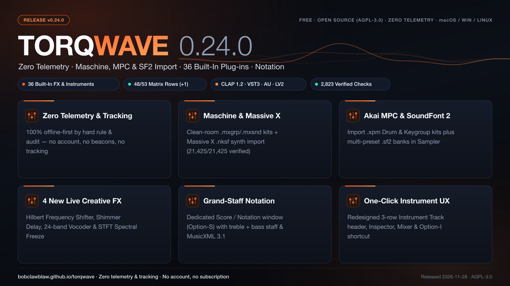
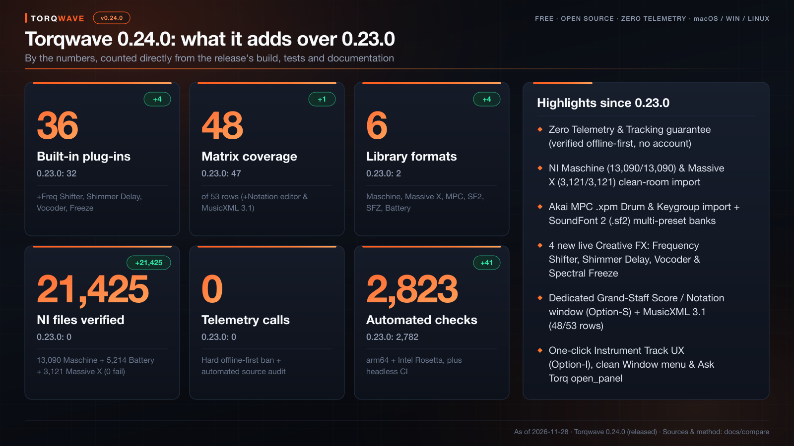
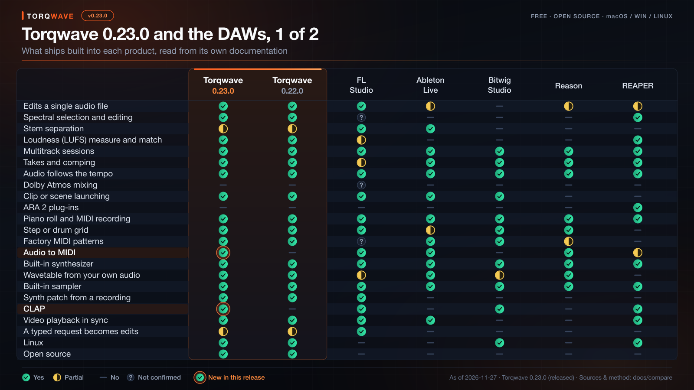

# Torqwave against the alternatives

Generated by `generate.py` from `data/`. Do not edit by hand: change the data and run the script.

**As of 2026-11-28.** Torqwave 0.24.0 is released; its column describes this repository at that release. 0.24.0 is set against 0.23.0.

## How to read it

- **Yes:** Built into the product at the edition assessed, and documented.
- **Partial:** A limited form; the note says how.
- **No:** The product's own documentation shows it absent, or its scope excludes it and its documentation has no mention.
- **Not confirmed:** No first-party page was found that settles it. Counted as neither yes nor no.
- **Info:** A fact, not a yes or no (price, licence, dates). Never counted.

- Every competitor cell was read from the product's own documentation, manual, feature or pricing page on the date in its snapshot, and keeps the page's address and a short quotation or a note of what was checked. Where no first-party page settled a cell it says 'not confirmed'.
- Torqwave's cells come from this repository's README, guide, roadmap and changelog at the commit the snapshot names.
- Only what ships in the product counts. Third-party plug-ins do not, and neither do separate downloads unless the note says so (those are 'partial').
- Each product is assessed at the edition its snapshot names, usually the largest, so a cheaper edition may have less than its column shows. Where a vendor bundles a separate application with that edition (an editor or a spectral tool that opens from the DAW), the note says so.
- Coverage of an area is a count: how many of the area's rows are yes, and how many partial. Rows are not weighted, and no single score or rank is computed across areas, because any weighting would be arbitrary.
- The rows were chosen for what Torqwave aims at (sound design, writing music, work to picture, game audio), so they favour a product that is both an editor and a DAW. A product built for one job covers few rows outside it by design, which says nothing about how well it does that job.
- A yes says a feature exists. It says nothing of its depth, its quality or how long it has been in use. Torqwave's features are new and mostly tested by its own suite, not by years of users; the 'maturity' facts under the matrix are there to keep that in view.

## Products

| Product | Version assessed | Edition | Looked up | Why it is here |
|---|---|---|---|---|
| Torqwave 0.24.0 | 0.24.0 (2026-11-28) | the only edition | 2026-11-28 | The product this set tracks. The current column is the release the snapshot is made for. |
| Torqwave 0.23.0 | 0.23.0 (2026-11-27) | the only edition | 2026-11-27 | The release before, as its own column, so each release's gains show. |
| Adobe Audition | 27.0 (2026-11-10) | Standalone Audition subscription (Creative Cloud), desktop | 2026-11-23 | The commercial reference for a waveform and spectral editor with a multitrack; named in the brief, and Torqwave ships an Audition-style key set. |
| Audacity | 4.0.2 (2 November (the page gives no year)) | Free open-source desktop app; Audacity 4.0.2 is current stable; no separate 4.x preview is needed. | 2026-11-23 | The free, open-source editor most people try first; named in the brief, and the README offers Torqwave as an alternative to it. |
| iZotope RX | 12.1.0 (2026-10-15) | RX 12 Advanced (standalone RX Audio Editor + plug-ins) | 2026-11-23 | The reference for spectral repair and restoration, the job of Torqwave's repair suite. |
| Steinberg SpectraLayers | 13.0.30 | Pro (Elements gaps noted in cells) | 2026-11-23 | The reference for spectral editing by layers and for unmixing. |
| Steinberg WaveLab | 13.0.30 (2026-07-22) | Pro (Elements 13 differences noted in cells) | 2026-11-23 | The reference for mastering, loudness and delivery, the job of Torqwave's mastering suite. |
| FL Studio | 2026.1.7 (2026-09-28 (FL Studio 2026 released 2026-07-07)) | All Plugins Edition | 2026-11-23 | Named in the brief; pattern-based writing with many built-in instruments, the area 0.20.0 moves into. |
| Ableton Live | 12.4.16 (2026-10-30) | Suite (Max for Live devices included; Standard gaps noted in cells). Live 13 was announced on 2026-11-10 for early 2027 and is not assessed; the compare-editions page already describes it. | 2026-11-23 | The reference for clip launching and electronic music, the ground the Idea Board and the built-in instruments move into. |
| Bitwig Studio | 6.1.7 (2026-11-05) | Bitwig Studio (full edition; Essentials/Producer differences noted per cell) | 2026-11-23 | A DAW on all three systems, Linux included, with a large set of built-in instruments. |
| Reason | 14.1.0 (Reason 14: 2026-05-11; the date of 14.1.0 is not stated) | Reason 14 (perpetual standalone DAW); Reason+ subscription includes Reason 14 and Reason Rack 14, adds Reason+ Rack Extensions and ongoing Sound Packs | 2026-11-23 | A DAW built around a rack of its own instruments and effects, the ground 0.20.0 moves into. |
| REAPER | 7.86 (2026-11-13) | REAPER with bundled ReaPlugs/ReaSynth (single edition; discounted $60 or commercial $225 licence, same software) | 2026-11-23 | A low-cost DAW on all three systems, widely used for sound design and game audio. |
| Logic Pro | 13.0 (2026-11-06) | Logic Pro for Mac, one-time purchase (US$199.99) and the same app in the Apple Creator Studio subscription | 2026-11-23 | One of the major DAWs, with a large set of built-in instruments; Mac only. |
| Cubase | 16.0.0 (2026-11-03) | Cubase Pro | 2026-11-23 | One of the major DAWs for writing and producing; Torqwave's sessions took their bar grid, info line and Track Inspector from its way of working. Its notes say how Nuendo differs for picture and game audio. |
| Pro Tools | 2026.11 (November 2026 (its guides are dated 2026-10-12)) | Pro Tools Ultimate (notes mark Studio, Artist, Intro) | 2026-11-23 | The recording and post-production standard, and the reference for work to picture. |
| Fender Studio Pro | 8.2 (2026-10-20) | Formerly PreSonus Studio One (Studio One Pro 7 was the top edition; renamed Fender Studio Pro with version 8 on 2026-01-13 per third-party news). Assessed the single paid edition, Fender Studio Pro (perpetual) with 8.2; editions are gone: one perpetual edition plus optional Pro+ subscription extras (Studio Assistant, MixFX, cloud, Notion); the free Studio One Prime is still mentioned. | 2026-11-23 | One of the major DAWs, sold as PreSonus Studio One until 2026; it has an editor-like project page for mastering. |
| Ardour | 9.10 (2026-11-10) | Ardour (open source, official ready-to-run build, pay-what-you-want) | 2026-11-23 | The open-source DAW: the other free-software route to multitrack work on Linux, macOS and Windows. |

Left out, and why:

- **ocenaudio:** A free editor for quick edits; without spectral editing or a multitrack it overlaps the Audacity column and adds no row where it differs.
- **Sound Forge:** Windows only in its current Pro edition; WaveLab covers the mastering-editor place on more systems.
- **Nuendo:** Cubase's sibling for post-production and game audio. It would repeat the Cubase column except in the picture rows, so the Cubase notes in MATRIX.md say where it differs instead.
- **Cakewalk Sonar:** Windows only by its own page, with a free core version and paid membership features; its ground is covered by the Cubase and Fender Studio Pro columns. Cakewalk Next, its lighter sibling, runs on Windows and macOS. Add Sonar if Windows users ask for it.
- **Digital Performer, Samplitude, Waveform, LMMS, GarageBand:** Not researched. Each is a candidate when a release moves into its ground.

## Graphics

## Coverage by area

Rows that are yes, with partial rows after a plus sign and rows not confirmed after a question mark. Counts, not a score.

**The editors**

| Area | Rows | Torqwave 0.24.0 | Torqwave 0.23.0 | Adobe Audition | Audacity | iZotope RX | Steinberg SpectraLayers | Steinberg WaveLab |
|---|---|---|---|---|---|---|---|---|
| Editing a file | 5 | 5 | 5 | 4 +1 | 3 +1 | 5 | 4 +1 | 5 |
| Repair | 5 | 4 +1 | 4 +1 | 3 +1 | 2 +2 | 5 | 5 | 2 +1 |
| Loudness and analysis | 5 | 5 | 5 | 4 +1 | 1 ?1 | 3 +2 | 1 +2 | 2 +3 |
| Multitrack and mixing | 9 | 7 | 7 | 4 +1 ?1 | 1 +2 ?1 | 0 +1 | 1 +3 | 4 +2 |
| MIDI and writing music | 6 | 6 | 5 | 0 +1 | 0 | 0 | 0 | 0 +1 |
| Built-in instruments | 6 | 6 | 6 | 0 | 0 | 0 | 0 | 0 |
| Plug-in hosting | 5 | 4 | 4 | 3 | 3 ?1 | 2 +1 | 1 | 2 |
| Working to picture | 4 | 4 | 4 | 3 | 1 | 1 | 0 +1 | 3 |
| Sound library | 1 | 1 | 1 | 0 ?1 | 0 | 0 | 0 | 0 |
| AI help | 3 | 2 +1 | 2 +1 | 0 ?1 | 0 | 0 ?1 | 1 | 0 |
| Platforms and licence | 4 | 4 | 4 | 2 | 4 | 2 | 2 | 2 |
| **All rows** | 53 | 48 +2 | 47 +2 | 23 +5 ?3 | 15 +5 ?3 | 18 +4 ?1 | 15 +7 | 20 +7 |

**The DAWs**

| Area | Rows | Torqwave 0.24.0 | Torqwave 0.23.0 | FL Studio | Ableton Live | Bitwig Studio | Reason | REAPER | Logic Pro | Cubase | Pro Tools | Fender Studio Pro | Ardour |
|---|---|---|---|---|---|---|---|---|---|---|---|---|---|
| Editing a file | 5 | 5 | 5 | 2 ?1 | 0 +1 | 0 | 0 +1 | 4 +1 | 1 +2 | 2 +2 | 3 +2 | 1 | 0 +2 |
| Repair | 5 | 4 +1 | 4 +1 | 4 +1 | 1 | 0 | 0 | 0 +2 | 2 +1 | 1 | 1 +2 | 1 +2 | 0 |
| Loudness and analysis | 5 | 5 | 5 | 2 +2 ?1 | 2 +1 | 0 +2 | 1 +2 | 4 +1 | 4 +1 | 4 +1 | 2 +2 | 4 +1 | 2 +2 |
| Multitrack and mixing | 9 | 7 | 7 | 6 +1 ?1 | 6 +1 | 6 | 5 | 7 | 8 ?1 | 8 | 9 | 8 +1 | 6 +1 |
| MIDI and writing music | 6 | 6 | 5 | 4 +1 ?1 | 4 +1 | 4 | 4 +1 | 3 +1 | 5 ?1 | 5 ?1 | 5 ?1 | 6 | 3 +1 |
| Built-in instruments | 6 | 6 | 6 | 5 +1 | 5 | 4 +1 | 5 | 2 +1 | 6 | 4 +1 | 4 | 4 | 2 +1 |
| Plug-in hosting | 5 | 4 | 4 | 4 | 3 | 3 | 2 | 5 | 1 | 2 | 0 | 3 | 4 |
| Working to picture | 4 | 4 | 4 | 2 +1 | 2 +1 | 0 | 0 | 3 | 4 | 3 | 3 | 3 | 3 |
| Sound library | 1 | 1 | 1 | 0 +1 | 1 | 1 | 1 | 1 | 1 | 1 | 1 | 0 +1 | 0 +1 |
| AI help | 3 | 2 +1 | 2 +1 | 1 +1 | 1 | 0 | 0 | 0 | 1 ?1 | 0 ?1 | 1 | 0 +1 | 0 +1 |
| Platforms and licence | 4 | 4 | 4 | 2 | 2 | 3 | 2 | 3 | 1 | 2 | 2 | 2 +1 | 4 |
| **All rows** | 53 | 48 +2 | 47 +2 | 32 +9 ?4 | 27 +5 | 21 +3 | 20 +4 | 32 +6 | 34 +4 ?3 | 32 +4 ?2 | 31 +6 ?1 | 32 +7 | 24 +9 |

## Torqwave by release

| Release | Yes | Partial | No | Rows |
|---|---|---|---|---|
| 0.23.0 | 47 | 2 | 4 | 53 |
| 0.24.0 | 48 | 2 | 3 | 53 |

The releases the comparison is drawn for. 0.20.1 and 0.21.0 came out between them; their snapshots are in `data/snapshots/`.

## Where Torqwave is behind

Rows where Torqwave 0.24.0 is no or partial and at least two of the 15 other products are yes.

| Row | Torqwave | Others that are yes |
|---|---|---|
| Stem separation | Partial | 8: iZotope RX, Steinberg SpectraLayers, FL Studio, Ableton Live, Logic Pro, Cubase, Pro Tools, Fender Studio Pro |
| Dolby Atmos mixing | No | 5: Steinberg WaveLab, Logic Pro, Cubase, Pro Tools, Fender Studio Pro |
| ARA 2 plug-ins | No | 4: Steinberg SpectraLayers, REAPER, Cubase, Pro Tools |
| VST2 | No | 10: Adobe Audition, Steinberg WaveLab, FL Studio, Ableton Live, Bitwig Studio, Reason, REAPER, Cubase, Fender Studio Pro, Ardour |
| A typed request becomes edits | Partial | 2: FL Studio, Logic Pro |

The facts under [Maturity and terms](#maturity-and-terms) belong here too: Torqwave is new (see First public release), its installers are not signed or notarized, it has no scripting API, and its release notes say which parts of a release were not tried by hand.

## Where Torqwave is ahead

Rows where Torqwave 0.24.0 is yes and at most two of the 15 other products are yes.

| Row | Others that are yes | Others partial | Not confirmed |
|---|---|---|---|
| Dialogue isolation | iZotope RX, Steinberg SpectraLayers | Adobe Audition, Audacity, FL Studio, Logic Pro, Fender Studio Pro | none |
| Delivery-spec check with a report | iZotope RX, Ardour | Adobe Audition, Steinberg WaveLab, REAPER, Logic Pro, Cubase, Pro Tools, Fender Studio Pro | FL Studio |
| Synth patch from a recording | FL Studio, Logic Pro | none | none |
| Scene-cut detection | Logic Pro | none | none |
| Uses a model server you choose | none | none | none |
| Open source | Audacity, Ardour | none | none |

## What 0.24.0 changes against 0.23.0

| Row | 0.23.0 | 0.24.0 |
|---|---|---|
| Piano roll and MIDI recording | Yes: Note clips, Piano Roll, Record Notes, Capture MIDI, per-note ratchets (1x-8x), micro-timing offsets, built-in groove/swing templates, cross-track ghost notes, and four live MIDI FX (Arpeggiator, Chord Trigger, Scale Lock, Note Echo). | Yes: Note clips, Piano Roll, Grand-Staff Score View + MusicXML 3.1, Record Notes, Capture MIDI, per-note ratchets (1x-8x), micro-timing offsets, built-in groove/swing templates, cross-track ghost notes, four live MIDI FX (Arpeggiator, Chord Trigger, Scale Lock, Note Echo), and one-click Instrument Track editing (Option-I). |
| Notation editor | No: No notation editor. | Yes: Interactive Grand-Staff Notation (Score) View inside the Note Editor (treble + bass staves, clefs, key/time signatures, barlines, ledger lines, noteheads/stems/flags/dots, direct editing) plus standard MusicXML 3.1 export. |
| Built-in drum instrument | Yes: Basic Drums, a drum synth and drum sampler: 64 pads (30 sounds covering 47 General MIDI drum notes + 34 user pads); 54 synthesized sources; Sample type on every pad with up to 16 velocity layers and round robin; per-pad envelope, transient shaper, saturator, four-band EQ, compressor, filter, crush and sends; 8-bus multi-out pad routing (Main + Aux 1-8); eight user choke groups; fifteen synthesized kits; imports a folder of sounds or Battery 4 kits. | Yes: Basic Drums, a drum synth and drum sampler: 64 pads (30 sounds covering 47 General MIDI drum notes + 34 user pads); 54 synthesized sources; Sample type on every pad with up to 16 velocity layers and round robin; per-pad envelope, transient shaper, saturator, four-band EQ, compressor, filter, crush and sends; 8-bus multi-out pad routing (Main + Aux 1-8); eight user choke groups; fifteen synthesized kits; imports folders of sounds, Battery 4 (.nbkt/.nbcl), NI Maschine 2/3 (.mxgrp/.mxsnd with Drum Synth, per-pad FX & 960 PPQN MIDI pattern drop/export), and Akai MPC (.xpm) kits. |
| Built-in sampler | Yes: Torqwave Sampler: up to 128 zones with loops, crossfades, per-zone round-robin groups (1-16), Signalsmith Stretch tempo-synced Warp playback, and standard SFZ multisample import, or slice loops on keys. Samples are held in memory (no disk streaming or SF2 import). | Yes: Torqwave Sampler: up to 128 zones with loops, crossfades, per-zone round-robin groups (1-16), Signalsmith Stretch tempo-synced Warp playback, standard SFZ multisample import, SoundFont 2 (.sf2) multi-preset bank import, and Akai MPC (.xpm) Keygroup import, or slice loops on keys. Samples are held in memory (no disk streaming). |

| Number | 0.23.0 | 0.24.0 | |
|---|---|---|---|
| Built-in plug-ins | 32 | 36 | +Freq Shifter, Shimmer Delay, Vocoder, Freeze |
| Matrix coverage | 47 | 48 | of 53 rows (+Notation editor & MusicXML 3.1) |
| Library formats | 2 | 6 | Maschine, Massive X, MPC, SF2, SFZ, Battery |
| NI files verified | 0 | 21,425 | 13,090 Maschine + 5,214 Battery + 3,121 Massive X (0 fail) |
| Telemetry calls | 0 | 0 | Hard offline-first ban + automated source audit |
| Automated checks | 2,782 | 2,823 | arm64 + Intel Rosetta, plus headless CI |

## The matrix

The whole matrix in one picture. The tables under it say the same, row by row, and the notes at the end give each cell's source.

### Editing a file

| The editors | Torqwave 0.24.0 | Torqwave 0.23.0 | Adobe Audition | Audacity | iZotope RX | Steinberg SpectraLayers | Steinberg WaveLab |
|---|---|---|---|---|---|---|---|
| Edits a single audio file | Yes | Yes | Yes | Yes | Yes | Partial | Yes |
| Spectrogram view | Yes | Yes | Yes | Yes | Yes | Yes | Yes |
| Spectral selection and editing | Yes | Yes | Yes | Yes | Yes | Yes | Yes |
| Spectral heal | Yes | Yes | Yes | No | Yes | Yes | Yes |
| Batch processing | Yes | Yes | Partial | Partial | Yes | Yes | Yes |

| The DAWs | Torqwave 0.24.0 | Torqwave 0.23.0 | FL Studio | Ableton Live | Bitwig Studio | Reason | REAPER | Logic Pro | Cubase | Pro Tools | Fender Studio Pro | Ardour |
|---|---|---|---|---|---|---|---|---|---|---|---|---|
| Edits a single audio file | Yes | Yes | Yes | Partial | No | Partial | Partial | Yes | Partial | Partial | No | No |
| Spectrogram view | Yes | Yes | Yes | No | No | No | Yes | Partial | Yes | Yes | No | Partial |
| Spectral selection and editing | Yes | Yes | Not confirmed | No | No | No | Yes | Partial | Yes | Yes | No | No |
| Spectral heal | Yes | Yes | No | No | No | No | Yes | No | No | Yes | No | No |
| Batch processing | Yes | Yes | No | No | No | No | Yes | No | Partial | Partial | Yes | Partial |

### Repair

| The editors | Torqwave 0.24.0 | Torqwave 0.23.0 | Adobe Audition | Audacity | iZotope RX | Steinberg SpectraLayers | Steinberg WaveLab |
|---|---|---|---|---|---|---|---|
| Noise reduction | Yes | Yes | Yes | Yes | Yes | Yes | Yes |
| Click, hum and clipping repair | Yes | Yes | Yes | Yes | Yes | Yes | Partial |
| Reverb reduction | Yes | Yes | Yes | No | Yes | Yes | Yes |
| Dialogue isolation | Yes | Yes | Partial | Partial | Yes | Yes | No |
| Stem separation | Partial | Partial | No | Partial | Yes | Yes | No |

| The DAWs | Torqwave 0.24.0 | Torqwave 0.23.0 | FL Studio | Ableton Live | Bitwig Studio | Reason | REAPER | Logic Pro | Cubase | Pro Tools | Fender Studio Pro | Ardour |
|---|---|---|---|---|---|---|---|---|---|---|---|---|
| Noise reduction | Yes | Yes | Yes | No | No | No | Partial | Yes | No | Partial | No | No |
| Click, hum and clipping repair | Yes | Yes | Yes | No | No | No | Partial | No | No | Partial | Partial | No |
| Reverb reduction | Yes | Yes | Yes | No | No | No | No | No | No | No | No | No |
| Dialogue isolation | Yes | Yes | Partial | No | No | No | No | Partial | No | No | Partial | No |
| Stem separation | Partial | Partial | Yes | Yes | No | No | No | Yes | Yes | Yes | Yes | No |

### Loudness and analysis

| The editors | Torqwave 0.24.0 | Torqwave 0.23.0 | Adobe Audition | Audacity | iZotope RX | Steinberg SpectraLayers | Steinberg WaveLab |
|---|---|---|---|---|---|---|---|
| Loudness (LUFS) measure and match | Yes | Yes | Yes | Yes | Yes | Partial | Yes |
| True-peak limiting or metering | Yes | Yes | Yes | No | Yes | Yes | Partial |
| Delivery-spec check with a report | Yes | Yes | Partial | No | Yes | No | Partial |
| Spectrum analyzer and phase meter | Yes | Yes | Yes | Not confirmed | Partial | Partial | Yes |
| Pitch correction | Yes | Yes | Yes | No | Partial | No | Partial |

| The DAWs | Torqwave 0.24.0 | Torqwave 0.23.0 | FL Studio | Ableton Live | Bitwig Studio | Reason | REAPER | Logic Pro | Cubase | Pro Tools | Fender Studio Pro | Ardour |
|---|---|---|---|---|---|---|---|---|---|---|---|---|
| Loudness (LUFS) measure and match | Yes | Yes | Partial | No | No | No | Yes | Yes | Yes | Partial | Yes | Yes |
| True-peak limiting or metering | Yes | Yes | Yes | Yes | No | Partial | Yes | Yes | Yes | Yes | Yes | Partial |
| Delivery-spec check with a report | Yes | Yes | Not confirmed | No | No | No | Partial | Partial | Partial | Partial | Partial | Yes |
| Spectrum analyzer and phase meter | Yes | Yes | Partial | Partial | Partial | Partial | Yes | Yes | Yes | No | Yes | Partial |
| Pitch correction | Yes | Yes | Yes | Yes | Partial | Yes | Yes | Yes | Yes | Yes | Yes | No |

### Multitrack and mixing

| The editors | Torqwave 0.24.0 | Torqwave 0.23.0 | Adobe Audition | Audacity | iZotope RX | Steinberg SpectraLayers | Steinberg WaveLab |
|---|---|---|---|---|---|---|---|
| Multitrack sessions | Yes | Yes | Yes | Yes | No | Partial | Yes |
| Buses and sends | Yes | Yes | Yes | No | No | No | Partial |
| Automation | Yes | Yes | Yes | Partial | No | Partial | Yes |
| Takes and comping | Yes | Yes | Partial | No | No | No | No |
| Audio follows the tempo | Yes | Yes | Not confirmed | Partial | No | No | No |
| Surround mixing (5.1 or more) | Yes | Yes | Yes | Not confirmed | No | Partial | Yes |
| Dolby Atmos mixing | No | No | No | No | No | No | Yes |
| Clip or scene launching | Yes | Yes | No | No | No | No | No |
| ARA 2 plug-ins | No | No | No | No | Partial | Yes | Partial |

| The DAWs | Torqwave 0.24.0 | Torqwave 0.23.0 | FL Studio | Ableton Live | Bitwig Studio | Reason | REAPER | Logic Pro | Cubase | Pro Tools | Fender Studio Pro | Ardour |
|---|---|---|---|---|---|---|---|---|---|---|---|---|
| Multitrack sessions | Yes | Yes | Yes | Yes | Yes | Yes | Yes | Yes | Yes | Yes | Yes | Yes |
| Buses and sends | Yes | Yes | Yes | Yes | Yes | Yes | Yes | Yes | Yes | Yes | Yes | Yes |
| Automation | Yes | Yes | Yes | Yes | Yes | Yes | Yes | Yes | Yes | Yes | Yes | Yes |
| Takes and comping | Yes | Yes | Partial | Yes | Yes | Yes | Yes | Yes | Yes | Yes | Yes | Yes |
| Audio follows the tempo | Yes | Yes | Yes | Yes | Yes | Yes | Yes | Yes | Yes | Yes | Yes | Yes |
| Surround mixing (5.1 or more) | Yes | Yes | Yes | Partial | No | No | Yes | Yes | Yes | Yes | Yes | Partial |
| Dolby Atmos mixing | No | No | Not confirmed | No | No | No | No | Yes | Yes | Yes | Yes | No |
| Clip or scene launching | Yes | Yes | Yes | Yes | Yes | No | No | Yes | No | Yes | Yes | Yes |
| ARA 2 plug-ins | No | No | No | No | No | No | Yes | Not confirmed | Yes | Yes | Partial | No |

### MIDI and writing music

| The editors | Torqwave 0.24.0 | Torqwave 0.23.0 | Adobe Audition | Audacity | iZotope RX | Steinberg SpectraLayers | Steinberg WaveLab |
|---|---|---|---|---|---|---|---|
| Piano roll and MIDI recording | Yes | Yes | No | No | No | No | No |
| Step or drum grid | Yes | Yes | No | No | No | No | No |
| Factory MIDI patterns | Yes | Yes | No | No | No | No | No |
| MIDI out and control surfaces | Yes | Yes | Partial | No | No | No | Partial |
| Audio to MIDI | Yes | Yes | No | No | No | No | No |
| Notation editor | Yes | No | No | No | No | No | No |

| The DAWs | Torqwave 0.24.0 | Torqwave 0.23.0 | FL Studio | Ableton Live | Bitwig Studio | Reason | REAPER | Logic Pro | Cubase | Pro Tools | Fender Studio Pro | Ardour |
|---|---|---|---|---|---|---|---|---|---|---|---|---|
| Piano roll and MIDI recording | Yes | Yes | Yes | Yes | Yes | Yes | Yes | Yes | Yes | Yes | Yes | Yes |
| Step or drum grid | Yes | Yes | Yes | Partial | Yes | Yes | No | Yes | Yes | Yes | Yes | Partial |
| Factory MIDI patterns | Yes | Yes | Not confirmed | Yes | Yes | Partial | No | Not confirmed | Not confirmed | Not confirmed | Yes | Yes |
| MIDI out and control surfaces | Yes | Yes | Yes | Yes | Yes | Yes | Yes | Yes | Yes | Yes | Yes | Yes |
| Audio to MIDI | Yes | Yes | Yes | Yes | No | Yes | Partial | Yes | Yes | Yes | Yes | No |
| Notation editor | Yes | No | Partial | No | No | No | Yes | Yes | Yes | Yes | Yes | No |

### Built-in instruments

| The editors | Torqwave 0.24.0 | Torqwave 0.23.0 | Adobe Audition | Audacity | iZotope RX | Steinberg SpectraLayers | Steinberg WaveLab |
|---|---|---|---|---|---|---|---|
| Built-in synthesizer | Yes | Yes | No | No | No | No | No |
| Wavetable from your own audio | Yes | Yes | No | No | No | No | No |
| Built-in drum instrument | Yes | Yes | No | No | No | No | No |
| Built-in sampler | Yes | Yes | No | No | No | No | No |
| Factory instrument sounds | Yes | Yes | No | No | No | No | No |
| Synth patch from a recording | Yes | Yes | No | No | No | No | No |

| The DAWs | Torqwave 0.24.0 | Torqwave 0.23.0 | FL Studio | Ableton Live | Bitwig Studio | Reason | REAPER | Logic Pro | Cubase | Pro Tools | Fender Studio Pro | Ardour |
|---|---|---|---|---|---|---|---|---|---|---|---|---|
| Built-in synthesizer | Yes | Yes | Yes | Yes | Yes | Yes | Yes | Yes | Yes | Yes | Yes | Yes |
| Wavetable from your own audio | Yes | Yes | Partial | Yes | Partial | Yes | No | Yes | Partial | No | No | No |
| Built-in drum instrument | Yes | Yes | Yes | Yes | Yes | Yes | Partial | Yes | Yes | Yes | Yes | No |
| Built-in sampler | Yes | Yes | Yes | Yes | Yes | Yes | Yes | Yes | Yes | Yes | Yes | Partial |
| Factory instrument sounds | Yes | Yes | Yes | Yes | Yes | Yes | No | Yes | Yes | Yes | Yes | Yes |
| Synth patch from a recording | Yes | Yes | Yes | No | No | No | No | Yes | No | No | No | No |

### Plug-in hosting

| The editors | Torqwave 0.24.0 | Torqwave 0.23.0 | Adobe Audition | Audacity | iZotope RX | Steinberg SpectraLayers | Steinberg WaveLab |
|---|---|---|---|---|---|---|---|
| VST3 | Yes | Yes | Yes | Yes | Yes | Yes | Yes |
| Audio Units (Mac) | Yes | Yes | Yes | Yes | Yes | No | No |
| LV2 | Yes | Yes | No | Yes | No | No | No |
| CLAP | Yes | Yes | No | No | No | No | No |
| VST2 | No | No | Yes | Not confirmed | Partial | No | Yes |

| The DAWs | Torqwave 0.24.0 | Torqwave 0.23.0 | FL Studio | Ableton Live | Bitwig Studio | Reason | REAPER | Logic Pro | Cubase | Pro Tools | Fender Studio Pro | Ardour |
|---|---|---|---|---|---|---|---|---|---|---|---|---|
| VST3 | Yes | Yes | Yes | Yes | Yes | Yes | Yes | No | Yes | No | Yes | Yes |
| Audio Units (Mac) | Yes | Yes | Yes | Yes | No | No | Yes | Yes | No | No | Yes | Yes |
| LV2 | Yes | Yes | No | No | No | No | Yes | No | No | No | No | Yes |
| CLAP | Yes | Yes | Yes | No | Yes | No | Yes | No | No | No | No | No |
| VST2 | No | No | Yes | Yes | Yes | Yes | Yes | No | Yes | No | Yes | Yes |

### Working to picture

| The editors | Torqwave 0.24.0 | Torqwave 0.23.0 | Adobe Audition | Audacity | iZotope RX | Steinberg SpectraLayers | Steinberg WaveLab |
|---|---|---|---|---|---|---|---|
| Video playback in sync | Yes | Yes | Yes | No | No | No | Yes |
| Sound written back into video | Yes | Yes | Yes | No | No | No | Yes |
| SMPTE timecode | Yes | Yes | Yes | Yes | Yes | Partial | Yes |
| Scene-cut detection | Yes | Yes | No | No | No | No | No |

| The DAWs | Torqwave 0.24.0 | Torqwave 0.23.0 | FL Studio | Ableton Live | Bitwig Studio | Reason | REAPER | Logic Pro | Cubase | Pro Tools | Fender Studio Pro | Ardour |
|---|---|---|---|---|---|---|---|---|---|---|---|---|
| Video playback in sync | Yes | Yes | Yes | Yes | No | No | Yes | Yes | Yes | Yes | Yes | Yes |
| Sound written back into video | Yes | Yes | Partial | Yes | No | No | Yes | Yes | Yes | Yes | Yes | Yes |
| SMPTE timecode | Yes | Yes | Yes | Partial | No | No | Yes | Yes | Yes | Yes | Yes | Yes |
| Scene-cut detection | Yes | Yes | No | No | No | No | No | Yes | No | No | No | No |

### Sound library

| The editors | Torqwave 0.24.0 | Torqwave 0.23.0 | Adobe Audition | Audacity | iZotope RX | Steinberg SpectraLayers | Steinberg WaveLab |
|---|---|---|---|---|---|---|---|
| Searchable sound library | Yes | Yes | Not confirmed | No | No | No | No |

| The DAWs | Torqwave 0.24.0 | Torqwave 0.23.0 | FL Studio | Ableton Live | Bitwig Studio | Reason | REAPER | Logic Pro | Cubase | Pro Tools | Fender Studio Pro | Ardour |
|---|---|---|---|---|---|---|---|---|---|---|---|---|
| Searchable sound library | Yes | Yes | Partial | Yes | Yes | Yes | Yes | Yes | Yes | Yes | Partial | Partial |

### AI help

| The editors | Torqwave 0.24.0 | Torqwave 0.23.0 | Adobe Audition | Audacity | iZotope RX | Steinberg SpectraLayers | Steinberg WaveLab |
|---|---|---|---|---|---|---|---|
| A typed request becomes edits | Partial | Partial | No | No | No | No | No |
| Machine learning runs locally | Yes | Yes | Not confirmed | No | Not confirmed | Yes | No |
| Uses a model server you choose | Yes | Yes | No | No | No | No | No |

| The DAWs | Torqwave 0.24.0 | Torqwave 0.23.0 | FL Studio | Ableton Live | Bitwig Studio | Reason | REAPER | Logic Pro | Cubase | Pro Tools | Fender Studio Pro | Ardour |
|---|---|---|---|---|---|---|---|---|---|---|---|---|
| A typed request becomes edits | Partial | Partial | Yes | No | No | No | No | Yes | No | No | No | Partial |
| Machine learning runs locally | Yes | Yes | Partial | Yes | No | No | No | Not confirmed | Not confirmed | Yes | Partial | No |
| Uses a model server you choose | Yes | Yes | No | No | No | No | No | No | No | No | No | No |

### Platforms and licence

| The editors | Torqwave 0.24.0 | Torqwave 0.23.0 | Adobe Audition | Audacity | iZotope RX | Steinberg SpectraLayers | Steinberg WaveLab |
|---|---|---|---|---|---|---|---|
| macOS | Yes | Yes | Yes | Yes | Yes | Yes | Yes |
| Windows | Yes | Yes | Yes | Yes | Yes | Yes | Yes |
| Linux | Yes | Yes | No | Yes | No | No | No |
| Open source | Yes | Yes | No | Yes | No | No | No |

| The DAWs | Torqwave 0.24.0 | Torqwave 0.23.0 | FL Studio | Ableton Live | Bitwig Studio | Reason | REAPER | Logic Pro | Cubase | Pro Tools | Fender Studio Pro | Ardour |
|---|---|---|---|---|---|---|---|---|---|---|---|---|
| macOS | Yes | Yes | Yes | Yes | Yes | Yes | Yes | Yes | Yes | Yes | Yes | Yes |
| Windows | Yes | Yes | Yes | Yes | Yes | Yes | Yes | No | Yes | Yes | Yes | Yes |
| Linux | Yes | Yes | No | No | Yes | No | Yes | No | No | No | Partial | Yes |
| Open source | Yes | Yes | No | No | No | No | No | No | No | No | No | Yes |

## Maturity and terms

Facts, not counted in any coverage figure. Prices are list prices on the date looked up, in the currency the vendor's page showed.

### Price

- **Torqwave 0.24.0:** Free. (`README.md`)
- **Torqwave 0.23.0:** Free. (`README.md`)
- **Adobe Audition:** US region: Audition single app US$22.99/mo (annual, billed monthly); Creative Cloud Pro US$29.99/mo first year then US$69.99/mo; students US$15.99/mo first year. All subscriptions. Looked up 2026-11-23. ([source](https://www.adobe.com/products/audition.html))
- **Audacity:** Free, no price. Optional MuseHub plug-in bundles are sold separately, no prices listed (checked 2026-11-23). ([source](https://www.audacityteam.org/))
- **iZotope RX:** USD list, single purchase price on the store page (no sale price shown): Elements $99.00, Standard $399.00, Advanced $1,399.00 (assessed), RX Post Production Suite 9 $1,799.00. Looked up 2026-11-23. ([source](https://www.izotope.com/en/products/rx/compare))
- **Steinberg SpectraLayers:** US store (USD) list prices shown struck through with a -50% promotion on 2026-11-23: Pro 13 $359.99, now $179.99; Elements 13 $89.99, now $44.99; Pro 13 upgrades from $289.99, now $144.99. Full-version licences; page does not say subscription. ([source](https://www.steinberg.net/spectralayers/))
- **Steinberg WaveLab:** US store, USD, full versions, read in a browser on 2026-11-23: WaveLab Pro 13 list $499.99, on sale at $249.99 (50% off, no end date shown); WaveLab Elements 13 list $99.99, on sale at $49.99. The Pro edition is the one assessed. ([source](https://www.steinberg.net/wavelab/))
- **FL Studio:** Shop, USD list price, one-time purchase with Lifetime Free Updates (download only): Fruity $99; Producer $179 (sale $139); Signature Bundle $269 (sale $199); All Plugins $449 (sale $224, the assessed edition). Sale prices seen 2026-11-23; Rent-to-Own Plus is 12 monthly payments. FL Cloud is a separate subscription. ([source](https://support.image-line.com/jshop/shop.php))
- **Ableton Live:** Live 12, USD, one-off purchase (Suite also rent-to-own USD 31.21/month). Suite list $749, sale $599; Standard $349/$279; Intro $99/$79. 20% sale from Nov 10, 2026 until Live 13 release; upgrade prices need login. Looked up 2026-11-23. ([source](https://www.ableton.com/en/shop/live/))
- **Bitwig Studio:** Shop USD list/winter sale until 7 Jan 2027: Essentials 99/75, Producer 199/149, Bitwig Studio 399/299; perpetual licence. Studio assessed: list 399, sale 299. Looked up 2026-11-23. ([source](https://www.bitwig.com/buy/))
- **Reason:** Looked up 2026-11-23, USD (shop page; press release also gives EUR/GBP). Perpetual: Reason 14 $299 list (on sale $199 at lookup, Black Friday), upgrade $99; Reason 14 Complete $799 list ($399 sale), upgrade $599 ($299 sale); Reason Rack 14 plug-in $199 ($133 sale), upgrade $79. Press release: Reason 14 EUR 239 / GBP 299, upgrade EUR 79 / GBP 99. Subscription Reason+ (includes Reason 14 and Rack 14) from $169/year, EUR 135, GBP 169; Reason Rack subscription from $99. Assessed edition Reason 14 perpetual: $299 list. ([source](https://www.reasonstudios.com/shop ; https://www.reasonstudios.com/press/reason-studios-introduces-reason-14))
- **REAPER:** USD, perpetual, excl. tax: discounted licence $60 (personal, or under $20,000 yearly revenue, or education/non-profit); commercial licence $225; 60-day free evaluation; looked up 2026-11-23. Assessed edition costs $60 or $225 by use. ([source](https://www.reaper.fm/purchase.php))
- **Logic Pro:** US list: Logic Pro for Mac $199.99 one-time purchase on the Mac App Store; or Apple Creator Studio subscription $12.99/month or $129/year (students/educators $2.99/month or $29.99/year; 30-day trial) which includes Logic Pro for Mac and iPad, Final Cut Pro, MainStage and others. Logic Pro for iPad is subscription only. Looked up 2026-11-23. ([source](https://www.apple.com/newsroom/2026/01/introducing-apple-creator-studio-an-inspiring-collection-of-creative-apps (also https://www.apple.com/logic-pro/)))
- **Cubase:** USD list, no sale price shown 2026-11-23 (US page): Cubase Pro 16 $599.99 full, update from $99.99; Artist 16 $299.99, update from $79.99; Elements 16 $99.99, update from $29.99. Assessed edition (Pro) costs $599.99. Crossgrade page lists reduced Pro price (not read). ([source](https://www.steinberg.net/cubase/))
- **Pro Tools:** First-party (avid.com/pro-tools, USD, looked up 2026-11-23). Ultimate: $599 list per year (shown $399 on sale, 33% off) or $99/month. Studio: $299/year (shown $199 on sale) or $34.99/month. Artist: $99/year (shown $79 on sale) or $9.99/month. Intro free. Perpetual licenses are no longer sold new; upgrade of an expired plan is $499 (Ultimate) or $199 (Studio) incl. 1 year of updates. Earlier third-party perpetual prices ($599/$1,499) are not on Avid's pages. ([source](https://www.avid.com/pro-tools))
- **Fender Studio Pro:** Fender US store 2026-11-23: Perpetual $199.99 list, sale $139.99 (30% off, Black Friday); Perpetual + Pro+ Annual Plan $179.99/year; Pro+ Monthly $19.99/month; Upgrade $99.99 (USD MSRP). Assessed edition (perpetual): $139.99 sale / $199.99 list. Other MSRPs: GBP 169.99, EUR 199.99. ([source](https://www.fender.com/products/fender-studio-pro))
- **Ardour:** Official ready-to-run builds: pay what you want, minimum US$1 per download; US$45 or more gets all updates to that version and the next major version; subscription also offered. Source code free. Looked up 2026-11-23; the download page itself showed no price figures, amounts are from the FAQ. ([source](https://ardour.org/faq.html))

### Licence model

- **Torqwave 0.24.0:** Free software under the AGPL-3.0; no paid edition. (`README.md`)
- **Torqwave 0.23.0:** Free software under the AGPL-3.0; no paid edition. (`README.md`)
- **Adobe Audition:** Subscription only (Creative Cloud); no perpetual licence listed. ([source](https://www.adobe.com/products/audition.html))
- **Audacity:** Free, GPL v3, no upgrade fee stated. ([source](https://www.audacityteam.org/about/))
- **iZotope RX:** Store page shows one price with immediate download and no subscription or perpetual wording; discounted prices for existing owners are shown after login. Perpetual vs subscription not stated on the pages read. ([source](https://www.izotope.com/en/products/rx/compare))
- **Steinberg SpectraLayers:** Full-version (non-subscription) licences with discounted Upgrade prices from earlier versions and Cubase/Nuendo; one installer, licence decides edition (per search summary of vendor page). ([source](https://www.steinberg.net/spectralayers/))
- **Steinberg WaveLab:** Full versions sold with update, upgrade and crossgrade offers; cart strings also mention rent-to-own. Edition set by licence (Pro 13 assessed). ([source](https://www.steinberg.net/wavelab/compare-editions/))
- **FL Studio:** Perpetual licence per edition with Lifetime Free Updates; upgrade to a higher edition by paying the difference; FL Cloud is subscription; Rent-to-Own option. ([source](https://www.image-line.com/fl-studio/pricing))
- **Ableton Live:** One-off purchase (or rent-to-own that ends in ownership); the page contrasts it with subscription. Live 12 buyers get a free Live 13 upgrade. ([source](https://www.ableton.com/en/shop/live/))
- **Bitwig Studio:** Perpetual licence, not a subscription; 12-month Upgrade Plan (renewable) gives major releases; after expiry the licence keeps working with the latest version already received plus minor fixes. ([source](https://www.bitwig.com/support/shop_license_activation/how-does-the-12-month-upgrade-plan-work-5/))
- **Reason:** Mixed: perpetual licence with paid upgrades (Reason 13 purchases after 2026-03-01 got Reason 14 free), or Reason+ subscription; 14.1.0 also supports Reason Free licences. ([source](https://www.reasonstudios.com/press/reason-studios-introduces-reason-14))
- **REAPER:** Perpetual, two tiers; includes free upgrades through version 8.99; discounted-to-commercial upgrade by contacting licensing@cockos.com. ([source](https://www.reaper.fm/purchase.php))
- **Logic Pro:** Mixed: perpetual one-time purchase on Mac, or subscription via Apple Creator Studio; the intelligent assistant needs the subscription; free updates for one-time buyers per press coverage only, not confirmed first-party. ([source](https://www.apple.com/logic-pro/))
- **Cubase:** Sold at a one-time full-version price; new-generation updates are paid, maintenance updates for the owned generation are free; edition upgrades are separate. 'Perpetual' is not worded on the page. ([source](https://www.steinberg.net/cubase/))
- **Pro Tools:** Mixed: Intro free; Artist, Studio and Ultimate by monthly or annual subscription; existing perpetual licenses upgrade with 1-year Software Updates + Support Plans ($499 Ultimate, $199 Studio). ([source](https://www.avid.com/pro-tools/pricing/perpetual))
- **Fender Studio Pro:** Mixed: perpetual license with one year of feature updates; Pro+ subscription (annual, with perpetual, or monthly) adds extras; discounted upgrade for prior Studio One Pro owners. ([source](https://www.fender.com/products/fender-studio-pro))
- **Ardour:** Mixed: source free (GPL v2); pre-built builds pay-what-you-want or subscription; US$45+ one-time covers next major version. ([source](https://ardour.org/faq.html))

### First public release

- **Torqwave 0.24.0:** 2026. The first release under the Torqwave name, 0.16.0, is dated 2026-11-18; earlier builds had another name and their dates are not in the repository. (`CHANGELOG.md`)
- **Torqwave 0.23.0:** 2026. The first release under the Torqwave name, 0.16.0, is dated 2026-11-18; earlier builds had another name and their dates are not in the repository. (`CHANGELOG.md`)
- **Adobe Audition:** 2003 as Adobe Audition (rebrand of Cool Edit Pro, introduced August 2003); an Adobe 2019 blog also says 2018 was the 25th anniversary of the Audition lineage. ([source](https://www.adobe.com/special/products/audition/syntrillium.html))
- **Audacity:** 2000: first public version, Audacity 0.8, released 28 May 2000 per the team's 25th-anniversary post. ([source](https://www.audacityteam.org/blog/25-years/))
- **iZotope RX:** 2010: vendor legacy-downloads page lists RX 1 as released June 30, 2010. ([source](https://www.izotope.com/pages/legacy-products))
- **Steinberg SpectraLayers:** Not confirmed. Only dated first-party entry: SpectraLayers 6.0.0 'Initial release' 2019/07/03 in Steinberg's manual (first Steinberg version); no page gives the original first release or names an earlier publisher. ([source](https://download.steinberg.net/downloads_software/SpectraLayers_6/SpectraLayers_6_Operation_Manual.pdf))
- **Steinberg WaveLab:** 1995 (WaveLab 1), per Steinberg staff post on the official Steinberg forum for the 30th anniversary, 2025-05-28. ([source](https://forums.steinberg.net/t/we-celebrate-30-years-of-wavelab-with-50-discount-on-wavelab-products/992570))
- **FL Studio:** 1997 (FruityLoops, launched 18 December 1997). ([source](https://www.image-line.com/fl-studio-news/fl-studio-25-years-x-lfu))
- **Ableton Live:** 2001 (October); Ableton press release. ([source](https://www.ableton.com/en/pages/press/releases/2002_01_10/))
- **Bitwig Studio:** 2014 (Bitwig Studio 1.0, 26 March 2014). ([source](https://www.bitwig.com/stories/10-years-of-bitwig-studio-305/))
- **Reason:** 2000 (Reason 1.0, November 2000). ([source](https://www.reasonstudios.com/news/post/hooray-reason-turns-25))
- **REAPER:** 2005; changelog's earliest entry v0.20 dated 12/18/05 is described as a first installer, private release. ([source](https://www.reaper.fm/whatsnew.txt))
- **Logic Pro:** Not confirmed. No first-party page read states the first release. ([source](https://support.apple.com/en-us/109503))
- **Cubase:** 1989 (Cubase 1.0). ([source](https://www.steinberg.net/company/))
- **Pro Tools:** 1991: Avid's knowledge base dates version 1.0 (ProDECK and ProEDIT, the original apps) to 6 May 1991; the software was renamed Pro Tools at 2.0 in March 1993. ([source](https://kb.avid.com/pkb/articles/en_US/readme/en207687))
- **Fender Studio Pro:** Not confirmed. Studio One, the predecessor product, was first released in 2009 per a search snippet of a PreSonus press page, but that page did not load. ([source](https://www.presonus.com/press/press-releases/introducing-studio-one))
- **Ardour:** Not confirmed. Project lead's post dates the project start to 28 Dec 1999 and calls 2.0 the first big release; no first-party page gives a first public release date. ([source](https://discourse.ardour.org/t/ardour-20th-birthday/102333))

### Version assessed

- **Torqwave 0.24.0:** 0.24.0 (2026-11-28) — free, open-source AGPL-3.0, zero telemetry & zero tracking. (`CHANGELOG.md`)
- **Torqwave 0.23.0:** 0.23.0, released 2026-11-27. (`CHANGELOG.md`)
- **Adobe Audition:** Version 27.0 (November 2026), released Nov 10, 2026; bug fixes only. ([source](https://helpx.adobe.com/audition/desktop/introduction/audition-releasenotes.html))
- **Audacity:** 4.0.2, released 02 Nov (year not shown on page); 4.0.0 on 03 Sep; 4.1 in progress. ([source](https://github.com/audacity/audacity/releases/tag/Audacity-4.0.2))
- **iZotope RX:** RX 12 Advanced 12.1.0 released October 15, 2026 (12.0.0 on April 28, 2026). ([source](https://www.izotope.com/en/products/release-notes/rx-advanced-release-notes))
- **Steinberg SpectraLayers:** Manual is for 13.0.30; 13.0.10 and 13.0.20 preceded it; release date of 13.0.30 not stated on pages read (13.0 launched July 2026 per press coverage, third-party source). ([source](https://download.steinberg.net/downloads_software/SpectraLayers_13/help/Pro/_new_features.html))
- **Steinberg WaveLab:** WaveLab Pro and Elements 13.0.30, announced 2026-07-22 (13.0 first released 2026-01-28 per forum announcement via search). ([source](https://forums.steinberg.net/t/wavelab-13-0-30-maintenance-update/1037474))
- **FL Studio:** FL Studio 2026.1.7 Maintenance Update, 28 September 2026 (builds 26.1.7.x); FL Studio 2026 itself released 7 July 2026. ([source](https://www.image-line.com/fl-studio-learning/fl-studio-online-manual/html/basics_new.htm))
- **Ableton Live:** Live 12.4.16, released Oct 30, 2026 (bugfix). Live 13 announced Nov 2026 for early 2027, not released. ([source](https://www.ableton.com/en/release-notes/live-12/))
- **Bitwig Studio:** 6.1.7, 5 Nov 2026 (6.1 released 26 Aug 2026). ([source](https://www.bitwig.com/previous_releases/))
- **Reason:** Reason 14.1.0 (14.0 announced as available 2026-05-11); the release date of 14.1.0 is not given on the page. ([source](https://www.reasonstudios.com/reason/updates/release-notes))
- **REAPER:** 7.86, released November 13, 2026. ([source](https://www.reaper.fm/download.php))
- **Logic Pro:** Logic Pro for Mac 13.0; release notes page published 2026-11-06. ([source](https://support.apple.com/en-us/109503))
- **Cubase:** Cubase 16.0.0 (Pro assessed). Steinberg press release dated 2026-11-03; manual published 2026-11-04. ([source](https://www.steinberg.net/press/2026/cubase-16/))
- **Pro Tools:** Pro Tools 2026.11 (guides created 12 Oct 2026; third-party news reports release in early Nov 2026, e.g. 3 Nov); 2026.4 was April 2026. ([source](https://resources.avid.com/SupportFiles/PT/Whats_New_in_Pro_Tools_2026.11.pdf))
- **Fender Studio Pro:** Fender Studio Pro 8.2, announced 2026-10-20; manual footer says Version 8.2. ([source](https://www.fender.com/newsroom/273556-fender-studio-pro-8-2-expands-mixing-and-creative-production-tools/))
- **Ardour:** Ardour 9.10 released November 10, 2026. ([source](https://ardour.org/whatsnew.html))

### Signed or notarized installers

- **Torqwave 0.24.0:** No. The Mac app is signed ad hoc and not notarized; the Windows program is not signed. A Developer ID is on the roadmap. (`ROADMAP.md`)
- **Torqwave 0.23.0:** No. The Mac app is signed ad hoc and not notarized; the Windows program is not signed. A Developer ID is on the roadmap. (`ROADMAP.md`)
- **Adobe Audition:** Not confirmed. No Adobe page read states code signing or notarization (system requirements, release notes, whats-new, 87 help pages searched). ([source](https://helpx.adobe.com/audition/desktop/introduction/system-requirements.html))
- **Audacity:** Not confirmed. Closed GitHub issue #9426 'Setup signing of Windows&macOS installer on CI' (closed Sep 2025 via PR #9427) suggests signing; no Audacity page states it, and the macOS download page is silent. ([source](https://github.com/audacity/audacity/issues/9426))
- **iZotope RX:** Not confirmed. No RX 12 guide, specs or release-notes page mentions code signing or notarization. ([source](https://docs.izotope.com/rx12/en/index-en.html))
- **Steinberg SpectraLayers:** Not confirmed. SpectraLayers 13 help (212 pages crawled) has no signing/notarization text; only Steinberg Download Assistant notes mention notarization, not the product installer. ([source](https://download.steinberg.net/downloads_software/SpectraLayers_13/help/Pro/_system_requirements.html))
- **Steinberg WaveLab:** Not confirmed. No steinberg.net/steinberg.help page found stating WaveLab installers are signed or notarized (only Download Assistant history says so for that tool). ([source](https://www.steinberg.net/wavelab/compare-editions/))
- **FL Studio:** Yes. Download page says the macOS app is signed and notarized. ([source](https://www.image-line.com/fl-studio/download))
- **Ableton Live:** Not confirmed. Live 12 release notes (all versions), Installing Live and manual searched; no statement on signing or notarization. ([source](https://www.ableton.com/en/release-notes/live-12/))
- **Bitwig Studio:** Not confirmed. Searched 5.3 guide, 6.0/6.1 notes, support page, feature list for notarized, code signing: no mention. ([source](https://downloads.bitwig.com/6.1/Release-Notes-6.1.html))
- **Reason:** Not confirmed. No first-party page read says installers are signed or notarized. ([source](https://cdn.reasonstudios.com/Reason14/Manuals/Reason_14_Operation_Manual.pdf))
- **REAPER:** Yes. Whatsnew lists a notarized macOS app (v5.986, 2019) and Windows installers with authenticode signatures (v4.30, 2012; new EV certificate in v7.08, 2024). ([source](https://www.reaper.fm/whatsnew.txt))
- **Logic Pro:** Not confirmed. No first-party page states code signing; distributed through the Mac App Store. ([source](https://support.apple.com/en-us/109503))
- **Cubase:** Not confirmed. No first-party page found about code signing or notarization. ([source](https://www.steinberg.net/system-requirements/))
- **Pro Tools:** Not confirmed. Read Me only mentions notarization in a known issue for the Carbon Central uninstall script; no statement on the main installer. ([source](https://resources.avid.com/SupportFiles/PT/Pro_Tools_2026.11_Read_Me-Mac.pdf))
- **Fender Studio Pro:** Not confirmed. No first-party page found that states code signing or notarization. ([source](https://fenderstudiopromanual.fender.com/en/Content/Setup_Topics/System_Requirements.htm))
- **Ardour:** Yes. macOS builds are notarized since Ardour 8 (8.1 notes); no page read on Windows signing. ([source](https://ardour.org/news/8.1.html))

### Scripting or extension API

- **Torqwave 0.24.0:** No. No scripting API. Recorded effect sequences and Batch Process repeat steps. (`README.md`)
- **Torqwave 0.23.0:** No. No scripting API. Recorded effect sequences and Batch Process repeat steps. (`README.md`)
- **Adobe Audition:** Yes. CEP extensions for integrated panels; macOS .jsx script files are opened. ([source](https://helpx.adobe.com/audition/desktop/applying-effects/enabling-cep-extensions.html))
- **Audacity:** Partial. Nyquist is a documented plug-in language; the scripting pipe and Macro Manager are not yet in 4.0 (one guide also lists Nyquist as missing). ([source](https://www.audacityteam.org/manual/tools/nyquist))
- **iZotope RX:** No. All 77 pages of the RX 12 user guide searched for 'scripting', 'command line', 'AppleScript', 'Python': nothing; only a Batch Processor GUI and RX Connect to DAWs ('Command Line' there is an external-editor setting). ([source](https://docs.izotope.com/rx12/en/index-en.html))
- **Steinberg SpectraLayers:** No. Only command-line launch/session options are documented; no scripting or extension API. ([source](https://download.steinberg.net/downloads_software/SpectraLayers_13/help/Pro/_command_line_options.html))
- **Steinberg WaveLab:** Yes. Script Editor with 'Writing and Executing a Script' topic; scripting reference is a separate manual. ([source](https://www.steinberg.help/r/wavelab-pro/13.0/en))
- **FL Studio:** Yes. Piano roll Scripting API (Python, flpianoroll), MIDI Scripting (Python), VFX Script. ([source](https://www.image-line.com/fl-studio-learning/fl-studio-online-manual/html/pianoroll_scripting_api.htm))
- **Ableton Live:** Yes. Max for Live (bundled in Suite) with Live API access to Live Sets; Standard needs the add-on. ([source](https://www.ableton.com/en/manual/max-for-live/))
- **Bitwig Studio:** Yes. Controller extensions: JavaScript .js and Java .bwextension files (Controller API). ([source](https://www.bitwig.com/support/technical_support/))
- **Reason:** Partial. Rack Extension SDK (version 5.0.0 supported in Reason 14) for third-party devices; the SDK docs site could not be read, so scripting detail is unconfirmed. ([source](https://www.reasonstudios.com/reason/updates/release-notes))
- **REAPER:** Yes. ReaScript (EEL2, Lua 5.4, Python), JSFX, Extensions SDK, OSC. ([source](https://www.reaper.fm/sdk/reascript/reascript.php))
- **Logic Pro:** Yes. Scripter MIDI plug-in with a documented JavaScript API (Scripter API overview). ([source](https://help.apple.com/pdf/logicpromac-effects/en_US/logic-pro-mac-effects-user-guide.pdf))
- **Cubase:** Partial. MIDI Remote API (programmer's guide) for controller scripts; no general project scripting API found. ([source](https://www.steinberg.help/r/cubase-pro/16.0/en/cubase_nuendo/topics/midi_remote/midi_remote_c.html))
- **Pro Tools:** Partial. SoundFlow Macros and Flows are integrated through an Extension, but a SoundFlow subscription is required; no first-party scripting API documented in the Reference Guide. ([source](https://resources.avid.com/SupportFiles/PT/Pro_Tools_Reference_Guide_2026.11.pdf))
- **Fender Studio Pro:** Partial. Only the Presence Editor sampler has a documented JavaScript scripting view; no general DAW scripting API found. ([source](https://fenderstudiopromanual.fender.com/en/Content/Built-In_Instruments_Topics/Presence_Editor.htm))
- **Ardour:** Yes. Lua scripting API with a documented class reference; also OSC. ([source](https://manual.ardour.org/lua-scripting/))

### Manual and interface languages

- **Torqwave 0.24.0:** English only. (`docs/guide/README.md`)
- **Torqwave 0.23.0:** English only. (`docs/guide/README.md`)
- **Adobe Audition:** UI languages: Deutsch, English, Espanol, Francais, Italiano, Portugues (Brasil), Russian, Japanese, Korean, Simplified Chinese. ([source](https://helpx.adobe.com/audition/desktop/introduction/system-requirements.html))
- **Audacity:** Not confirmed. Translating page says translation happens on Transifex with a language dropdown; no first-party list of languages shipped in 4.0.2. ([source](https://www.audacityteam.org/contribute/translating/))
- **iZotope RX:** Help documentation in English and Japanese (RX 10.2 notes); tooltips localized in French, Italian, German, Spanish, Japanese, Mandarin. No RX 12 page lists languages. ([source](https://www.izotope.com/pages/release-notes/rx-advanced))
- **Steinberg SpectraLayers:** Vendor page lists UI languages English, German, French, Spanish, Japanese, Chinese; documentation language English only. ([source](https://www.steinberg.net/spectralayers/))
- **Steinberg WaveLab:** WaveLab Pro 13 help is offered in English, German, French, Spanish, Italian and Japanese (13.0.x maps); no Chinese. ([source](https://www.steinberg.help/r/wavelab-pro/13.0/en))
- **FL Studio:** Not confirmed. General settings lets the user pick an interface language but lists none; only an older knowledge-base page names manual translations. ([source](https://www.image-line.com/fl-studio-learning/fl-studio-online-manual/html/envsettings_general.htm))
- **Ableton Live:** English, Deutsch, Francais, Japanese, Simplified Chinese, Espanol, Italiano (Italiano missing from header selector). ([source](https://www.ableton.com/en/manual/welcome-to-live/))
- **Bitwig Studio:** Support page: localized in English, German, French, Spanish, Japanese, Chinese, Korean; guide PDFs published per language. ([source](https://www.bitwig.com/support/technical_support/))
- **Reason:** Not confirmed. Manual read is English; no page read lists other languages. ([source](https://docs.reasonstudios.com/))
- **REAPER:** Current user guide is English (7.86); older v4 guides in Polish, German, Spanish; UI language packs downloadable, list not given. ([source](https://dlx.reaper.fm/userguide/ReaperUserGuide786c.pdf))
- **Logic Pro:** Not confirmed. Guide is served under many regional paths but the languages of the content were not verified. ([source](https://support.apple.com/guide/logicpro/welcome/mac))
- **Cubase:** English for 16.0; German, French, Spanish, Italian and Japanese manuals are published for 15.0.30 (16.0 translations not listed on 2026-11-23). ([source](https://www.steinberg.help/api/khub/maps))
- **Pro Tools:** Not confirmed. The Reference Guide PDF is English; no first-party page fetched lists manual languages. ([source](https://resources.avid.com/SupportFiles/PT/Pro_Tools_Reference_Guide_2026.11.pdf))
- **Fender Studio Pro:** Online reference manual is English (/en/); product page lists documents as English; UI language is selectable in General Options without a list. ([source](https://www.fender.com/products/fender-studio-pro))
- **Ardour:** UI translations (gettext .po files in the project's own source repo): ca, cs, de, el, en_GB, es, eu, fr, it, ja, ko, nn, pl, pt, pt_PT, ru, sv, zh; manual is English only. ([source](https://github.com/Ardour/ardour/tree/master/gtk2_ardour/po))

## Cells not confirmed

- **Adobe Audition** (4): Audio follows the tempo; Searchable sound library; Machine learning runs locally; Signed or notarized installers
- **Audacity** (5): Spectrum analyzer and phase meter; Surround mixing (5.1 or more); VST2; Signed or notarized installers; Manual and interface languages
- **iZotope RX** (2): Machine learning runs locally; Signed or notarized installers
- **Steinberg SpectraLayers** (2): First public release; Signed or notarized installers
- **Steinberg WaveLab** (1): Signed or notarized installers
- **FL Studio** (5): Spectral selection and editing; Delivery-spec check with a report; Dolby Atmos mixing; Factory MIDI patterns; Manual and interface languages
- **Ableton Live** (1): Signed or notarized installers
- **Bitwig Studio** (1): Signed or notarized installers
- **Reason** (2): Signed or notarized installers; Manual and interface languages
- **Logic Pro** (6): ARA 2 plug-ins; Factory MIDI patterns; Machine learning runs locally; First public release; Signed or notarized installers; Manual and interface languages
- **Cubase** (3): Factory MIDI patterns; Machine learning runs locally; Signed or notarized installers
- **Pro Tools** (3): Factory MIDI patterns; Signed or notarized installers; Manual and interface languages
- **Fender Studio Pro** (2): First public release; Signed or notarized installers
- **Ardour** (1): First public release

## Notes and sources

Every cell with its note, the page it was read on and what the page said. Row definitions are in `data/comparison.json`.

### Torqwave 0.24.0

Version 0.24.0, the only edition. Looked up 2026-11-28. This repository at tag v0.24.0.

| Row | Value | Note | Source | Evidence |
|---|---|---|---|---|
| Edits a single audio file | Yes | Waveform editor for files, with undo history. | `README.md` |  |
| Spectrogram view | Yes | Waveform, spectrogram or both. | `README.md` |  |
| Spectral selection and editing | Yes | Box, lasso and brush selections; delete, attenuate or heal what is inside. | `README.md` |  |
| Spectral heal | Yes | Heal fills a drawn spot from the sound around it. | `docs/guide/03-spectral-editing-and-repair.md` |  |
| Batch processing | Yes | File > Batch Process: rack, recorded sequence, sample rate, channels, level and file type, with a report. | `README.md` |  |
| Noise reduction | Yes | Noise Reduction from a noise print, and Adaptive Noise Reduction. | `docs/guide/03-spectral-editing-and-repair.md` |  |
| Click, hum and clipping repair | Yes | Click and Pop Repair, Remove Hum, Repair Clipping. | `README.md` |  |
| Reverb reduction | Yes | Reduce Reverb. | `README.md` |  |
| Dialogue isolation | Yes | Dialogue Isolation keeps speech and lowers the rest. Signal processing, no model. The roadmap notes it needs quiet moments or one pitch, and that the repair tools have had little real use. | `docs/guide/03-spectral-editing-and-repair.md` |  |
| Stem separation | Partial | Rebalance turns the voice, bass, drums and the rest of a mix up or down in place; it writes no stems. Stem separation with a model is not planned: the roadmap puts it out of scope. | `docs/guide/03-spectral-editing-and-repair.md; ROADMAP.md` |  |
| Loudness (LUFS) measure and match | Yes | EBU R128 loudness, Match Loudness. | `README.md` |  |
| True-peak limiting or metering | Yes | True-peak limiting and true-peak figures in Amplitude Statistics. | `README.md` |  |
| Delivery-spec check with a report | Yes | Meet Delivery Spec: EBU R128, ATSC A/85, an online target or a custom spec, with a report; also for mixdowns and stems. | `README.md` |  |
| Spectrum analyzer and phase meter | Yes | Frequency analyzer, phase meter, tonal balance. | `README.md` |  |
| Pitch correction | Yes | To a scale, or by dragging notes in the Pitch Editor. | `README.md` |  |
| Multitrack sessions | Yes | Sessions with tracks, clips, fades and crossfades. | `docs/guide/06-multitrack-sessions.md` |  |
| Buses and sends | Yes | Buses, sends, a master track, VCA faders. | `docs/guide/06-multitrack-sessions.md` |  |
| Automation | Yes | Volume, pan, surround pan and effect parameters, drawn or written while playing, plus Track-Level Modulators (tempo-synced/free LFOs and audio envelope followers driving any plug-in parameter). | `README.md; docs/guide/06-multitrack-sessions.md` |  |
| Takes and comping | Yes | Loop recording into takes, and comping (since 0.19.0). | `docs/guide/08-recording.md` |  |
| Audio follows the tempo | Yes | Audio clips that follow the tempo (since 0.19.0). | `ROADMAP.md` |  |
| Surround mixing (5.1 or more) | Yes | 5.1 and 7.1 files, tracks and masters. | `docs/guide/09-video-and-surround.md` |  |
| Dolby Atmos mixing | No | No Dolby Atmos; the guide and README have no mention. | `docs/guide/09-video-and-surround.md` |  |
| Clip or scene launching | Yes | The Idea Board launches sequences and scenes on the next bar (since 0.19.0). Note sequences only, not audio clips. | `docs/guide/07-instruments-and-midi.md` |  |
| ARA 2 plug-ins | No | Not supported; no mention in the README's plug-in section. | `README.md` |  |
| Piano roll and MIDI recording | Yes | Note clips, Piano Roll, Grand-Staff Score View + MusicXML 3.1, Record Notes, Capture MIDI, per-note ratchets (1x-8x), micro-timing offsets, built-in groove/swing templates, cross-track ghost notes, four live MIDI FX (Arpeggiator, Chord Trigger, Scale Lock, Note Echo), and one-click Instrument Track editing (Option-I). | `docs/guide/07-instruments-and-midi.md` |  |
| Step or drum grid | Yes | Drum grid with swing in the Sequencer (since 0.19.0). On a Basic Drums track it lists the kit's user pads under their names. | `docs/guide/07-instruments-and-midi.md; CHANGELOG.md (Unreleased)` |  |
| Factory MIDI patterns | Yes | 1,024 factory sequence presets and 116 starter kits in 37 styles; no two presets play the same notes. | `README.md` |  |
| MIDI out and control surfaces | Yes | MIDI Out per track, Mackie Control surfaces, MIDI learn (since 0.19.0). The changelog says MIDI out was not tried with a hardware synth. | `CHANGELOG.md` |  |
| Audio to MIDI | Yes | Convert to MIDI (Melody) via YIN pitch tracking with RMS velocity and optional scale snap, and Convert to MIDI (Drums) via 3-band transient classification into Kick, Snare, Closed Hat and Open Hat plus groove offsets. Signal processing, no neural model required. | `docs/guide/06-multitrack-sessions.md; CHANGELOG.md` |  |
| Notation editor | Yes | Interactive Grand-Staff Notation (Score) View inside the Note Editor (treble + bass staves, clefs, key/time signatures, barlines, ledger lines, noteheads/stems/flags/dots, direct editing) plus standard MusicXML 3.1 export. | `docs/guide/07-instruments-and-midi.md; CHANGELOG.md` |  |
| Built-in synthesizer | Yes | Torqwave Synth (wavetable, 9 oscillators with FM from any of them, 4 LFOs including 16-node smooth MSEG Curve, 24 mod slots with Slot Depth as destination, built-in tempo-synced Arpeggiator, 4-scene continuous Evolve morphing, 456 parameters) and StringSwarm. | `docs/guide/07-instruments-and-midi.md` |  |
| Wavetable from your own audio | Yes | A sound dropped on an oscillator of Torqwave Synth becomes its wavetable. | `docs/guide/07-instruments-and-midi.md` |  |
| Built-in drum instrument | Yes | Basic Drums, a drum synth and drum sampler: 64 pads (30 sounds covering 47 General MIDI drum notes + 34 user pads); 54 synthesized sources; Sample type on every pad with up to 16 velocity layers and round robin; per-pad envelope, transient shaper, saturator, four-band EQ, compressor, filter, crush and sends; 8-bus multi-out pad routing (Main + Aux 1-8); eight user choke groups; fifteen synthesized kits; imports folders of sounds, Battery 4 (.nbkt/.nbcl), NI Maschine 2/3 (.mxgrp/.mxsnd with Drum Synth, per-pad FX & 960 PPQN MIDI pattern drop/export), and Akai MPC (.xpm) kits. | `CHANGELOG.md; docs/guide/07-instruments-and-midi.md` | Tests: --drums, --battery-kit, --maschine-kit, --maschine-kit-files (160/160 real files), --024. |
| Built-in sampler | Yes | Torqwave Sampler: up to 128 zones with loops, crossfades, per-zone round-robin groups (1-16), Signalsmith Stretch tempo-synced Warp playback, standard SFZ multisample import, SoundFont 2 (.sf2) multi-preset bank import, and Akai MPC (.xpm) Keygroup import, or slice loops on keys. Samples are held in memory (no disk streaming). | `docs/guide/07-instruments-and-midi.md; CHANGELOG.md` |  |
| Factory instrument sounds | Yes | 4 instruments: Torqwave Synth with 3,569 factory patches in 29 categories and 116 Complex patches (3,685 total), StringSwarm with 296 presets, Basic Drums with fifteen kits, Torqwave Sampler with 11 presets. | `README.md; CHANGELOG.md` |  |
| Synth patch from a recording | Yes | Decrypt searches for a Torqwave Synth patch that plays like a recording of one note or a chord, with optional Complex (9-oscillator) matching. Close for sounds the synth made; loose for voices, drums and samples; effects off. | `docs/guide/07-instruments-and-midi.md; CHANGELOG.md` |  |
| VST3 | Yes | Effects and instruments, scanned out of process. | `README.md` |  |
| Audio Units (Mac) | Yes | Audio Units v2 and v3 on the Mac. | `README.md` |  |
| LV2 | Yes | On the Mac and Linux; not on Windows. | `README.md` |  |
| CLAP | Yes | CLAP 1.2.2 plug-ins hosted natively on macOS, Windows and Linux, scanned out of process alongside VST3, AU and LV2. | `README.md; docs/guide/04-effects-and-the-rack.md` |  |
| VST2 | No | Deliberately not supported. | `README.md` |  |
| Video playback in sync | Yes | Video panel follows the file or the session; some formats need ffmpeg installed. | `docs/guide/09-video-and-surround.md` |  |
| Sound written back into video | Yes | Save Sound into Video and Save Mix into Video; both need ffmpeg installed separately. | `docs/guide/09-video-and-surround.md` |  |
| SMPTE timecode | Yes | SMPTE at 24, 25, 29.97 (drop or non-drop) and 30 fps; session timecode read from the video. | `docs/guide/09-video-and-surround.md` |  |
| Scene-cut detection | Yes | Find Cuts marks each new shot (since 0.19.0). | `docs/guide/09-video-and-surround.md` |  |
| Searchable sound library | Yes | Sound Library: indexed folders, word search, UCS categories, ratings, favourites, tags. | `docs/guide/10-sound-library.md` |  |
| A typed request becomes edits | Partial | Ask Torq turns a sentence into a plan of edits on files, sessions and sequences. Experimental and off by default; it needs a language model the user runs, and Torqwave ships none. Its follow-up requests were measured with one local model: 4 of 4 right in each of three runs. | `docs/guide/13-ask-torq.md; CHANGELOG.md (Unreleased)` |  |
| Machine learning runs locally | Yes | The only model is the one the user runs, on their computer or network. No audio is sent unless a setting, off to begin with, is turned on for Decrypt. | `docs/guide/13-ask-torq.md` |  |
| Uses a model server you choose | Yes | Any server that speaks the OpenAI-compatible API, by its address. | `docs/guide/13-ask-torq.md` |  |
| macOS | Yes | macOS 13 or later, universal. Signed ad hoc, not notarized. | `README.md` |  |
| Windows | Yes | Windows 10 or later, 64-bit. The installer and zip are built by GitHub Actions, which runs TorqwaveTests --headless automatically on windows-2025; the packaged installer itself has not been tried by hand on hardware. | `README.md; .github/workflows/windows.yml` |  |
| Linux | Yes | 64-bit x86, built on Ubuntu 24.04 where GitHub Actions runs TorqwaveTests --headless under xvfb-run automatically; the packaged tarball has not been tried by hand on hardware. | `README.md; .github/workflows/linux.yml` |  |
| Open source | Yes | AGPL-3.0. | `LICENSE` |  |
| Price | Info | Free. | `README.md` |  |
| Licence model | Info | Free software under the AGPL-3.0; no paid edition. | `README.md` |  |
| First public release | Info | 2026. The first release under the Torqwave name, 0.16.0, is dated 2026-11-18; earlier builds had another name and their dates are not in the repository. | `CHANGELOG.md` |  |
| Version assessed | Info | 0.24.0 (2026-11-28) — free, open-source AGPL-3.0, zero telemetry & zero tracking. | `CHANGELOG.md` |  |
| Signed or notarized installers | No | The Mac app is signed ad hoc and not notarized; the Windows program is not signed. A Developer ID is on the roadmap. | `ROADMAP.md` |  |
| Scripting or extension API | No | No scripting API. Recorded effect sequences and Batch Process repeat steps. | `README.md` |  |
| Manual and interface languages | Info | English only. | `docs/guide/README.md` |  |

### Torqwave 0.23.0

Version 0.23.0, the only edition. Looked up 2026-11-27. This repository at tag v0.23.0.

| Row | Value | Note | Source | Evidence |
|---|---|---|---|---|
| Edits a single audio file | Yes | Waveform editor for files, with undo history. | `README.md` |  |
| Spectrogram view | Yes | Waveform, spectrogram or both. | `README.md` |  |
| Spectral selection and editing | Yes | Box, lasso and brush selections; delete, attenuate or heal what is inside. | `README.md` |  |
| Spectral heal | Yes | Heal fills a drawn spot from the sound around it. | `docs/guide/03-spectral-editing-and-repair.md` |  |
| Batch processing | Yes | File > Batch Process: rack, recorded sequence, sample rate, channels, level and file type, with a report. | `README.md` |  |
| Noise reduction | Yes | Noise Reduction from a noise print, and Adaptive Noise Reduction. | `docs/guide/03-spectral-editing-and-repair.md` |  |
| Click, hum and clipping repair | Yes | Click and Pop Repair, Remove Hum, Repair Clipping. | `README.md` |  |
| Reverb reduction | Yes | Reduce Reverb. | `README.md` |  |
| Dialogue isolation | Yes | Dialogue Isolation keeps speech and lowers the rest. Signal processing, no model. The roadmap notes it needs quiet moments or one pitch, and that the repair tools have had little real use. | `docs/guide/03-spectral-editing-and-repair.md` |  |
| Stem separation | Partial | Rebalance turns the voice, bass, drums and the rest of a mix up or down in place; it writes no stems. Stem separation with a model is not planned: the roadmap puts it out of scope. | `docs/guide/03-spectral-editing-and-repair.md; ROADMAP.md` |  |
| Loudness (LUFS) measure and match | Yes | EBU R128 loudness, Match Loudness. | `README.md` |  |
| True-peak limiting or metering | Yes | True-peak limiting and true-peak figures in Amplitude Statistics. | `README.md` |  |
| Delivery-spec check with a report | Yes | Meet Delivery Spec: EBU R128, ATSC A/85, an online target or a custom spec, with a report; also for mixdowns and stems. | `README.md` |  |
| Spectrum analyzer and phase meter | Yes | Frequency analyzer, phase meter, tonal balance. | `README.md` |  |
| Pitch correction | Yes | To a scale, or by dragging notes in the Pitch Editor. | `README.md` |  |
| Multitrack sessions | Yes | Sessions with tracks, clips, fades and crossfades. | `docs/guide/06-multitrack-sessions.md` |  |
| Buses and sends | Yes | Buses, sends, a master track, VCA faders. | `docs/guide/06-multitrack-sessions.md` |  |
| Automation | Yes | Volume, pan, surround pan and effect parameters, drawn or written while playing, plus Track-Level Modulators (tempo-synced/free LFOs and audio envelope followers driving any plug-in parameter). | `README.md; docs/guide/06-multitrack-sessions.md` |  |
| Takes and comping | Yes | Loop recording into takes, and comping (since 0.19.0). | `docs/guide/08-recording.md` |  |
| Audio follows the tempo | Yes | Audio clips that follow the tempo (since 0.19.0). | `ROADMAP.md` |  |
| Surround mixing (5.1 or more) | Yes | 5.1 and 7.1 files, tracks and masters. | `docs/guide/09-video-and-surround.md` |  |
| Dolby Atmos mixing | No | No Dolby Atmos; the guide and README have no mention. | `docs/guide/09-video-and-surround.md` |  |
| Clip or scene launching | Yes | The Idea Board launches sequences and scenes on the next bar (since 0.19.0). Note sequences only, not audio clips. | `docs/guide/07-instruments-and-midi.md` |  |
| ARA 2 plug-ins | No | Not supported; no mention in the README's plug-in section. | `README.md` |  |
| Piano roll and MIDI recording | Yes | Note clips, Piano Roll, Record Notes, Capture MIDI, per-note ratchets (1x-8x), micro-timing offsets, built-in groove/swing templates, cross-track ghost notes, and four live MIDI FX (Arpeggiator, Chord Trigger, Scale Lock, Note Echo). | `docs/guide/07-instruments-and-midi.md` |  |
| Step or drum grid | Yes | Drum grid with swing in the Sequencer (since 0.19.0). On a Basic Drums track it lists the kit's user pads under their names. | `docs/guide/07-instruments-and-midi.md; CHANGELOG.md (Unreleased)` |  |
| Factory MIDI patterns | Yes | 1,024 factory sequence presets and 116 starter kits in 37 styles; no two presets play the same notes. | `README.md` |  |
| MIDI out and control surfaces | Yes | MIDI Out per track, Mackie Control surfaces, MIDI learn (since 0.19.0). The changelog says MIDI out was not tried with a hardware synth. | `CHANGELOG.md` |  |
| Audio to MIDI | Yes | Convert to MIDI (Melody) via YIN pitch tracking with RMS velocity and optional scale snap, and Convert to MIDI (Drums) via 3-band transient classification into Kick, Snare, Closed Hat and Open Hat plus groove offsets. Signal processing, no neural model required. | `docs/guide/06-multitrack-sessions.md; CHANGELOG.md` |  |
| Notation editor | No | No notation editor. | `docs/guide/07-instruments-and-midi.md` |  |
| Built-in synthesizer | Yes | Torqwave Synth (wavetable, 9 oscillators with FM from any of them, 4 LFOs including 16-node smooth MSEG Curve, 24 mod slots with Slot Depth as destination, built-in tempo-synced Arpeggiator, 4-scene continuous Evolve morphing, 456 parameters) and StringSwarm. | `docs/guide/07-instruments-and-midi.md` |  |
| Wavetable from your own audio | Yes | A sound dropped on an oscillator of Torqwave Synth becomes its wavetable. | `docs/guide/07-instruments-and-midi.md` |  |
| Built-in drum instrument | Yes | Basic Drums, a drum synth and drum sampler: 64 pads (30 sounds covering 47 General MIDI drum notes + 34 user pads); 54 synthesized sources; Sample type on every pad with up to 16 velocity layers and round robin; per-pad envelope, transient shaper, saturator, four-band EQ, compressor, filter, crush and sends; 8-bus multi-out pad routing (Main + Aux 1-8); eight user choke groups; fifteen synthesized kits; imports a folder of sounds or Battery 4 kits. | `CHANGELOG.md; docs/guide/07-instruments-and-midi.md` | Tests: --drums, --battery-kit, and --023 multi-out routing and persistence checks. |
| Built-in sampler | Yes | Torqwave Sampler: up to 128 zones with loops, crossfades, per-zone round-robin groups (1-16), Signalsmith Stretch tempo-synced Warp playback, and standard SFZ multisample import, or slice loops on keys. Samples are held in memory (no disk streaming or SF2 import). | `docs/guide/07-instruments-and-midi.md; CHANGELOG.md` |  |
| Factory instrument sounds | Yes | 4 instruments: Torqwave Synth with 3,569 factory patches in 29 categories and 116 Complex patches (3,685 total), StringSwarm with 296 presets, Basic Drums with fifteen kits, Torqwave Sampler with 11 presets. | `README.md; CHANGELOG.md` |  |
| Synth patch from a recording | Yes | Decrypt searches for a Torqwave Synth patch that plays like a recording of one note or a chord, with optional Complex (9-oscillator) matching. Close for sounds the synth made; loose for voices, drums and samples; effects off. | `docs/guide/07-instruments-and-midi.md; CHANGELOG.md` |  |
| VST3 | Yes | Effects and instruments, scanned out of process. | `README.md` |  |
| Audio Units (Mac) | Yes | Audio Units v2 and v3 on the Mac. | `README.md` |  |
| LV2 | Yes | On the Mac and Linux; not on Windows. | `README.md` |  |
| CLAP | Yes | CLAP 1.2.2 plug-ins hosted natively on macOS, Windows and Linux, scanned out of process alongside VST3, AU and LV2. | `README.md; docs/guide/04-effects-and-the-rack.md` |  |
| VST2 | No | Deliberately not supported. | `README.md` |  |
| Video playback in sync | Yes | Video panel follows the file or the session; some formats need ffmpeg installed. | `docs/guide/09-video-and-surround.md` |  |
| Sound written back into video | Yes | Save Sound into Video and Save Mix into Video; both need ffmpeg installed separately. | `docs/guide/09-video-and-surround.md` |  |
| SMPTE timecode | Yes | SMPTE at 24, 25, 29.97 (drop or non-drop) and 30 fps; session timecode read from the video. | `docs/guide/09-video-and-surround.md` |  |
| Scene-cut detection | Yes | Find Cuts marks each new shot (since 0.19.0). | `docs/guide/09-video-and-surround.md` |  |
| Searchable sound library | Yes | Sound Library: indexed folders, word search, UCS categories, ratings, favourites, tags. | `docs/guide/10-sound-library.md` |  |
| A typed request becomes edits | Partial | Ask Torq turns a sentence into a plan of edits on files, sessions and sequences. Experimental and off by default; it needs a language model the user runs, and Torqwave ships none. Its follow-up requests were measured with one local model: 4 of 4 right in each of three runs. | `docs/guide/13-ask-torq.md; CHANGELOG.md (Unreleased)` |  |
| Machine learning runs locally | Yes | The only model is the one the user runs, on their computer or network. No audio is sent unless a setting, off to begin with, is turned on for Decrypt. | `docs/guide/13-ask-torq.md` |  |
| Uses a model server you choose | Yes | Any server that speaks the OpenAI-compatible API, by its address. | `docs/guide/13-ask-torq.md` |  |
| macOS | Yes | macOS 13 or later, universal. Signed ad hoc, not notarized. | `README.md` |  |
| Windows | Yes | Windows 10 or later, 64-bit. The installer and zip are built by GitHub Actions, which runs TorqwaveTests --headless automatically on windows-2025; the packaged installer itself has not been tried by hand on hardware. | `README.md; .github/workflows/windows.yml` |  |
| Linux | Yes | 64-bit x86, built on Ubuntu 24.04 where GitHub Actions runs TorqwaveTests --headless under xvfb-run automatically; the packaged tarball has not been tried by hand on hardware. | `README.md; .github/workflows/linux.yml` |  |
| Open source | Yes | AGPL-3.0. | `LICENSE` |  |
| Price | Info | Free. | `README.md` |  |
| Licence model | Info | Free software under the AGPL-3.0; no paid edition. | `README.md` |  |
| First public release | Info | 2026. The first release under the Torqwave name, 0.16.0, is dated 2026-11-18; earlier builds had another name and their dates are not in the repository. | `CHANGELOG.md` |  |
| Version assessed | Info | 0.23.0, released 2026-11-27. | `CHANGELOG.md` |  |
| Signed or notarized installers | No | The Mac app is signed ad hoc and not notarized; the Windows program is not signed. A Developer ID is on the roadmap. | `ROADMAP.md` |  |
| Scripting or extension API | No | No scripting API. Recorded effect sequences and Batch Process repeat steps. | `README.md` |  |
| Manual and interface languages | Info | English only. | `docs/guide/README.md` |  |

### Adobe Audition

Version 27.0, Standalone Audition subscription (Creative Cloud), desktop. Looked up 2026-11-23.

| Row | Value | Note | Source | Evidence |
|---|---|---|---|---|
| Edits a single audio file | Yes | Waveform Editor with copy, cut, paste and delete of audio. | [link](https://helpx.adobe.com/audition/desktop/editing-audio-files/copying-cutting-pasting-deleting-audio.html) | Copy, cut, paste, and delete audio in Audition |
| Spectrogram view | Yes | Spectral display shows frequencies below the waveform. | [link](https://helpx.adobe.com/audition/desktop/editing-audio-files/displaying-audio-waveform-editor.html) | you can view audio in the spectral display, which reveals audio frequencies |
| Spectral selection and editing | Yes | Marquee, Lasso and Paintbrush spectral selection tools. | [link](https://helpx.adobe.com/audition/desktop/editing-audio-files/selecting-audio.html) | A. Marquee B. Lasso C. Paintbrush |
| Spectral heal | Yes | Spot Healing Brush applies Auto Heal to small artifacts in the spectral display. | [link](https://helpx.adobe.com/audition/desktop/editing-audio-files/selecting-audio.html) | use the Spot Healing Brush. When you select audio with this tool, it automatically applies the Favorites > Auto Heal |
| Batch processing | Partial | Only File > Save All Audio as Batch Process for open files; no unattended multi-file step runner confirmed. | [link](https://helpx.adobe.com/audition/desktop/saving-and-exporting/saving-exporting-files1.html) | To process all open files, select File > Save All Audio as Batch Process. |
| Noise reduction | Yes | Noise Reduction (noise print), Adaptive Noise Reduction and Hiss Reduction effects. | [link](https://helpx.adobe.com/audition/desktop/effects-reference/noise-reduction-restoration-effects.html) | effectively reduces background and broadband noise with minimal impact on signal quality |
| Click, hum and clipping repair | Yes | DeClicker, Click/Pop Eliminator, DeHummer and DeClipper effects. | [link](https://helpx.adobe.com/audition/desktop/effects-reference/diagnostics-effects-waveform-editor-only.html) | The Diagnostics > DeClipper effect repairs clipped waveforms by filling in clipped sections |
| Reverb reduction | Yes | DeReverb effect, 0% to 100% amount. | [link](https://helpx.adobe.com/audition/desktop/effects-reference/noise-reduction-restoration-effects.html) | Noise Reduction/Restoration > DeReverb effect estimates the reverberation profile |
| Dialogue isolation | Partial | Essential Sound Dialogue repair (Reduce Noise, Rumble, DeHum, DeEss) and Center Channel Extractor; no dedicated speech-isolation effect found. | [link](https://helpx.adobe.com/audition/desktop/editing-audio-files/essential-sound-panel.html) | reducing noise, rumble, hum, and 'ess' sounds |
| Stem separation | No | No stem output feature in the Audition 27.0 help tree; Remix only uses separation internally to find transition points. | [link](https://helpx.adobe.com/audition/desktop/mixing-multitrack-sessions/creating-remix.html) | Searched all 87 pages of the desktop help tree (TOC-linked) for stem separat, rebalance, Music Rebalance: none; Remix page cites spectral source separation |
| Loudness (LUFS) measure and match | Yes | Match Loudness panel and Loudness Meter use LUFS; standards include EBU R128 (-23 LUFS) and ATSC A/85. | [link](https://helpx.adobe.com/audition/desktop/editing-audio-files/match-loudness.html) | EBU R128 (Target Loudness: -23 LUFS +/-0.5 LUFS |
| True-peak limiting or metering | Yes | Match Loudness applies Maximum True Peak limiting; Loudness Meter shows True Peak. | [link](https://helpx.adobe.com/audition/desktop/editing-audio-files/match-loudness.html) | Maximum True Peak Limiting prevents a signal from crossing a pre-defined limit |
| Delivery-spec check with a report | Partial | Match Loudness conforms to named standards (EBU R128, ATSC A/85, ITU BS1770); a report was not confirmed. | [link](https://helpx.adobe.com/audition/desktop/editing-audio-files/match-loudness.html) | From the Match To drop-down list, select a loudness standard for your region. |
| Spectrum analyzer and phase meter | Yes | Frequency Analysis panel and Phase Meter panel. | [link](https://helpx.adobe.com/audition/desktop/editing-audio-files/analyzing-phase-frequency-amplitude.html) | Phase Meter panel reveals out-of-phase channels for stereo and surround waveforms |
| Pitch correction | Yes | Automatic Pitch Correction (scale/key) and Manual Pitch Correction (draw on pitch display). | [link](https://helpx.adobe.com/audition/desktop/effects-reference/time-pitch-manipulation-effects.html) | quickly correct out-of-tune vocals or instruments to a chosen key |
| Multitrack sessions | Yes | Multitrack Editor with audio tracks, clips, bus tracks and a mix track. | [link](https://helpx.adobe.com/audition/desktop/mixing-multitrack-sessions/basic-multitrack-controls.html) | Audio Tracks contain imported or session-recorded clips |
| Buses and sends | Yes | Bus tracks, sends and a mix track; effects on buses. | [link](https://helpx.adobe.com/audition/desktop/mixing-multitrack-sessions/basic-multitrack-controls.html) | Bus tracks combine outputs from multiple audio tracks or sends |
| Automation | Yes | Nondestructive automation envelopes on volume, pan and effect parameters; control-surface automation. | [link](https://helpx.adobe.com/audition/desktop/mixing-multitrack-sessions/automating-mixes-envelopes1.html) | Envelopes are nondestructive, so they don't change audio files in any way |
| Takes and comping | Partial | Multiple takes are saved per track and can be punched in and edited; no dedicated comp lanes found. | [link](https://helpx.adobe.com/audition/desktop/importing-recording-and-playing/recording-audio.html) | you can punch in multiple takes, and then select or edit takes |
| Audio follows the tempo | Not confirmed | Clip stretch is manual (drag, Properties panel); loops only snap to bars and beats; no page says clips follow session tempo. | [link](https://helpx.adobe.com/audition/desktop/mixing-multitrack-sessions/looping-clips.html) | Existing audio clips: only their start or end points will align with loop beats. |
| Surround mixing (5.1 or more) | Yes | 5.1 surround mixing with 5.1 bus tracks and Surround Reverb. | [link](https://helpx.adobe.com/audition/desktop/video-and-surround-sound/5-1-surround-sound.html) | Adobe Audition supports 5.1 surround |
| Dolby Atmos mixing | No | Surround page documents 5.1 only; searched 54 help pages for Atmos, none. | [link](https://helpx.adobe.com/audition/desktop/video-and-surround-sound/5-1-surround-sound.html) | Searched for Atmos and 7.1 across the help pages: no match |
| Clip or scene launching | No | Checked Audition help index, what's-new pages and effects reference; no mention. | [link](https://helpx.adobe.com/audition/desktop/introduction/whats-new.html) | Help index and multitrack pages list no clip-launch grid |
| ARA 2 plug-ins | No | Third-party plug-in page lists VST3, VST and AU only; searched help pages for ARA. | [link](https://helpx.adobe.com/audition/desktop/applying-effects/adding-third-party-plug-ins.html) | supports VST3 and VST plug-ins on both platforms and Audio Units |
| Piano roll and MIDI recording | No | Help pages read show no MIDI note editing; MIDI appears only for control surfaces. | [link](https://helpx.adobe.com/audition/desktop/workspace-and-setup/control-surface-support.html) | Only MIDI mention: To configure MIDI input devices and MIDI output devices, click Settings. |
| Step or drum grid | No | Help pages read show no a step sequencer; MIDI appears only for control surfaces. | [link](https://helpx.adobe.com/audition/desktop/workspace-and-setup/control-surface-support.html) | Only MIDI mention: To configure MIDI input devices and MIDI output devices, click Settings. |
| Factory MIDI patterns | No | Help pages read show no factory MIDI patterns; MIDI appears only for control surfaces. | [link](https://helpx.adobe.com/audition/desktop/workspace-and-setup/control-surface-support.html) | Only MIDI mention: To configure MIDI input devices and MIDI output devices, click Settings. |
| MIDI out and control surfaces | Partial | Control-surface support (PreSonus FaderPort V1, Mackie Control) with MIDI device settings; no MIDI note output found. | [link](https://helpx.adobe.com/audition/desktop/workspace-and-setup/control-surface-support.html) | To configure MIDI input devices and MIDI output devices, click Settings. |
| Audio to MIDI | No | Help pages read show no audio to MIDI; MIDI appears only for control surfaces. | [link](https://helpx.adobe.com/audition/desktop/workspace-and-setup/control-surface-support.html) | Only MIDI mention: To configure MIDI input devices and MIDI output devices, click Settings. |
| Notation editor | No | Help pages read show no a notation editor; MIDI appears only for control surfaces. | [link](https://helpx.adobe.com/audition/desktop/workspace-and-setup/control-surface-support.html) | Only MIDI mention: To configure MIDI input devices and MIDI output devices, click Settings. |
| Built-in synthesizer | No | Audition is an editor/mixer; help index and effects reference list a built-in synthesizer nowhere. | [link](https://helpx.adobe.com/audition/desktop/introduction/whats-new.html) | Help index lists no instrument pages (effects and editing topics only) |
| Wavetable from your own audio | No | Audition is an editor/mixer; help index and effects reference list a wavetable synth nowhere. | [link](https://helpx.adobe.com/audition/desktop/introduction/whats-new.html) | Help index lists no instrument pages (effects and editing topics only) |
| Built-in drum instrument | No | Audition is an editor/mixer; help index and effects reference list a drum machine nowhere. | [link](https://helpx.adobe.com/audition/desktop/introduction/whats-new.html) | Help index lists no instrument pages (effects and editing topics only) |
| Built-in sampler | No | Audition is an editor/mixer; help index and effects reference list a sampler instrument nowhere. | [link](https://helpx.adobe.com/audition/desktop/introduction/whats-new.html) | Help index lists no instrument pages (effects and editing topics only) |
| Factory instrument sounds | No | Audition is an editor/mixer; help index and effects reference list built-in instruments or instrument presets nowhere. | [link](https://helpx.adobe.com/audition/desktop/introduction/whats-new.html) | Help index lists no instrument pages (effects and editing topics only) |
| Synth patch from a recording | No | Audition is an editor/mixer; help index and effects reference list resynthesis into a synth patch nowhere. | [link](https://helpx.adobe.com/audition/desktop/introduction/whats-new.html) | Help index lists no instrument pages (effects and editing topics only) |
| VST3 | Yes | VST3 supported on both platforms. | [link](https://helpx.adobe.com/audition/desktop/applying-effects/adding-third-party-plug-ins.html) | supports VST3 and VST plug-ins on both platforms |
| Audio Units (Mac) | Yes | Audio Units supported on macOS. | [link](https://helpx.adobe.com/audition/desktop/applying-effects/adding-third-party-plug-ins.html) | Audio Units plug-ins on macOS |
| LV2 | No | Plug-in page names VST3, VST and AU only. | [link](https://helpx.adobe.com/audition/desktop/applying-effects/adding-third-party-plug-ins.html) | supports VST3 and VST plug-ins on both platforms and Audio Units |
| CLAP | No | Plug-in page names VST3, VST and AU only. | [link](https://helpx.adobe.com/audition/desktop/applying-effects/adding-third-party-plug-ins.html) | supports VST3 and VST plug-ins on both platforms and Audio Units |
| VST2 | Yes | Legacy VST plug-ins supported, with VST folder scanning. | [link](https://helpx.adobe.com/audition/desktop/applying-effects/adding-third-party-plug-ins.html) | VST Plug-in Folders ... applies only to the legacy VST effects |
| Video playback in sync | Yes | Video panel plays imported video in sync with the timeline. | [link](https://helpx.adobe.com/audition/desktop/video-and-surround-sound/importing-video-video-clips.html) | import video files, sync audio with video clips, preview frames |
| Sound written back into video | Yes | Export with Adobe Media Encoder sends audio and video; mixdowns link back to Premiere. | [link](https://helpx.adobe.com/audition/desktop/saving-and-exporting/saving-exporting-files1.html) | sending audio and video from Audition to Adobe Media Encoder |
| SMPTE timecode | Yes | SMPTE time formats selectable to match clip frame rate. | [link](https://helpx.adobe.com/audition/desktop/video-and-surround-sound/importing-video-video-clips.html) | select the SMPTE time format that matches the clip's frame rate |
| Scene-cut detection | No | Only silence-based Split Scene found; no video scene-cut detection in the video pages. | [link](https://helpx.adobe.com/audition/desktop/video-and-surround-sound/importing-video-video-clips.html) | Video pages cover import, frame preview and snapping to frames only |
| Searchable sound library | Not confirmed | No Media Browser help page in the current tree (404); Files panel lists open files only; XMP search works inside one file; no tag search of a user's collection documented. | [link](https://helpx.adobe.com/audition/desktop/importing-recording-and-playing/importing-files-panel.html) | The Files panel displays a list of open audio and video files for easy access. |
| A typed request becomes edits | No | What's-new pages for 2025-2026 list no assistant; version 27.0 is bug fixes only. | [link](https://helpx.adobe.com/audition/desktop/introduction/whats-new.html) | Adobe Audition November 2026 (version 27.0) release includes bug fixes. |
| Machine learning runs locally | Not confirmed | Adobe blog calls Remix and auto-ducking Adobe AI machine-learning features; no Adobe page says whether they run on the device or in the cloud. | [link](https://business.adobe.com/blog/the-latest/celebrating-25-years-of-adobe-audition) | thanks to advanced Adobe AI machine-learning technology |
| Uses a model server you choose | No | No AI model-server setting in the help pages read. | [link](https://helpx.adobe.com/audition/desktop/introduction/whats-new.html) | Adobe Audition November 2026 (version 27.0) release includes bug fixes. |
| macOS | Yes | macOS 15 Sequoia and macOS 26 Tahoe and later (version 27.0). | [link](https://helpx.adobe.com/audition/desktop/introduction/system-requirements.html) | macOS 15 Sequoia |
| Windows | Yes | Windows 11 v24H2 minimum; Windows on Arm native since 26.0. | [link](https://helpx.adobe.com/audition/desktop/introduction/system-requirements.html) | Windows 11 v24H2 |
| Linux | No | System requirements list Windows and macOS only. | [link](https://helpx.adobe.com/audition/desktop/introduction/system-requirements.html) | Tabs: Windows, macOS |
| Open source | No | Proprietary Adobe product; product and help pages state all rights reserved. | [link](https://helpx.adobe.com/audition/desktop/introduction/audition-releasenotes.html) | Copyright 1990-2026 Adobe and its licensors. All rights reserved. |
| Price | Info | US region: Audition single app US$22.99/mo (annual, billed monthly); Creative Cloud Pro US$29.99/mo first year then US$69.99/mo; students US$15.99/mo first year. All subscriptions. Looked up 2026-11-23. | [link](https://www.adobe.com/products/audition.html) | Audition single app: US$22.99/mo, annual billed monthly |
| Licence model | Info | Subscription only (Creative Cloud); no perpetual licence listed. | [link](https://www.adobe.com/products/audition.html) | All plans are subscriptions. |
| First public release | Info | 2003 as Adobe Audition (rebrand of Cool Edit Pro, introduced August 2003); an Adobe 2019 blog also says 2018 was the 25th anniversary of the Audition lineage. | [link](https://www.adobe.com/special/products/audition/syntrillium.html) | introduced Adobe Audition software (a rebranded release of Cool Edit Pro) in August 2003. |
| Version assessed | Info | Version 27.0 (November 2026), released Nov 10, 2026; bug fixes only. | [link](https://helpx.adobe.com/audition/desktop/introduction/audition-releasenotes.html) | The latest version of Adobe Audition is the November 2026 release (version 27.0). |
| Signed or notarized installers | Not confirmed | No Adobe page read states code signing or notarization (system requirements, release notes, whats-new, 87 help pages searched). | [link](https://helpx.adobe.com/audition/desktop/introduction/system-requirements.html) | searched help tree for notariz, code sign, digitally signed: none |
| Scripting or extension API | Yes | CEP extensions for integrated panels; macOS .jsx script files are opened. | [link](https://helpx.adobe.com/audition/desktop/applying-effects/enabling-cep-extensions.html) | Audition supports Common Extensibility Platform (CEP) extensions |
| Manual and interface languages | Info | UI languages: Deutsch, English, Espanol, Francais, Italiano, Portugues (Brasil), Russian, Japanese, Korean, Simplified Chinese. | [link](https://helpx.adobe.com/audition/desktop/introduction/system-requirements.html) | Language versions available for Audition |

### Audacity

Version 4.0.2, Free open-source desktop app; Audacity 4.0.2 is current stable; no separate 4.x preview is needed.. Looked up 2026-11-23.

| Row | Value | Note | Source | Evidence |
|---|---|---|---|---|
| Edits a single audio file | Yes | Audacity edits audio files directly: cut, paste, trim, split clips and drag individual samples; exports back to audio formats. | [link](https://www.audacityteam.org/audacity-4) | You can zoom in and drag individual samples |
| Spectrogram view | Yes | Spectrogram view is built in; 4.0.0 notes say the spectrogram was redesigned. | [link](https://www.audacityteam.org/) | Spectrogram view for frequency visualization |
| Spectral selection and editing | Yes | Rectangular time-and-frequency selection dragged in a spectrogram; four spectral tools act on it. Box only, no lasso or brush stated. | [link](https://www.audacityteam.org/manual/effects/spectral-tools) | Effects that act on a rectangle of time and frequency marked out in a spectrogram |
| Spectral heal | No | Spectral tools are delete/amplify of the selection; Repair fills a short time-domain gap. No fill-from-surroundings in the spectrogram listed. | [link](https://www.audacityteam.org/manual/effects/spectral-tools) | Checked spectral tools page: only Delete and Amplify selection tools |
| Batch processing | Partial | Macro Manager and scripting pipe are listed as not yet in 4.0; 4.0.1 added multi-export. | [link](https://github.com/audacity/audacity/releases) | Not yet in 4.0: Macro Manager and scripting pipe |
| Noise reduction | Yes | Noise Reduction profiles steady background noise then filters the recording; also a Noise Gate. | [link](https://www.audacityteam.org/manual/effects/noise-removal-and-repair) | Learns the profile of constant background noise |
| Click, hum and clipping repair | Yes | Click Removal, Clip Fix (declip) and Notch Filter (mains hum, 50/60 Hz); no dedicated one-click hum effect. | [link](https://www.audacityteam.org/manual/effects/eq-and-filters/notch-filter) | usual job is removing mains hum |
| Reverb reduction | No | Only Reverb and Delay effects are listed; no reverb-reduction effect in the effects reference. | [link](https://www.audacityteam.org/manual/effects/delay-and-reverb) | Checked effect reference categories: no dereverb |
| Dialogue isolation | Partial | Not built in; the OpenVINO Noise Suppression plug-in (Intel-built, separate download, hosted by Audacity) targets speech. Page says not yet compatible with the latest Audacity. | [link](https://www.audacityteam.org/download/openvino/) | Reduces background noise, mainly for speech recordings |
| Stem separation | Partial | Not built in; OpenVINO Music Separation plug-in (Intel-built, separate download) splits drums, bass, vocals, other. Page says not yet compatible with the latest Audacity. | [link](https://www.audacityteam.org/download/openvino/) | Splits a mono or stereo track into drums, bass, vocals |
| Loudness (LUFS) measure and match | Yes | Loudness Normalisation has a Perceived loudness mode in LUFS, default -23 LUFS (EBU R 128). Integrated-loudness metering not separately stated. | [link](https://www.audacityteam.org/manual/effects/volume-and-compression/loudness-normalisation) | measures in LUFS, following the broadcast loudness model |
| True-peak limiting or metering | No | Limiter has lookahead 0-50 ms but the page does not mention true peak. | [link](https://www.audacityteam.org/manual/effects/volume-and-compression/limiter) | Checked limiter page: no true-peak mention |
| Delivery-spec check with a report | No | No delivery-spec report found in the manual; Contrast Analyzer is an accessibility check only. | [link](https://www.audacityteam.org/manual/analyzers) | Checked analyzers and volume pages: no delivery spec report |
| Spectrum analyzer and phase meter | Not confirmed | 4.x Analyzers page lists Label Sounds, Beat Finder, Measure RMS, Contrast Analyzer and does not mention Plot Spectrum or phase/correlation; Analyze page text from alpha says the Plot Spectrum window is not implemented; 4.0.2 status unsettled; no phase meter found. | [link](https://www.audacityteam.org/manual/menu-bar/analyze) | menu item is present but the spectrum window itself has not yet been implemented. |
| Pitch correction | No | Change Pitch shifts by semitones/cents; no automatic or note-dragging correction listed. | [link](https://www.audacityteam.org/manual/clips/trim-and-stretch) | shifting pitch in semitones and cents |
| Multitrack sessions | Yes | Multi-track projects with audio clips; clips can be selected, grouped, moved and split. | [link](https://github.com/audacity/audacity/releases/tag/Audacity-4.0.0) | Clip-focused editing: select clips directly, edit several at once |
| Buses and sends | No | Mixer is listed as not yet available in 4.0; only per-track volume and pan sliders documented. | [link](https://github.com/audacity/audacity/releases) | Not yet in 4.0: Mixer |
| Automation | Partial | Envelopes are a visual layer toggled with an Automation button (volume envelope); no pan or plug-in parameter automation stated. | [link](https://support.audacityteam.org/new-in-audacity-4/audacity-3-to-4-transition-guide.md) | visual layer which can be toggled visible using the Automation button |
| Takes and comping | No | No take or comping feature in the manual reference index. | [link](https://www.audacityteam.org/manual/menu-bar/record) | Checked record menu and reference index: no takes/comping |
| Audio follows the tempo | Partial | The clip menu has a per-clip 'Stretch with tempo changes' command; the manual does not describe it, and a GitHub issue says a project-wide option is missing in 4.0. | [link](https://www.audacityteam.org/manual/clips/) | Stretch with tempo changes, and the pitch and speed dialog |
| Surround mixing (5.1 or more) | Not confirmed | 4.0.0 notes mention custom channel mapping in Audio Setup and channel layouts on paste; the 5.1 export/mixing pages found are for Audacity 3 only. | [link](https://github.com/audacity/audacity/releases/tag/Audacity-4.0.0) | Audio Setup now includes system-default devices, refreshable device lists and custom channel mapping. |
| Dolby Atmos mixing | No | No Dolby Atmos mention in feature pages or manual reference. | [link](https://www.audacityteam.org/audacity-4) | Checked Audacity 4 page and reference: no Atmos mention |
| Clip or scene launching | No | No clip launcher grid in feature pages or manual reference. | [link](https://www.audacityteam.org/audacity-4) | Checked Audacity 4 page and reference: no launcher grid |
| ARA 2 plug-ins | No | No ARA mention in plug-in preferences or Audacity 4 page. | [link](https://www.audacityteam.org/manual/preferences/plugin) | Checked plugin preferences: VST, LV2, Audio Unit only |
| Piano roll and MIDI recording | No | Note/MIDI tracks are not yet available in 4.0. | [link](https://github.com/audacity/audacity/releases) | Not yet in 4.0: Note/MIDI tracks |
| Step or drum grid | No | Rhythm track generator exists but no step sequencer or drum grid is documented. | [link](https://www.audacityteam.org/manual/generators) | Checked generators list: Rhythm track, Risset Drum, no grid |
| Factory MIDI patterns | No | No MIDI pattern library documented. | [link](https://www.audacityteam.org/manual/generators) | Checked manual: no patterns |
| MIDI out and control surfaces | No | Note/MIDI tracks not yet in 4.0; MIDI export not yet enabled. | [link](https://www.audacityteam.org/manual/menu-bar/file) | MIDI export, which is Not yet enabled |
| Audio to MIDI | No | No audio-to-MIDI feature in manual reference. | [link](https://www.audacityteam.org/manual/analyzers) | Checked analyzers and effects: none |
| Notation editor | No | No score editor in manual reference. | [link](https://www.audacityteam.org/manual/menu-bar/tracks) | Checked tracks menu: audio and label tracks only |
| Built-in synthesizer | No | Generators are Tone, Chirp, Noise, Pluck, Risset Drum etc. (signal generators, not played instruments); no instrument. | [link](https://www.audacityteam.org/manual/generators) | Checked generators list: Chirp, DTMF, Noise, Tone, Pluck |
| Wavetable from your own audio | No | No wavetable synth in manual. | [link](https://www.audacityteam.org/manual/generators) | Checked generators: none |
| Built-in drum instrument | No | Rhythm track and Risset Drum generators only, no drum machine instrument. | [link](https://www.audacityteam.org/manual/generators) | Rhythm track, Risset Drum |
| Built-in sampler | No | No sampler instrument in manual. | [link](https://www.audacityteam.org/manual/generators) | Checked generators: none |
| Factory instrument sounds | No | No instruments documented. | [link](https://www.audacityteam.org/manual/generators) | Checked generators: none |
| Synth patch from a recording | No | No resynthesis or sound-matching feature documented. | [link](https://www.audacityteam.org/manual/generators) | Checked generators: none |
| VST3 | Yes | VST3 hosted in 4.0. | [link](https://github.com/audacity/audacity/releases/tag/Audacity-4.0.0) | VST3, Nyquist, LV2 (Linux), and Audio Units (macOS) |
| Audio Units (Mac) | Yes | Audio Units on macOS. | [link](https://github.com/audacity/audacity/releases/tag/Audacity-4.0.0) | Audio Units (macOS) |
| LV2 | Yes | LV2 on Linux only. | [link](https://support.audacityteam.org/new-in-audacity-4/audacity-3-to-4-transition-guide.md) | LV2 (Linux only) |
| CLAP | No | CLAP listed as missing in 4; may be re-added. | [link](https://support.audacityteam.org/new-in-audacity-4/audacity-3-to-4-transition-guide.md) | CLAP, which may be (re-)added in the future |
| VST2 | Not confirmed | First-party pages conflict: the 4.0.0 release notes list VST3, Nyquist, LV2 and Audio Units, while the transition guide and the preferences page say "VST" without a version. | [link](https://github.com/audacity/audacity/releases/tag/Audacity-4.0.0) | Supported plugin formats are VST3, Nyquist, LV2 on Linux and Audio Units on macOS. |
| Video playback in sync | No | Video files import audio only. | [link](https://www.audacityteam.org/manual/menu-bar/file) | imports only their audio |
| Sound written back into video | No | No video export in file menu. | [link](https://www.audacityteam.org/manual/menu-bar/file) | imports only their audio |
| SMPTE timecode | Yes | Playhead position offers hh:mm:ss + frames and film frames; Snapping offers Video 24, NTSC 29.97/30, PAL 25 and CDDA 75 fps frame grids; no page names SMPTE. | [link](https://www.audacityteam.org/manual/toolbar/snapping/) | NTSC Frames (29.97 fps), NTSC Frames (30 fps), PAL Frames (25 fps) |
| Scene-cut detection | No | No video analysis; video audio only. | [link](https://www.audacityteam.org/manual/menu-bar/file) | imports only their audio |
| Searchable sound library | No | No sound library browser documented. | [link](https://www.audacityteam.org/audacity-4) | Checked Audacity 4 page and reference: none |
| A typed request becomes edits | No | No assistant in feature pages or manual. | [link](https://www.audacityteam.org/features/) | Checked feature list: no assistant |
| Machine learning runs locally | No | No built-in ML features; optional OpenVINO plug-ins (Intel-built, separate download) run locally. | [link](https://www.audacityteam.org/download/openvino/) | The OpenVINO plugins are not yet compatible with the latest Audacity |
| Uses a model server you choose | No | No AI server setting documented. | [link](https://www.audacityteam.org/download/openvino/) | Checked features and AI plug-in page: none |
| macOS | Yes | macOS universal, Apple Silicon and Intel builds. | [link](https://www.audacityteam.org/download/) | macOS has universal, Apple Silicon, and Intel builds |
| Windows | Yes | Windows x86_64 and ARM64 installers. | [link](https://www.audacityteam.org/download/) | Windows has x86_64 and ARM64 installers |
| Linux | Yes | Linux x86_64 and ARM64 AppImages. | [link](https://www.audacityteam.org/download/) | Linux has x86_64 and ARM64 AppImages |
| Open source | Yes | GPL v3 (most files GPLv2-or-later; documentation CC-by 3.0). | [link](https://github.com/audacity/audacity) | licensed GPLv3 |
| Price | Info | Free, no price. Optional MuseHub plug-in bundles are sold separately, no prices listed (checked 2026-11-23). | [link](https://www.audacityteam.org/) | Audacity has always been and will always remain free |
| Licence model | Info | Free, GPL v3, no upgrade fee stated. | [link](https://www.audacityteam.org/about/) | The same free, open-source license |
| First public release | Info | 2000: first public version, Audacity 0.8, released 28 May 2000 per the team's 25th-anniversary post. | [link](https://www.audacityteam.org/blog/25-years/) | the very first public version of Audacity was released, Audacity 0.8. |
| Version assessed | Info | 4.0.2, released 02 Nov (year not shown on page); 4.0.0 on 03 Sep; 4.1 in progress. | [link](https://github.com/audacity/audacity/releases/tag/Audacity-4.0.2) | released 02 Nov |
| Signed or notarized installers | Not confirmed | Closed GitHub issue #9426 'Setup signing of Windows&macOS installer on CI' (closed Sep 2025 via PR #9427) suggests signing; no Audacity page states it, and the macOS download page is silent. | [link](https://github.com/audacity/audacity/issues/9426) | Setup signing of Windows&macOS installer on CI. |
| Scripting or extension API | Partial | Nyquist is a documented plug-in language; the scripting pipe and Macro Manager are not yet in 4.0 (one guide also lists Nyquist as missing). | [link](https://www.audacityteam.org/manual/tools/nyquist) | scripting language many of Audacity's shipped plug-ins are written in |
| Manual and interface languages | Not confirmed | Translating page says translation happens on Transifex with a language dropdown; no first-party list of languages shipped in 4.0.2. | [link](https://www.audacityteam.org/contribute/translating/) | Translation happens on Transifex |

### iZotope RX

Version 12.1.0, RX 12 Advanced (standalone RX Audio Editor + plug-ins). Looked up 2026-11-23.

| Row | Value | Note | Source | Evidence |
|---|---|---|---|---|
| Edits a single audio file | Yes | RX Audio Editor opens audio files, supports Edit>Paste variants and File>Save Overwrite Original. | [link](https://docs.izotope.com/rx12/en/keyboard-shortcuts.html) | File.SaveOverwriteOriginal; Edit.PasteReplace; Edit.PasteInsert |
| Spectrogram view | Yes | Spectrogram in the Audio Editor, both Standard and Advanced. | [link](https://www.izotope.com/en/products/rx/compare) | Spectrogram ... Standard ✓ Advanced ✓ (non-module features table) |
| Spectral selection and editing | Yes | Time-Frequency (rectangle), Lasso, Brush and Magic Wand selection tools in the spectrogram; Spectral Editing Tools in Standard and Advanced. | [link](https://docs.izotope.com/rx12/en/interactive-tools.html) | Lasso Selection tool [L]; Brush Selection tool [B]; Magic Wand Selection tool [W] |
| Spectral heal | Yes | Spectral Repair module (Attenuate, Replace, Pattern, Partials+Noise modes) and Interpolate; Standard and Advanced, not Elements. | [link](https://www.izotope.com/en/products/rx/compare) | Spectral Repair ... resynthesize the audio ... Included in RX Standard and Advanced. |
| Batch processing | Yes | Batch Processor runs a module chain over many files and folders, with output format choice; Standard and Advanced. | [link](https://docs.izotope.com/rx12/en/batch-processor.html) | process multiple files at once with a custom module chain |
| Noise reduction | Yes | Spectral De-noise (Standard, Advanced) and Voice De-noise (Elements, Standard, Advanced). | [link](https://www.izotope.com/en/products/rx/compare) | Spectral De-noise ... Included in RX Standard and Advanced. |
| Click, hum and clipping repair | Yes | De-click, De-hum and De-clip are in all three editions (Elements, Standard, Advanced). | [link](https://www.izotope.com/en/products/rx/compare) | De-clip repairs digital and analog clipping artifacts. Included in RX Elements, Standard, and Advanced. |
| Reverb reduction | Yes | De-reverb module in Elements, Standard and Advanced; Dialogue Isolate also has a reverb gain. | [link](https://www.izotope.com/en/products/rx/compare) | Reduce some of the reverb from a recorded space with De-reverb. |
| Dialogue isolation | Yes | Dialogue Isolate (neural net, offline and real-time) in Standard and Advanced; Advanced adds a high-quality offline mode and multi-band processing. | [link](https://www.izotope.com/en/products/rx/compare) | Dialogue Isolate ... Included in RX Standard and Advanced. |
| Stem separation | Yes | Music Rebalance separates Voice, Bass, Drums, Other; Stems View exports stems; Standard and Advanced. Scene Rebalance (dialogue/music/effects) is Advanced only. | [link](https://docs.izotope.com/rx12/en/music-rebalance.html) | separate the following elements in a mix: Voice, Bass, Drums, and Other. |
| Loudness (LUFS) measure and match | Yes | Loudness Control measures integrated/short-term/momentary loudness in LKFS=LUFS and conforms to target; Standard and Advanced. | [link](https://docs.izotope.com/rx12/en/loudness-control.html) | Sets the desired integrated loudness of the clip, in LKFS (which is the same as LUFS). |
| True-peak limiting or metering | Yes | Loudness Control applies a post-limiter to meet a true-peak ceiling; Waveform Statistics shows true peak. | [link](https://docs.izotope.com/rx12/en/loudness-control.html) | a post-limiter will be applied ... to meet the True peak specification. |
| Delivery-spec check with a report | Yes | Loudness Control presets include EBU R128, ATSC A/85, ARIB TR-B32, BS.1770-1/2/3/4, OP-59 and others; Streaming Preview renders per-platform previews. A written report file was not found. | [link](https://docs.izotope.com/rx12/en/loudness-control.html) | ATSC A/85 \| -24 \| 2 ... EBU R128 \| -23 \| 0.5 |
| Spectrum analyzer and phase meter | Partial | Spectrum Analyzer (Standard, Advanced) is built in; no stereo phase/correlation meter found (Phase module only rotates phase). | [link](https://docs.izotope.com/rx12/en/spectrum-analyzer.html) | Spectrum Analyzer; Phase module = Adaptive Phase Rotation (no correlation meter listed) |
| Pitch correction | Partial | Variable Pitch edits a pitch contour curve by dragging nodes, -24 to +24 semitones; no automatic note-snap tuning found. | [link](https://docs.izotope.com/rx12/en/variable-pitch.html) | The Pitch axis ranges from -24 (bottom) to +24 (top) semitones. |
| Multitrack sessions | No | Composite View applies edits to up to 32 open files at once and is not for mixing; no tracks or mixer in the manual. | [link](https://docs.izotope.com/rx12/en/working-with-files.html) | Composite view is designed to function as a bulk editor, it is not intended for mixing. |
| Buses and sends | No | No mixer, buses or sends in the manual contents. | [link](https://docs.izotope.com/rx12/en/index-en.html) | manual table of contents (index-en.html) and compare page checked; no mention |
| Automation | No | No automation lanes; only a Clip Gain envelope exists in the editor. | [link](https://docs.izotope.com/rx12/en/index-en.html) | manual table of contents (index-en.html) and compare page checked; no mention |
| Takes and comping | No | Recording exists in the editor; no take comping found in manual contents. | [link](https://docs.izotope.com/rx12/en/index-en.html) | manual table of contents (index-en.html) and compare page checked; no mention |
| Audio follows the tempo | No | Time & Pitch has a BPM calculator for stretching a selection; no project tempo following. | [link](https://docs.izotope.com/rx12/en/index-en.html) | manual table of contents (index-en.html) and compare page checked; no mention |
| Surround mixing (5.1 or more) | No | Opens files up to 10 channels per tab for editing; no surround mixing. | [link](https://docs.izotope.com/rx12/en/index-en.html) | manual table of contents (index-en.html) and compare page checked; no mention |
| Dolby Atmos mixing | No | No Dolby Atmos in the manual contents or compare page. | [link](https://docs.izotope.com/rx12/en/index-en.html) | manual table of contents (index-en.html) and compare page checked; no mention |
| Clip or scene launching | No | No clip launcher in the manual contents. | [link](https://docs.izotope.com/rx12/en/index-en.html) | manual table of contents (index-en.html) and compare page checked; no mention |
| ARA 2 plug-ins | Partial | RX Spectral Editor is an ARA plug-in (AU ARA in Logic Pro via Rosetta, VST3 ARA in Studio One 7/Studio Pro 8); the page does not say ARA 2. | [link](https://www.izotope.com/en/products/rx/compare) | AU ARA*, VST3 ARA* ... Spectral Editor AU ARA: Logic Pro 10.7+ |
| Piano roll and MIDI recording | No | Outside the product's scope as an audio repair editor; not listed in the manual contents or editions comparison. | [link](https://docs.izotope.com/rx12/en/index-en.html) | manual table of contents (index-en.html) and compare page checked; no mention |
| Step or drum grid | No | Outside the product's scope as an audio repair editor; not listed in the manual contents or editions comparison. | [link](https://docs.izotope.com/rx12/en/index-en.html) | manual table of contents (index-en.html) and compare page checked; no mention |
| Factory MIDI patterns | No | Outside the product's scope as an audio repair editor; not listed in the manual contents or editions comparison. | [link](https://docs.izotope.com/rx12/en/index-en.html) | manual table of contents (index-en.html) and compare page checked; no mention |
| MIDI out and control surfaces | No | Outside the product's scope as an audio repair editor; not listed in the manual contents or editions comparison. | [link](https://docs.izotope.com/rx12/en/index-en.html) | manual table of contents (index-en.html) and compare page checked; no mention |
| Audio to MIDI | No | Outside the product's scope as an audio repair editor; not listed in the manual contents or editions comparison. | [link](https://docs.izotope.com/rx12/en/index-en.html) | manual table of contents (index-en.html) and compare page checked; no mention |
| Notation editor | No | Outside the product's scope as an audio repair editor; not listed in the manual contents or editions comparison. | [link](https://docs.izotope.com/rx12/en/index-en.html) | manual table of contents (index-en.html) and compare page checked; no mention |
| Built-in synthesizer | No | Outside the product's scope as an audio repair editor; not listed in the manual contents or editions comparison. | [link](https://docs.izotope.com/rx12/en/index-en.html) | manual table of contents (index-en.html) and compare page checked; no mention |
| Wavetable from your own audio | No | Outside the product's scope as an audio repair editor; not listed in the manual contents or editions comparison. | [link](https://docs.izotope.com/rx12/en/index-en.html) | manual table of contents (index-en.html) and compare page checked; no mention |
| Built-in drum instrument | No | Outside the product's scope as an audio repair editor; not listed in the manual contents or editions comparison. | [link](https://docs.izotope.com/rx12/en/index-en.html) | manual table of contents (index-en.html) and compare page checked; no mention |
| Built-in sampler | No | Outside the product's scope as an audio repair editor; not listed in the manual contents or editions comparison. | [link](https://docs.izotope.com/rx12/en/index-en.html) | manual table of contents (index-en.html) and compare page checked; no mention |
| Factory instrument sounds | No | No instruments; the product has no instrument presets. | [link](https://docs.izotope.com/rx12/en/index-en.html) | manual table of contents (index-en.html) and compare page checked; no mention |
| Synth patch from a recording | No | Outside the product's scope as an audio repair editor; not listed in the manual contents or editions comparison. | [link](https://docs.izotope.com/rx12/en/index-en.html) | manual table of contents (index-en.html) and compare page checked; no mention |
| VST3 | Yes | The Plug-in module hosts VST3 on Windows and macOS (Standard and Advanced). | [link](https://docs.izotope.com/rx12/en/plug-in-hosting.html) | On Windows, RX supports VST3 and VST2 plug-ins. |
| Audio Units (Mac) | Yes | Plug-in module hosts AU on macOS, including native Apple silicon. | [link](https://docs.izotope.com/rx12/en/plug-in-hosting.html) | For macs running RX natively on Apple silicon, AU and VST3 are supported. |
| LV2 | No | Plug-in hosting page lists only AU, VST3 and VST2. | [link](https://docs.izotope.com/rx12/en/plug-in-hosting.html) | RX supports AU, VST3, and VST2 plug-ins (no LV2/CLAP mentioned) |
| CLAP | No | Plug-in hosting page lists only AU, VST3 and VST2. | [link](https://docs.izotope.com/rx12/en/plug-in-hosting.html) | RX supports AU, VST3, and VST2 plug-ins (no LV2/CLAP mentioned) |
| VST2 | Partial | VST2 hosted on Windows and on Rosetta-run macOS; not when running natively on Apple silicon. | [link](https://docs.izotope.com/rx12/en/plug-in-hosting.html) | VST2 is not supported when RX is running natively on Apple silicon. |
| Video playback in sync | No | Video files (AVI, M4V, MOV and others) open but only audio is imported; no video playback. | [link](https://docs.izotope.com/rx12/en/working-with-files.html) | supports loading video file formats, but does not support video playback. |
| Sound written back into video | No | Only audio data is imported from a video file; no video export described. RX Connect/external-editor round trips with NLEs exist. | [link](https://docs.izotope.com/rx12/en/working-with-files.html) | only the audio data from that file will be imported |
| SMPTE timecode | Yes | Time display can show timecode (hh:mm:ss:ff) at a chosen frame rate. | [link](https://docs.izotope.com/rx12/en/transport-controls---displays.html) | The time code in hours, minutes, seconds, and frames |
| Scene-cut detection | No | No scene or cut detection; video is not played. | [link](https://docs.izotope.com/rx12/en/working-with-files.html) | does not support video playback |
| Searchable sound library | No | Outside the product's scope as an audio repair editor; not listed in the manual contents or editions comparison. | [link](https://docs.izotope.com/rx12/en/index-en.html) | manual table of contents (index-en.html) and compare page checked; no mention |
| A typed request becomes edits | No | Repair Assistant analyses audio and proposes fixes, and Text Navigation transcribes speech for searching; neither turns a typed request into edits. | [link](https://www.izotope.com/en/products/rx/compare) | Repair Assistant ... select the type of material ... analyze the audio |
| Machine learning runs locally | Not confirmed | Read the RX 12 user guide (77 pages), RX 12 specs page and Advanced release notes; none says where the neural nets run (local or cloud). 'Offline' there means non-real-time render mode. | [link](https://izotope.com/en/products/repair-and-edit/rx-plug-in-pack/specs.html) | upgraded with state-of-the-art neural nets for finer accuracy across both offline and real-time modes |
| Uses a model server you choose | No | Outside the product's scope as an audio repair editor; not listed in the manual contents or editions comparison. | [link](https://docs.izotope.com/rx12/en/index-en.html) | manual table of contents (index-en.html) and compare page checked; no mention |
| macOS | Yes | macOS Sonoma 14.7, Sequoia 15.8, Tahoe 26.x; Intel and Apple silicon (native and Rosetta). | [link](https://www.izotope.com/en/products/rx/compare) | Mac: macOS Sonoma (14.7), macOS Sequoia (15.8), macOS Tahoe (26.x) |
| Windows | Yes | Windows 10 (22H2) and Windows 11 (24H2). | [link](https://www.izotope.com/en/products/rx/compare) | Windows: Windows 10 (22H2), Windows 11 (24H2) |
| Linux | No | System requirements list only macOS and Windows. | [link](https://www.izotope.com/en/products/rx/compare) | system requirements list Mac and Windows only |
| Open source | No | Sold as a commercial product; manual lists third-party open-source notices only. | [link](https://docs.izotope.com/rx12/en/license-information.html) | manual license-information page lists third-party notices; product sold at $1,399.00 |
| Price | Info | USD list, single purchase price on the store page (no sale price shown): Elements $99.00, Standard $399.00, Advanced $1,399.00 (assessed), RX Post Production Suite 9 $1,799.00. Looked up 2026-11-23. | [link](https://www.izotope.com/en/products/rx/compare) | RX 12 Advanced ... $1,399.00 ... Standard $399.00 ... Elements $99.00 |
| Licence model | Info | Store page shows one price with immediate download and no subscription or perpetual wording; discounted prices for existing owners are shown after login. Perpetual vs subscription not stated on the pages read. | [link](https://www.izotope.com/en/products/rx/compare) | If you already own an iZotope product, you might qualify for a better price. |
| First public release | Info | 2010: vendor legacy-downloads page lists RX 1 as released June 30, 2010. | [link](https://www.izotope.com/pages/legacy-products) | RX 1 Download for Mac \| Download for Windows Released: June 30, 2010 |
| Version assessed | Info | RX 12 Advanced 12.1.0 released October 15, 2026 (12.0.0 on April 28, 2026). | [link](https://www.izotope.com/en/products/release-notes/rx-advanced-release-notes) | Version 12.1.0 released October 15, 2026 |
| Signed or notarized installers | Not confirmed | No RX 12 guide, specs or release-notes page mentions code signing or notarization. | [link](https://docs.izotope.com/rx12/en/index-en.html) | searched: notariz, code sign, signed in RX 12 guide and release notes; no match |
| Scripting or extension API | No | All 77 pages of the RX 12 user guide searched for 'scripting', 'command line', 'AppleScript', 'Python': nothing; only a Batch Processor GUI and RX Connect to DAWs ('Command Line' there is an external-editor setting). | [link](https://docs.izotope.com/rx12/en/index-en.html) | searched: scripting, command line, AppleScript, Python across RX 12 user guide; no API documented |
| Manual and interface languages | Info | Help documentation in English and Japanese (RX 10.2 notes); tooltips localized in French, Italian, German, Spanish, Japanese, Mandarin. No RX 12 page lists languages. | [link](https://www.izotope.com/pages/release-notes/rx-advanced) | Added localized tooltips in French, Italian, German, and Spanish. Updated Japanese help documentation. |

### Steinberg SpectraLayers

Version 13.0.30, Pro (Elements gaps noted in cells). Looked up 2026-11-23.

| Row | Value | Note | Source | Evidence |
|---|---|---|---|---|
| Edits a single audio file | Partial | Opens, cuts/pastes and exports audio files, but works on spectral layers rather than as a sample-level waveform editor. | [link](https://download.steinberg.net/downloads_software/SpectraLayers_13/help/Pro/_introduction.html) | layer system, similar to tracks in a DAW, nondestructive way |
| Spectrogram view | Yes | The Spectral Display shows the spectrogram of the project layers. | [link](https://download.steinberg.net/downloads_software/SpectraLayers_13/help/Pro/_waveform_and_spectral_display_area.html) | lets you visualize and edit the spectrogram of the layers |
| Spectral selection and editing | Yes | Marquee, lasso, brush, magic wand and frequency selection tools; Pro has lasso, magic wand and harmonics selection that Elements lacks. | [link](https://download.steinberg.net/downloads_software/SpectraLayers_13/help/Pro/_spectralayers_editions_comparison.html) | Lasso Selection \| Brush Selection \| Magic Wand Selection (table rows) |
| Spectral heal | Yes | Heal is listed as a Pro-only edit function; Elements has no Heal. | [link](https://download.steinberg.net/downloads_software/SpectraLayers_13/help/Pro/_spectralayers_editions_comparison.html) | Heal row: marked for Pro only |
| Batch processing | Yes | Batch Process Files and Batch Process Project Tabs apply a Modules Chain unattended; Pro only, not in Elements. | [link](https://download.steinberg.net/downloads_software/SpectraLayers_13/help/Pro/_batch_processing.html) | apply a Modules Chain to multiple files in a fully automated way |
| Noise reduction | Yes | DeNoise (noiseprint-based) is in both Pro and Elements; Pro adds Voice DeNoise. | [link](https://download.steinberg.net/downloads_software/SpectraLayers_13/help/Pro/_spectralayers_editions_comparison.html) | DeNoise row: Pro and Elements both marked |
| Click, hum and clipping repair | Yes | DeClick, DeHum and DeClip are in Pro; Elements has DeClick and DeHum but not DeClip. | [link](https://download.steinberg.net/downloads_software/SpectraLayers_13/help/Pro/_spectralayers_editions_comparison.html) | DeClick, DeHum, DeClip rows (DeClip Pro only) |
| Reverb reduction | Yes | DeReverb and Voice DeReverb modules; Pro only, not in Elements. | [link](https://download.steinberg.net/downloads_software/SpectraLayers_13/help/Pro/_spectralayers_editions_comparison.html) | DeReverb row: marked for Pro only |
| Dialogue isolation | Yes | Unmix Noisy Speech, Voice DeNoise, Voice DeCrosstalk and Unmix Two Voices; Pro only, not in Elements. | [link](https://download.steinberg.net/downloads_software/SpectraLayers_13/help/Pro/_spectralayers_editions_comparison.html) | Unmix Noisy Speech row: Pro only |
| Stem separation | Yes | Unmix Song, Drums, Instrument and others in Pro; Elements unmixes vocals only. | [link](https://download.steinberg.net/downloads_software/SpectraLayers_13/help/Pro/_spectralayers_editions_comparison.html) | Unmix Song \| Pro marked \| Elements: Vocals Only |
| Loudness (LUFS) measure and match | Partial | Level Check (Pro) measures momentary, short-term and integrated loudness in LUFS plus LRA; Normalize works to a peak level, not a LUFS target. | [link](https://download.steinberg.net/downloads_software/SpectraLayers_13/help/Pro/_level_check.html) | maximum momentary loudness, ... integrated loudness (in LUFS), and the loudness range |
| True-peak limiting or metering | Yes | Level Check (Pro only) shows true peak level per channel; no limiter module is listed. | [link](https://download.steinberg.net/downloads_software/SpectraLayers_13/help/Pro/_level_check.html) | the module shows the true peak level, the sample peak level |
| Delivery-spec check with a report | No | Checked the manual modules list and Level Check page: measurements and CSV export only, no named delivery-spec conformance report. | [link](https://download.steinberg.net/downloads_software/SpectraLayers_13/help/Pro/_level_check.html) | Export… : Export all the measurements to a CSV file. |
| Spectrum analyzer and phase meter | Partial | Measurement tools (Sampler, Plot, Statistics) are Pro only; no stereo phase/correlation meter appears in the tool or module lists. | [link](https://download.steinberg.net/downloads_software/SpectraLayers_13/help/Pro/_spectralayers_editions_comparison.html) | Measurement Tools (Sampler, Plot, Statistics): Pro only |
| Pitch correction | No | Checked the manual introduction and module lists: only a Transform tool that pitch-shifts; no pitch-correction module. | [link](https://download.steinberg.net/downloads_software/SpectraLayers_13/help/Pro/_introduction.html) | Transform tools shift layers and selections in time or rescale (pitch-shift, time-stretch) them. |
| Multitrack sessions | Partial | Layers act like DAW tracks within one project and mix additively, but this is a single-file spectral editor, not a multitrack session with clips. | [link](https://download.steinberg.net/downloads_software/SpectraLayers_13/help/Pro/_introduction.html) | The layer system, similar to tracks in a DAW |
| Buses and sends | No | Checked the manual table of contents and editions table: no mixer, bus or send is listed. | [link](https://download.steinberg.net/downloads_software/SpectraLayers_13/help/Pro/_spectralayers_editions_comparison.html) | no bus/send row in the editions table |
| Automation | Partial | Per-layer Volume Envelope in both editions; no automation of effect parameters is listed. | [link](https://download.steinberg.net/downloads_software/SpectraLayers_13/help/Pro/_spectralayers_editions_comparison.html) | Volume Envelope row: Pro and Elements both marked |
| Takes and comping | No | Checked the manual table of contents and editions table: no recording or take comping. | [link](https://download.steinberg.net/downloads_software/SpectraLayers_13/help/Pro/_spectralayers_editions_comparison.html) | no recording/comping row in the editions table |
| Audio follows the tempo | No | Checked the manual: no tempo-synced clip stretching; the Transform tool time-stretches manually. | [link](https://download.steinberg.net/downloads_software/SpectraLayers_13/help/Pro/_introduction.html) | Transform tools ... rescale (pitch-shift, time-stretch) them. |
| Surround mixing (5.1 or more) | Partial | Handles up to 8 channels in Pro (2 in Elements) and has Unmix Multichannel Content; no surround mixing is documented. | [link](https://download.steinberg.net/downloads_software/SpectraLayers_13/help/Pro/_spectralayers_editions_comparison.html) | Maximum Number of Channels \| 8 \| 2 \| 2 |
| Dolby Atmos mixing | No | Checked the manual table of contents and new-features page: no Dolby Atmos. | [link](https://download.steinberg.net/downloads_software/SpectraLayers_13/help/Pro/_new_features.html) | no Atmos mention in the 13.0.30 new-features list |
| Clip or scene launching | No | Checked the manual and editions table: no clip-launch grid. | [link](https://download.steinberg.net/downloads_software/SpectraLayers_13/help/Pro/_spectralayers_editions_comparison.html) | no clip launching row in the editions table |
| ARA 2 plug-ins | Yes | Runs as VST3 ARA and AAX ARA plug-in in both editions; vendor page names ARA 2; hosts include Cubase, Nuendo, Pro Tools, Reaper, Studio One. | [link](https://download.steinberg.net/downloads_software/SpectraLayers_13/help/Pro/_ara_plugin.html) | available as a VST3 ARA and AAX ARA plugins for DAWs |
| Piano roll and MIDI recording | No | Checked the manual table of contents and editions table: no MIDI note clips. | [link](https://download.steinberg.net/downloads_software/SpectraLayers_13/help/Pro/_spectralayers_editions_comparison.html) | no MIDI note clips row in the editions table |
| Step or drum grid | No | Checked the manual table of contents and editions table: no step sequencer. | [link](https://download.steinberg.net/downloads_software/SpectraLayers_13/help/Pro/_spectralayers_editions_comparison.html) | no step sequencer row in the editions table |
| Factory MIDI patterns | No | Checked the manual table of contents and editions table: no factory MIDI patterns. | [link](https://download.steinberg.net/downloads_software/SpectraLayers_13/help/Pro/_spectralayers_editions_comparison.html) | no factory MIDI patterns row in the editions table |
| MIDI out and control surfaces | No | Checked the manual table of contents and editions table: no MIDI output or control surfaces. | [link](https://download.steinberg.net/downloads_software/SpectraLayers_13/help/Pro/_spectralayers_editions_comparison.html) | no MIDI output or control surfaces row in the editions table |
| Audio to MIDI | No | Checked the manual table of contents and editions table: no audio-to-MIDI. | [link](https://download.steinberg.net/downloads_software/SpectraLayers_13/help/Pro/_spectralayers_editions_comparison.html) | no audio-to-MIDI row in the editions table |
| Notation editor | No | Checked the manual table of contents and editions table: no notation. | [link](https://download.steinberg.net/downloads_software/SpectraLayers_13/help/Pro/_spectralayers_editions_comparison.html) | no notation row in the editions table |
| Built-in synthesizer | No | Checked the manual table of contents and editions table: no built-in synthesizer. | [link](https://download.steinberg.net/downloads_software/SpectraLayers_13/help/Pro/_spectralayers_editions_comparison.html) | no synthesizer in the module or tool lists |
| Wavetable from your own audio | No | Checked the manual table of contents and editions table: no built-in wavetable synth. | [link](https://download.steinberg.net/downloads_software/SpectraLayers_13/help/Pro/_spectralayers_editions_comparison.html) | no wavetable synth in the module or tool lists |
| Built-in drum instrument | No | Checked the manual table of contents and editions table: no built-in drum machine. | [link](https://download.steinberg.net/downloads_software/SpectraLayers_13/help/Pro/_spectralayers_editions_comparison.html) | no drum machine in the module or tool lists |
| Built-in sampler | No | Checked the manual table of contents and editions table: no built-in sampler. | [link](https://download.steinberg.net/downloads_software/SpectraLayers_13/help/Pro/_spectralayers_editions_comparison.html) | no sampler in the module or tool lists |
| Factory instrument sounds | No | No built-in instruments; no instrument preset count on the pages read. | [link](https://download.steinberg.net/downloads_software/SpectraLayers_13/help/Pro/_spectralayers_editions_comparison.html) | no instrument rows in the editions table |
| Synth patch from a recording | No | Checked the manual table of contents and editions table: no built-in patch-from-recording feature. | [link](https://download.steinberg.net/downloads_software/SpectraLayers_13/help/Pro/_spectralayers_editions_comparison.html) | no patch-from-recording feature in the module or tool lists |
| VST3 | Yes | VST3 Effects module hosts VST3 effects: Pro unlimited slots by table, Elements yes, Go one slot. | [link](https://download.steinberg.net/downloads_software/SpectraLayers_13/help/Pro/_spectralayers_editions_comparison.html) | VST3 Effects \| Pro marked \| Elements marked \| Go: One Slot Only |
| Audio Units (Mac) | No | Checked the manual modules list and editions table: only VST3 Effects is listed as plug-in hosting; no Audio Units. | [link](https://download.steinberg.net/downloads_software/SpectraLayers_13/help/Pro/_spectralayers_editions_comparison.html) | VST3 Effects is the only hosted plug-in format listed |
| LV2 | No | Checked the manual modules list and editions table: only VST3 Effects is listed as plug-in hosting; no LV2. | [link](https://download.steinberg.net/downloads_software/SpectraLayers_13/help/Pro/_spectralayers_editions_comparison.html) | VST3 Effects is the only hosted plug-in format listed |
| CLAP | No | Checked the manual modules list and editions table: only VST3 Effects is listed as plug-in hosting; no CLAP. | [link](https://download.steinberg.net/downloads_software/SpectraLayers_13/help/Pro/_spectralayers_editions_comparison.html) | VST3 Effects is the only hosted plug-in format listed |
| VST2 | No | Checked the manual modules list and editions table: only VST3 Effects is listed as plug-in hosting; no VST2. | [link](https://download.steinberg.net/downloads_software/SpectraLayers_13/help/Pro/_spectralayers_editions_comparison.html) | VST3 Effects is the only hosted plug-in format listed |
| Video playback in sync | No | Checked the manual playback pages: no video track or video playback. | [link](https://download.steinberg.net/downloads_software/SpectraLayers_13/help/Pro/_playback.html) | no video playback in the Playback and Transport section |
| Sound written back into video | No | Checked the manual file menu: exports audio formats only (AAC, AC3, CAF, AIFF, FLAC, MP3, Opus, OGG, WAV, RAW). | [link](https://download.steinberg.net/downloads_software/SpectraLayers_13/help/Pro/_spectralayers_editions_comparison.html) | Export \| AAC, AC3, CAF, AIFF, FLAC, MP3, Opus, OGG, WAV, RAW |
| SMPTE timecode | Partial | View > Time Unit offers Frames (frame rate can be set) next to Samples, Seconds, Beats; no page names SMPTE or timecode formats. | [link](https://download.steinberg.net/downloads_software/SpectraLayers_13/help/Pro/_define_units_and_scales.html) | Choose the time unit: Samples, Decimals, Seconds, Beats, Frames, Pixels. |
| Scene-cut detection | No | Checked the manual and new-features pages: no video scene-cut detection. | [link](https://download.steinberg.net/downloads_software/SpectraLayers_13/help/Pro/_new_features.html) | no cut detection in the 13.0.30 new-features list |
| Searchable sound library | No | Checked the manual table of contents: no sound-effects database or browser. | [link](https://download.steinberg.net/downloads_software/SpectraLayers_13/help/Pro/_introduction.html) | no library browser in the table of contents |
| A typed request becomes edits | No | Checked the manual and vendor page: AI is limited to unmix and repair modules, no typed-request assistant. | [link](https://www.steinberg.net/spectralayers/) | AI-assisted processes ... unmix tracks into stems |
| Machine learning runs locally | Yes | AI modules run on the user's machine; the manual has a GPU selector for AI processing (Windows) and no cloud service is mentioned. | [link](https://download.steinberg.net/downloads_software/SpectraLayers_13/help/Pro/_system_preferences.html) | AI Processing Device: (Windows only) Select a GPU to accelerate AI processing. |
| Uses a model server you choose | No | Checked the manual preferences pages: no setting to point AI features at an external model server. | [link](https://download.steinberg.net/downloads_software/SpectraLayers_13/help/Pro/_system_preferences.html) | only AI Processing Device (GPU) is configurable |
| macOS | Yes | Vendor page lists macOS 14 (Sonoma), 15 (Sequoia) and 26 (Tahoe); Intel and Apple silicon per the 13.0.30 manual. | [link](https://www.steinberg.net/spectralayers/) | macOS 14 (Sonoma), macOS 15 (Sequoia), macOS 26 (Tahoe) |
| Windows | Yes | Windows 10 21H2 or higher and Windows 11 21H2 or higher, 64-bit. | [link](https://www.steinberg.net/spectralayers/) | 64-bit Windows 10 Version 21H2 (or higher) |
| Linux | No | System requirements list only Windows and macOS. | [link](https://download.steinberg.net/downloads_software/SpectraLayers_13/help/Pro/_system_requirements.html) | Windows ... macOS (only two platforms listed) |
| Open source | No | Proprietary Steinberg product; no source or open-source licence on pages read. | [link](https://www.steinberg.net/spectralayers/) | © 2026 Steinberg Media Technologies GmbH. All rights reserved. |
| Price | Info | US store (USD) list prices shown struck through with a -50% promotion on 2026-11-23: Pro 13 $359.99, now $179.99; Elements 13 $89.99, now $44.99; Pro 13 upgrades from $289.99, now $144.99. Full-version licences; page does not say subscription. | [link](https://www.steinberg.net/spectralayers/) | SpectraLayers Pro 13 -50% $359.99 $179.99 ... Elements 13 $89.99 $44.99 |
| Licence model | Info | Full-version (non-subscription) licences with discounted Upgrade prices from earlier versions and Cubase/Nuendo; one installer, licence decides edition (per search summary of vendor page). | [link](https://www.steinberg.net/spectralayers/) | SpectraLayers Pro 13 Upgrades from $289.99 $144.99 |
| First public release | Not confirmed | Only dated first-party entry: SpectraLayers 6.0.0 'Initial release' 2019/07/03 in Steinberg's manual (first Steinberg version); no page gives the original first release or names an earlier publisher. | [link](https://download.steinberg.net/downloads_software/SpectraLayers_6/SpectraLayers_6_Operation_Manual.pdf) | Release 6.0.0.190 (2019/07/03) • Initial release |
| Version assessed | Info | Manual is for 13.0.30; 13.0.10 and 13.0.20 preceded it; release date of 13.0.30 not stated on pages read (13.0 launched July 2026 per press coverage, third-party source). | [link](https://download.steinberg.net/downloads_software/SpectraLayers_13/help/Pro/_new_features.html) | SpectraLayers Pro 13.0.30 Operation Manual |
| Signed or notarized installers | Not confirmed | SpectraLayers 13 help (212 pages crawled) has no signing/notarization text; only Steinberg Download Assistant notes mention notarization, not the product installer. | [link](https://download.steinberg.net/downloads_software/SpectraLayers_13/help/Pro/_system_requirements.html) | searched: notariz, code sign, signed, digitally signed in SpectraLayers 13 help; no match |
| Scripting or extension API | No | Only command-line launch/session options are documented; no scripting or extension API. | [link](https://download.steinberg.net/downloads_software/SpectraLayers_13/help/Pro/_command_line_options.html) | SpectraLayers Pro can be called with various command line options. |
| Manual and interface languages | Info | Vendor page lists UI languages English, German, French, Spanish, Japanese, Chinese; documentation language English only. | [link](https://www.steinberg.net/spectralayers/) | documentationLanguages items: English |

### Steinberg WaveLab

Version 13.0.30, Pro (Elements 13 differences noted in cells). Looked up 2026-11-23.

| Row | Value | Note | Source | Evidence |
|---|---|---|---|---|
| Edits a single audio file | Yes | Audio File environment with editing toolset; Pro Full, Elements Limited. | [link](https://www.steinberg.net/wavelab/compare-editions/) | Audio File environment \| Full \| Limited |
| Spectrogram view | Yes | Spectrogram view and Live Spectrogram in Pro; Elements has Spectrogram view, no Live Spectrogram. | [link](https://www.steinberg.net/wavelab/compare-editions/) | Spectrogram view Full; Live Spectrogram Full (Pro) |
| Spectral selection and editing | Yes | Spectrum tab has Lasso, Rectangle, Brush and Magic Wand selection by time and frequency. Not in Elements (Spectrum Editor blank). | [link](https://www.steinberg.help/r/wavelab-pro/13.0/en/wavelab/topics/spectral_editing/spectral_editing_spectrum_tab_r.html) | allows you to paint a spectrum selection with a round brush |
| Spectral heal | Yes | Audio Inpainting restores a spectrum selection from content left and right of it. Not in Elements. | [link](https://www.steinberg.help/r/wavelab-pro/13.0/en/wavelab/topics/spectral_editing/spectral_editing_spectrum_tab_r.html) | restores a spectrum selection based on the content to the left and to the right |
| Batch processing | Yes | Batch Processor with naming scheme and Watch Folders in Pro; Elements has neither (blank in compare table). | [link](https://www.steinberg.net/wavelab/compare-editions/) | Batch Processor incl. naming scheme \| Full |
| Noise reduction | Yes | RestoreRig suite includes DeNoiser; Elements also lists RestoreRig (Full). | [link](https://www.steinberg.help/r/wavelab-pro/wavelabplugref/13.0/en/_shared/topics/plug_ref/restore_rig/restore_rig_declicker_r.html) | RestoreRig modules: DeClicker, DeNoiser, DeBuzzer |
| Click, hum and clipping repair | Partial | DeClicker (clicks) and DeBuzzer (hum) in RestoreRig; no dedicated declipper module found in the plug-in list or compare table. | [link](https://www.steinberg.help/r/wavelab-pro/wavelabplugref/13.0/en/_shared/topics/plug_ref/restore_rig/restore_rig_declicker_r.html) | DeClicker allows you to remove clicks from audio material. |
| Reverb reduction | Yes | DeReverb plug-in listed for Pro; blank for Elements. | [link](https://www.steinberg.net/wavelab/compare-editions/) | DeReverb \| True (Pro) |
| Dialogue isolation | No | Compare table (all sections) and help TOC list no speech-isolation tool; DeNoiser only. | [link](https://www.steinberg.net/wavelab/compare-editions/) | checked compare table Restoration/Podcasting/Plug-ins and help TOC: no mention |
| Stem separation | No | No stem-separation tool in compare table or help TOC; 'Stem Rendering' exports montage stems, not separation. | [link](https://www.steinberg.net/wavelab/compare-editions/) | checked compare table and help TOC: no separation entry |
| Loudness (LUFS) measure and match | Yes | EBU-compliant loudness processing, Loudness Meta Normalizer, offline loudness analysis in Pro; Elements lacks the EBU loudness meter ('Not included'). | [link](https://www.steinberg.net/wavelab/compare-editions/) | EBU-compliant loudness processing \| Full |
| True-peak limiting or metering | Partial | Loudness and TruePeak normalization named for Dolby Atmos ADM files; Brickwall Limiter and Peak Master plug-ins listed; true-peak limiter mode not confirmed. | [link](https://www.steinberg.net/wavelab/new-features/) | loudness and TruePeak normalization ensure consistent, professional results |
| Delivery-spec check with a report | Partial | Loudness analysis compares against audio standards and offline loudness report exists; named delivery specs not confirmed. | [link](https://www.steinberg.help/r/wavelab-pro/13.0/en/wavelab/topics/audio_analysis/analyzing_loudness_t.html) | check it against an audio standard |
| Spectrum analyzer and phase meter | Yes | Spectroscope and Phasescope (also Spectrometer, 3D Spectrum, Wavescope) in Pro; Elements has Spectroscope and Phasescope too. | [link](https://www.steinberg.net/wavelab/compare-editions/) | Spectroscope Full; Phasescope Full |
| Pitch correction | Partial | Pitch Bend (envelope), Pitch Shifting and clip pitch shifting; no note-level or automatic pitch correction found. | [link](https://www.steinberg.help/r/wavelab-pro/13.0/en) | Pitch Bend; Pitch Shifting; Clip Pitch Shifting |
| Multitrack sessions | Yes | Audio Montage: more than 1000 audio tracks in Pro, 8 in Elements. | [link](https://www.steinberg.net/wavelab/compare-editions/) | Maximum number of audio tracks \| >1000 \| 8 |
| Buses and sends | Partial | Send and return buses for external effects, input-bus assignment, clip plug-in send automation (Pro); no general mixer with sends documented. | [link](https://www.steinberg.help/r/wavelab-pro/13.0/en) | Assigning External Effects to Send Buses and Return Buses |
| Automation | Yes | Parameter automation with clip envelopes, plus level, fade and pan envelopes (Pro only). | [link](https://www.steinberg.net/wavelab/compare-editions/) | Parameter automation with clip envelopes \| True (Pro) |
| Takes and comping | No | Multi-track recording is listed but no takes/comping feature found in compare table or TOC. | [link](https://www.steinberg.net/wavelab/compare-editions/) | checked compare table and help TOC: no comping/takes entry |
| Audio follows the tempo | No | No tempo-follow or tempo-map clip stretching in compare table or help TOC. | [link](https://www.steinberg.net/wavelab/compare-editions/) | checked compare table and help TOC: no tempo entry |
| Surround mixing (5.1 or more) | Yes | Pro edits multichannel files up to 22.2 and renders 5.1 surround; Dolby Atmos too. Elements up to 5.1 files. | [link](https://www.steinberg.net/wavelab/compare-editions/) | Multichannel interleaved audio file editing \| up to 22.2 \| up to 5.1 |
| Dolby Atmos mixing | Yes | WaveLab 13 adds Dolby Atmos Master and Album montages for ADM files (Pro; Elements 13 also listed on the new-features page). | [link](https://www.steinberg.net/wavelab/new-features/) | WaveLab 13 introduces Dolby Atmos mastering |
| Clip or scene launching | No | Mastering/montage tool; no clip-launch grid in compare table or TOC. | [link](https://www.steinberg.net/wavelab/compare-editions/) | checked compare table and help TOC: no mention |
| ARA 2 plug-ins | Partial | WaveLab runs as an ARA extension inside other DAWs (topic 'WaveLab as an ARA Extension'); hosting ARA 2 plug-ins not confirmed. | [link](https://www.steinberg.help/r/wavelab-pro/13.0/en) | WaveLab as an ARA Extension |
| Piano roll and MIDI recording | No | No such feature in compare table or help TOC; product is an audio editing/mastering tool. | [link](https://www.steinberg.net/wavelab/compare-editions/) | checked compare table and help TOC: no mention |
| Step or drum grid | No | No such feature in compare table or help TOC; product is an audio editing/mastering tool. | [link](https://www.steinberg.net/wavelab/compare-editions/) | checked compare table and help TOC: no mention |
| Factory MIDI patterns | No | No such feature in compare table or help TOC; product is an audio editing/mastering tool. | [link](https://www.steinberg.net/wavelab/compare-editions/) | checked compare table and help TOC: no mention |
| MIDI out and control surfaces | Partial | MIDI remote-control device selection and MIDI controller assignment to parameters; no MIDI output to hardware documented. | [link](https://www.steinberg.help/r/wavelab-pro/13.0/en) | Assigning a MIDI Controller to a Parameter |
| Audio to MIDI | No | No such feature in compare table or help TOC; product is an audio editing/mastering tool. | [link](https://www.steinberg.net/wavelab/compare-editions/) | checked compare table and help TOC: no mention |
| Notation editor | No | No such feature in compare table or help TOC; product is an audio editing/mastering tool. | [link](https://www.steinberg.net/wavelab/compare-editions/) | checked compare table and help TOC: no mention |
| Built-in synthesizer | No | No instrument in compare table plug-in list or help TOC. | [link](https://www.steinberg.net/wavelab/compare-editions/) | checked plug-in list (effects, test generators only) and help TOC: no instruments |
| Wavetable from your own audio | No | No instrument in compare table plug-in list or help TOC. | [link](https://www.steinberg.net/wavelab/compare-editions/) | checked plug-in list (effects, test generators only) and help TOC: no instruments |
| Built-in drum instrument | No | No instrument in compare table plug-in list or help TOC. | [link](https://www.steinberg.net/wavelab/compare-editions/) | checked plug-in list (effects, test generators only) and help TOC: no instruments |
| Built-in sampler | No | No instrument in compare table plug-in list or help TOC. | [link](https://www.steinberg.net/wavelab/compare-editions/) | checked plug-in list (effects, test generators only) and help TOC: no instruments |
| Factory instrument sounds | No | No instrument in compare table plug-in list or help TOC. | [link](https://www.steinberg.net/wavelab/compare-editions/) | checked plug-in list (effects, test generators only) and help TOC: no instruments |
| Synth patch from a recording | No | No instrument in compare table plug-in list or help TOC. | [link](https://www.steinberg.net/wavelab/compare-editions/) | checked plug-in list (effects, test generators only) and help TOC: no instruments |
| VST3 | Yes | Pro hosts 58 real-time VST 3 effect plug-ins in the list; Elements 35. | [link](https://www.steinberg.net/wavelab/compare-editions/) | Real-time VST 3 effect plug-ins \| 58 \| 35 |
| Audio Units (Mac) | No | No Audio Units mention in the 13.0 help TOC (all three chunks read) or compare table; formats named are VST 2 and VST 3. | [link](https://www.steinberg.help/r/wavelab-pro/13.0/en) | checked full help TOC and compare table: no Audio Units topic |
| LV2 | No | No LV2 mention in the 13.0 help TOC (all three chunks read) or compare table; formats named are VST 2 and VST 3. | [link](https://www.steinberg.help/r/wavelab-pro/13.0/en) | checked full help TOC and compare table: no LV2 topic |
| CLAP | No | No CLAP mention in the 13.0 help TOC (all three chunks read) or compare table; formats named are VST 2 and VST 3. | [link](https://www.steinberg.help/r/wavelab-pro/13.0/en) | checked full help TOC and compare table: no CLAP topic |
| VST2 | Yes | Help TOC has 'Presets for VST 2 Plug-ins'. | [link](https://www.steinberg.help/r/wavelab-pro/13.0/en) | Presets for VST 2 Plug-ins |
| Video playback in sync | Yes | Video track and video window in Audio Montage; video playback support Full in both editions. | [link](https://www.steinberg.net/wavelab/compare-editions/) | Video playback support \| Full \| Full |
| Sound written back into video | Yes | Topic 'Replacing Audio in Video' (listed in Podcasting row, both editions). | [link](https://www.steinberg.help/r/wavelab-pro/13.0/en) | Replacing Audio in Video |
| SMPTE timecode | Yes | Timecode display Full in Pro and Elements; video track timecode topic. | [link](https://www.steinberg.net/wavelab/compare-editions/) | Timecode display \| Full \| Full |
| Scene-cut detection | No | Video topics cover tracks, clips, codecs, frame rates; no scene-cut detection. | [link](https://www.steinberg.help/r/wavelab-pro/13.0/en) | checked Video topics in help TOC: no cut detection |
| Searchable sound library | No | Audio file browser and metadata support exist; no searchable sound-effects database found. | [link](https://www.steinberg.net/wavelab/compare-editions/) | checked compare table and help TOC: no library/database entry |
| A typed request becomes edits | No | No assistant or AI feature in compare table, new-features page or help TOC. | [link](https://www.steinberg.net/wavelab/new-features/) | checked new-features page and compare table: no mention |
| Machine learning runs locally | No | No machine-learning features listed in compare table, new-features page or help TOC. | [link](https://www.steinberg.net/wavelab/new-features/) | checked new-features page and compare table: no ML features |
| Uses a model server you choose | No | No assistant or AI feature in compare table, new-features page or help TOC. | [link](https://www.steinberg.net/wavelab/new-features/) | checked new-features page and compare table: no mention |
| macOS | Yes | macOS 14 Sonoma, 15 Sequoia, 26 Tahoe; native Apple silicon and Rosetta 2. | [link](https://www.steinberg.net/wavelab/compare-editions/) | macOS 26 (Tahoe), macOS 14 (Sonoma), macOS 15 (Sequoia) |
| Windows | Yes | 64-bit Windows 11 24H2 or higher, Windows 10 22H2 or higher. | [link](https://www.steinberg.net/wavelab/compare-editions/) | 64-bit Windows 11 Version 24H2 (or higher) |
| Linux | No | System requirements list only Windows and macOS. | [link](https://www.steinberg.net/wavelab/compare-editions/) | Operating systems (Windows), Operating systems (Mac) only |
| Open source | No | Commercial Steinberg product; no source or open-source licence mentioned on fetched pages. | [link](https://www.steinberg.net/wavelab/compare-editions/) | checked compare page and help: no mention |
| Price | Info | US store, USD, full versions, read in a browser on 2026-11-23: WaveLab Pro 13 list $499.99, on sale at $249.99 (50% off, no end date shown); WaveLab Elements 13 list $99.99, on sale at $49.99. The Pro edition is the one assessed. | [link](https://www.steinberg.net/wavelab/) | Save 50% $499.99 $249.99 |
| Licence model | Info | Full versions sold with update, upgrade and crossgrade offers; cart strings also mention rent-to-own. Edition set by licence (Pro 13 assessed). | [link](https://www.steinberg.net/wavelab/compare-editions/) | Download with Download Access Code (DAC) |
| First public release | Info | 1995 (WaveLab 1), per Steinberg staff post on the official Steinberg forum for the 30th anniversary, 2025-05-28. | [link](https://forums.steinberg.net/t/we-celebrate-30-years-of-wavelab-with-50-discount-on-wavelab-products/992570) | It was in 1995 when WaveLab 1 saw the light of the day. |
| Version assessed | Info | WaveLab Pro and Elements 13.0.30, announced 2026-07-22 (13.0 first released 2026-01-28 per forum announcement via search). | [link](https://forums.steinberg.net/t/wavelab-13-0-30-maintenance-update/1037474) | WaveLab Pro and WaveLab Elements 13.0.30 |
| Signed or notarized installers | Not confirmed | No steinberg.net/steinberg.help page found stating WaveLab installers are signed or notarized (only Download Assistant history says so for that tool). | [link](https://www.steinberg.net/wavelab/compare-editions/) | searched: notariz, code sign, signed on WaveLab pages and Steinberg site search; no WaveLab statement |
| Scripting or extension API | Yes | Script Editor with 'Writing and Executing a Script' topic; scripting reference is a separate manual. | [link](https://www.steinberg.help/r/wavelab-pro/13.0/en) | Script Editor; Writing and Executing a Script |
| Manual and interface languages | Info | WaveLab Pro 13 help is offered in English, German, French, Spanish, Italian and Japanese (13.0.x maps); no Chinese. | [link](https://www.steinberg.help/r/wavelab-pro/13.0/en) | Help map titles: WaveLab Pro Hilfe (de), Aide de WaveLab Pro (fr), Ayuda (es), Aiuto (it), ヘルプ (ja) via steinberg.help API |

### FL Studio

Version 2026.1.7, All Plugins Edition. Looked up 2026-11-23.

| Row | Value | Note | Source | Evidence |
|---|---|---|---|---|
| Edits a single audio file | Yes | Edison is a built-in audio editor and recorder; Producer Edition and up, so in All Plugins. | [link](https://www.image-line.com/fl-studio-learning/fl-studio-online-manual/html/plugins/Edison.htm) | a fully integrated audio editing and recording tool |
| Spectrogram view | Yes | Edison swaps between waveform and spectrum display; a dual view option exists. | [link](https://www.image-line.com/fl-studio-learning/fl-studio-online-manual/html/plugins/Edison_11.htm) | Swap between waveform and spectrum display |
| Spectral selection and editing | Not confirmed | Edison Tools > Spectral (Blur, Equalize, Clean up, Vocal denoise, Deverb) and the display-mode page read; no time-and-frequency region selection described, but not shown absent. | [link](https://www.image-line.com/fl-studio-learning/fl-studio-online-manual/html/plugins/Edison_11.htm) | Display mode – Swap between waveform and spectrum display. |
| Spectral heal | No | Edison's full Tools menu lists no heal, interpolate or spectral-repair tool; closest are Clean up (denoise), Vocal denoise and Deverb. | [link](https://www.image-line.com/fl-studio-learning/fl-studio-online-manual/html/plugins/Edison_3.htm) | Read the whole Edison Tools menu page; searched for heal, interpolate, repair, fill; none. 2026 What's New has no spectral repair. |
| Batch processing | No | Edison Tools menu has no batch command; only per-file region actions such as Normalize all regions. | [link](https://www.image-line.com/fl-studio-learning/fl-studio-online-manual/html/plugins/Edison_3.htm) | Regions: Normalize all regions, Declick in all regions (menu list has no batch) |
| Noise reduction | Yes | Edison Denoiser reduces constant noise such as tape hiss and mains buzz; uses a noise profile. | [link](https://www.image-line.com/fl-studio-learning/fl-studio-online-manual/html/plugins/editortool_clean.htm) | tape hiss, microphone hum, power mains buzz |
| Click, hum and clipping repair | Yes | Edison has Declicker (Windows only), Declipper (AI models) and Denoiser that covers hum; no separate hum tool. | [link](https://www.image-line.com/fl-studio-learning/fl-studio-online-manual/html/plugins/editortool_clean.htm) | Declipper is based on two AI models |
| Reverb reduction | Yes | Edison Tools > Spectral > Deverb uses an AI model to remove reverb. | [link](https://www.image-line.com/fl-studio-learning/fl-studio-online-manual/html/plugins/Edison_3.htm) | Uses an AI model trained to remove reverb from audio |
| Dialogue isolation | Partial | Edison Vocal denoise / isolator separates voice from other sound with a mix knob; the page is about vocals, not named for dialogue. | [link](https://www.image-line.com/fl-studio-learning/fl-studio-online-manual/html/plugins/editortool_vocaldenoiser.htm) | an AI vocal extraction tool |
| Stem separation | Yes | Extract up to 4 stems (drums, bass, instruments, vocals) from an Audio Clip; listed Producer Edition and up. | [link](https://www.image-line.com/fl-studio-learning/fl-studio-online-manual/html/playlist.htm) | Extract up to 4 tracks from any Audio Clip including Drums, Bass, Instruments and Vocals |
| Loudness (LUFS) measure and match | Partial | Wave Candy has an ITU-R BS.1770 meter mode; no LUFS-target normalise found (Edison Normalize is level-based). | [link](https://www.image-line.com/fl-studio-learning/fl-studio-online-manual/html/plugins/Wave%20Candy.htm) | ITU-R BS.1770 mode measures loudness over a long time window |
| True-peak limiting or metering | Yes | Emphasis includes a true-peak limiter (EBU R 128) and an M/S/I LUFS meter; included with All Plugins Edition. | [link](https://www.image-line.com/fl-studio-learning/fl-studio-online-manual/html/plugins/Emphasis.htm) | True-peak limiting in compliance with the EBU R 128 standard. |
| Delivery-spec check with a report | Not confirmed | Emphasis and Emphasizer give LUFS metering only; no streaming-target presets or conformance report found. | [link](https://www.image-line.com/fl-studio-learning/fl-studio-online-manual/html/plugins/Emphasizer.htm) | Page names no platform targets or delivery-spec report; only a LUFS meter. |
| Spectrum analyzer and phase meter | Partial | Wave Candy has a spectrum mode and a vectorscope that shows phase; no numeric correlation meter described. | [link](https://www.image-line.com/fl-studio-learning/fl-studio-online-manual/html/plugins/Wave%20Candy.htm) | Displays a moving trace of the audio signal |
| Pitch correction | Yes | Newtone is a pitch-correction and time editor; compare page lists it Signature Bundle and up (missing from Producer Edition); Pitcher also listed Signature and up. | [link](https://www.image-line.com/fl-studio-learning/fl-studio-online-manual/html/plugins/Newtone.htm) | pitch-correction and time manipulation editor |
| Multitrack sessions | Yes | Playlist holds Audio Clips on tracks with unlimited audio clips from Producer Edition; mixer up to 500 tracks. | [link](https://www.image-line.com/fl-studio-learning/fl-studio-online-manual/html/playlist_audioclip.htm) | Dragging a clip's left or right edge stretches it |
| Buses and sends | Yes | Mixer tracks route to other tracks with send level knobs, plus sidechain sends; the page does not use the word bus. | [link](https://www.image-line.com/fl-studio-learning/fl-studio-online-manual/html/mixer_iorouting.htm) | Left-click the send control switch |
| Automation | Yes | Automation Clips automate linked controls on the interface or plugins, including VST/AU parameters. | [link](https://www.image-line.com/fl-studio-learning/fl-studio-online-manual/html/playlist_automationclip.htm) | move (automate) linked controls on the FL Studio interface or plugins |
| Takes and comping | Partial | Loop recording keeps takes as child tracks and region markers in Edison; takes are combined by bouncing; no comping tool named. | [link](https://www.image-line.com/fl-studio-learning/fl-studio-online-manual/html/recording_audio.htm) | compile your audio takes into single Audio Clip |
| Audio follows the tempo | Yes | Fit to tempo stretches a clip to project tempo; clips can be locked to stretch when tempo changes. | [link](https://www.image-line.com/fl-studio-learning/fl-studio-online-manual/html/playlist.htm) | Fits the sample to the project tempo |
| Surround mixing (5.1 or more) | Yes | Mixer tracks can output to individual channels of a 5.1 system; 7.1 also mentioned; surround panner template. | [link](https://www.image-line.com/fl-studio-learning/fl-studio-online-manual/html/mixer_iorouting.htm) | output (External audio OUT) to the individual channels of a 5.1 surround system |
| Dolby Atmos mixing | Not confirmed | Manual mixer page documents 5.1/7.1 output routing but never mentions Atmos; 2026 What's New has no Atmos match; only forum posts discuss it. | [link](https://www.image-line.com/fl-studio-learning/fl-studio-online-manual/html/mixer.htm) | Surround sound 5.1 or 7.1 - output to individual channels of a surround sound system. |
| Clip or scene launching | Yes | Performance Mode triggers Playlist Clips live from mouse, keyboard or controllers, pad controllers suited. | [link](https://www.image-line.com/fl-studio-learning/fl-studio-online-manual/html/playlist_performance.htm) | use a mouse or touch on the Playlist, the typing keyboard or a controller to trigger Clips |
| ARA 2 plug-ins | No | Plugin Standards page lists VST, VST3, AU and CLAP only; ARA not mentioned. | [link](https://www.image-line.com/fl-studio-learning/fl-studio-online-manual/html/plugins_supported.htm) | LV2 and ARA: page doesn't mention either format |
| Piano roll and MIDI recording | Yes | Piano roll with draw, paint, slice tools and recording from live MIDI controllers. | [link](https://www.image-line.com/fl-studio-learning/fl-studio-online-manual/html/pianoroll.htm) | recorded in from 'live' MIDI controllers |
| Step or drum grid | Yes | Channel Rack Step Sequencer is a pattern grid for drum loops; default 16 steps. | [link](https://www.image-line.com/fl-studio-learning/fl-studio-online-manual/html/channelrack.htm) | a pattern-based grid sequencer ideal for creating drum loops |
| Factory MIDI patterns | Not confirmed | Browser page says Channel presets hold presets and scores; Piano roll has a Chord Progression tool and Stamp chords; no page states a count of shipped patterns. | [link](https://www.image-line.com/fl-studio-learning/fl-studio-online-manual/html/browser.htm) | Contains a collection of instrument/effects presets, scores, etc. |
| MIDI out and control surfaces | Yes | MIDI Out is in all editions; Python MIDI scripting supports controller surfaces and midiOutMsg; controller linking. | [link](https://www.image-line.com/fl-studio-learning/fl-studio-online-manual/html/midi_scripting.htm) | enables native support for any MIDI controller |
| Audio to MIDI | Yes | Newtone sends detected notes to Piano roll or saves a .mid; Edison can convert to score and dump to piano roll. | [link](https://www.image-line.com/fl-studio-learning/fl-studio-online-manual/html/plugins/Newtone.htm) | Save as MIDI |
| Notation editor | Partial | Piano roll File menu exports selected notes as a standard-notation PDF score sheet (title, time signature, key); no score editor. | [link](https://www.image-line.com/fl-studio-learning/fl-studio-online-manual/html/pianoroll_menu.htm) | Exports the selected Piano roll data to standard music notation in .pdf format. |
| Built-in synthesizer | Yes | Instruments include Harmor, Sytrus, FLEX, 3x OSC and others; All Plugins has 39 instruments. | [link](https://www.image-line.com/fl-studio/compare-editions) | Instruments 23 / 27 / 29 / 39 |
| Wavetable from your own audio | Partial | Harmor (All Plugins only) builds timbre from a user single-cycle waveform and resynthesises audio files; not a multi-frame wavetable maker. | [link](https://www.image-line.com/fl-studio-learning/fl-studio-online-manual/html/plugins/Harmor.htm) | right-click it to analyze a single-cycle waveform |
| Built-in drum instrument | Yes | FPC drum sampler and Drumpad, BassDrum, Drumaxx (All Plugins) are built in. | [link](https://www.image-line.com/fl-studio-learning/fl-studio-online-manual/html/plugins/FPC.htm) | self-contained multi-layer/velocity drum machine |
| Built-in sampler | Yes | DirectWave maps samples across the keyboard in zones; Channel Sampler and DirectWave Player are in all editions. | [link](https://www.image-line.com/fl-studio-learning/fl-studio-online-manual/html/plugins/DirectWave.htm) | assign samples over the keyboard for pitch (horizontal) and velocity (vertical) 'Zones' |
| Factory instrument sounds | Yes | All Plugins lists 39 instruments and 71 effects; FLEX page says over 200 free Core Series presets in 8 packs; no total preset count stated. | [link](https://www.image-line.com/flex) | over 200 new free presets |
| Synth patch from a recording | Yes | Harmor (All Plugins only, missing from Producer) analyses an audio file in resynthesis mode into an editable image/partial patch. | [link](https://www.image-line.com/fl-studio-learning/fl-studio-online-manual/html/plugins/Harmor.htm) | Analyze audio file |
| VST3 | Yes | VST3 hosted on Windows and macOS. | [link](https://www.image-line.com/fl-studio-learning/fl-studio-online-manual/html/plugins_supported.htm) | VST3 |
| Audio Units (Mac) | Yes | 64-bit Audio Units hosted on macOS. | [link](https://www.image-line.com/fl-studio-learning/fl-studio-online-manual/html/plugins_supported.htm) | 64 Bit Audio Units (AU) |
| LV2 | No | Plugin Standards page lists VST 1/2, VST3, AU and CLAP; LV2 not mentioned. | [link](https://www.image-line.com/fl-studio-learning/fl-studio-online-manual/html/plugins_supported.htm) | LV2 and ARA: page doesn't mention either format |
| CLAP | Yes | CLAP hosted on Windows and macOS. | [link](https://www.image-line.com/fl-studio-learning/fl-studio-online-manual/html/plugins_supported.htm) | VST3, CLAP |
| VST2 | Yes | VST 1/2 hosted (32 and 64 bit on Windows, 64 bit on macOS). | [link](https://www.image-line.com/fl-studio-learning/fl-studio-online-manual/html/plugins_supported.htm) | 32 and 64 Bit VST 1/2 |
| Video playback in sync | Yes | Video Player plays video files in sync with the Playlist timeline. | [link](https://www.image-line.com/fl-studio-learning/fl-studio-online-manual/html/plugins/Fruity%20Video%20Player.htm) | plays video files in sync with FL Studio's Playlist/time-line |
| Sound written back into video | Partial | Video Player cannot render footage; the separate ZGameEditor Visualizer can export video. | [link](https://www.image-line.com/fl-studio-learning/fl-studio-online-manual/html/plugins/Fruity%20Video%20Player.htm) | ZGameEditor Visualizer can export video |
| SMPTE timecode | Yes | Video Player includes SMPTE time display. | [link](https://www.image-line.com/fl-studio-learning/fl-studio-online-manual/html/plugins/Fruity%20Video%20Player.htm) | includes SMPTE time display |
| Scene-cut detection | No | Video Player page has no mention of scene or cut detection. | [link](https://www.image-line.com/fl-studio-learning/fl-studio-online-manual/html/plugins/Fruity%20Video%20Player.htm) | Video Player page checked; no mention of scene detection |
| Searchable sound library | Partial | Browser searches added folders by name (wildcards, Boolean) and user tags; no embedded-metadata search stated. | [link](https://www.image-line.com/fl-studio-learning/fl-studio-online-manual/html/browser.htm) | Type in a Tag to add to the file |
| A typed request becomes edits | Yes | Gopher (experimental) takes typed requests and edits channels, mixer, Piano roll, runs Python scripts, after Approve. | [link](https://www.image-line.com/fl-studio-learning/fl-studio-online-manual/html/gopher/gopher_control.htm) | Gopher can only access your project after you click Approve |
| Machine learning runs locally | Partial | Stem and Declipper models download to run in the app; Gopher is hosted on an external server. | [link](https://support.image-line.com/action/knowledgebase?ans=901) | hosted on an external server |
| Uses a model server you choose | No | Gopher is hosted by Image-Line; no setting to point to another model server found. | [link](https://support.image-line.com/action/knowledgebase?ans=901) | hosted on an external server |
| macOS | Yes | macOS 10.15.7 or newer, Intel and Apple Silicon; version 26.1.7.5421. | [link](https://www.image-line.com/fl-studio/download) | macOS 10.15.7 or newer |
| Windows | Yes | Windows 10, 11 or newer, Intel or AMD; ARM not supported; version 26.1.7.5654. | [link](https://www.image-line.com/fl-studio/download) | Windows 10, 11, or newer |
| Linux | No | Download page and Producer Edition page name Windows and macOS only. | [link](https://www.image-line.com/fl-studio/editions/producer-edition) | FL Studio runs on Windows 10 or 11 and on macOS 10.15 or later |
| Open source | No | Sold as a licensed download; no open-source licence stated on shop or features pages. | [link](https://support.image-line.com/jshop/shop.php) | downloads only |
| Price | Info | Shop, USD list price, one-time purchase with Lifetime Free Updates (download only): Fruity $99; Producer $179 (sale $139); Signature Bundle $269 (sale $199); All Plugins $449 (sale $224, the assessed edition). Sale prices seen 2026-11-23; Rent-to-Own Plus is 12 monthly payments. FL Cloud is a separate subscription. | [link](https://support.image-line.com/jshop/shop.php) | All Plugins Edition $449.00 sale $224.00; All editions include lifetime free updates |
| Licence model | Info | Perpetual licence per edition with Lifetime Free Updates; upgrade to a higher edition by paying the difference; FL Cloud is subscription; Rent-to-Own option. | [link](https://www.image-line.com/fl-studio/pricing) | After 12 payments, FL Studio is yours forever |
| First public release | Info | 1997 (FruityLoops, launched 18 December 1997). | [link](https://www.image-line.com/fl-studio-news/fl-studio-25-years-x-lfu) | born 25 years ago today on December 18, 1997 |
| Version assessed | Info | FL Studio 2026.1.7 Maintenance Update, 28 September 2026 (builds 26.1.7.x); FL Studio 2026 itself released 7 July 2026. | [link](https://www.image-line.com/fl-studio-learning/fl-studio-online-manual/html/basics_new.htm) | 2026.1.7 Maintenance Update: 28 September 2026 |
| Signed or notarized installers | Yes | Download page says the macOS app is signed and notarized. | [link](https://www.image-line.com/fl-studio/download) | app is signed and notarized |
| Scripting or extension API | Yes | Piano roll Scripting API (Python, flpianoroll), MIDI Scripting (Python), VFX Script. | [link](https://www.image-line.com/fl-studio-learning/fl-studio-online-manual/html/pianoroll_scripting_api.htm) | Piano roll scripts allow you to manipulate the note data |
| Manual and interface languages | Not confirmed | General settings lets the user pick an interface language but lists none; only an older knowledge-base page names manual translations. | [link](https://www.image-line.com/fl-studio-learning/fl-studio-online-manual/html/envsettings_general.htm) | Choose a display language for the FL Studio user interface and (most) Image-Line plugins. |

### Ableton Live

Version 12.4.16, Suite (Max for Live devices included; Standard gaps noted in cells). Live 13 was announced on 2026-11-10 for early 2027 and is not assessed; the compare-editions page already describes it.. Looked up 2026-11-23.

| Row | Value | Note | Source | Evidence |
|---|---|---|---|---|
| Edits a single audio file | Partial | Manual contents list a 'Destructive Sample Editing' section in Clip View; the section text was not read, so scope is not confirmed. | [link](https://www.ableton.com/en/manual/audio-clips-tempo-and-warping/) | 8.4.3 Destructive Sample Editing |
| Spectrogram view | No | No clip or file spectrogram found; 'Spectrogram' appears only under the Spectral Resonator device, and the Spectrum device is a real-time analyzer. | [link](https://www.ableton.com/en/manual/audio-clips-tempo-and-warping/) | Spectrogram appears only under Spectral Resonator (29.36.4) |
| Spectral selection and editing | No | Checked compare-editions, manual chapter list and warping chapter; no time-and-frequency selection editing. | [link](https://www.ableton.com/en/live/compare-editions/) | compare-editions feature list and manual chapter list have no mention |
| Spectral heal | No | Checked compare-editions and manual chapter list; no spectral repair or heal tool. | [link](https://www.ableton.com/en/live/compare-editions/) | compare-editions feature list and manual chapter list have no mention |
| Batch processing | No | Checked compare-editions and manual chapter list; no batch file processing. | [link](https://www.ableton.com/en/live/compare-editions/) | compare-editions feature list and manual chapter list have no mention |
| Noise reduction | No | No broadband noise reduction device; Gate is listed for dynamics processing for noise reduction. | [link](https://www.ableton.com/en/live/compare-editions/) | Gate: Dynamics processing for noise reduction and decay or reverb shaping |
| Click, hum and clipping repair | No | No click, hum or declip repair device in the Suite device lists. | [link](https://www.ableton.com/en/live/compare-editions/) | compare-editions feature list and manual chapter list have no mention |
| Reverb reduction | No | No reverb-reduction device in the device lists; only Gate is described as reverb shaping. | [link](https://www.ableton.com/en/live/compare-editions/) | compare-editions feature list and manual chapter list have no mention |
| Dialogue isolation | No | No speech-from-noise separation; stem separation splits music into Vocals, Drums, Bass, Others. | [link](https://www.ableton.com/en/manual/stem-separation/) | separated into four stems: Vocals, Drums, Bass, and Others |
| Stem separation | Yes | Local deep learning model, four stems (Vocals, Drums, Bass, Others); added in 12.3 (Nov 25, 2025) and described there as running in Live Suite; Standard availability not confirmed. | [link](https://www.ableton.com/en/release-notes/live-12/) | Stem separation runs locally in Live Suite and splits audio into Vocals, Drums, Bass, and Others |
| Loudness (LUFS) measure and match | No | Track meters show peak and RMS. The Live 12 release notes and the audio effect reference have no mention of LUFS metering or a loudness target; the Limiter has a True Peak mode. | [link](https://www.ableton.com/en/manual/mixing/) | release notes and effect reference searched for LUFS: no match; meters show peak and RMS |
| True-peak limiting or metering | Yes | Limiter has a True Peak ceiling mode. | [link](https://www.ableton.com/en/manual/live-audio-effect-reference/) | the True Peak mode prevents inter-sample peaks |
| Delivery-spec check with a report | No | No delivery-spec check or report found in manual chapter list or compare-editions. | [link](https://www.ableton.com/en/live/compare-editions/) | compare-editions feature list and manual chapter list have no mention |
| Spectrum analyzer and phase meter | Partial | Spectrum device is a real-time frequency analyzer; no phase/correlation meter found (Utility has phase invert controls only). | [link](https://www.ableton.com/en/manual/live-audio-effect-reference/) | Spectrum performs real-time frequency analysis of incoming audio signals. |
| Pitch correction | Yes | Auto Shift: real-time monophonic pitch tracking and correction device, added in Live 12.1 (Oct 8, 2024). | [link](https://www.ableton.com/en/manual/live-audio-effect-reference/) | real-time pitch tracking and correction device with controls for vibrato |
| Multitrack sessions | Yes | Unlimited audio and MIDI tracks in Standard and Suite, multitrack recording up to 32-bit/192 kHz. | [link](https://www.ableton.com/en/live/compare-editions/) | Multitrack recording up to 32-bit/192 kHz |
| Buses and sends | Yes | Group tracks and return tracks; 12 send/return tracks in Standard and Suite (count from the compare page, which is labelled Live 13). | [link](https://www.ableton.com/en/manual/mixing/) | return tracks can process audio sent to them from numerous tracks. |
| Automation | Yes | Arrangement automation of mixer and device parameters; multiple automation lanes listed. | [link](https://www.ableton.com/en/manual/automation/) | adjustments you now make to the tempo, the mixer parameters, or the device parameters will be saved as automation |
| Takes and comping | Yes | Take lanes per track, audition and copy to main lane, crossfades on clip edges. | [link](https://www.ableton.com/en/manual/comping/) | Recording over existing clips adds a new take lane for each pass. |
| Audio follows the tempo | Yes | Warped clips follow the Set tempo by default. | [link](https://www.ableton.com/en/manual/audio-clips-tempo-and-warping/) | By default, warped clips follow the Set's tempo |
| Surround mixing (5.1 or more) | Partial | Surround Panner (free Max for Live device, Suite) with presets for four-, six- and eight-channel setups; 5.1/7.1 not named. | [link](https://www.ableton.com/en/packs/surround-panner/) | presets for four-, six- and eight-channel setups |
| Dolby Atmos mixing | No | No Dolby Atmos mention on compare-editions, mixing chapter or Surround Panner page. | [link](https://www.ableton.com/en/live/compare-editions/) | feature list and mixing chapter have no mention of Atmos |
| Clip or scene launching | Yes | Session View clip slots, scenes and Follow Actions. | [link](https://www.ableton.com/en/manual/launching-clips/) | clips in the Session View are launched by their Clip Launch buttons |
| ARA 2 plug-ins | No | ARA 2 is listed as new in Live 13, which is announced for early 2027 and not released; not in the current 12.4.16 release. | [link](https://www.ableton.com/en/live/compare-editions/) | ARA 2 Support (new) |
| Piano roll and MIDI recording | Yes | MIDI Note Editor with Draw Mode, MIDI recording and Capture MIDI. | [link](https://www.ableton.com/en/manual/editing-midi/) | The MIDI Note Editor allows you to add, move and adjust MIDI notes |
| Step or drum grid | Partial | MIDI editor shows a list of drum pads for a Drum Rack; the dedicated Step Sequencer is marked new in Live 13 (unreleased). | [link](https://www.ableton.com/en/manual/editing-midi/) | a list of drum pads if a Drum Rack is loaded |
| Factory MIDI patterns | Yes | Beat Tools pack is stated as more than 120 Drum and Instrument Racks and over 180 loops; no total pattern count stated. | [link](https://www.ableton.com/en/live/compare-editions/) | more than 120 Drum and Instrument Racks |
| MIDI out and control surfaces | Yes | MIDI output to hardware synths; up to six control surfaces at once; MIDI Map Mode for mapping. | [link](https://www.ableton.com/en/manual/midi-and-key-remote-control/) | Up to six supported control surfaces can be used simultaneously in Live |
| Audio to MIDI | Yes | Four commands: Slice, Harmony, Melody and Drums to new MIDI track; not in Intro. | [link](https://www.ableton.com/en/manual/converting-audio-to-midi/) | Convert Melody to New MIDI Track |
| Notation editor | No | No score or notation editor found in manual chapter list, MIDI editing chapter or compare-editions. | [link](https://www.ableton.com/en/manual/editing-midi/) | MIDI editing chapter has no notation or score view |
| Built-in synthesizer | Yes | Built-in synths include Operator, Wavetable, Analog, Drift, Meld, Tension, Collision, Electric; Operator, Meld, Wavetable are Suite-only (Standard has Analog, Collision, Electric, Tension, Drift). | [link](https://www.ableton.com/en/live/compare-editions/) | Operator N N Y; Wavetable N N Y |
| Wavetable from your own audio | Yes | Wavetable (Suite only; not in Standard) loads any WAV or AIFF as a wavetable. | [link](https://www.ableton.com/en/manual/live-instrument-reference/) | any WAV or AIFF file as a wavetable |
| Built-in drum instrument | Yes | Drum Rack, Drum Sampler, Drum Synth and Impulse. | [link](https://www.ableton.com/en/live/compare-editions/) | Drum Sampler (updated) Drum Synth (updated) |
| Built-in sampler | Yes | Sampler (Suite only; not in Standard) maps samples across Key, Velocity and Sample Select zones; Simpler is in all editions. | [link](https://www.ableton.com/en/manual/live-instrument-reference/) | Key zones define the range of MIDI notes over which each sample will play. |
| Factory instrument sounds | Yes | Shop lists Suite as 20 instruments and 71+ GB of sounds (Standard 13 instruments, 38+ GB); no preset count stated. | [link](https://www.ableton.com/en/shop/live/) | Unlimited tracks, 20 instruments, Max for Live, 71+ GB sounds |
| Synth patch from a recording | No | No resynthesis or sound-matching into a synth patch in instrument reference or compare-editions. | [link](https://www.ableton.com/en/live/compare-editions/) | feature list and instrument reference have no mention |
| VST3 | Yes | VST3 supported on macOS and Windows. | [link](https://www.ableton.com/en/manual/using-plug-ins/) | VST2 and VST3: listed as supported |
| Audio Units (Mac) | Yes | Audio Units v2 and v3 on macOS only. | [link](https://www.ableton.com/en/manual/using-plug-ins/) | Audio Units plug-ins are only available in macOS. |
| LV2 | No | Plug-in chapter and compare-editions list only VST2, VST3 and Audio Units. | [link](https://www.ableton.com/en/manual/using-plug-ins/) | plug-in chapter lists VST2, VST3, Audio Units only |
| CLAP | No | Plug-in chapter and compare-editions list only VST2, VST3 and Audio Units; first 100k characters of chapter read. | [link](https://www.ableton.com/en/manual/using-plug-ins/) | plug-in chapter lists VST2, VST3, Audio Units only |
| VST2 | Yes | VST2 supported. | [link](https://www.ableton.com/en/live/compare-editions/) | VST2, VST3, Audio Unit v2 and v3 support |
| Video playback in sync | Yes | Video Window floats above main window; video plays for Arrangement View clips. | [link](https://www.ableton.com/en/manual/working-with-video/) | a separate, floating window that always remains above Live's main window |
| Sound written back into video | Yes | File > Export Audio/Video writes a video file with the mix. | [link](https://www.ableton.com/en/manual/working-with-video/) | export your video file using this command |
| SMPTE timecode | Partial | Ableton help: Arrangement time ruler defaults to min:sec:ms and can show frames per second via ruler context menu; Live does not sync to or generate SMPTE (MIDI Timecode in only). | [link](https://help.ableton.com/hc/en-us/articles/360010120320-SMPTE-Timecode-FAQ) | you can also set it to display frames per second. |
| Scene-cut detection | No | Video chapter has no scene-cut detection. | [link](https://www.ableton.com/en/manual/working-with-video/) | video chapter has no mention of scene cut detection |
| Searchable sound library | Yes | Browser search, user tags (#tag search), collections, Sound Similarity analysis of user samples up to 60 s. | [link](https://www.ableton.com/en/manual/working-with-the-browser/) | Tags are useful for quickly locating or organizing the browser content |
| A typed request becomes edits | No | No assistant in compare-editions or recent release notes (12.3, 12.4, 12.4.15 read). | [link](https://www.ableton.com/en/release-notes/live-12/) | release notes list no assistant or text-prompt feature |
| Machine learning runs locally | Yes | Stem separation runs locally; Splice 'Search with Sound' needs an internet connection and is not described as ML. | [link](https://www.ableton.com/en/manual/stem-separation/) | optimized for local use |
| Uses a model server you choose | No | No setting for external model servers in the manual chapters or release notes read. | [link](https://www.ableton.com/en/release-notes/live-12/) | release notes and manual list no such setting |
| macOS | Yes | Supported; shop lists macOS 11 Big Sur or higher for Live 12 (compare page for Live 13 lists macOS 14.8.9 Sonoma or later), Intel Core i5 or Apple Silicon. | [link](https://www.ableton.com/en/shop/live/) | macOS 11 Big Sur or higher |
| Windows | Yes | Windows 10 (22H2) or Windows 11 (22H2 or higher) on the shop page for Live 12. | [link](https://www.ableton.com/en/shop/live/) | Windows 10 (22H2) or Windows 11 |
| Linux | No | System requirements list only macOS and Windows. | [link](https://www.ableton.com/en/shop/live/) | system requirements list macOS and Windows only |
| Open source | No | Sold as a commercial product in the shop; no open-source licence stated. | [link](https://www.ableton.com/en/shop/live/) | Suite $749 sale $599 |
| Price | Info | Live 12, USD, one-off purchase (Suite also rent-to-own USD 31.21/month). Suite list $749, sale $599; Standard $349/$279; Intro $99/$79. 20% sale from Nov 10, 2026 until Live 13 release; upgrade prices need login. Looked up 2026-11-23. | [link](https://www.ableton.com/en/shop/live/) | Suite $749 sale $599; rent-to-own USD 31.21/month |
| Licence model | Info | One-off purchase (or rent-to-own that ends in ownership); the page contrasts it with subscription. Live 12 buyers get a free Live 13 upgrade. | [link](https://www.ableton.com/en/shop/live/) | free upgrade to Live 13 |
| First public release | Info | 2001 (October); Ableton press release. | [link](https://www.ableton.com/en/pages/press/releases/2002_01_10/) | released in October 2001 |
| Version assessed | Info | Live 12.4.16, released Oct 30, 2026 (bugfix). Live 13 announced Nov 2026 for early 2027, not released. | [link](https://www.ableton.com/en/release-notes/live-12/) | Live 12.4.16, released October 30, 2026 |
| Signed or notarized installers | Not confirmed | Live 12 release notes (all versions), Installing Live and manual searched; no statement on signing or notarization. | [link](https://www.ableton.com/en/release-notes/live-12/) | searched: notariz, code sign, signed in Live 12 release notes; no match |
| Scripting or extension API | Yes | Max for Live (bundled in Suite) with Live API access to Live Sets; Standard needs the add-on. | [link](https://www.ableton.com/en/manual/max-for-live/) | access and modify elements in a Live Set |
| Manual and interface languages | Info | English, Deutsch, Francais, Japanese, Simplified Chinese, Espanol, Italiano (Italiano missing from header selector). | [link](https://www.ableton.com/en/manual/welcome-to-live/) | English, Deutsch, Français, 日本語, 简体中文, Español, Italiano |

### Bitwig Studio

Version 6.1.7, Bitwig Studio (full edition; Essentials/Producer differences noted per cell). Looked up 2026-11-23.

| Row | Value | Note | Source | Evidence |
|---|---|---|---|---|
| Edits a single audio file | No | Audio events are edited non-destructively in a Waveform Editor inside the project; no single-file destructive editor is listed. | [link](https://www.bitwig.com/userguide/latest/) | Searched for words [destructive, sample editor, wave editor, save audio file]: 5.3 user guide PDF (696 pages, the newest full manual; the 'latest' web guide is the same 5.x text; 6.x guide is being overhauled per the 6.1 notes), 6.0 and 6.1 release notes (HTML and PDF changelogs), 5.0-5.2 release notes, feature list, overview, instruments and Grid pages, support KB: no hits. |
| Spectrogram view | No | Only a live Sonogram display style in the Transient Split device and a live Spectrum analyzer device; no spectrogram of a file or clip. | [link](https://www.bitwig.com/userguide/latest/) | Searched for words [spectrogram, sonogram, spectral edit]: 5.3 user guide PDF (696 pages, the newest full manual; the 'latest' web guide is the same 5.x text; 6.x guide is being overhauled per the 6.1 notes), 6.0 and 6.1 release notes (HTML and PDF changelogs), 5.0-5.2 release notes, feature list, overview, instruments and Grid pages, support KB: no hits. |
| Spectral selection and editing | No | No time-and-frequency selection editing found. | [link](https://www.bitwig.com/userguide/latest/) | Searched for words [spectral edit, frequency selection, lasso, brush]: 5.3 user guide PDF (696 pages, the newest full manual; the 'latest' web guide is the same 5.x text; 6.x guide is being overhauled per the 6.1 notes), 6.0 and 6.1 release notes (HTML and PDF changelogs), 5.0-5.2 release notes, feature list, overview, instruments and Grid pages, support KB: no hits. |
| Spectral heal | No | No spectral repair found. | [link](https://www.bitwig.com/userguide/latest/) | Searched for words [spectral repair, heal, interpolate, restore]: 5.3 user guide PDF (696 pages, the newest full manual; the 'latest' web guide is the same 5.x text; 6.x guide is being overhauled per the 6.1 notes), 6.0 and 6.1 release notes (HTML and PDF changelogs), 5.0-5.2 release notes, feature list, overview, instruments and Grid pages, support KB: no hits. |
| Batch processing | No | Multi-track audio export exists; no unattended batch file processing found. | [link](https://www.bitwig.com/userguide/latest/) | Searched for words [batch process, batch convert, batch export]: 5.3 user guide PDF (696 pages, the newest full manual; the 'latest' web guide is the same 5.x text; 6.x guide is being overhauled per the 6.1 notes), 6.0 and 6.1 release notes (HTML and PDF changelogs), 5.0-5.2 release notes, feature list, overview, instruments and Grid pages, support KB: no hits. |
| Noise reduction | No | Gate device (noise gate) and De-Esser exist; no broadband noise reduction found. | [link](https://www.bitwig.com/userguide/latest/) | Searched for words [noise reduction, denoise, declick, hum]: 5.3 user guide PDF (696 pages, the newest full manual; the 'latest' web guide is the same 5.x text; 6.x guide is being overhauled per the 6.1 notes), 6.0 and 6.1 release notes (HTML and PDF changelogs), 5.0-5.2 release notes, feature list, overview, instruments and Grid pages, support KB: no hits. |
| Click, hum and clipping repair | No | No click, hum or declip repair found. | [link](https://www.bitwig.com/userguide/latest/) | Searched for words [declick, click removal, hum, declip]: 5.3 user guide PDF (696 pages, the newest full manual; the 'latest' web guide is the same 5.x text; 6.x guide is being overhauled per the 6.1 notes), 6.0 and 6.1 release notes (HTML and PDF changelogs), 5.0-5.2 release notes, feature list, overview, instruments and Grid pages, support KB: no hits. |
| Reverb reduction | No | No dereverb found. | [link](https://www.bitwig.com/userguide/latest/) | Searched for words [dereverb, reverb reduction]: 5.3 user guide PDF (696 pages, the newest full manual; the 'latest' web guide is the same 5.x text; 6.x guide is being overhauled per the 6.1 notes), 6.0 and 6.1 release notes (HTML and PDF changelogs), 5.0-5.2 release notes, feature list, overview, instruments and Grid pages, support KB: no hits. |
| Dialogue isolation | No | No dialogue isolation found. | [link](https://www.bitwig.com/userguide/latest/) | Searched for words [dialogue isolation, speech separation, isolate]: 5.3 user guide PDF (696 pages, the newest full manual; the 'latest' web guide is the same 5.x text; 6.x guide is being overhauled per the 6.1 notes), 6.0 and 6.1 release notes (HTML and PDF changelogs), 5.0-5.2 release notes, feature list, overview, instruments and Grid pages, support KB: no hits. |
| Stem separation | No | Track stem export exists; no splitting of a mix into stems found. | [link](https://www.bitwig.com/userguide/latest/) | Searched for words [stem separation, separate vocals/drums, AI]: 5.3 user guide PDF (696 pages, the newest full manual; the 'latest' web guide is the same 5.x text; 6.x guide is being overhauled per the 6.1 notes), 6.0 and 6.1 release notes (HTML and PDF changelogs), 5.0-5.2 release notes, feature list, overview, instruments and Grid pages, support KB: no hits. |
| Loudness (LUFS) measure and match | No | Normalize makes gain adjustments to clips by peak level; no LUFS metering or target found. | [link](https://www.bitwig.com/userguide/latest/) | Searched for words [LUFS, loudness, BS.1770, R128, normalize]: 5.3 user guide PDF (696 pages, the newest full manual; the 'latest' web guide is the same 5.x text; 6.x guide is being overhauled per the 6.1 notes), 6.0 and 6.1 release notes (HTML and PDF changelogs), 5.0-5.2 release notes, feature list, overview, instruments and Grid pages, support KB: no hits. |
| True-peak limiting or metering | No | Peak Limiter device exists; no true-peak limiting or metering stated. | [link](https://www.bitwig.com/userguide/latest/) | Searched for words [true peak, inter-sample peak]: 5.3 user guide PDF (696 pages, the newest full manual; the 'latest' web guide is the same 5.x text; 6.x guide is being overhauled per the 6.1 notes), 6.0 and 6.1 release notes (HTML and PDF changelogs), 5.0-5.2 release notes, feature list, overview, instruments and Grid pages, support KB: no hits. |
| Delivery-spec check with a report | No | No delivery-spec check found. | [link](https://www.bitwig.com/userguide/latest/) | Searched for words [delivery spec, R128, A/85, streaming target, loudness report]: 5.3 user guide PDF (696 pages, the newest full manual; the 'latest' web guide is the same 5.x text; 6.x guide is being overhauled per the 6.1 notes), 6.0 and 6.1 release notes (HTML and PDF changelogs), 5.0-5.2 release notes, feature list, overview, instruments and Grid pages, support KB: no hits. |
| Spectrum analyzer and phase meter | Partial | Spectrum (dual-trace spectroscope) and Oscilloscope devices exist; no phase/correlation meter found (searched correlation, goniometer, vectorscope, phase meter). | [link](https://www.bitwig.com/userguide/latest/device_descriptions/) | A dual-trace spectroscope, providing a frequency-domain representation of incoming and/or external audio signals. |
| Pitch correction | Partial | 6.1 Sampler pitch analysis lets a sample follow played pitch (Repitch: "auto-tune"); the new Tuner device only displays tuning; no pitch-corrector device. | [link](https://www.bitwig.com/whats-new/) | a whole new take on auto-tune |
| Multitrack sessions | Yes | Unlimited audio, instrument and hybrid tracks in all three editions. | [link](https://www.bitwig.com/feature-list) | Audio-, instrument-, hybrid tracks Unlimited |
| Buses and sends | Yes | Effect (FX) tracks with a send amount per track, group tracks unlimited. | [link](https://www.bitwig.com/userguide/latest/the_mix_view/) | FX Tracks and Send Amounts |
| Automation | Yes | Track automation and automation clips; 6.0 added an Automation Editing overhaul. | [link](https://downloads.bitwig.com/6.0/Release-Notes-6.0.html) | Automation Clips |
| Takes and comping | Yes | Comping Editor for audio take lanes; audio comping in Arranger and Clip Launcher. | [link](https://www.bitwig.com/overview/) | capture your best takes with Bitwig's fluid comping system |
| Audio follows the tempo | Yes | Dragged audio defaults to Stretch to Project Tempo; stretch algorithms: 3 (Essentials) or 8 (Producer, Studio). | [link](https://downloads.bitwig.com/5.2/Release-Notes-5.2.html) | default Import Mode of Stretch to Project Tempo |
| Surround mixing (5.1 or more) | No | Track and master routing are Stereo or Mono; the Combined Audio Device only merges interfaces; no surround mix found. | [link](https://www.bitwig.com/userguide/latest/) | Searched for words [surround, 5.1, 7.1, multichannel master, Dolby]: 5.3 user guide PDF (696 pages, the newest full manual; the 'latest' web guide is the same 5.x text; 6.x guide is being overhauled per the 6.1 notes), 6.0 and 6.1 release notes (HTML and PDF changelogs), 5.0-5.2 release notes, feature list, overview, instruments and Grid pages, support KB: no hits. |
| Dolby Atmos mixing | No | No Dolby Atmos found. | [link](https://www.bitwig.com/userguide/latest/) | Searched for words [Atmos, Dolby, object-based, spatial audio]: 5.3 user guide PDF (696 pages, the newest full manual; the 'latest' web guide is the same 5.x text; 6.x guide is being overhauled per the 6.1 notes), 6.0 and 6.1 release notes (HTML and PDF changelogs), 5.0-5.2 release notes, feature list, overview, instruments and Grid pages, support KB: no hits. |
| Clip or scene launching | Yes | Clip Launcher with unlimited scenes in all editions. | [link](https://www.bitwig.com/overview/) | Jam out ideas and perform live in the Clip Launcher |
| ARA 2 plug-ins | No | Plug-in formats listed are CLAP, VST 2 and VST 3; no ARA found. | [link](https://www.bitwig.com/userguide/latest/) | Searched for words [ARA, ARA 2]: 5.3 user guide PDF (696 pages, the newest full manual; the 'latest' web guide is the same 5.x text; 6.x guide is being overhauled per the 6.1 notes), 6.0 and 6.1 release notes (HTML and PDF changelogs), 5.0-5.2 release notes, feature list, overview, instruments and Grid pages, support KB: no hits. |
| Piano roll and MIDI recording | Yes | Piano Roll Editor and Drum/Hybrid Editor; 6.0 added Step Input, Spray Can and key-snap tools; MIDI recording; MPE playing, recording and editing. | [link](https://downloads.bitwig.com/6.0/Release-Notes-6.0.html) | Piano Roll Editor can Snap to Key |
| Step or drum grid | Yes | Drum/Hybrid Editor with per-pad note lanes (revamped 6.0), Drum Machine, and the eight-row Stepwise step sequencer note FX. | [link](https://downloads.bitwig.com/6.0/Release-Notes-6.0.html) | Drum/Hybrid Editor (previously the Drum Editor) has received significant improvements. |
| Factory MIDI patterns | Yes | Sound packages include note clips (e.g. Freeform); 22/28/53 packages per edition; page gives no total clip count. | [link](https://www.bitwig.com/overview/) | thousands of presets, clips, and samples right out of the box |
| MIDI out and control surfaces | Yes | HW Instrument, MIDI CC, Program Change and HW Clock Out devices; MIDI-learn style controller assignment; controller scripts. | [link](https://www.bitwig.com/feature-list) | Hardware Devices 5 8 8 |
| Audio to MIDI | No | Slice to Drum Machine/Sampler produces a clip that triggers slices; no pitch-to-note transcription found. | [link](https://www.bitwig.com/userguide/latest/) | Searched for words [audio to MIDI, audio to notes, convert to notes, bounce to notes]: 5.3 user guide PDF (696 pages, the newest full manual; the 'latest' web guide is the same 5.x text; 6.x guide is being overhauled per the 6.1 notes), 6.0 and 6.1 release notes (HTML and PDF changelogs), 5.0-5.2 release notes, feature list, overview, instruments and Grid pages, support KB: no hits. |
| Notation editor | No | Notes are edited in the Piano Roll and Drum/Hybrid editors; no score editor found. | [link](https://www.bitwig.com/userguide/latest/) | Searched for words [notation, score, sheet music]: 5.3 user guide PDF (696 pages, the newest full manual; the 'latest' web guide is the same 5.x text; 6.x guide is being overhauled per the 6.1 notes), 6.0 and 6.1 release notes (HTML and PDF changelogs), 5.0-5.2 release notes, feature list, overview, instruments and Grid pages, support KB: no hits. |
| Built-in synthesizer | Yes | Polymer, Phase-4, FM-4, Organ, Polysynth, Poly Grid. | [link](https://www.bitwig.com/feature-list) | FM-4 Organ Phase-4 Polymer Polysynth |
| Wavetable from your own audio | Partial | Polymer/Grid Wavetable reads WT files and Serum/WaveEdit-compatible WAVs made elsewhere; 6.1 Sampler Cycles mode extracts single cycles from a user sample as pseudo wavetables. | [link](https://www.bitwig.com/polymer/) | you can import Serum and WaveEdit-compatible WAV files |
| Built-in drum instrument | Yes | Drum Machine container plus kick, snare, hat, clap, tom and cymbal instruments in v0, v1, v8 and v9 styles. | [link](https://www.bitwig.com/feature-list) | Drum Machine |
| Built-in sampler | Yes | 6.1 Sampler: single, multisample and sliced modes; Spectral and Fragments play modes in the full edition. | [link](https://downloads.bitwig.com/6.1/Release-Notes-6.1.html) | Sampler now offers a sliced Sampler configuration |
| Factory instrument sounds | Yes | Feature list: instruments 13/21/38 and sound packages 22/28/53 (Essentials/Producer/Studio); overview: 188 instruments, audio and note FX in Studio; no preset total stated. | [link](https://www.bitwig.com/feature-list) | Instruments 13 21 38 |
| Synth patch from a recording | No | Sampler analyses pitch (6.1) but does not build a synth patch from a recording. | [link](https://downloads.bitwig.com/6.1/Release-Notes-6.1.html) | Searched for words [resynthesis, sound matching, patch from audio]: 5.3 user guide PDF (696 pages, the newest full manual; the 'latest' web guide is the same 5.x text; 6.x guide is being overhauled per the 6.1 notes), 6.0 and 6.1 release notes (HTML and PDF changelogs), 5.0-5.2 release notes, feature list, overview, instruments and Grid pages, support KB: no hits. |
| VST3 | Yes | VST3 hosted with crash protection (plug-ins run in separate processes). | [link](https://www.bitwig.com/media/bitwig_userguide/pdf/Bitwig_Studio_User_Guide_English_XfuP7Nz.pdf) | CLAP, VST 2, and even VST3 plug-ins |
| Audio Units (Mac) | No | Support page says Audio Units are not supported; Bitwig focuses on VST. | [link](https://www.bitwig.com/support/technical_support/) | Why doesn't Bitwig Studio support Audio Units? |
| LV2 | No | The 5.3 guide lists hosted plug-in types as CLAP, VST 2 and VST3; LV2 is not named anywhere. | [link](https://www.bitwig.com/media/bitwig_userguide/pdf/Bitwig_Studio_User_Guide_English_XfuP7Nz.pdf) | Searched for words [LV2]: 5.3 user guide PDF (696 pages, the newest full manual; the 'latest' web guide is the same 5.x text; 6.x guide is being overhauled per the 6.1 notes), 6.0 and 6.1 release notes (HTML and PDF changelogs), 5.0-5.2 release notes, feature list, overview, instruments and Grid pages, support KB: no hits. |
| CLAP | Yes | CLAP hosted; Bitwig co-developed the standard. | [link](https://www.bitwig.com/feature-list) | VST/CLAP plug-ins (with side-chain support, 32-/64-bit bridging |
| VST2 | Yes | VST 2 hosted in the 5.3 guide plug-in list; the 6.0/6.1 notes do not remove it. | [link](https://www.bitwig.com/media/bitwig_userguide/pdf/Bitwig_Studio_User_Guide_English_XfuP7Nz.pdf) | CLAP, VST 2, and even VST3 plug-ins |
| Video playback in sync | No | Support page: Bitwig Studio does not directly support video playback; a VST plug-in is suggested. | [link](https://www.bitwig.com/support/technical_support/does-bitwig-studio-support-video-34/) | Bitwig Studio does not directly support video playback |
| Sound written back into video | No | No video features found. | [link](https://www.bitwig.com/userguide/latest/) | Searched for words [video export, render video]: 5.3 user guide PDF (696 pages, the newest full manual; the 'latest' web guide is the same 5.x text; 6.x guide is being overhauled per the 6.1 notes), 6.0 and 6.1 release notes (HTML and PDF changelogs), 5.0-5.2 release notes, feature list, overview, instruments and Grid pages, support KB: no hits. |
| SMPTE timecode | No | Only MIDI Timecode (MTC) output is listed; no SMPTE timecode display found. | [link](https://www.bitwig.com/userguide/latest/) | Searched for words [SMPTE, timecode]: 5.3 user guide PDF (696 pages, the newest full manual; the 'latest' web guide is the same 5.x text; 6.x guide is being overhauled per the 6.1 notes), 6.0 and 6.1 release notes (HTML and PDF changelogs), 5.0-5.2 release notes, feature list, overview, instruments and Grid pages, support KB: no hits. |
| Scene-cut detection | No | No video features found. | [link](https://www.bitwig.com/userguide/latest/) | Searched for words [scene cut, video cut detection]: 5.3 user guide PDF (696 pages, the newest full manual; the 'latest' web guide is the same 5.x text; 6.x guide is being overhauled per the 6.1 notes), 6.0 and 6.1 release notes (HTML and PDF changelogs), 5.0-5.2 release notes, feature list, overview, instruments and Grid pages, support KB: no hits. |
| Searchable sound library | Yes | Browser indexes user sample files by filename, folder, category and known tags; saved smart collections and snapshots (5.0). | [link](https://downloads.bitwig.com/5.0/Release-Notes-5.0.html) | All sample files are now indexed in new ways |
| A typed request becomes edits | No | No assistant found. | [link](https://www.bitwig.com/userguide/latest/) | Searched for words [AI, assistant, prompt, text to]: 5.3 user guide PDF (696 pages, the newest full manual; the 'latest' web guide is the same 5.x text; 6.x guide is being overhauled per the 6.1 notes), 6.0 and 6.1 release notes (HTML and PDF changelogs), 5.0-5.2 release notes, feature list, overview, instruments and Grid pages, support KB: no hits. |
| Machine learning runs locally | No | No machine-learning features found in the product; Sampler pitch and onset analysis are conventional DSP. | [link](https://www.bitwig.com/userguide/latest/) | Searched for words [AI, machine learning, neural, cloud]: 5.3 user guide PDF (696 pages, the newest full manual; the 'latest' web guide is the same 5.x text; 6.x guide is being overhauled per the 6.1 notes), 6.0 and 6.1 release notes (HTML and PDF changelogs), 5.0-5.2 release notes, feature list, overview, instruments and Grid pages, support KB: no hits. |
| Uses a model server you choose | No | No AI features, so no model-server setting. | [link](https://www.bitwig.com/userguide/latest/) | Searched for words [AI, model server, endpoint]: 5.3 user guide PDF (696 pages, the newest full manual; the 'latest' web guide is the same 5.x text; 6.x guide is being overhauled per the 6.1 notes), 6.0 and 6.1 release notes (HTML and PDF changelogs), 5.0-5.2 release notes, feature list, overview, instruments and Grid pages, support KB: no hits. |
| macOS | Yes | macOS 12 (Monterey) or above. | [link](https://downloads.bitwig.com/6.1/Release-Notes-6.1.html) | Mac - macOS 12 ("Monterey") or above |
| Windows | Yes | Windows 10 or 11, 64-bit, DirectX 11; Windows on Arm builds listed. | [link](https://downloads.bitwig.com/6.1/Release-Notes-6.1.html) | Windows - Windows 10, or 11 (all in 64-bit) |
| Linux | Yes | Ubuntu 24.04+ DEB or Flatpak. | [link](https://downloads.bitwig.com/6.1/Release-Notes-6.1.html) | Ubuntu 24.04 or later |
| Open source | No | Proprietary: terms of sale say a EULA must be accepted before use; no open-source licence stated. | [link](https://www.bitwig.com/terms-conditions/) | license terms (End-User License Agreement, EULA), which must be accepted by the Customer |
| Price | Info | Shop USD list/winter sale until 7 Jan 2027: Essentials 99/75, Producer 199/149, Bitwig Studio 399/299; perpetual licence. Studio assessed: list 399, sale 299. Looked up 2026-11-23. | [link](https://www.bitwig.com/buy/) | Bitwig Studio USD 399.- 299.- |
| Licence model | Info | Perpetual licence, not a subscription; 12-month Upgrade Plan (renewable) gives major releases; after expiry the licence keeps working with the latest version already received plus minor fixes. | [link](https://www.bitwig.com/support/shop_license_activation/how-does-the-12-month-upgrade-plan-work-5/) | This is not a subscription; you own a perpetual license. |
| First public release | Info | 2014 (Bitwig Studio 1.0, 26 March 2014). | [link](https://www.bitwig.com/stories/10-years-of-bitwig-studio-305/) | On March 26, 2014, Bitwig Studio 1.0 saw the light of day. |
| Version assessed | Info | 6.1.7, 5 Nov 2026 (6.1 released 26 Aug 2026). | [link](https://www.bitwig.com/previous_releases/) | 6.1.7 Nov 5, 2026 |
| Signed or notarized installers | Not confirmed | Searched 5.3 guide, 6.0/6.1 notes, support page, feature list for notarized, code signing: no mention. | [link](https://downloads.bitwig.com/6.1/Release-Notes-6.1.html) | no mention of code signing or notarization found |
| Scripting or extension API | Yes | Controller extensions: JavaScript .js and Java .bwextension files (Controller API). | [link](https://www.bitwig.com/support/technical_support/) | .js files (JavaScript) and .bwextension files (Java) |
| Manual and interface languages | Info | Support page: localized in English, German, French, Spanish, Japanese, Chinese, Korean; guide PDFs published per language. | [link](https://www.bitwig.com/support/technical_support/) | Bitwig Studio is currently localized in the following languages |

### Reason

Version 14.1.0, Reason 14 (perpetual standalone DAW); Reason+ subscription includes Reason 14 and Reason Rack 14, adds Reason+ Rack Extensions and ongoing Sound Packs. Looked up 2026-11-23.

| Row | Value | Note | Source | Evidence |
|---|---|---|---|---|
| Edits a single audio file | Partial | Edit Sample window crops, normalizes, reverses, fades and loops a sample and saves it; no general file editor. | [link](https://cdn.reasonstudios.com/Reason14/Manuals/Reason_14_Operation_Manual.pdf) | Cropping samples / Normalizing samples / Reversing samples / Fading in/out samples |
| Spectrogram view | No | Only a channel Spectrum EQ analyzer; no spectrogram. | [link](https://cdn.reasonstudios.com/Reason14/Manuals/Reason_14_Operation_Manual.pdf) | searched the Reason 14 Operation Manual (1,580 pages, table of contents and full text) for 'spectrogram': no matches |
| Spectral selection and editing | No | No time-and-frequency selection. | [link](https://cdn.reasonstudios.com/Reason14/Manuals/Reason_14_Operation_Manual.pdf) | searched the Reason 14 Operation Manual (1,580 pages, table of contents and full text) for 'spectrogram', 'spectral repair', 'lasso': no matches |
| Spectral heal | No | No spectral repair. | [link](https://cdn.reasonstudios.com/Reason14/Manuals/Reason_14_Operation_Manual.pdf) | searched the Reason 14 Operation Manual (1,580 pages, table of contents and full text) for 'spectral repair', 'heal', 'lasso': no matches |
| Batch processing | No | No unattended multi-file processing; export is per song or per selected channel/clip. | [link](https://cdn.reasonstudios.com/Reason14/Manuals/Reason_14_Operation_Manual.pdf) | searched the Reason 14 Operation Manual (1,580 pages, table of contents and full text) for 'batch': only audio-buffer text |
| Noise reduction | No | No broadband noise reduction device; noise appears only as a generator/gate context. | [link](https://cdn.reasonstudios.com/Reason14/Manuals/Reason_14_Operation_Manual.pdf) | searched the Reason 14 Operation Manual (1,580 pages, table of contents and full text) for 'noise reduction', 'denoise', 'noise removal': no matches |
| Click, hum and clipping repair | No | No click, hum or declip tool. | [link](https://cdn.reasonstudios.com/Reason14/Manuals/Reason_14_Operation_Manual.pdf) | searched the Reason 14 Operation Manual (1,580 pages, table of contents and full text) for 'declick', 'click removal', 'declip', 'hum removal': no matches |
| Reverb reduction | No | No reverb reduction. | [link](https://cdn.reasonstudios.com/Reason14/Manuals/Reason_14_Operation_Manual.pdf) | searched the Reason 14 Operation Manual (1,580 pages, table of contents and full text) for 'dereverb', 'reverb reduction': no matches |
| Dialogue isolation | No | No speech isolation. | [link](https://cdn.reasonstudios.com/Reason14/Manuals/Reason_14_Operation_Manual.pdf) | searched the Reason 14 Operation Manual (1,580 pages, table of contents and full text) for 'isolate', 'separation', 'demix': only unrelated routing text |
| Stem separation | No | Stem export of mixer channels exists, but no splitting of a mix into stems. | [link](https://cdn.reasonstudios.com/Reason14/Manuals/Reason_14_Operation_Manual.pdf) | searched the Reason 14 Operation Manual (1,580 pages, table of contents and full text) for 'stem separation', 'demix', 'separation': no matches |
| Loudness (LUFS) measure and match | No | Level meters and VU only; no LUFS measurement or target matching. | [link](https://cdn.reasonstudios.com/Reason14/Manuals/Reason_14_Operation_Manual.pdf) | searched the Reason 14 Operation Manual (1,580 pages, table of contents and full text) for 'LUFS', 'EBU', 'R128', 'loudness': only VU/maximizer/compensation text |
| True-peak limiting or metering | Partial | MClass Maximizer limiter ships; the manual does not call it or any meter true-peak. | [link](https://cdn.reasonstudios.com/Reason14/Manuals/Reason_14_Operation_Manual.pdf) | a special limiter tailored for loudness maximizing without risk of clipping |
| Delivery-spec check with a report | No | No delivery-spec check or report. | [link](https://cdn.reasonstudios.com/Reason14/Manuals/Reason_14_Operation_Manual.pdf) | searched the Reason 14 Operation Manual (1,580 pages, table of contents and full text) for 'EBU', 'R128', 'A/85', 'delivery': no matches |
| Spectrum analyzer and phase meter | Partial | Spectrum EQ window has a real-time spectrum analyzer; no phase/correlation meter found. | [link](https://cdn.reasonstudios.com/Reason14/Manuals/Reason_14_Operation_Manual.pdf) | features a spectrum analyzer which displays the audio frequency content of the selected mixer channel |
| Pitch correction | Yes | Neptune Pitch Adjuster (automatic and manual) and Vocal Edit mode for audio clips. | [link](https://cdn.reasonstudios.com/Reason14/Manuals/Reason_14_Operation_Manual.pdf) | edit and correct the pitches of monophonic audio recordings, in the Vocal Edit mode |
| Multitrack sessions | Yes | Sequencer with audio and instrument tracks, clips and lanes. | [link](https://cdn.reasonstudios.com/Reason14/Manuals/Reason_14_Operation_Manual.pdf) | The Sequencer is where you record your audio and instrument tracks. |
| Buses and sends | Yes | Output Busses, Send FX and Parallel Channels in the Main Mixer. | [link](https://cdn.reasonstudios.com/Reason14/Manuals/Reason_14_Operation_Manual.pdf) | Output Busses / Send FX / Parallel Channels (table of contents) |
| Automation | Yes | Parameter automation lanes for mixer and device parameters, plus tempo automation. | [link](https://cdn.reasonstudios.com/Reason14/Manuals/Reason_14_Operation_Manual.pdf) | record automation of device parameters in the Rack and of channel strip parameters |
| Takes and comping | Yes | Comp Editor with comp rows, cuts and crossfades. | [link](https://cdn.reasonstudios.com/Reason14/Manuals/Reason_14_Operation_Manual.pdf) | compile (comp) them into a final “perfect” audio clip |
| Audio follows the tempo | Yes | Audio clips stretch to tempo; imported loops get automatic tempo detection in 14. | [link](https://www.reasonstudios.com/reason/updates/release-notes) | automatic tempo detection for imported loops |
| Surround mixing (5.1 or more) | No | Stereo master only; no surround mixing. | [link](https://cdn.reasonstudios.com/Reason14/Manuals/Reason_14_Operation_Manual.pdf) | searched the Reason 14 Operation Manual (1,580 pages, table of contents and full text) for 'surround', '5.1', '7.1': no mixing feature |
| Dolby Atmos mixing | No | No Dolby Atmos. | [link](https://cdn.reasonstudios.com/Reason14/Manuals/Reason_14_Operation_Manual.pdf) | searched the Reason 14 Operation Manual (1,580 pages, table of contents and full text) for 'Atmos', 'Dolby': no matches |
| Clip or scene launching | No | Blocks arrange patterns in the song timeline; no live launch grid found. | [link](https://cdn.reasonstudios.com/Reason14/Manuals/Reason_14_Operation_Manual.pdf) | searched the Reason 14 Operation Manual (1,580 pages, table of contents and full text) for 'launch', 'scene', 'session view': only program/app launch text; Blocks are arranged via Block Automation Clips |
| ARA 2 plug-ins | No | No ARA support listed. | [link](https://cdn.reasonstudios.com/Reason14/Manuals/Reason_14_Operation_Manual.pdf) | searched the Reason 14 Operation Manual (1,580 pages, table of contents and full text) for 'ARA' (case-sensitive): no matches |
| Piano roll and MIDI recording | Yes | Note clips edited in the Edit Area piano roll; MIDI recording. | [link](https://cdn.reasonstudios.com/Reason14/Manuals/Reason_14_Operation_Manual.pdf) | Note events are displayed in a “piano roll” fashion in the clip. |
| Step or drum grid | Yes | Redrum pattern sequencer, Matrix and Rytmik, and Beat Map generator. | [link](https://cdn.reasonstudios.com/Reason14/Manuals/Reason_14_Operation_Manual.pdf) | Redrum Drum Computer / Programming patterns (table of contents) |
| Factory MIDI patterns | Partial | Beat Map ships built-in beats and Combinator patches; no count stated. | [link](https://cdn.reasonstudios.com/Reason14/Manuals/Reason_14_Operation_Manual.pdf) | generates drum patterns based on built-in beats, algorithms and simple but powerful controls |
| MIDI out and control surfaces | Yes | MIDI Out Device for external hardware; Remote for control surfaces with overrides. | [link](https://cdn.reasonstudios.com/Reason14/Manuals/Reason_14_Operation_Manual.pdf) | you have to use the MIDI Out Device |
| Audio to MIDI | Yes | Bounce Audio Clips To MIDI makes a monophonic note clip on a Subtractor track. | [link](https://cdn.reasonstudios.com/Reason14/Manuals/Reason_14_Operation_Manual.pdf) | Select one or several Single Take audio clips ... “Bounce > Bounce Audio Clips To MIDI” |
| Notation editor | No | No score editor. | [link](https://cdn.reasonstudios.com/Reason14/Manuals/Reason_14_Operation_Manual.pdf) | searched the Reason 14 Operation Manual (1,580 pages, table of contents and full text) for 'notation', 'score', 'staff': no matches |
| Built-in synthesizer | Yes | Subtractor, Thor, Europa, Malstrom, Polytone, Monotone and others. | [link](https://cdn.reasonstudios.com/Reason14/Manuals/Reason_14_Operation_Manual.pdf) | Europa Shapeshifting Synthesizer / Polytone Dual-Layer Synthesizer (table of contents) |
| Wavetable from your own audio | Yes | Europa User Wave oscillator makes wavetables (grains) from a loaded sample. | [link](https://cdn.reasonstudios.com/Reason14/Manuals/Reason_14_Operation_Manual.pdf) | generates and plays back wavetables (grains) of that sample |
| Built-in drum instrument | Yes | Kong, Redrum, Rytmik and Beat Map player. | [link](https://cdn.reasonstudios.com/Reason14/Manuals/Reason_14_Operation_Manual.pdf) | Kong Drum Designer / Redrum Drum Computer / Rytmik Drum Machine (table of contents) |
| Built-in sampler | Yes | Mimic, NN-XT, NN-19, NN-Nano and Grain play user samples across the keys. | [link](https://cdn.reasonstudios.com/Reason14/Manuals/Reason_14_Operation_Manual.pdf) | Mimic Creative Sampler / NN-XT Sampler / NN-19 Sampler (table of contents) |
| Factory instrument sounds | Yes | Device count not stated; product page gives more than 30,000 patches, loops and samples combined. | [link](https://www.reasonstudios.com/reason) | A library of more than 30,000 patches, loops, and samples |
| Synth patch from a recording | No | Samplers play recordings; no resynthesis into a synth patch. | [link](https://cdn.reasonstudios.com/Reason14/Manuals/Reason_14_Operation_Manual.pdf) | searched the Reason 14 Operation Manual (1,580 pages, table of contents and full text) for 'resynth', 'sound match': no feature |
| VST3 | Yes | Hosts 64-bit VST3 in the standalone DAW (not in the Rack Plugin). | [link](https://cdn.reasonstudios.com/Reason14/Manuals/Reason_14_Operation_Manual.pdf) | Reason 12.5 and later supports 64-bit VST3 and 64-bit VST2 (2.4) plugins. |
| Audio Units (Mac) | No | Standalone hosts VST3/VST2 only; AU is offered as Reason Rack plug-in format, not hosted. | [link](https://www.reasonstudios.com/shop/product/reason) | As a standalone DAW, it can also host VST3 and VST2 plugins. (shop page) |
| LV2 | No | Only VST3 and VST2 hosting listed. | [link](https://cdn.reasonstudios.com/Reason14/Manuals/Reason_14_Operation_Manual.pdf) | searched the Reason 14 Operation Manual (1,580 pages, table of contents and full text) for 'LV2': no matches |
| CLAP | No | Only VST3 and VST2 hosting listed. | [link](https://cdn.reasonstudios.com/Reason14/Manuals/Reason_14_Operation_Manual.pdf) | searched the Reason 14 Operation Manual (1,580 pages, table of contents and full text) for 'CLAP': no matches |
| VST2 | Yes | Hosts 64-bit VST2 (2.4); no VST2 plug-ins that output MIDI. | [link](https://cdn.reasonstudios.com/Reason14/Manuals/Reason_14_Operation_Manual.pdf) | supports 64-bit VST3 and 64-bit VST2 (2.4) plugins. |
| Video playback in sync | No | No video import or playback. | [link](https://cdn.reasonstudios.com/Reason14/Manuals/Reason_14_Operation_Manual.pdf) | searched the Reason 14 Operation Manual (1,580 pages, table of contents and full text) for 'video' (as media), 'SMPTE', 'timecode', 'movie': only Video Tutorials links |
| Sound written back into video | No | No video export. | [link](https://cdn.reasonstudios.com/Reason14/Manuals/Reason_14_Operation_Manual.pdf) | searched the Reason 14 Operation Manual (1,580 pages, table of contents and full text) for 'video' (as media), 'SMPTE', 'timecode', 'movie': only Video Tutorials links |
| SMPTE timecode | No | No SMPTE display. | [link](https://cdn.reasonstudios.com/Reason14/Manuals/Reason_14_Operation_Manual.pdf) | searched the Reason 14 Operation Manual (1,580 pages, table of contents and full text) for 'video' (as media), 'SMPTE', 'timecode', 'movie': only Video Tutorials links |
| Scene-cut detection | No | No scene-cut detection. | [link](https://cdn.reasonstudios.com/Reason14/Manuals/Reason_14_Operation_Manual.pdf) | searched the Reason 14 Operation Manual (1,580 pages, table of contents and full text) for 'video' (as media), 'SMPTE', 'timecode', 'movie': only Video Tutorials links |
| Searchable sound library | Yes | Browser indexes content and user folders; filters by category, tag, author and text. | [link](https://cdn.reasonstudios.com/Reason14/Manuals/Reason_14_Operation_Manual.pdf) | Search for files by name, type, category, and tags |
| A typed request becomes edits | No | No assistant. | [link](https://cdn.reasonstudios.com/Reason14/Manuals/Reason_14_Operation_Manual.pdf) | searched the Reason 14 Operation Manual (1,580 pages, table of contents and full text) for 'AI', 'assistant', 'machine learning': no matches |
| Machine learning runs locally | No | No machine-learning features. | [link](https://cdn.reasonstudios.com/Reason14/Manuals/Reason_14_Operation_Manual.pdf) | searched the Reason 14 Operation Manual (1,580 pages, table of contents and full text) for 'AI', 'machine learning': no matches |
| Uses a model server you choose | No | No AI features. | [link](https://cdn.reasonstudios.com/Reason14/Manuals/Reason_14_Operation_Manual.pdf) | searched the Reason 14 Operation Manual (1,580 pages, table of contents and full text) for 'AI', 'model server': no matches |
| macOS | Yes | macOS 11 or later, 64-bit; Intel or Apple silicon. | [link](https://www.reasonstudios.com/shop/product/reason) | macOS 11 or later (64-bit) |
| Windows | Yes | Windows 10 or later, 64-bit. | [link](https://www.reasonstudios.com/shop/product/reason) | Windows 10 or later (64-bit) |
| Linux | No | Manual says two platform versions, Windows and macOS. | [link](https://cdn.reasonstudios.com/Reason14/Manuals/Reason_14_Operation_Manual.pdf) | Reason comes in two platform versions: one for Windows 10/11 (64-bit) and one for macOS 11 |
| Open source | No | Proprietary; manual states software is subject to a License Agreement. | [link](https://cdn.reasonstudios.com/Reason14/Manuals/Reason_14_Operation_Manual.pdf) | The software described herein is subject to a License Agreement |
| Price | Info | Looked up 2026-11-23, USD (shop page; press release also gives EUR/GBP). Perpetual: Reason 14 $299 list (on sale $199 at lookup, Black Friday), upgrade $99; Reason 14 Complete $799 list ($399 sale), upgrade $599 ($299 sale); Reason Rack 14 plug-in $199 ($133 sale), upgrade $79. Press release: Reason 14 EUR 239 / GBP 299, upgrade EUR 79 / GBP 99. Subscription Reason+ (includes Reason 14 and Rack 14) from $169/year, EUR 135, GBP 169; Reason Rack subscription from $99. Assessed edition Reason 14 perpetual: $299 list. | [link](https://www.reasonstudios.com/shop ; https://www.reasonstudios.com/press/reason-studios-introduces-reason-14) | Reason 14: $199.00 on sale (was $299.00); Reason+ from $169 / €135 / £169 per year |
| Licence model | Info | Mixed: perpetual licence with paid upgrades (Reason 13 purchases after 2026-03-01 got Reason 14 free), or Reason+ subscription; 14.1.0 also supports Reason Free licences. | [link](https://www.reasonstudios.com/press/reason-studios-introduces-reason-14) | Customers who bought Reason 13 or Reason Rack 13 after March 1, 2026 get a free upgrade |
| First public release | Info | 2000 (Reason 1.0, November 2000). | [link](https://www.reasonstudios.com/news/post/hooray-reason-turns-25) | Reason 1.0 was released in November 2000. |
| Version assessed | Info | Reason 14.1.0 (14.0 announced as available 2026-05-11); the release date of 14.1.0 is not given on the page. | [link](https://www.reasonstudios.com/reason/updates/release-notes) | Reason 14.1.0 |
| Signed or notarized installers | Not confirmed | No first-party page read says installers are signed or notarized. | [link](https://cdn.reasonstudios.com/Reason14/Manuals/Reason_14_Operation_Manual.pdf) | Searched manual for 'notariz', 'signed', 'Gatekeeper': no match |
| Scripting or extension API | Partial | Rack Extension SDK (version 5.0.0 supported in Reason 14) for third-party devices; the SDK docs site could not be read, so scripting detail is unconfirmed. | [link](https://www.reasonstudios.com/reason/updates/release-notes) | Rack Extensions: SDK 5.0.0 devices are supported |
| Manual and interface languages | Not confirmed | Manual read is English; no page read lists other languages. | [link](https://docs.reasonstudios.com/) | Reason 14 Operation Manual |

### REAPER

Version 7.86, REAPER with bundled ReaPlugs/ReaSynth (single edition; discounted $60 or commercial $225 licence, same software). Looked up 2026-11-23.

| Row | Value | Note | Source | Evidence |
|---|---|---|---|---|
| Edits a single audio file | Partial | No separate file editor; items get pencil sample editing at sample level, non-destructive to the source file. | [link](https://dlx.reaper.fm/userguide/ReaperUserGuide786c.pdf) | Direct sample editing allows you to use your mouse as a pencil to draw edits |
| Spectrogram view | Yes | Spectrogram and spectrogram+peaks display modes for items, plus a spectral peaks mode. | [link](https://dlx.reaper.fm/userguide/ReaperUserGuide786c.pdf) | Spectrogram view shows you a visual representation of all of an item's sound frequencies |
| Spectral selection and editing | Yes | Box region in time and frequency with freehand edge drawing and per-region gain, compressor and gate knobs. | [link](https://dlx.reaper.fm/userguide/ReaperUserGuide786c.pdf) | Spectral editing allows you to make edits to selected frequencies within an item |
| Spectral heal | Yes | Spectral repair fills a time selection from audio before and after it, with bias, scale, balance and fade settings. | [link](https://dlx.reaper.fm/userguide/ReaperUserGuide786c.pdf) | fixing the problem by adjusting the audio segment based on the surrounding audio |
| Batch processing | Yes | Batch File/Item Converter dialog, with wildcard output naming; v7.86 adds .RPP conversion. | [link](https://dlx.reaper.fm/userguide/ReaperUserGuide786c.pdf) | Both the Render to File and Batch Converter dialogs offer you the opportunity |
| Noise reduction | Partial | ReaFir (bundled) can subtract a noise profile; it is an FFT effect, not a one-click denoiser. | [link](https://dlx.reaper.fm/userguide/ReaperUserGuide786c.pdf) | Noise Reduction with ReaFir |
| Click, hum and clipping repair | Partial | Edit > Repair Pops/Clicks dialog covers pops and clicks; no built-in hum remover or declipper found in the guide. | [link](https://dlx.reaper.fm/userguide/ReaperUserGuide786c.pdf) | Pops and clicks on your recordings can be removed using REAPER's pop and click remover |
| Reverb reduction | No | Checked user guide text, ReaPlugs page and changelog: no reverb-reduction tool mentioned. | [link](https://www.reaper.fm/reaplugs/) | Page lists nine ReaPlugs; none is a reverb reducer |
| Dialogue isolation | No | Checked user guide text, feature page and changelog: no speech-isolation tool mentioned. | [link](https://www.reaper.fm/index.php) | feature list and changelog have no mention |
| Stem separation | No | Checked user guide text, feature page and changelog: no source separation of mixes; only stem rendering of tracks. | [link](https://www.reaper.fm/index.php) | feature list, user guide and changelog have no mention |
| Loudness (LUFS) measure and match | Yes | Item and render normalise to LUFS, RMS, Peak or True Peak; JS Loudness Meter shows LUFS-I, -S, -M. | [link](https://dlx.reaper.fm/userguide/ReaperUserGuide786c.pdf) | Option to Normalize to LUFS, RMS, Peak or True Peak. |
| True-peak limiting or metering | Yes | ReaLimit brickwall limiter has a true peak display; the Loudness Meter also shows true peak. | [link](https://dlx.reaper.fm/userguide/ReaperUserGuide786c.pdf) | True peak: whether to show true peak (a more accurate than peak) |
| Delivery-spec check with a report | Partial | Normalise to a LUFS target and render statistics exist; no named-spec (R128, A/85) conformance report found. | [link](https://www.reaper.fm/index.php) | render statistics with loudness measurement |
| Spectrum analyzer and phase meter | Yes | Frequency Spectrum Analyzer Meter plug-in; JS analysis effects include a goniometer. | [link](https://dlx.reaper.fm/userguide/ReaperUserGuide786c.pdf) | Spectrum analyzers, Goniometers and more. |
| Pitch correction | Yes | ReaTune bundled, manual or automatic mode. | [link](https://dlx.reaper.fm/userguide/ReaperUserGuide786c.pdf) | The plug-in ReaTune can be used for pitch correction, in manual or automatic mode. |
| Multitrack sessions | Yes | Tracks with media items, takes, folders, non-destructive project (.RPP) model. | [link](https://www.reaper.fm/index.php) | Version 7 additions include Track Lanes, Swipe Comping, FX Containers |
| Buses and sends | Yes | Sends, receives, submixes and folders, with multichannel routing. | [link](https://dlx.reaper.fm/userguide/ReaperUserGuide786c.pdf) | Understanding Sends, Buses, Submixes and Folders |
| Automation | Yes | Envelopes for volume, pan and FX parameters, plus automation items and modulation. | [link](https://www.reaper.fm/index.php) | Automation, modulation, grouping, VCA, macros, control surfaces |
| Takes and comping | Yes | Takes and fixed media lanes; Swipe Comping added in v7; ranked take markers. | [link](https://dlx.reaper.fm/userguide/ReaperUserGuide786c.pdf) | Comping with Ranked Take Markers |
| Audio follows the tempo | Yes | Item timebase 'beats (auto stretch at tempo changes)' and tempo-match on import. | [link](https://dlx.reaper.fm/userguide/ReaperUserGuide786c.pdf) | beats (auto stretch at tempo |
| Surround mixing (5.1 or more) | Yes | ReaSurround and ReaSurroundPan multichannel panners; surround rendering; no Atmos. | [link](https://dlx.reaper.fm/userguide/ReaperUserGuide786c.pdf) | REAPER includes two plug-ins for surround mixing |
| Dolby Atmos mixing | No | Checked user guide text and changelog: no Dolby Atmos mention. | [link](https://dlx.reaper.fm/userguide/ReaperUserGuide786c.pdf) | index and changelog have no mention of Atmos |
| Clip or scene launching | No | Checked user guide, feature page and changelog: no clip launcher grid mentioned. | [link](https://www.reaper.fm/index.php) | feature list and changelog have no mention |
| ARA 2 plug-ins | Yes | Supports ARA2-compatible VST3 plug-ins (e.g. Melodyne); not AU. | [link](https://www.reaper.fm/whatsnew.txt) | ARA: support for ARA2-compatible plugins |
| Piano roll and MIDI recording | Yes | MIDI editor with piano roll, named note, event list and notation views; MIDI recording. | [link](https://dlx.reaper.fm/userguide/ReaperUserGuide786c.pdf) | Piano roll (the default), Named note, Event list and Musical notation |
| Step or drum grid | No | No step-sequencer grid found; only an F1-F12 key note-entry option in the MIDI editor. | [link](https://dlx.reaper.fm/userguide/ReaperUserGuide786c.pdf) | Use F1-F12 as step sequencer |
| Factory MIDI patterns | No | REAPER 7.86 user guide (466 pp) searched for 'factory', 'MIDI pattern', 'drum pattern', 'MIDI loops', 'sample content', 'demo project': no shipped patterns/clips described ('factory' = reset defaults only). | [link](https://dlx.reaper.fm/userguide/ReaperUserGuide786c.pdf) | searched: factory, MIDI pattern, drum pattern, MIDI loops, sample content; none describes shipped MIDI patterns |
| MIDI out and control surfaces | Yes | MIDI hardware output, up to 128 in/out devices, control surfaces, FX parameter MIDI learn. | [link](https://www.reaper.fm/index.php) | hardware support covers up to 128 MIDI input and 128 output devices |
| Audio to MIDI | Partial | Dynamic split can create a chromatic MIDI item with one note per hit; rhythm only, no pitch transcription. | [link](https://dlx.reaper.fm/userguide/ReaperUserGuide786c.pdf) | Create chromatic MIDI item from slices. |
| Notation editor | Yes | Notation Editor view for MIDI items. | [link](https://dlx.reaper.fm/userguide/ReaperUserGuide786c.pdf) | Music Notation and REAPER's Notation Editor |
| Built-in synthesizer | Yes | ReaSynth virtual instrument bundled. | [link](https://dlx.reaper.fm/userguide/ReaperUserGuide786c.pdf) | add a virtual instrument (e,g, ReaSynth) to its FX chain |
| Wavetable from your own audio | No | Checked ReaPlugs page and user guide: no wavetable synth. | [link](https://www.reaper.fm/reaplugs/) | page lists no wavetable instrument |
| Built-in drum instrument | Partial | ReaSamplOmatic5000 with a ReaDrums example; no dedicated drum machine instrument found. | [link](https://dlx.reaper.fm/userguide/ReaperUserGuide786c.pdf) | ReaSamplomatic and ReaDrums |
| Built-in sampler | Yes | ReaSamplOmatic5000 sampler plug-in. | [link](https://dlx.reaper.fm/userguide/ReaperUserGuide786c.pdf) | VSTi sampling plug-in, such as ReaSamplOmatic5000 |
| Factory instrument sounds | No | No first-party page states counts of instruments or factory presets. | [link](https://dlx.reaper.fm/userguide/ReaperUserGuide786c.pdf) | no count stated |
| Synth patch from a recording | No | Checked user guide and changelog: no resynthesis or sound-matching into a synth patch. | [link](https://dlx.reaper.fm/userguide/ReaperUserGuide786c.pdf) | guide and changelog have no mention |
| VST3 | Yes | VST3 hosted; VST2 and VST3 listed together. | [link](https://www.reaper.fm/index.php) | VST, VST3, LV2, AU, CLAP, DX, and JS |
| Audio Units (Mac) | Yes | Audio Units hosted (macOS); listed among supported formats. | [link](https://www.reaper.fm/index.php) | VST, VST3, LV2, AU, CLAP, DX, and JS |
| LV2 | Yes | Scans and installs LV2 plug-ins, with LV2/CLAP preferences page. | [link](https://dlx.reaper.fm/userguide/ReaperUserGuide786c.pdf) | REAPER will also automatically scan for LV2 plug-ins |
| CLAP | Yes | CLAP plug-ins supported, scan options on LV2/CLAP preferences page. | [link](https://dlx.reaper.fm/userguide/ReaperUserGuide786c.pdf) | REAPER also supports Clever Audio Plugin format (CLAP) plug-ins. |
| VST2 | Yes | VST2 listed as supported in the user guide. | [link](https://dlx.reaper.fm/userguide/ReaperUserGuide786c.pdf) | VST2, VST3, CLAP and LV2 are supported |
| Video playback in sync | Yes | Video window plays imported video files with the project; Windows via DirectShow, macOS via QuickTime per guide. | [link](https://dlx.reaper.fm/userguide/ReaperUserGuide786c.pdf) | REAPER can be used to edit the soundtrack of your video files |
| Sound written back into video | Yes | Render the project output into a new video file. | [link](https://dlx.reaper.fm/userguide/ReaperUserGuide786c.pdf) | Render the output of your project into a new video file. |
| SMPTE timecode | Yes | SMPTE timecode ruler display, negative timecodes, LTC/MTC generator. | [link](https://dlx.reaper.fm/userguide/ReaperUserGuide786c.pdf) | Insert, SMPTE LTC/MTC Timecode Generator |
| Scene-cut detection | No | Checked user guide video chapter and changelog: no scene-cut detection. | [link](https://dlx.reaper.fm/userguide/ReaperUserGuide786c.pdf) | video chapter has no mention |
| Searchable sound library | Yes | Media Explorer with user databases and metadata search (BPM, key, custom tags). | [link](https://dlx.reaper.fm/userguide/ReaperUserGuide786c.pdf) | Creating and Using Databases |
| A typed request becomes edits | No | Checked feature page, user guide and changelog: no assistant. | [link](https://www.reaper.fm/index.php) | no mention |
| Machine learning runs locally | No | No machine-learning features found in the product. | [link](https://www.reaper.fm/index.php) | feature list and changelog have no mention |
| Uses a model server you choose | No | No AI features exist to point at a server. | [link](https://www.reaper.fm/index.php) | feature list and changelog have no mention |
| macOS | Yes | Download page lists universal (Intel/ARM64) macOS build, macOS 10.5 to 26. | [link](https://www.reaper.fm/download.php) | supports macOS 10.5 to macOS 26 |
| Windows | Yes | Windows XP to Windows 11 builds (x64, 32-bit, arm64ec beta). | [link](https://www.reaper.fm/download.php) | supports all Windows versions from Windows XP to Windows 11 |
| Linux | Yes | Linux builds for x86_64, i686, aarch64, armv7l. | [link](https://www.reaper.fm/download.php) | supports Intel and ARM architectures |
| Open source | No | Sold under commercial licences; purchase page and download page offer no source code. | [link](https://www.reaper.fm/purchase.php) | purchase page lists only discounted and commercial licences |
| Price | Info | USD, perpetual, excl. tax: discounted licence $60 (personal, or under $20,000 yearly revenue, or education/non-profit); commercial licence $225; 60-day free evaluation; looked up 2026-11-23. Assessed edition costs $60 or $225 by use. | [link](https://www.reaper.fm/purchase.php) | Discounted license: $60. Commercial license: $225. |
| Licence model | Info | Perpetual, two tiers; includes free upgrades through version 8.99; discounted-to-commercial upgrade by contacting licensing@cockos.com. | [link](https://www.reaper.fm/purchase.php) | free upgrades through REAPER version 8.99 |
| First public release | Info | 2005; changelog's earliest entry v0.20 dated 12/18/05 is described as a first installer, private release. | [link](https://www.reaper.fm/whatsnew.txt) | v0.20 12/18/05: first installer, private release |
| Version assessed | Info | 7.86, released November 13, 2026. | [link](https://www.reaper.fm/download.php) | REAPER v7.86, released November 13, 2026 |
| Signed or notarized installers | Yes | Whatsnew lists a notarized macOS app (v5.986, 2019) and Windows installers with authenticode signatures (v4.30, 2012; new EV certificate in v7.08, 2024). | [link](https://www.reaper.fm/whatsnew.txt) | macOS: notarized application for macOS Catalina; Windows: installers now have authenticode signatures |
| Scripting or extension API | Yes | ReaScript (EEL2, Lua 5.4, Python), JSFX, Extensions SDK, OSC. | [link](https://www.reaper.fm/sdk/reascript/reascript.php) | EEL2, Lua, Python |
| Manual and interface languages | Info | Current user guide is English (7.86); older v4 guides in Polish, German, Spanish; UI language packs downloadable, list not given. | [link](https://dlx.reaper.fm/userguide/ReaperUserGuide786c.pdf) | language pack for REAPER to use for its menus |

### Logic Pro

Version 13.0, Logic Pro for Mac, one-time purchase (US$199.99) and the same app in the Apple Creator Studio subscription. Looked up 2026-11-23.

| Row | Value | Note | Source | Evidence |
|---|---|---|---|---|
| Edits a single audio file | Yes | Audio File Editor edits an audio file: select, cut, delete, trim, silence, normalize, fade, reverse, with backup of the original. | [link](https://help.apple.com/pdf/logicpromac/en_US/logic-pro-mac-user-guide.pdf) | Cut, Delete, or Trim) all data from the selected area of an audio file |
| Spectrogram view | Partial | Only inside Alchemy: its Spectral edit window shows a spectrogram canvas of an imported sample; there is no spectrogram view of project audio files or regions. | [link](https://help.apple.com/pdf/logicpromac-instruments/en_US/logic-pro-mac-instruments-user-guide.pdf) | Drag across the spectral canvas to select an area. |
| Spectral selection and editing | Partial | Alchemy's Spectral edit window has Lasso and brush modes to select or draw on the spectrogram of a sample for resynthesis, not for editing project audio. | [link](https://help.apple.com/pdf/logicpromac-instruments/en_US/logic-pro-mac-instruments-user-guide.pdf) | Lasso button: Turn on to activate a select mode. |
| Spectral heal | No | No heal/repair of audio in a spectrogram; Alchemy's spectral Erase brush only shapes a synth sample. | [link](https://help.apple.com/pdf/logicpromac-instruments/en_US/logic-pro-mac-instruments-user-guide.pdf) | searched the four 13.0 guide PDFs (user, effects, instruments, control surfaces) and the guide table of contents for: heal, spectral repair, interpolat; only Step Sequencer automation matches |
| Batch processing | No | No unattended multi-file processing; only per-region/file functions are documented. | [link](https://help.apple.com/pdf/logicpromac/en_US/logic-pro-mac-user-guide.pdf) | searched the four 13.0 guide PDFs (user, effects, instruments, control surfaces) and the guide table of contents for: batch (only SysEx fader 'batches of messages') |
| Noise reduction | Yes | Denoiser (listed as legacy) reduces noise below a threshold using FFT analysis; Noise Gate also ships. | [link](https://help.apple.com/pdf/logicpromac-effects/en_US/logic-pro-mac-effects-user-guide.pdf) | Denoiser eliminates or reduces any noise below a threshold volume level. |
| Click, hum and clipping repair | No | No click/pop, hum or declip tool; Noise Gate only gates low-level hum and noise. | [link](https://help.apple.com/pdf/logicpromac-effects/en_US/logic-pro-mac-effects-user-guide.pdf) | searched the four 13.0 guide PDFs (user, effects, instruments, control surfaces) and the guide table of contents for: hum, declick, declip, click removal, pop removal, decrackle |
| Reverb reduction | No | No reverb-reduction tool documented. | [link](https://help.apple.com/pdf/logicpromac-effects/en_US/logic-pro-mac-effects-user-guide.pdf) | searched the four 13.0 guide PDFs (user, effects, instruments, control surfaces) and the guide table of contents for: dereverb, de-reverb, reverb removal/reduction |
| Dialogue isolation | Partial | Stem Splitter separates vocals from a mix; legacy Speech Enhancer denoises and remodels speech from the internal microphone; no dedicated dialogue isolation. | [link](https://help.apple.com/pdf/logicpromac-effects/en_US/logic-pro-mac-effects-user-guide.pdf) | improve speech recordings made with the computer internal microphone |
| Stem separation | Yes | Stem Splitter extracts vocals, drums, bass, guitar, piano and other; drums can be split into kit pieces; needs M1 or later. | [link](https://help.apple.com/pdf/logicpromac/en_US/logic-pro-mac-user-guide.pdf) | isolate the different vocal and instrument parts in a multitrack mix |
| Loudness (LUFS) measure and match | Yes | Loudness Meter shows momentary, short-term and integrated LUFS (conforms to EBU R 128); region Normalize can target a Loudness value in LUFS. | [link](https://help.apple.com/pdf/logicpromac-effects/en_US/logic-pro-mac-effects-user-guide.pdf) | Loudness Meter conforms to the EBU R 128 specification. |
| True-peak limiting or metering | Yes | Adaptive Limiter has a True Peak Detection button (inter-sample peaks). | [link](https://help.apple.com/pdf/logicpromac-effects/en_US/logic-pro-mac-effects-user-guide.pdf) | True Peak Detection button: Turn on to detect inter-sample peaks |
| Delivery-spec check with a report | Partial | Loudness Meter measures against EBU R 128 and streaming loudness targets; no named-spec conform or report found. | [link](https://help.apple.com/pdf/logicpromac-effects/en_US/logic-pro-mac-effects-user-guide.pdf) | Loudness Meter conforms to the EBU R 128 specification. |
| Spectrum analyzer and phase meter | Yes | MultiMeter, Correlation Meter (phase), Level Meter, and EQ analyzers ship. | [link](https://help.apple.com/pdf/logicpromac-effects/en_US/logic-pro-mac-effects-user-guide.pdf) | Correlation Meter displays the phase relationship |
| Pitch correction | Yes | Pitch Correction effect plus Flex Pitch note editing in the Audio Track Editor. | [link](https://help.apple.com/pdf/logicpromac-effects/en_US/logic-pro-mac-effects-user-guide.pdf) | You can use the Pitch Correction effect to fix the pitch of incoming audio signals. |
| Multitrack sessions | Yes | Projects hold audio and MIDI tracks with regions in the Tracks area; track stacks, folders, freeze. | [link](https://help.apple.com/pdf/logicpromac/en_US/logic-pro-mac-user-guide.pdf) | Tracks overview |
| Buses and sends | Yes | Aux channel strips, Send slots and buses in the Mixer; VCA groups. | [link](https://help.apple.com/pdf/logicpromac/en_US/logic-pro-mac-user-guide.pdf) | Aux channel strips are used to set up send returns |
| Automation | Yes | Guide has a chapter on automating mix and effects settings, with track and plug-in parameter automation. | [link](https://support.apple.com/guide/logicpro/welcome/mac) | Automate mix and effects settings |
| Takes and comping | Yes | Take folders with Quick Swipe Comping and edit modes. | [link](https://help.apple.com/pdf/logicpromac/en_US/logic-pro-mac-user-guide.pdf) | achieved by using the Quick Swipe Comping feature |
| Audio follows the tempo | Yes | Smart Tempo analyzes audio and can flex a region to the project tempo; Flex Time. | [link](https://help.apple.com/pdf/logicpromac/en_US/logic-pro-mac-user-guide.pdf) | apply the project tempo to the region and flex the region |
| Surround mixing (5.1 or more) | Yes | Surround projects with selectable surround formats (up to 7.1 per format table) plus Spatial Audio with Dolby Atmos. | [link](https://help.apple.com/pdf/logicpromac/en_US/logic-pro-mac-user-guide.pdf) | Choose a surround format from the Surround Format pop-up menu. |
| Dolby Atmos mixing | Yes | Spatial Audio with Dolby Atmos projects with Dolby Atmos plug-in, ADM BWF import and export. | [link](https://help.apple.com/pdf/logicpromac/en_US/logic-pro-mac-user-guide.pdf) | Choose Dolby Atmos to create a Spatial Audio with Dolby Atmos project |
| Clip or scene launching | Yes | Live Loops grid of cells and scenes. | [link](https://help.apple.com/pdf/logicpromac/en_US/logic-pro-mac-user-guide.pdf) | Live Loops lets you arrange and play with musical ideas in real time |
| ARA 2 plug-ins | Not confirmed | No ARA mention found in the 13.0 guides or release notes, but a first-party statement of absence was not found. | [link](https://help.apple.com/pdf/logicpromac/en_US/logic-pro-mac-user-guide.pdf) | searched the four 13.0 guide PDFs (user, effects, instruments, control surfaces) and the guide table of contents for: ARA, Audio Random Access, Melodyne: none |
| Piano roll and MIDI recording | Yes | Piano Roll Editor with MIDI recording. | [link](https://help.apple.com/pdf/logicpromac/en_US/logic-pro-mac-user-guide.pdf) | Edit MIDI regions in the Piano Roll Editor |
| Step or drum grid | Yes | Step Sequencer for drum, bass and melodic patterns, with Drum Machine Designer. | [link](https://help.apple.com/pdf/logicpromac/en_US/logic-pro-mac-user-guide.pdf) | Step Sequencer patterns are contained in pattern regions |
| Factory MIDI patterns | Not confirmed | Step Sequencer pattern regions and Session Players ship, but no first-party page found stating factory MIDI patterns or a count. | [link](https://help.apple.com/pdf/logicpromac/en_US/logic-pro-mac-user-guide.pdf) | searched the four 13.0 guide PDFs (user, effects, instruments, control surfaces) and the guide table of contents for: factory patterns, pattern presets: no shipped count |
| MIDI out and control surfaces | Yes | MIDI output to external devices; Control Surfaces support (Mackie, EuCon etc.), Controller Assignments window, and a Learn button for Smart Controls. | [link](https://help.apple.com/pdf/logicpromac-css/en_US/logic-pro-mac-control-surfaces-support-guide.pdf) | you cannot use the Controller Assignments window |
| Audio to MIDI | Yes | Creates MIDI regions from audio regions using Flex Pitch; works best with monophonic material. | [link](https://help.apple.com/pdf/logicpromac/en_US/logic-pro-mac-user-guide.pdf) | You can create MIDI regions from audio regions in an audio track |
| Notation editor | Yes | Score Editor with parts, lyrics, chord grids and MusicXML export. | [link](https://help.apple.com/pdf/logicpromac/en_US/logic-pro-mac-user-guide.pdf) | the Score Editor is primarily designed to deliver notation |
| Built-in synthesizer | Yes | Alchemy, Retro Synth, ES2, Sculpture, EVOC 20 and more. | [link](https://help.apple.com/pdf/logicpromac-instruments/en_US/logic-pro-mac-instruments-user-guide.pdf) | Alchemy is an easy-to-use, yet powerful sample manipulation synthesizer. |
| Wavetable from your own audio | Yes | Retro Synth's Wavetable menu has 'Create Wavetable from Audiofile'. | [link](https://help.apple.com/pdf/logicpromac-instruments/en_US/logic-pro-mac-instruments-user-guide.pdf) | Create Wavetable from Audiofile: Opens a file browser where you can choose |
| Built-in drum instrument | Yes | Drum Machine Designer, Drum Kit Designer, Drum Synth, Ultrabeat, and Drummer Session Player. | [link](https://help.apple.com/pdf/logicpromac-instruments/en_US/logic-pro-mac-instruments-user-guide.pdf) | Drum Machine Designer is the ideal way to create, organize, and interact with drum kits |
| Built-in sampler | Yes | Sampler and Quick Sampler. | [link](https://help.apple.com/pdf/logicpromac-instruments/en_US/logic-pro-mac-instruments-user-guide.pdf) | Quick Sampler lets you quickly create sampler instruments |
| Factory instrument sounds | Yes | apple.com specs page: Alchemy has over 3000 sounds, Studio Piano three pianos, Studio Bass six basses; no total count of instruments or presets stated. | [link](https://www.apple.com/logic-pro/specs/) | a library of over 3000 sounds |
| Synth patch from a recording | Yes | Alchemy and Sample Alchemy resynthesize an imported sample (additive/spectral) into an editable synth patch. | [link](https://help.apple.com/pdf/logicpromac-instruments/en_US/logic-pro-mac-instruments-user-guide.pdf) | Sample Alchemy is designed to allow you to quickly resynthesize a single sample |
| VST3 | No | Hosts Audio Units only. | [link](https://help.apple.com/pdf/logicpromac/en_US/logic-pro-mac-user-guide.pdf) | searched the four 13.0 guide PDFs (user, effects, instruments, control surfaces) and the guide table of contents for: VST: none; manual says 'supports third-party Audio Units plug-ins' |
| Audio Units (Mac) | Yes | Hosts third-party Audio Units plug-ins and Audio Unit Extensions, with a Plug-in Manager. | [link](https://help.apple.com/pdf/logicpromac/en_US/logic-pro-mac-user-guide.pdf) | supports third-party Audio Units plug-ins and Audio Unit Extensions |
| LV2 | No | Hosts Audio Units only. | [link](https://help.apple.com/pdf/logicpromac/en_US/logic-pro-mac-user-guide.pdf) | searched the four 13.0 guide PDFs (user, effects, instruments, control surfaces) and the guide table of contents for: LV2: none |
| CLAP | No | Hosts Audio Units only. | [link](https://help.apple.com/pdf/logicpromac/en_US/logic-pro-mac-user-guide.pdf) | searched the four 13.0 guide PDFs (user, effects, instruments, control surfaces) and the guide table of contents for: CLAP: none |
| VST2 | No | Hosts Audio Units only. | [link](https://help.apple.com/pdf/logicpromac/en_US/logic-pro-mac-user-guide.pdf) | searched the four 13.0 guide PDFs (user, effects, instruments, control surfaces) and the guide table of contents for: VST: none |
| Video playback in sync | Yes | Movie window and Movie track play a video in sync with the project. | [link](https://help.apple.com/pdf/logicpromac/en_US/logic-pro-mac-user-guide.pdf) | Use movies in Logic Pro |
| Sound written back into video | Yes | File > Movie > Export Audio to Movie writes the project audio into the movie file; Final Cut Pro XML export can include video. | [link](https://help.apple.com/pdf/logicpromac/en_US/logic-pro-mac-user-guide.pdf) | export audio from your project to the movie file itself |
| SMPTE timecode | Yes | SMPTE time display with optional view offset; absolute timecode for soundtracks; MTC sync. | [link](https://help.apple.com/pdf/logicpromac/en_US/logic-pro-mac-user-guide.pdf) | You can change it to show SMPTE time |
| Scene-cut detection | Yes | Movie scene markers can be generated from scene cuts in the Movie track. | [link](https://help.apple.com/pdf/logicpromac/en_US/logic-pro-mac-user-guide.pdf) | generate movie scene markers from scene cuts in the Movie track |
| Searchable sound library | Yes | Browser searches the Sound Library and the user's own added folders with tags, filters, Find Similar and Smart Searches; 13.0 adds a Unified Browser. | [link](https://help.apple.com/pdf/logicpromac/en_US/logic-pro-mac-user-guide.pdf) | You can then assign tags to the added sounds |
| A typed request becomes edits | Yes | Intelligent assistant (beta) turns typed or dictated requests into track, plug-in, region and arrangement actions; requires an Apple Creator Studio subscription, not the one-time purchase. | [link](https://help.apple.com/pdf/logicpromac/en_US/logic-pro-mac-user-guide.pdf) | lets you use natural language to perform various production tasks |
| Machine learning runs locally | Not confirmed | Guides say Stem Splitter needs M1 or later and the assistant needs an Apple Account, iCloud and has usage limits; no first-party page says where the assistant runs. | [link](https://help.apple.com/pdf/logicpromac/en_US/logic-pro-mac-user-guide.pdf) | Intelligent assistant may be subject to usage limitations. |
| Uses a model server you choose | No | Assistant has no setting for a user-chosen model or server. | [link](https://help.apple.com/pdf/logicpromac/en_US/logic-pro-mac-user-guide.pdf) | searched the four 13.0 guide PDFs (user, effects, instruments, control surfaces) and the guide table of contents for: model server, custom model, OpenAI, ChatGPT, Gemini: none |
| macOS | Yes | Mac app needs macOS 15.6 or later and Apple silicon (13.0 assistant needs macOS 27). | [link](https://www.apple.com/logic-pro/specs/) | macOS 15.6 or later |
| Windows | No | Specs list only Mac and iPad. | [link](https://www.apple.com/logic-pro/specs/) | Requirements list Mac and iPad only |
| Linux | No | Specs list only Mac and iPad. | [link](https://www.apple.com/logic-pro/specs/) | Requirements list Mac and iPad only |
| Open source | No | Proprietary Apple software; no source published. | [link](https://help.apple.com/pdf/logicpromac/en_US/logic-pro-mac-user-guide.pdf) | searched the four 13.0 guide PDFs (user, effects, instruments, control surfaces) and the guide table of contents for: open source, source code: none; product is Apple Inc. copyright |
| Price | Info | US list: Logic Pro for Mac $199.99 one-time purchase on the Mac App Store; or Apple Creator Studio subscription $12.99/month or $129/year (students/educators $2.99/month or $29.99/year; 30-day trial) which includes Logic Pro for Mac and iPad, Final Cut Pro, MainStage and others. Logic Pro for iPad is subscription only. Looked up 2026-11-23. | [link](https://www.apple.com/newsroom/2026/01/introducing-apple-creator-studio-an-inspiring-collection-of-creative-apps (also https://www.apple.com/logic-pro/)) | Logic Pro costs $199.99 (U.S.) on the Mac App Store |
| Licence model | Info | Mixed: perpetual one-time purchase on Mac, or subscription via Apple Creator Studio; the intelligent assistant needs the subscription; free updates for one-time buyers per press coverage only, not confirmed first-party. | [link](https://www.apple.com/logic-pro/) | Logic Pro for Mac, one-time purchase |
| First public release | Not confirmed | No first-party page read states the first release. | [link](https://support.apple.com/en-us/109503) | Version history lists 10.0 to 13.0 only |
| Version assessed | Info | Logic Pro for Mac 13.0; release notes page published 2026-11-06. | [link](https://support.apple.com/en-us/109503) | Logic Pro for Mac 13.0 |
| Signed or notarized installers | Not confirmed | No first-party page states code signing; distributed through the Mac App Store. | [link](https://support.apple.com/en-us/109503) | Not mentioned |
| Scripting or extension API | Yes | Scripter MIDI plug-in with a documented JavaScript API (Scripter API overview). | [link](https://help.apple.com/pdf/logicpromac-effects/en_US/logic-pro-mac-effects-user-guide.pdf) | You can create your own MIDI processing plug-ins using the JavaScript API |
| Manual and interface languages | Not confirmed | Guide is served under many regional paths but the languages of the content were not verified. | [link](https://support.apple.com/guide/logicpro/welcome/mac) | Not confirmed |

### Cubase

Version 16.0.0, Cubase Pro. Looked up 2026-11-23.

- **Nuendo: Version and price:** Current Nuendo is 15 (manual 15.0.30, press release 2026-03-24). List price in USD: full $999.99; crossgrade $799.99. Cubase Pro 16 is $599.99. ([source](https://www.steinberg.net/nuendo/))
- **Nuendo: Compare page baseline:** Steinberg's Nuendo compare page sets Nuendo 15 against Cubase Pro 15, not 16, so Cubase Pro 16 additions (such as ADM Authoring and Dolby Atmos Renderer) may narrow some gaps. ([source](https://www.steinberg.net/nuendo/compare-editions/))
- **Nuendo: ADR and dialogue editing:** ADR system, ADR Script Reader, dialogue transcription, take lists and script editing with video overlay, countdown and swipes, ADR API, CSV and EdiCue import, TTAL import/export, Foley recording. ([source](https://www.steinberg.net/nuendo/compare-editions/))
- **Nuendo: Dialogue analysis and ducking:** Dialogue Detection, Adaptive Background Attenuation (automatic ducking), Analyzer Track with dialogue intelligibility (Fraunhofer IDMT), Auto-Align Post. Nothing that separates speech from background noise was found in the Nuendo 15 manual. (row dialogue_isolation: Nuendo would be no) ([source](https://www.steinberg.net/nuendo/new-features/))
- **Nuendo: Video cut detection and ReConform:** Video Cut Detection panel adds markers at detected shot changes; ReConform adapts edited audio projects to new cuts using EDLs. (row cut_detection: Nuendo would be yes) ([source](https://www.steinberg.help/r/nuendo/15.0/en/cubase_nuendo/topics/audio_editing_to_picture/audio_editing_to_picture_to_picture_markers_at_cut_positions_adding_t.html))
- **Nuendo: Video playback and MXF:** Video playback up to 8K as in Cubase, plus MXF video and audio import (OP1a; AVC Intra 50/100/200 and MPEG 2). (row video_playback: Nuendo would be yes (adds MXF video import)) ([source](https://www.steinberg.net/nuendo/new-features/))
- **Nuendo: Video export:** Export Video adds resolution and encoder presets, software or GPU encoding, and burn-in of marker-track text such as timecode, dialogue and ADR attributes. (row video_export: Nuendo would be yes (adds GPU encoding and text overlays)) ([source](https://www.steinberg.net/nuendo/new-features/))
- **Nuendo: Timecode:** Timecode ruler as in Cubase; Nuendo also burns timecode into exported video and has 32 marker tracks against Cubase Pro's 10. (row timecode: Nuendo would be yes (adds burned-in timecode on export)) ([source](https://www.steinberg.net/nuendo/new-features/))
- **Nuendo: Dolby Atmos and immersive:** External Dolby Atmos Renderer support, ADM import, up to 64 beds (Cubase Pro 15: 1), Auro-3D, true multichannel path up to 22.2 (Cubase Pro 15: 5.1), dearVR Spatial Connect, MPEG-H authoring. (row atmos: Nuendo would be yes (more beds, external renderer, ADM import)) ([source](https://www.steinberg.net/nuendo/compare-editions/))
- **Nuendo: Game audio middleware:** Game Audio Connect with Wwise and CRIWARE ADX2, Perforce version control, project round trip from Wwise, Game Sound FX, Sound Randomizer, rename events from CSV, export selected events. ([source](https://www.steinberg.net/nuendo/game-audio/))
- **Nuendo: Loudness and delivery for broadcast:** Netflix Loudness Meter, loudness curve, loudness measurement and processing, Cue Sheet export, AES31, MXF audio, Channel Batch Export (advanced). ([source](https://www.steinberg.net/nuendo/compare-editions/))
- **Nuendo: Sound design and content:** VoiceDesigner, Doppler effect, Pitch Driver, Bass Manager, Post Filter, Pro Sound Effects Library, Soundly support, network collaboration. ([source](https://www.steinberg.net/nuendo/compare-editions/))

| Row | Value | Note | Source | Evidence |
|---|---|---|---|---|
| Edits a single audio file | Partial | Cubase's Sample Editor edits audio events non-destructively inside the project; the included WaveLab Go is an Audio Editor for single files (ARA extension or standalone). WaveLab Go is listed for Pro and Artist. | [link](https://www.steinberg.help/r/wavelab-go/13.0/en/wavelab/topics/wavelab_go_ara/wavelab_go_introduction_c.html) | either as an ARA extension in your DAW or as a standalone application |
| Spectrogram view | Yes | Spectrogram display in the included WaveLab Go and SpectraLayers Go (separate bundled apps, ARA 2 extensions); SuperVision in Cubase also has a real-time Spectrogram module. Not in Elements (neither extension is listed there). | [link](https://www.steinberg.help/r/wavelab-go/13.0/en/wavelab/topics/wavelab_go_ara/wavelab_go_spectrogram_c.html) | Spectrogram display allows you to view the level intensity |
| Spectral selection and editing | Yes | WaveLab Go (included) selects time and frequency regions with rectangle, lasso and brush tools; SpectraLayers Go has time/frequency range, marquee and brush selection. Both are bundled apps, not Cubase's own editor; Pro and Artist only. | [link](https://www.steinberg.help/r/wavelab-go/13.0/en/wavelab/topics/wavelab_go_ara/wavelab_go_spectrum_tab_r.html) | paint a spectrum selection with a round brush |
| Spectral heal | No | WaveLab Go's audio inpainting needs a WaveLab Pro license; SpectraLayers Go's edition table shows Heal only in the Pro column. SpectraLayers Go's Eraser only attenuates. | [link](https://www.steinberg.help/r/wavelab-go/13.0/en/wavelab/topics/wavelab_go_ara/wavelab_go_spectrum_tab_r.html) | Audio Inpainting Exclusively available with an active WaveLab Pro license |
| Batch processing | Partial | Direct Offline Processing saves several processes as a batch applied with one click to the selected audio; no unattended file-list or folder job was found in the manual. Direct Offline Processing is listed for Pro only on the compare page. | [link](https://www.steinberg.help/r/cubase-pro/16.0/en/cubase_nuendo/topics/direct_offline_processing/direct_offline_processing_batch_processing_c.html) | apply these batches with one click |
| Noise reduction | No | No broadband noise reduction ships; Direct Offline Processing can host a trained noise-reduction plug-in but none is included. | [link](https://www.steinberg.help/r/cubase-pro/16.0/en/cubase_nuendo/topics/direct_offline_processing/direct_offline_processing_plug_ins_with_learn_function_applying_t.html) | Searched the full Cubase Pro 16.0 manual (2,251 topics) and Plug-in Reference (188 topics) on steinberg.help for: noise reduction, denois, de-noise, dereverb, reverb reduction, declick, hum removal, declip, dialogue, speech. No such effect or process is listed; SpectraLayers Go's table lists DeNoise, DeClick, DeHum, DeReverb, DeClip, Voice DeNoise only for other editions. |
| Click, hum and clipping repair | No | No click, hum or declip tool in Cubase, WaveLab Go or SpectraLayers Go as bundled. | [link](https://download.steinberg.net/downloads_software/SpectraLayers_13/help/Go/_spectralayers_editions_comparison.html) | DeClick, DeHum, DeClip rows: bullets only in Pro/Elements columns, none for Go. Searched the full Cubase Pro 16.0 manual (2,251 topics) and Plug-in Reference (188 topics) on steinberg.help for: noise reduction, denois, de-noise, dereverb, reverb reduction, declick, hum removal, declip, dialogue, speech. No such effect or process is listed; SpectraLayers Go's table lists DeNoise, DeClick, DeHum, DeReverb, DeClip, Voice DeNoise only for other editions. |
| Reverb reduction | No | No reverb reduction ships. | [link](https://download.steinberg.net/downloads_software/SpectraLayers_13/help/Go/_spectralayers_editions_comparison.html) | DeReverb row: bullet only in the Pro column, none for Go. Searched the full Cubase Pro 16.0 manual (2,251 topics) and Plug-in Reference (188 topics) on steinberg.help for: noise reduction, denois, de-noise, dereverb, reverb reduction, declick, hum removal, declip, dialogue, speech. No such effect or process is listed; SpectraLayers Go's table lists DeNoise, DeClick, DeHum, DeReverb, DeClip, Voice DeNoise only for other editions. |
| Dialogue isolation | No | Nothing that separates speech from background noise ships; Stem Separation handles music stems only. | [link](https://download.steinberg.net/downloads_software/SpectraLayers_13/help/Go/_spectralayers_editions_comparison.html) | Unmix Noisy Speech and Voice DeNoise rows: bullets only in Pro column, none for Go. Searched the full Cubase Pro 16.0 manual (2,251 topics) and Plug-in Reference (188 topics) on steinberg.help for: noise reduction, denois, de-noise, dereverb, reverb reduction, declick, hum removal, declip, dialogue, speech. No such effect or process is listed; SpectraLayers Go's table lists DeNoise, DeClick, DeHum, DeReverb, DeClip, Voice DeNoise only for other editions. |
| Stem separation | Yes | Stem Separation panel with Vocals, Drums, Bass, Piano, Guitar, Other (piano and guitar new in 16). Pro only: Artist is 'No' on the compare page. | [link](https://www.steinberg.help/r/cubase-pro/16.0/en/cubase_nuendo/topics/audio_functions/audio_functions_stem_separation_r.html) | separate mixed audio events into individual tracks by instrument types |
| Loudness (LUFS) measure and match | Yes | Loudness Meter measures integrated, short-term and momentary loudness (LUFS/LU); Direct Offline Processing Normalize can target integrated loudness per R 128. Loudness Meter is Pro only; Normalize is in Direct Offline Processing (Pro only on the compare page). | [link](https://www.steinberg.help/r/cubase-pro/16.0/en/cubase_nuendo/topics/direct_offline_processing/direct_offline_processing_normalize_r.html) | Loudness Normalization Allows you to normalize your audio based on the integrated loudness |
| True-peak limiting or metering | Yes | Brickwall Limiter has an intersample-clipping (oversampled) detection option and the master meter is a multi-channel true peak meter (Pro only). Brickwall Limiter is in Pro, Artist and Elements. | [link](https://www.steinberg.help/r/cubase-pro/cubaseplugref/16.0/en/_shared/topics/plug_ref/brickwalllimiter_r.html) | Detect Intersample Clipping |
| Delivery-spec check with a report | Partial | Statistics window reports peak, true peak and R 128 values for a clip, and the Loudness Meter marks values over set thresholds; no named delivery-spec presets or conformance report found. Searched manual for ATSC, A/85, delivery, Netflix, Spotify, streaming. | [link](https://www.steinberg.help/r/cubase-pro/16.0/en/cubase_nuendo/topics/audio_functions/audio_functions_statistics_r.html) | True Peak Shows the maximum absolute level of the audio signal waveform |
| Spectrum analyzer and phase meter | Yes | SuperVision has a Spectrum Curve module and a Phasescope with phase correlation meters; Spectrum Analyzer window analyses clips. SuperVision is Pro and Artist only. | [link](https://www.steinberg.help/r/cubase-pro/cubaseplugref/16.0/en/_shared/topics/plug_ref/supervision_modules_phase_category_r.html) | uses a vectorscope display to show the phase and amplitude relationship |
| Pitch correction | Yes | VariAudio edits pitch and timing of single sounds in the Sample Editor; Pitch Correct and VocalTouch plug-ins also ship. VariAudio is Pro and Artist; Elements has Pitch Correct but VariAudio is 'No'. | [link](https://www.steinberg.help/r/cubase-pro/16.0/en/cubase_nuendo/topics/sample_editor_window/sample_editor_inspector_variaudio_r.html) | to change their pitch or timing |
| Multitrack sessions | Yes | Unlimited audio, MIDI and instrument tracks; 64-bit engine, 192 kHz. Elements is limited in track count. | [link](https://www.steinberg.net/cubase/compare-editions/) | Audio tracks \| unlimited \| unlimited |
| Buses and sends | Yes | Group channels 256 and FX sends S:16 - R:64 (Pro); Artist has 32 group channels and S:8 - R:64. | [link](https://www.steinberg.net/cubase/compare-editions/) | FX send and return channels \| S:16 - R:64 |
| Automation | Yes | Automation of mixer and plug-in parameters with 'ultra-precise automation curves'; compare page lists it for all three editions. | [link](https://www.steinberg.net/cubase/compare-editions/) | Ultra-precise automation curves \| Yes |
| Takes and comping | Yes | Cycle-record takes on lanes and assemble with the Comp tool. Not in Elements (compare page says No). | [link](https://www.steinberg.help/r/cubase-pro/16.0/en/cubase_nuendo/topics/track_handling/track_handling_perfect_take_assembling_t.html) | combine the best parts of your recording in a final take |
| Audio follows the tempo | Yes | Imported audio with tempo information follows project tempo; Detect Tempo and Align to Project for other files; Audio Warp Quantize is not in Elements. | [link](https://www.steinberg.help/r/cubase-pro/16.0/en/cubase_nuendo/topics/sample_editor_tempo_matching_audio/tempo_matching_audio_events_to_project_tempo_aligning_t.html) | automatically follow the project tempo |
| Surround mixing (5.1 or more) | Yes | Mono and stereo plus 2D and 3D formats including 5.0, 5.1, 7.1, 5.1.4 and 7.1.4; Cubase Pro compare page lists surround mixing under Pro highlights. | [link](https://www.steinberg.help/r/cubase-pro/16.0/en/cubase_nuendo/topics/surround_sound/surround_sound_surround_configurations_available_r.html) | Cubase supports several 2D and 3D surround channel configurations |
| Dolby Atmos mixing | Yes | ADM Authoring for Dolby Atmos and the Renderer for Dolby Atmos plug-in (stereo, 5.1, 7.1, 5.1.2, 5.1.4, 7.1.2, 7.1.4 outputs). Pro only; not in Artist or Elements. | [link](https://www.steinberg.help/r/cubase-pro/16.0/en/cubase_nuendo/topics/surround_sound/surround_sound_adm_authoring_dolby_atmos_about_c.html) | supports the following output channel configurations: Stereo, 5.1, 7.1, 5.1.2, 5.1.4, 7.1.2, and 7.1.4 |
| Clip or scene launching | No | No clip or scene launcher grid; step/pattern editing exists but is not a live launch grid. | [link](https://www.steinberg.help/r/cubase-pro/16.0/en/cubase_nuendo/topics/new_features/new_features.html) | Searched the Cubase Pro 16.0 manual (2,251 topics) for: launch, launcher, clip launch, scene; no clip-launch feature, only unrelated hits. |
| ARA 2 plug-ins | Yes | ARA 2 extensions (WaveLab Go, SpectraLayers Go, Melodyne) per audio track or event. Pro and Artist; not Elements. | [link](https://www.steinberg.help/r/cubase-pro/16.0/en/cubase_nuendo/topics/ara_integration/extensions_for_audio_tracks_activating_t.html) | extensions, such as the ARA plug-ins WaveLab Go, SpectraLayers or Melodyne |
| Piano roll and MIDI recording | Yes | Key Editor in all editions; MPE support is not in Elements. | [link](https://www.steinberg.net/cubase/compare-editions/) | Key Editor \| Yes \| Yes \| Yes \| Yes \| Yes |
| Step or drum grid | Yes | Drum Editor and Drum Maps in all editions; Pattern Sequencer, Drum Track and Beat Designer step designer are Pro and Artist only. | [link](https://www.steinberg.net/cubase/compare-editions/) | Pattern Sequencer \| Yes \| Yes |
| Factory MIDI patterns | Not confirmed | The manual says Media rack presets include pattern banks (Beat Designer presets) and MIDI loops, but no first-party page found says factory MIDI patterns ship or gives a count. | [link](https://www.steinberg.help/r/cubase-pro/16.0/en/cubase_nuendo/topics/mediabay/mediabay_home_page_r.html) | Presets Shows track presets, strip presets, patterns, FX chain presets |
| MIDI out and control surfaces | Yes | MIDI Remote integrates third-party controllers via scripts and a surface editor; external instruments and devices are set up in the Settings dialog. | [link](https://www.steinberg.help/r/cubase-pro/16.0/en/cubase_nuendo/topics/midi_remote/midi_remote_c.html) | MIDI Remote allows you to integrate and use third party MIDI controllers in Cubase |
| Audio to MIDI | Yes | VariAudio Extract MIDI creates a MIDI part from audio; hitpoints can also be converted to MIDI notes (all editions); VariAudio is not in Elements. | [link](https://www.steinberg.help/r/cubase-pro/16.0/en/cubase_nuendo/topics/sample_editor_window/sample_editor_inspector_variaudio_r.html) | to extract MIDI from your audio |
| Notation editor | Yes | Score Editor in all editions; separate Score Editor manual. | [link](https://www.steinberg.help/r/cubase-pro/16.0/en/cubase_nuendo/topics/introduction/documentation_and_help_about_cubase_c.html) | professional music notation, score editing, and printing features included in the Score Editor |
| Built-in synthesizer | Yes | Retrologue 2 and Padshop 2 (Pro and Artist; not in Elements), plus HALion Sonic. | [link](https://www.steinberg.net/cubase/compare-editions/) | Retrologue 2 \| Yes \| Yes |
| Wavetable from your own audio | Partial | No wavetable synth found; Padshop 2 uses samples as grain or spectral oscillator sources and accepts the user's own samples. Searched Retrologue, Padshop, HALion Sonic and Groove Agent SE manuals for 'wavetable': no hits. | [link](https://www.steinberg.help/r/padshop/2.3/en/halion/topics/padshop/padshop_introduction_c.html) | samples as grain or spectral oscillator sources |
| Built-in drum instrument | Yes | Drum Machine (Pro and Artist) and Groove Agent SE (all editions). | [link](https://www.steinberg.net/cubase/compare-editions/) | Drum Machine \| Yes \| Yes |
| Built-in sampler | Yes | Sampler Track 2 in Pro, Artist and Elements. | [link](https://www.steinberg.net/cubase/compare-editions/) | Sampler Track 2 \| Yes \| Yes \| Yes |
| Factory instrument sounds | Yes | Pro: 12 virtual instruments and libraries, more than 3000 instrument sounds, 20+ GB samples and loops. Artist >2600 sounds, Elements 7 instruments and >1500 sounds. | [link](https://www.steinberg.net/cubase/compare-editions/) | Instrument sounds \| > 3000 \| > 2600 \| > 1500 |
| Synth patch from a recording | No | No resynthesis or sound-matching into an editable patch found. Searched Cubase manual, Retrologue, Padshop, HALion Sonic and Groove Agent SE help for: resynth, imitat, sound matching, analy. | [link](https://www.steinberg.help/r/cubase-pro/16.0/en/cubase_nuendo/topics/introduction/documentation_and_help_about_cubase_c.html) | Describes the features and parameters of the included VST instrument Padshop |
| VST3 | Yes | VST 3 effects and instruments, with side-chain inputs. | [link](https://www.steinberg.help/r/cubase-pro/16.0/en/cubase_nuendo/topics/audio_effects/audio_effects_vst_3_standard_c.html) | At the moment, the VST 3 and VST 2 standards are supported |
| Audio Units (Mac) | No | Plug-in standards named in the manual are VST 3 and VST 2 only. Searched the 16.0 manual for 'Audio Unit', 'AU', 'AUv3': no plug-in format hits. | [link](https://www.steinberg.help/r/cubase-pro/16.0/en/cubase_nuendo/topics/audio_effects/audio_effects_vst_3_standard_c.html) | At the moment, the VST 3 and VST 2 standards are supported |
| LV2 | No | Plug-in standards named in the manual are VST 3 and VST 2 only. Searched the 16.0 manual for 'LV2': no hits. | [link](https://www.steinberg.help/r/cubase-pro/16.0/en/cubase_nuendo/topics/audio_effects/audio_effects_vst_3_standard_c.html) | At the moment, the VST 3 and VST 2 standards are supported |
| CLAP | No | Plug-in standards named in the manual are VST 3 and VST 2 only. Searched the 16.0 manual for 'CLAP' as a plug-in format: only drum-machine clap sounds. | [link](https://www.steinberg.help/r/cubase-pro/16.0/en/cubase_nuendo/topics/audio_effects/audio_effects_vst_3_standard_c.html) | At the moment, the VST 3 and VST 2 standards are supported |
| VST2 | Yes | Manual says VST 2 is supported at present; VST 2 effects can be inserted on multi-channel tracks. | [link](https://www.steinberg.help/r/cubase-pro/16.0/en/cubase_nuendo/topics/audio_effects/audio_effects_vst_3_standard_c.html) | At the moment, the VST 3 and VST 2 standards are supported |
| Video playback in sync | Yes | Up to 2 video tracks, playback up to 8K, external video output devices (multiple outputs new in 16). Video Player is in Pro, Artist, Elements. | [link](https://www.steinberg.help/r/cubase-pro/16.0/en/cubase_nuendo/topics/video/video_introduction_c.html) | Cubase supports the playback of video files with a resolution of up to 8K |
| Sound written back into video | Yes | Export Video writes MP4 (H.264) at up to 3840 x 2160 with a stereo mix, or replaces the audio in existing video files without re-rendering. Pro, Artist, Elements. | [link](https://www.steinberg.help/r/cubase-pro/16.0/en/cubase_nuendo/topics/video/video_export_c.html) | Container format: MP4 Video compression codec: H.264 |
| SMPTE timecode | Yes | Ruler timecode format with project frame rate, timecode grid, video timecode display, and SMPTE Generator plug-in (Pro). | [link](https://www.steinberg.help/r/cubase-pro/16.0/en/cubase_nuendo/topics/project_window/project_window_ruler_display_formats_r.html) | Timecode Sets the ruler to display hours, minutes, seconds, and frames |
| Scene-cut detection | No | No video cut detection in Cubase Pro. Searched the 16.0 manual for: cut detect, scene change, shot detect, video cut. Nuendo's compare page lists Video Cut Detection for Nuendo only. | [link](https://www.steinberg.net/nuendo/compare-editions/) | Video Cut Detection \| Yes \| (blank for Cubase Pro 15) |
| Searchable sound library | Yes | MediaBay database of media files and presets with an Attribute Inspector (Media, Musical, Preset attribute groups); in all editions. | [link](https://www.steinberg.help/r/cubase-pro/16.0/en/cubase_nuendo/topics/mediabay/mediabay_attribute_inspector_r.html) | attributes are divided into several groups (Media, Musical, Preset, etc.) |
| A typed request becomes edits | No | No typed-request assistant. Searched the 16.0 manual for: chatbot, assistant, prompt, natural language, LLM; only Scale/Chord/MIDI Remote Mapping Assistants and dialog prompts. | [link](https://www.steinberg.help/r/cubase-pro/16.0/en/cubase_nuendo/topics/new_features/new_features.html) | Searched 16.0 manual: no assistant, chatbot, natural language or LLM feature |
| Machine learning runs locally | Not confirmed | Stem Separation and Omnivocal Basic ship; Waves Illugen integration connects to Waves' sample generator (two-month voucher). No first-party page found stating whether stem separation or Illugen run locally or in a cloud. | [link](https://www.steinberg.net/cubase/new-features/) | Waves Illugen Integration \| Connect Cubase with Waves' Illugen sample generator |
| Uses a model server you choose | No | No setting to point features at a user model server. Searched the 16.0 manual for: model server, API key, LLM, endpoint; no hits. | [link](https://www.steinberg.help/r/cubase-pro/16.0/en/cubase_nuendo/topics/new_features/new_features.html) | Searched 16.0 manual: no AI server or API key setting |
| macOS | Yes | macOS 27, 26 and 15; native Apple silicon and Rosetta 2 apps. | [link](https://www.steinberg.net/cubase/compare-editions/) | macOS 27 (Golden Gate), macOS 26 (Tahoe), macOS 15 (Sequoia) |
| Windows | Yes | 64-bit Windows 11 25H2 or later and Windows 10 22H2 or later; Windows on Arm processors listed. | [link](https://www.steinberg.net/cubase/compare-editions/) | 64-bit Windows 11 Version 25H2 (or higher), 64-bit Windows 10 Version 22H2 (or higher) |
| Linux | No | System requirements list Windows and macOS only. Searched the 16.0 manual for 'Linux': no hits. | [link](https://www.steinberg.net/cubase/compare-editions/) | Operating systems (Windows) ... Operating systems (Mac); no Linux row |
| Open source | No | Commercial closed-source product. Searched the 16.0 manual for: open source, GPL: only mentions of FLAC and Ogg Vorbis formats. | [link](https://www.steinberg.help/r/cubase-pro/16.0/en/cubase_nuendo/topics/importing_audio_and_midi/importing_audio_and_midi_supported_compressed_audio_file_formats_r.html) | Searched 16.0 manual: no source-code license; 'open source' appears only for FLAC and Ogg formats |
| Price | Info | USD list, no sale price shown 2026-11-23 (US page): Cubase Pro 16 $599.99 full, update from $99.99; Artist 16 $299.99, update from $79.99; Elements 16 $99.99, update from $29.99. Assessed edition (Pro) costs $599.99. Crossgrade page lists reduced Pro price (not read). | [link](https://www.steinberg.net/cubase/) | Cubase Pro 16 ... $599.99 ... Cubase Artist 16 ... $299.99 |
| Licence model | Info | Sold at a one-time full-version price; new-generation updates are paid, maintenance updates for the owned generation are free; edition upgrades are separate. 'Perpetual' is not worded on the page. | [link](https://www.steinberg.net/cubase/) | maintenance updates for your existing generation are free |
| First public release | Info | 1989 (Cubase 1.0). | [link](https://www.steinberg.net/company/) | Cubase 1.0 is significantly more powerful than its predecessors |
| Version assessed | Info | Cubase 16.0.0 (Pro assessed). Steinberg press release dated 2026-11-03; manual published 2026-11-04. | [link](https://www.steinberg.net/press/2026/cubase-16/) | November 3, 2026 \| Cubase 16: New Creative Possibilities, Faster Workflows |
| Signed or notarized installers | Not confirmed | No first-party page found about code signing or notarization. | [link](https://www.steinberg.net/system-requirements/) | Page fetched; no code-signing or notarization statement found |
| Scripting or extension API | Partial | MIDI Remote API (programmer's guide) for controller scripts; no general project scripting API found. | [link](https://www.steinberg.help/r/cubase-pro/16.0/en/cubase_nuendo/topics/midi_remote/midi_remote_c.html) | we have created a MIDI Remote API that allows you to develop a script |
| Manual and interface languages | Info | English for 16.0; German, French, Spanish, Italian and Japanese manuals are published for 15.0.30 (16.0 translations not listed on 2026-11-23). | [link](https://www.steinberg.help/api/khub/maps) | Cubase Pro Hilfe, Aide de Cubase Pro, Ayuda de Cubase Pro, Guida di Cubase Pro |

### Pro Tools

Version 2026.11, Pro Tools Ultimate (notes mark Studio, Artist, Intro). Looked up 2026-11-23.

| Row | Value | Note | Source | Evidence |
|---|---|---|---|---|
| Edits a single audio file | Partial | No separate single-file editor; AudioSuite plug-ins can overwrite audio files on disk, and WaveLab Go (feature-reduced) is supported as an ARA editor. | [link](https://resources.avid.com/SupportFiles/PT/Pro_Tools_Reference_Guide_2026.11.pdf) | Undo is not available when a plugin is configured for destructive editing |
| Spectrogram view | Yes | iZotope RX Spectral Editor (ARA 2) shows a spectrogram of the selected clip; included with Ultimate, Studio and Artist, not Intro. | [link](https://resources.avid.com/SupportFiles/PT/Pro_Tools_Reference_Guide_2026.11.pdf) | Selected audio appears in the spectrogram view of the RX Spectral Editor ARA |
| Spectral selection and editing | Yes | RX Spectral Editor has time-frequency, frequency, lasso, brush and magic-wand selection tools (Ultimate, Studio, Artist). | [link](https://resources.avid.com/SupportFiles/PT/Pro_Tools_Reference_Guide_2026.11.pdf) | Lasso selection tool [L]: Makes a selection based on a free-form outline |
| Spectral heal | Yes | RX Spectral Editor Replace mode re-synthesises damaged regions from surrounding data; Attenuate mode compares inside to outside the selection. | [link](https://resources.avid.com/SupportFiles/PT/Pro_Tools_Reference_Guide_2026.11.pdf) | completely replaces the selected content with audio interpolated from the surrounding data |
| Batch processing | Partial | AudioSuite renders one process over any number of selected clips, and fades/renames work in batches; no unattended file-folder batch chain found (WaveLab Go ARA lists batch conversion). | [link](https://resources.avid.com/SupportFiles/PT/Pro_Tools_Reference_Guide_2026.11.pdf) | apply a specific AudioSuite process (such as Normalization or DC Offset Removal) to any number of audio clips |
| Noise reduction | Partial | No broadband noise-reduction plug-in in Avid's Ultimate included list; Acon Acoustica Essentials (ARA, included, installed separately) is described as including noise reduction, and RX Spectral Editor has De-click and De-hum. | [link](https://www.avid.com/pro-tools/whats-included-ultimate) | Acon Digital Acoustica Essentials |
| Click, hum and clipping repair | Partial | RX Spectral Editor has De-click and De-hum modes (Ultimate, Studio, Artist); no declip found. | [link](https://resources.avid.com/SupportFiles/PT/Pro_Tools_Reference_Guide_2026.11.pdf) | De-hum is designed to remove persistent tonal noise, such as AC noise |
| Reverb reduction | No | Avid's complete list of plug-ins included with Ultimate has no reverb-reduction tool (reverbs only); also not found in the 2026.11 Reference Guide. | [link](https://www.avid.com/pro-tools/whats-included-ultimate) | searched included plugin list for dereverb, de-reverb, reverb reduction: none |
| Dialogue isolation | No | No dialogue or speech isolation tool in Avid's Ultimate included list or the 2026.11 Reference Guide; Stem Separator splits music into vocals, drums, bass and other. | [link](https://www.avid.com/pro-tools/whats-included-ultimate) | searched included list for dialogue isolate, voice isolation, dialogue: none |
| Stem separation | Yes | Stem Separator extension runs locally with Demucs-based models: 4 stems, 4 stems high quality, 6 stems, and single-stem models; in all editions, installed separately. | [link](https://resources.avid.com/SupportFiles/PT/Whats_New_in_Pro_Tools_2026.11.pdf) | Available in all versions of Pro Tools, this Extension separates any audio |
| Loudness (LUFS) measure and match | Partial | Pro Limiter (included with Ultimate) measures integrated, short-term and momentary loudness (BS.1770-3) with an AudioSuite Loudness Analyzer; Normalize works to peak or RMS level, not a LUFS target. | [link](https://resources.avid.com/SupportFiles/PT/Audio_Plug-Ins_Guide_2024.6.pdf) | Displays the current integrated level of the processed signal level in LUFS |
| True-peak limiting or metering | Yes | Pro Limiter, included in Ultimate, is a brickwall limiter that limits to the true peak with a ceiling in dBTP. | [link](https://resources.avid.com/SupportFiles/PT/Audio_Plug-Ins_Guide_2024.6.pdf) | Pro Limiter limits incoming audio to the True Peak of the signal |
| Delivery-spec check with a report | Partial | Pro Limiter's loudness meters are stated to suit EBU R128 and ATSC A/85 workflows; no pass/fail report against a named spec found. | [link](https://resources.avid.com/SupportFiles/PT/Audio_Plug-Ins_Guide_2024.6.pdf) | suitable for both EBU R128 and ATSC A/85 (CALM Act) broadcast workflows |
| Spectrum analyzer and phase meter | No | Avid's complete Ultimate included-plug-in list has no spectrum analyzer or stereo correlation meter (MasterMeter, InTune, Signal Generator and Advanced metering only). | [link](https://www.avid.com/pro-tools/whats-included-ultimate) | Audio tools: Click II, InTune, MasterMeter, Signal Generator (no spectrum analyzer or phase meter listed) |
| Pitch correction | Yes | Melodyne Essentials is installed with all tiers and its license is included in all but Intro; Synchro Arts RePitch Elements is also included. | [link](https://resources.avid.com/SupportFiles/PT/Pro_Tools_Reference_Guide_2026.11.pdf) | a Melodyne Essentials license is included with all versions except Pro Tools Intro |
| Multitrack sessions | Yes | Non-destructive multitrack sessions; Ultimate allows up to 2,048 audio tracks (Studio 512, Artist 32, Intro 8); Avid comparison page agrees. | [link](https://resources.avid.com/SupportFiles/PT/Pro_Tools_Reference_Guide_2026.11.pdf) | Up to a total of 2,048 voiceable audio tracks of any channel width |
| Buses and sends | Yes | Up to 10 sends per track in every edition, plus Aux Input and Master Fader tracks. | [link](https://resources.avid.com/SupportFiles/PT/Pro_Tools_Reference_Guide_2026.11.pdf) | Up to 10 sends per track |
| Automation | Yes | Mix automation with Read/Touch/Latch/Trim modes and plug-in parameter automation; Studio and Ultimate add advanced automation features. | [link](https://resources.avid.com/SupportFiles/PT/Pro_Tools_Reference_Guide_2026.11.pdf) | Non-destructive, random-access editing and mix automation |
| Takes and comping | Yes | Loop-recorded takes go to alternate playlists, with Playlists view and Track Compositing. | [link](https://resources.avid.com/SupportFiles/PT/Pro_Tools_Reference_Guide_2026.11.pdf) | Automatically Create New Playlists When Loop Recording |
| Audio follows the tempo | Yes | Elastic Audio provides real-time and rendered time compression/expansion that follows session tempo changes (élastique Pro V3). | [link](https://resources.avid.com/SupportFiles/PT/Pro_Tools_Reference_Guide_2026.11.pdf) | Elastic Audio provides real-time and non-real-time (rendered) Time Compression and Expansion |
| Surround mixing (5.1 or more) | Yes | Multichannel surround mixing including Dolby Atmos and Ambisonics in Ultimate and Studio (not listed for Artist or Intro). | [link](https://resources.avid.com/SupportFiles/PT/Pro_Tools_Reference_Guide_2026.11.pdf) | Multichannel support for surround sound including Dolby Atmos and Ambisonics |
| Dolby Atmos mixing | Yes | Dolby Atmos renderer is built into Pro Tools (internal mode); an external renderer app is a separate purchase; Atmos is Ultimate and Studio only. | [link](https://resources.avid.com/SupportFiles/PT/Pro_Tools_Reference_Guide_2026.11.pdf) | The internal mode has the Dolby Atmos renderer built directly into Pro Tools |
| Clip or scene launching | Yes | Pro Tools Sketch window (all tiers, same as the iPad app) has Scenes of clips and an arrangement; it is a separate window from the main timeline. | [link](https://resources.avid.com/SupportFiles/PT/Pro_Tools_Reference_Guide_2026.11.pdf) | Pro Tools Sketch is essentially a clip launching application (both audio and MIDI) |
| ARA 2 plug-ins | Yes | ARA 2 plug-ins are hosted per track or clip; RX Spectral Editor is ARA 2.0 only, and Melodyne is also ARA. | [link](https://resources.avid.com/SupportFiles/PT/Pro_Tools_Reference_Guide_2026.11.pdf) | RX Spectral Editor is only available in Pro Tools as an ARA 2.0 plugin |
| Piano roll and MIDI recording | Yes | MIDI Editor windows, Notes view in the Edit window, and MIDI recording on MIDI and Instrument tracks. | [link](https://resources.avid.com/SupportFiles/PT/Pro_Tools_Reference_Guide_2026.11.pdf) | Notes View for MIDI and Instrument Tracks |
| Step or drum grid | Yes | Pro Tools \| GrooveCell has a 16-pad kit and 32-step sequencer; AIR Boom is also a drum machine and sequencer. | [link](https://www.avid.com/pro-tools/virtual-instruments) | Build up patterns with the 32-step sequencer. |
| Factory MIDI patterns | Not confirmed | SynthCell has 16 arpeggiator presets and several MIDI plug-ins (Riffer, Captain Chords Lite, Groove Shaper) ship, but no first-party page states a count of factory MIDI patterns or clips. | [link](https://www.avid.com/pro-tools/whats-included-ultimate) | MIDI Effect Plugins: Audiomodern Riffer 3, Captain Chords Lite, Groove Shaper |
| MIDI out and control surfaces | Yes | MIDI output to external devices and MIDI/EUCON control surfaces; plug-in Learn mode maps parameters to a control-surface channel strip. | [link](https://resources.avid.com/SupportFiles/PT/Pro_Tools_Reference_Guide_2026.11.pdf) | Puts the plugin in Learn mode, where you can map plugin parameters to a control surface |
| Audio to MIDI | Yes | Extract MIDI to New Track and Copy Audio as MIDI convert audio to MIDI pitch and velocity data (uses Melodyne; Essentials excluded from Intro). | [link](https://resources.avid.com/SupportFiles/PT/Pro_Tools_Reference_Guide_2026.11.pdf) | Pro Tools lets you extract MIDI pitch and velocity data from selected audio tracks |
| Notation editor | Yes | Score Editor window opens MIDI clips as notation; Notation View also in the MIDI Editor window. | [link](https://resources.avid.com/SupportFiles/PT/Pro_Tools_Reference_Guide_2026.11.pdf) | Score Editor Opens the MIDI clip in the Score Editor window |
| Built-in synthesizer | Yes | Included synths: Pro Tools \| SynthCell (two oscillators, two filters, arpeggiator), AIR Vacuum, AIR DB-33 organ, AIR Xpand!2 workstation. | [link](https://www.avid.com/pro-tools/virtual-instruments) | Pro Tools \| SynthCell: modern virtual synth with an analog heart |
| Wavetable from your own audio | No | Included synths are SynthCell (two-oscillator subtractive), Vacuum, DB-33 and Xpand!2; Massive X Player is a player for presets, with no building of tables from user audio found. | [link](https://www.avid.com/pro-tools/virtual-instruments) | searched instrument list for wavetable from user audio: none |
| Built-in drum instrument | Yes | Pro Tools \| GrooveCell drum machine and AIR Boom drum machine are included. | [link](https://www.avid.com/pro-tools/virtual-instruments) | Create beats and grooves fast with this powerful yet easy-to-use drum machine. |
| Built-in sampler | Yes | Structure Free plays and edits samples from Structure, Kontakt, EXS and SampleCell libraries; Kontakt 8 Player also included. | [link](https://www.avid.com/pro-tools/virtual-instruments) | Play and tweak samples from your Structure, Kontakt, EXS, and SampleCell libraries |
| Factory instrument sounds | Yes | About 12 instruments are listed (Kontakt 8 Player, Massive X Player, PlayCell, GrooveCell, SynthCell, Boom, Mini Grand, Xpand!2, DB-33, Structure Free, Vacuum); Boom has 10 kits and 50+ presets, DB-33 120 presets, Structure Free a 600 MB library, Mini Grand 7 pianos; Ultimate lists 130+ instruments and plug-ins in total. | [link](https://www.avid.com/pro-tools/virtual-instruments) | 10 different classic electronic drum kits and 50+ presets |
| Synth patch from a recording | No | No resynthesis or sound-matching into a synth patch found in the 2026.11 Reference Guide, 2026.4 and 2026.11 What's New guides, or the 2024.6 plug-in guide. | [link](https://resources.avid.com/SupportFiles/PT/Pro_Tools_Reference_Guide_2026.11.pdf) | searched for resynthesis, sound matching, patch from audio: none |
| VST3 | No | Pro Tools hosts AAX Native, AAX DSP and AudioSuite plug-ins only; VST3 not mentioned in the comparison page and 2026.11 Reference Guide. | [link](https://www.avid.com/pro-tools/comparison) | Supported plugin formats: AAX Native, AAX AudioSuite (Ultimate adds AAX DSP) |
| Audio Units (Mac) | No | Pro Tools hosts AAX Native, AAX DSP and AudioSuite plug-ins only; Audio Units not mentioned in the comparison page and 2026.11 Reference Guide. | [link](https://www.avid.com/pro-tools/comparison) | Supported plugin formats: AAX Native, AAX AudioSuite (Ultimate adds AAX DSP) |
| LV2 | No | Pro Tools hosts AAX Native, AAX DSP and AudioSuite plug-ins only; LV2 not mentioned in the comparison page and 2026.11 Reference Guide. | [link](https://www.avid.com/pro-tools/comparison) | Supported plugin formats: AAX Native, AAX AudioSuite (Ultimate adds AAX DSP) |
| CLAP | No | Pro Tools hosts AAX Native, AAX DSP and AudioSuite plug-ins only; CLAP not mentioned in the comparison page and 2026.11 Reference Guide. | [link](https://www.avid.com/pro-tools/comparison) | Supported plugin formats: AAX Native, AAX AudioSuite (Ultimate adds AAX DSP) |
| VST2 | No | Pro Tools hosts AAX Native, AAX DSP and AudioSuite plug-ins only; VST2 not mentioned in the comparison page and 2026.11 Reference Guide. | [link](https://www.avid.com/pro-tools/comparison) | Supported plugin formats: AAX Native, AAX AudioSuite (Ultimate adds AAX DSP) |
| Video playback in sync | Yes | Video track plays in sync; Ultimate supports up to 64 video tracks per session, Studio a single video track; Artist and Intro list no video. | [link](https://resources.avid.com/SupportFiles/PT/Pro_Tools_Reference_Guide_2026.11.pdf) | Up to 64 video tracks per session |
| Sound written back into video | Yes | Bounce Mix to MOV writes the mix into a video file; multichannel and multi-stem bounce is Ultimate and Studio only. | [link](https://resources.avid.com/SupportFiles/PT/Pro_Tools_Reference_Guide_2026.11.pdf) | Pro Tools Ultimate and Studio also let you bounce multiple stems |
| SMPTE timecode | Yes | SMPTE timecode ruler and displays with many frame rates; Timecode support listed from Artist up, Feet/Frames from Studio up. | [link](https://resources.avid.com/SupportFiles/PT/Pro_Tools_Reference_Guide_2026.11.pdf) | Timecode + Feet/Frames support |
| Scene-cut detection | No | No scene or shot-cut detection found in the 2026.11 Reference Guide or What's New guides (searched: scene change, shot detect, cut detect, detect cuts). | [link](https://resources.avid.com/SupportFiles/PT/Pro_Tools_Reference_Guide_2026.11.pdf) | searched for scene change, shot detect, cut detect: none |
| Searchable sound library | Yes | Workspace browsers with Soundbase search by tags and metadata, plus the Sound Libraries folder; Splice is an Extension. | [link](https://resources.avid.com/SupportFiles/PT/Pro_Tools_Reference_Guide_2026.11.pdf) | Sound Libraries provides easy access to tagged audio files, and search on criteria |
| A typed request becomes edits | No | No typed-request assistant found in the 2026.11 Reference Guide; Extensions are said to be able to host AI-powered assistants from third parties. | [link](https://resources.avid.com/SupportFiles/PT/Pro_Tools_Reference_Guide_2026.11.pdf) | Extensions provide in-application access to sound libraries, AI-powered assistants |
| Machine learning runs locally | Yes | Stem Separator runs fully on the user's computer, and Speech to Text needs no internet connection (Studio and Ultimate). | [link](https://resources.avid.com/SupportFiles/PT/Whats_New_in_Pro_Tools_2026.11.pdf) | All audio analysis and stem separation processing occurs locally on your machine |
| Uses a model server you choose | No | No setting to point AI features at a user-chosen model server found in the 2026.11 Reference Guide (searched: model server, API key, endpoint). | [link](https://resources.avid.com/SupportFiles/PT/Pro_Tools_Reference_Guide_2026.11.pdf) | searched Reference Guide for model server, API key, endpoint: none |
| macOS | Yes | Read Me covers macOS 14.8.x, 15.7.x and 26.6.x for all tiers. | [link](https://resources.avid.com/SupportFiles/PT/Pro_Tools_2026.11_Read_Me-Mac.pdf) | macOS 14.8.x (“Sonoma”), 15.7.x ("Sequoia"), and 26.6.x ("Tahoe") |
| Windows | Yes | Read Me covers Windows 11 (24H2 and 25H2) for all tiers. | [link](https://resources.avid.com/SupportFiles/PT/Pro_Tools_2026.11_Read_Me-Win.pdf) | Windows 11 (24H2 and 25H2) |
| Linux | No | Read Me files list only macOS and Windows; no Linux support in the Reference Guide. | [link](https://resources.avid.com/SupportFiles/PT/Pro_Tools_2026.11_Read_Me-Mac.pdf) | searched Read Mes and Reference Guide for Linux: only macOS and Windows listed |
| Open source | No | Proprietary commercial software; the guide carries all-rights-reserved notices and no open-source licence is mentioned. | [link](https://resources.avid.com/SupportFiles/PT/Pro_Tools_Reference_Guide_2026.11.pdf) | all rights reserved. This guide may not be duplicated in whole or in part |
| Price | Info | First-party (avid.com/pro-tools, USD, looked up 2026-11-23). Ultimate: $599 list per year (shown $399 on sale, 33% off) or $99/month. Studio: $299/year (shown $199 on sale) or $34.99/month. Artist: $99/year (shown $79 on sale) or $9.99/month. Intro free. Perpetual licenses are no longer sold new; upgrade of an expired plan is $499 (Ultimate) or $199 (Studio) incl. 1 year of updates. Earlier third-party perpetual prices ($599/$1,499) are not on Avid's pages. | [link](https://www.avid.com/pro-tools) | Ultimate Advanced suite for audio post... 33% OFF $599 $399 USD/year |
| Licence model | Info | Mixed: Intro free; Artist, Studio and Ultimate by monthly or annual subscription; existing perpetual licenses upgrade with 1-year Software Updates + Support Plans ($499 Ultimate, $199 Studio). | [link](https://www.avid.com/pro-tools/pricing/perpetual) | A Perpetual License Upgrade includes 1-year of software updates and ExpertPlus support. |
| First public release | Info | 1991: Avid's knowledge base dates version 1.0 (ProDECK and ProEDIT, the original apps) to 6 May 1991; the software was renamed Pro Tools at 2.0 in March 1993. | [link](https://kb.avid.com/pkb/articles/en_US/readme/en207687) | 1.0 (ProDECK and ProEDIT - original apps) |
| Version assessed | Info | Pro Tools 2026.11 (guides created 12 Oct 2026; third-party news reports release in early Nov 2026, e.g. 3 Nov); 2026.4 was April 2026. | [link](https://resources.avid.com/SupportFiles/PT/Whats_New_in_Pro_Tools_2026.11.pdf) | What’s New in Pro Tools Version 2026.11 |
| Signed or notarized installers | Not confirmed | Read Me only mentions notarization in a known issue for the Carbon Central uninstall script; no statement on the main installer. | [link](https://resources.avid.com/SupportFiles/PT/Pro_Tools_2026.11_Read_Me-Mac.pdf) | cannot run UninstallAvidCarbonCentral.command from the installer DMG due to notarization |
| Scripting or extension API | Partial | SoundFlow Macros and Flows are integrated through an Extension, but a SoundFlow subscription is required; no first-party scripting API documented in the Reference Guide. | [link](https://resources.avid.com/SupportFiles/PT/Pro_Tools_Reference_Guide_2026.11.pdf) | Pro Tools includes SoundFlow technology to provide customizable Macros and Flows (SoundFlow subscription required) |
| Manual and interface languages | Not confirmed | The Reference Guide PDF is English; no first-party page fetched lists manual languages. | [link](https://resources.avid.com/SupportFiles/PT/Pro_Tools_Reference_Guide_2026.11.pdf) | searched Reference Guide for manual language list: none |

### Fender Studio Pro

Version 8.2, Formerly PreSonus Studio One (Studio One Pro 7 was the top edition; renamed Fender Studio Pro with version 8 on 2026-01-13 per third-party news). Assessed the single paid edition, Fender Studio Pro (perpetual) with 8.2; editions are gone: one perpetual edition plus optional Pro+ subscription extras (Studio Assistant, MixFX, cloud, Notion); the free Studio One Prime is still mentioned.. Looked up 2026-11-23.

| Row | Value | Note | Source | Evidence |
|---|---|---|---|---|
| Edits a single audio file | No | Audio is edited non-destructively in the Arrange and Edit views; no destructive file-level wave editor is documented. | [link](https://fenderstudiopromanual.fender.com/en/Content/Built-In_Instruments_Topics/Presence_Editor.htm) | Searched the 8.2 online manual (all 224 topics in its table of contents, read in full) for 'wave editor', 'sample editor', 'destructive'; the only hits say a dedicated wave editor should be used for in-depth loop editing |
| Spectrogram view | No | No spectrogram display or time-frequency editing is documented in 8.2. | [link](https://fenderstudiopromanual.fender.com/en/Content/Built-In_Effects_Topics/Metering%2C%20Analysis%2C%20and%20Signal%20Generation.htm) | Searched the 8.2 online manual (all 224 topics in its table of contents, read in full) for 'spectrogram', 'spectral' (only Mai Tai synth filter modes matched); nothing found |
| Spectral selection and editing | No | No spectrogram display or time-frequency editing is documented in 8.2. | [link](https://fenderstudiopromanual.fender.com/en/Content/Built-In_Effects_Topics/Metering%2C%20Analysis%2C%20and%20Signal%20Generation.htm) | Searched the 8.2 online manual (all 224 topics in its table of contents, read in full) for 'spectral', 'spectrogram', 'lasso'; nothing found |
| Spectral heal | No | No spectrogram display or time-frequency editing is documented in 8.2. | [link](https://fenderstudiopromanual.fender.com/en/Content/Built-In_Effects_Topics/Metering%2C%20Analysis%2C%20and%20Signal%20Generation.htm) | Searched the 8.2 online manual (all 224 topics in its table of contents, read in full) for 'spectral', 'spectrogram', 'heal', 'repair'; nothing found |
| Batch processing | Yes | Audio Batch Converter page runs a Process Rack on many files offline; listed as an included extension in the perpetual license. | [link](https://fenderstudiopromanual.fender.com/en/Content/Saving%2C%20Import%20and%20Export/Audio_Batch_Converter.htm) | supports real-time preview and offline batch processing of audio files |
| Noise reduction | No | No broadband noise reduction tool is documented in 8.2. | [link](https://fenderstudiopromanual.fender.com/en/Content/Saving%2C%20Import%20and%20Export/Audio_Batch_Converter.htm) | Searched the 8.2 online manual (all 224 topics in its table of contents, read in full) for 'noise reduc', 'denois', 'de-noise'; only a generic mention of noise reduction in the Mastering chapter overview |
| Click, hum and clipping repair | Partial | Only a basic Declicker and Remove DC Offset exist, inside Audio Batch Converter; no hum removal or declip found. | [link](https://fenderstudiopromanual.fender.com/en/Content/Saving%2C%20Import%20and%20Export/Audio_Batch_Converter.htm) | Declicker: A basic repair module to remove clicks in the audio signal. |
| Reverb reduction | No | No reverb reduction tool is documented in 8.2. | [link](https://fenderstudiopromanual.fender.com/en/Content/Built-In_Effects_Topics/Reverb.htm) | Searched the 8.2 online manual (all 224 topics in its table of contents, read in full) for 'dereverb', 'de-reverb', 'reverb reduc'; nothing found |
| Dialogue isolation | Partial | Stem Separation can isolate a vocal stem from a mix; no separation of speech from background noise is documented. | [link](https://fenderstudiopromanual.fender.com/en/Content/Editing_Topics/Stem%20Separation.htm) | isolating vocals, guitar, piano, bass, drums, and “other” |
| Stem separation | Yes | Stem Separation extension splits a track into vocals, drums, bass, guitar, piano and other; 8.2 added guitar and piano. | [link](https://fenderstudiopromanual.fender.com/en/Content/Editing_Topics/Stem%20Separation.htm) | capable of separating any stereo or mono track into four separate stem tracks |
| Loudness (LUFS) measure and match | Yes | Mastering page shows LUFS/LU loudness; Audio Batch Converter Normalize offers EBU R128 targets; export Adjust Loudness matches presets. | [link](https://fenderstudiopromanual.fender.com/en/Content/Mastering_Topics/Publishing_Your_Project.htm) | loudness and true peak are matched to the selected settings |
| True-peak limiting or metering | Yes | Limiter² has a True Peak option and the Level Meter has a True Peak mode. | [link](https://fenderstudiopromanual.fender.com/en/Content/Built-In_Effects_Topics/Dynamics.htm) | True Peak: Often the sample that represents the "peak" of a waveform |
| Delivery-spec check with a report | Partial | Export Adjust Loudness has streaming-service presets (Apple Music, Spotify) for max loudness and true peak; no report or EBU/ATSC check found. | [link](https://fenderstudiopromanual.fender.com/en/Content/Mastering_Topics/Publishing_Your_Project.htm) | The streaming service Presets like Apple Music and Spotify cannot be edited or saved. |
| Spectrum analyzer and phase meter | Yes | Spectrum Meter and a Phase Meter with goniometer and correlation meter are native effects. | [link](https://fenderstudiopromanual.fender.com/en/Content/Built-In_Effects_Topics/Metering%2C%20Analysis%2C%20and%20Signal%20Generation.htm) | a large goniometer at the center of the plug-in window and a correlation meter |
| Pitch correction | Yes | Native Vocal Tune (real-time, 8.2 adds Low Latency mode) and bundled Melodyne Essential 5 via ARA. | [link](https://fenderstudiopromanual.fender.com/en/Content/Built-In_Effects_Topics/Vocal%20Tune.htm) | Vocal Tune delivers real-time pitch correction built specifically for vocals. |
| Multitrack sessions | Yes | Sessions hold audio and instrument tracks with events; editing is non-destructive. | [link](https://fenderstudiopromanual.fender.com/en/Content/Recording_Topics/Audio_Tracks.htm) | Choose mono, stereo, or one of many available surround formats. |
| Buses and sends | Yes | Console has Bus Channels, Sends and FX routing; folder tracks can output to a bus. | [link](https://fenderstudiopromanual.fender.com/en/Content/Arranging_Topics/Folder_Tracks.htm) | allows the selection or creation of a Bus Channel |
| Automation | Yes | Nearly every parameter, including Insert and Send parameters, can be automated; 8.2 adds Trim Automation. | [link](https://fenderstudiopromanual.fender.com/en/Content/Automation_Topics/Automation_Types.htm) | Nearly every parameter in Fender Studio Pro can be automated. |
| Takes and comping | Yes | Takes record to layers and are comped into one performance. | [link](https://fenderstudiopromanual.fender.com/en/Content/Editing_Topics/Comping.htm) | piecing together multiple performances into a single, continuous performance |
| Audio follows the tempo | Yes | Track Tempo mode Timestretch stretches audio events to tempo changes; Follow mode moves them. | [link](https://fenderstudiopromanual.fender.com/en/Content/Recording_Topics/Audio_Tracks.htm) | tempo changes cause Audio Events on the selected Track to be dynamically stretched |
| Surround mixing (5.1 or more) | Yes | Surround formats such as 5.1 and 7.0 supported for sessions and channels, plus Dolby Atmos. | [link](https://fenderstudiopromanual.fender.com/en/Content/Spatial_Audio_Topics/Spatial_Audio_Formats.htm) | Spatial Audio formats supported by Fender Studio Pro include Surround and Dolby Atmos. |
| Dolby Atmos mixing | Yes | Dolby Atmos Renderer is built into the Main Out channel; Atmos master file export and import documented. | [link](https://fenderstudiopromanual.fender.com/en/Content/Spatial_Audio_Topics/The_Dolby_Atmos_Renderer.htm) | A Session in Dolby Atmos format will feature the Dolby Atmos Renderer |
| Clip or scene launching | Yes | The Launcher holds Cells of audio events, instrument parts or patterns organised in Scenes. | [link](https://fenderstudiopromanual.fender.com/en/Content/Arranging_Topics/The%20Launcher.htm) | Cells are organized into Scenes, which represent vertical stacks (or columns) of Cells. |
| ARA 2 plug-ins | Partial | Manual documents ARA (Audio Random Access) effects such as Melodyne and VocAlign; the version 'ARA 2' is not named. | [link](https://fenderstudiopromanual.fender.com/en/Content/Editing_Topics/Events.htm) | when you are working with ARA (Audio Random Access) effects, like Melodyne or VocAlign |
| Piano roll and MIDI recording | Yes | Note Editor with piano view, drum view and score view; MIDI recording on instrument tracks. | [link](https://fenderstudiopromanual.fender.com/en/Content/Editing_Topics/Note%20Editor.htm) | Drum View removes the vertical keyboard |
| Step or drum grid | Yes | Patterns have a drum mode with per-row note naming for Impact and step recording. | [link](https://fenderstudiopromanual.fender.com/en/Content/Editing_Topics/Patterns.htm) | The other is for drums and other percussive parts |
| Factory MIDI patterns | Yes | Audio and music loops ship in the Loops tab; product page lists a 20+ GB loops and samples library; no pattern count stated. | [link](https://fenderstudiopromanual.fender.com/en/Content/The_Browser_Topics/Loops_Tab.htm) | locate and explore audio and music loop content made for Fender Studio Pro |
| MIDI out and control surfaces | Yes | External Devices setup for keyboards, instruments and control surfaces; Control Link mapping and Mackie Control support. | [link](https://fenderstudiopromanual.fender.com/en/Content/Setup_Topics/Set_Up_Your_MIDI_Devices.htm) | three types of External Devices: Keyboards, Instruments, and Control Surfaces |
| Audio to MIDI | Yes | Extract Note and Extract Drum on an audio event create note data. | [link](https://fenderstudiopromanual.fender.com/en/Content/Editing_Topics/Events.htm) | extract the note data that was detected, and add that note data into a new instrument event |
| Notation editor | Yes | Score Editor with notation, tablature and drum notation; Fender Notion exchange. | [link](https://fenderstudiopromanual.fender.com/en/Content/Score_Editor_Topics/Score_Editor_overview.htm) | notes can be viewed on a musical line (or "staff") |
| Built-in synthesizer | Yes | Mai Tai, Mojito, Deep Flight One and others are built in. | [link](https://fenderstudiopromanual.fender.com/en/Content/Built-In_Instruments_Topics/Mai_Tai.htm) | Choose from a range of different spectral and formant processing modes. |
| Wavetable from your own audio | No | No wavetable synth is documented in 8.2. | [link](https://fenderstudiopromanual.fender.com/en/Content/Built-In_Instruments_Topics/Mai_Tai.htm) | Searched the 8.2 online manual (all 224 topics in its table of contents, read in full) for 'wavetable', 'wave table'; nothing found |
| Built-in drum instrument | Yes | Impact is a pad-based drum sampler. | [link](https://fenderstudiopromanual.fender.com/en/Content/Built-In_Instruments_Topics/Impact.htm) | Impact features a grid of pads into which samples are loaded |
| Built-in sampler | Yes | SampleOne and Presence play user samples; Presence Editor adds full sampler functionality. | [link](https://fenderstudiopromanual.fender.com/en/Content/Built-In_Instruments_Topics/Presence.htm) | Presence is a virtual sample-player instrument |
| Factory instrument sounds | Yes | Product page: 9 virtual instruments and 40+ GB of instrument soundsets; manual intro lists six instruments; preset count not stated. | [link](https://www.fender.com/products/fender-studio-pro) | Over 45 Native Effects and 9 Virtual Instruments |
| Synth patch from a recording | No | No resynthesis or sound-matching tool is documented in 8.2. | [link](https://fenderstudiopromanual.fender.com/en/Content/Built-In_Instruments_Topics/Mai_Tai.htm) | Searched the 8.2 online manual (all 224 topics in its table of contents, read in full) for 'resynth', 'sound match', 'imitat'; nothing relevant |
| VST3 | Yes | VST3 plug-ins are scanned and hosted. | [link](https://fenderstudiopromanual.fender.com/en/Content/Getting_Started_Topics/Chapter-Installation_and_Activation.htm) | the VST2/VST3 plug-in scanner will sweep through your external VST2/VST3 plug-ins |
| Audio Units (Mac) | Yes | Effects tab lists Audio Units; Audio Batch Converter hosts AU. | [link](https://fenderstudiopromanual.fender.com/en/Content/Saving%2C%20Import%20and%20Export/Audio_Batch_Converter.htm) | any compatible VST2/VST3 and AudioUnit (AU) plug-in can be used |
| LV2 | No | LV2 is not mentioned in the 8.2 manual. | [link](https://fenderstudiopromanual.fender.com/en/Content/Setup_Topics/System_Requirements.htm) | Searched the 8.2 online manual (all 224 topics in its table of contents, read in full) for 'LV2'; zero hits (the plug-in scanner text names VST2/VST3 only) |
| CLAP | No | CLAP is not mentioned in the 8.2 manual. | [link](https://fenderstudiopromanual.fender.com/en/Content/Setup_Topics/System_Requirements.htm) | Searched the 8.2 online manual (all 224 topics in its table of contents, read in full) for 'CLAP'; zero hits (the plug-in scanner text names VST2/VST3 only) |
| VST2 | Yes | VST2 plug-ins are scanned and hosted. | [link](https://fenderstudiopromanual.fender.com/en/Content/Getting_Started_Topics/Chapter-Installation_and_Activation.htm) | the VST2/VST3 plug-in scanner will sweep through your external VST2/VST3 plug-ins |
| Video playback in sync | Yes | Built-in Video Player and Video Track sync to the session. | [link](https://fenderstudiopromanual.fender.com/en/Content/Video_Playback_and_Sync_Topics/Chapter-Video_Playback_and_Sync.htm) | built-in Video Player and Video Track that enables you to score to picture |
| Sound written back into video | Yes | Export Video writes the session mix into a video file; codec options come from the OS. | [link](https://fenderstudiopromanual.fender.com/en/Content/Video_Playback_and_Sync_Topics/Exporting_Video_Files.htm) | To export the Session to a Video file |
| SMPTE timecode | Yes | Timebase includes Frames and a secondary timecode (frames) display; thirteen frame rates. | [link](https://fenderstudiopromanual.fender.com/en/Content/Video_Playback_and_Sync_Topics/Sync_to_Video.htm) | You may choose from the thirteen Frame Rates |
| Scene-cut detection | No | No scene-cut detection is documented in the video chapter or elsewhere in 8.2. | [link](https://fenderstudiopromanual.fender.com/en/Content/Video_Playback_and_Sync_Topics/Chapter-Video_Playback_and_Sync.htm) | Searched the 8.2 online manual (all 224 topics in its table of contents, read in full) for 'cut detect', 'scene change', 'shot detect' and read the Video chapter topics; nothing found |
| Searchable sound library | Partial | Browser Loops tab sorts installed loops by Style, Instrument, Character tags; Home searches all tabs; Files tab is a plain file browser, no indexed user-library database. | [link](https://fenderstudiopromanual.fender.com/en/Content/The_Browser_Topics/Loops_Tab.htm) | Sorts your loops into folders corresponding to the Style, Instrument and Character tags |
| A typed request becomes edits | No | Studio Assistant answers questions about the program in a chat; it is not documented as performing edits. | [link](https://fenderstudiopromanual.fender.com/en/Content/Pages_Topics/Start.htm) | type in Studio Pro specific questions for quick answers or trouble shooting |
| Machine learning runs locally | Partial | Studio Assistant requires an online connection and Moises Studio is a cloud integration; the manual does not say where Stem Separation runs. | [link](https://fenderstudiopromanual.fender.com/en/Content/Pages_Topics/Start.htm) | Studio Assistant requires an online connection. |
| Uses a model server you choose | No | No setting to point AI features at a user-chosen model server is documented. | [link](https://fenderstudiopromanual.fender.com/en/Content/Pages_Topics/Start.htm) | Searched the 8.2 online manual (all 224 topics in its table of contents, read in full) for 'model server', 'API key', 'bring your own'; nothing found |
| macOS | Yes | macOS 13 Ventura or higher (support for 13 ends 2026-12-31); Intel Core i3 or Apple M1 or better. | [link](https://fenderstudiopromanual.fender.com/en/Content/Setup_Topics/System_Requirements.htm) | macOS® 13 (Ventura) or higher |
| Windows | Yes | Windows 10 22H2 (to end 2026-12-31) and Windows 11 22H2 or higher; includes Arm64 installer. | [link](https://fenderstudiopromanual.fender.com/en/Content/Setup_Topics/System_Requirements.htm) | Windows 10 22H2 (64-bit only) |
| Linux | Partial | Linux is a public beta on Ubuntu 26.04 LTS (manual) or 24.04 LTS (product page). | [link](https://fenderstudiopromanual.fender.com/en/Content/Setup_Topics/System_Requirements.htm) | Linux (Public Beta) Ubuntu 26.04 LTS or higher |
| Open source | No | Sold under a commercial perpetual license; no source release found. | [link](https://www.fender.com/products/fender-studio-pro) | One-time payment for a perpetual license to the current version of Fender Studio Pro. |
| Price | Info | Fender US store 2026-11-23: Perpetual $199.99 list, sale $139.99 (30% off, Black Friday); Perpetual + Pro+ Annual Plan $179.99/year; Pro+ Monthly $19.99/month; Upgrade $99.99 (USD MSRP). Assessed edition (perpetual): $139.99 sale / $199.99 list. Other MSRPs: GBP 169.99, EUR 199.99. | [link](https://www.fender.com/products/fender-studio-pro) | Perpetual License - $199.99 $139.99 |
| Licence model | Info | Mixed: perpetual license with one year of feature updates; Pro+ subscription (annual, with perpetual, or monthly) adds extras; discounted upgrade for prior Studio One Pro owners. | [link](https://www.fender.com/products/fender-studio-pro) | One (1) year of new feature releases included, all yours to keep. |
| First public release | Not confirmed | Studio One, the predecessor product, was first released in 2009 per a search snippet of a PreSonus press page, but that page did not load. | [link](https://www.presonus.com/press/press-releases/introducing-studio-one) | page returned HTTP 404 when fetched |
| Version assessed | Info | Fender Studio Pro 8.2, announced 2026-10-20; manual footer says Version 8.2. | [link](https://www.fender.com/newsroom/273556-fender-studio-pro-8-2-expands-mixing-and-creative-production-tools/) | Fender Studio announces Fender Studio Pro 8.2, the latest update |
| Signed or notarized installers | Not confirmed | No first-party page found that states code signing or notarization. | [link](https://fenderstudiopromanual.fender.com/en/Content/Setup_Topics/System_Requirements.htm) | searched manual for notarized, code signed, digitally signed: no hit |
| Scripting or extension API | Partial | Only the Presence Editor sampler has a documented JavaScript scripting view; no general DAW scripting API found. | [link](https://fenderstudiopromanual.fender.com/en/Content/Built-In_Instruments_Topics/Presence_Editor.htm) | you can write scripts in JavaScript for greater creative control |
| Manual and interface languages | Info | Online reference manual is English (/en/); product page lists documents as English; UI language is selectable in General Options without a list. | [link](https://www.fender.com/products/fender-studio-pro) | User Manual - English |

### Ardour

Version 9.10, Ardour (open source, official ready-to-run build, pay-what-you-want). Looked up 2026-11-23.

| Row | Value | Note | Source | Evidence |
|---|---|---|---|---|
| Edits a single audio file | No | Editing is non-destructive region editing in sessions; no single-file destructive editor is listed. | [link](https://ardour.org/features.html) | Edit your sessions non-destructively, with unlimited undo/redo |
| Spectrogram view | Partial | ACE Inline Spectrogram plug-in shows track audio live; export report adds a frequency analysis; no file/clip spectrogram editor. | [link](https://manual.ardour.org/plugins-inline-scopes/) | This plugin displays a spectrogram of audio signal being played in the track |
| Spectral selection and editing | No | Checked features page and manual index: no time-frequency selection or editing. | [link](https://ardour.org/features.html) | feature list and manual table of contents have no mention |
| Spectral heal | No | Checked features page and manual index: no spectral repair or heal. | [link](https://ardour.org/features.html) | feature list and manual table of contents have no mention |
| Batch processing | Partial | Export can render several formats at once and Lua scripts automate tasks; no batch file-processing tool listed. | [link](https://ardour.org/features.html) | Export to common formats one by one or all at once |
| Noise reduction | No | Bundled ACE filters are compressor, expander, delay, reverb, filters, EQ, notch bank; no denoiser. | [link](https://manual.ardour.org/plugins-filters/) | ACE Compressor ACE Expander ACE Delay ACE Reverb ACE EQ ACE Notch Bank (list checked) |
| Click, hum and clipping repair | No | Bundled plug-in pages list no click remover, de-hum or declipper (ACE Notch Bank is a Lua filter demo). | [link](https://manual.ardour.org/plugins-filters/) | list of bundled ACE plug-ins has no repair tools |
| Reverb reduction | No | Bundled plug-in pages list no reverb reduction; ACE Reverb only adds reverb. | [link](https://manual.ardour.org/plugins-filters/) | ACE Reverb: simple reverb with Blend and Room Size controls (paraphrase of page) |
| Dialogue isolation | No | Checked features page and manual index: no speech isolation. | [link](https://ardour.org/features.html) | feature list and manual table of contents have no mention |
| Stem separation | No | Checked features page and manual index: no source separation; 'Stem exports' only writes per-track files. | [link](https://ardour.org/features.html) | Stem exporting creates per-track files for external mixing |
| Loudness (LUFS) measure and match | Yes | Loudness Analyzer and Normalizer measures integrated, short and momentary LUFS and sets master gain to a target. | [link](https://manual.ardour.org/mixing/basic-mixing/loudness-analyzer-and-normalizer/) | y-axis represents the perceived loudness in LUFS |
| True-peak limiting or metering | Partial | True Peak is measured in the Loudness Analyzer and post-export analysis; no limiter plug-in in the bundled list. | [link](https://manual.ardour.org/mixing/basic-mixing/loudness-analyzer-and-normalizer/) | True Peak : is the highest signal level value where the signal has been oversampled |
| Delivery-spec check with a report | Yes | Presets include EBU R128, ATSC A/85, AES Streaming, Spotify, Apple Music, YouTube; a Conformity Analysis panel and analysis report show pass/fail. | [link](https://manual.ardour.org/mixing/basic-mixing/loudness-analyzer-and-normalizer/) | Conformity Analysis info panel indicating, for each of the presets above |
| Spectrum analyzer and phase meter | Partial | Realtime Perceptual Analyzer shows live spectrum of tracks/busses; no phase/correlation meter found on the metering or utilities pages. | [link](https://manual.ardour.org/mixing/basic-mixing/realtime-perceptual-analyzer/) | visualize the live spectrum of multiple tracks and/or busses |
| Pitch correction | No | Region pitch-shift/stretch exists; no tuner or note-based pitch correction listed. | [link](https://ardour.org/features.html) | Audio editing covers splitting, pitch-shifting, and fades |
| Multitrack sessions | Yes | Non-destructive region-based sessions; no track or bus count limit stated. | [link](https://ardour.org/features.html) | Edit your sessions non-destructively, with unlimited undo/redo |
| Buses and sends | Yes | Aux sends, external sends, subgroups, VCAs, foldback busses and matrix routing. | [link](https://ardour.org/features.html) | Group tracks and busses with VCA faders and use foldback busses |
| Automation | Yes | Automation lanes, modes and curves for gain, pan and plug-in parameters (Mixing > Automation chapter). | [link](https://manual.ardour.org/toc/) | Automation Lanes Automation Curves Automation Modes |
| Takes and comping | Yes | Takes are kept as playlists and composited by cherry-picking into a new track. | [link](https://ardour.org/features.html) | playlist-based comping and flexible layering |
| Audio follows the tempo | Yes | Audio clips in trigger slots are time-stretched to the session tempo map and re-stretched on tempo change; modes Crisp, Smooth, Mixed. | [link](https://manual.ardour.org/cue/setting-up-cues/clip-stretch-options/) | the clip is time-stretched to match the session's tempo map |
| Surround mixing (5.1 or more) | Partial | VBAP panner works for tracks with more than two outputs (regular N-gon layout; 5.1/7.1 approximate), static only, flagged in development. | [link](https://manual.ardour.org/mixing/panning/vbap_panner/) | currently in development, and its semantics may change in the near future |
| Dolby Atmos mixing | No | Checked features page, manual index and 9.x release notes: no Dolby Atmos or object-based mixing. | [link](https://ardour.org/features.html) | feature list and manual table of contents have no mention |
| Clip or scene launching | Yes | Cue window with trigger slots, launch options and follow actions; Launchpad and Push 2 supported. | [link](https://ardour.org/features.html) | trigger clips playback, repeat, and transition in the built-in non-linear sequencer |
| ARA 2 plug-ins | No | Checked features page, manual index, 9.0/9.5/9.10 release notes: no ARA. | [link](https://ardour.org/features.html) | feature list and manual table of contents have no mention |
| Piano roll and MIDI recording | Yes | Pianoroll window with note drawing, step entry and MIDI recording. | [link](https://ardour.org/features.html) | step entry or pianoroll note drawing for precise timing |
| Step or drum grid | Partial | Step entry dialog (chords, note lengths, rests) enters notes in the piano roll; no pattern step sequencer or drum grid listed. | [link](https://manual.ardour.org/working-with-midi/step-entry/) | Chord entry switch (successive notes are stacked in a chord until it is released) |
| Factory MIDI patterns | Yes | Bundled audio and MIDI clips ship with official builds; features page says thousands, no exact count. | [link](https://ardour.org/features.html) | access thousands of royalty-free MIDI grooves and audio clips |
| MIDI out and control surfaces | Yes | MIDI I/O, MIDNAM patch lists, Generic MIDI with MIDI learn, Mackie Control, Push 2, Launchpad, FaderPort, OSC. | [link](https://manual.ardour.org/toc/) | Generic MIDI Learn Mackie Control Devices Using the Ableton Push 2 |
| Audio to MIDI | No | Checked features page and manual index: no audio-to-MIDI conversion (Rhythm Ferret only slices audio). | [link](https://ardour.org/features.html) | feature list and manual table of contents have no mention |
| Notation editor | No | Checked features page and manual index: no score editor. | [link](https://ardour.org/features.html) | feature list and manual table of contents have no mention |
| Built-in synthesizer | Yes | Bundled instruments: ACE Fluid Synth, General MIDI Synth, ACE Reasonable Synth. | [link](https://manual.ardour.org/plugins-instruments/) | A minimal synth with a piano-like sound (ACE Reasonable Synth) |
| Wavetable from your own audio | No | Bundled instruments page lists three; none is a wavetable synth. | [link](https://manual.ardour.org/plugins-instruments/) | ACE Fluid Synth, General MIDI Synth, ACE Reasonable Synth |
| Built-in drum instrument | No | Bundled instruments page lists no drum machine or drum sampler. | [link](https://manual.ardour.org/plugins-instruments/) | ACE Fluid Synth, General MIDI Synth, ACE Reasonable Synth |
| Built-in sampler | Partial | ACE Fluid Synth plays SF2 soundfonts; silent without third-party SF2 files; no sampler for user samples. | [link](https://manual.ardour.org/plugins-instruments/) | doesn't work without 3rd party SF2 files, otherwise it will be silent |
| Factory instrument sounds | Yes | Three bundled instruments; the page gives no preset count (General MIDI Synth uses the GeneralUser GS soundfont). | [link](https://manual.ardour.org/plugins-instruments/) | General MIDI Synth uses the FluidSynth engine and the GeneralUser GS soundfont |
| Synth patch from a recording | No | Checked features page and manual index: no resynthesis or sound matching. | [link](https://ardour.org/features.html) | feature list and manual table of contents have no mention |
| VST3 | Yes | Hosts VST3 plug-ins. | [link](https://ardour.org/features.html) | thousands of native VST2, VST3, AU, LADSPA, and LV2 plugins |
| Audio Units (Mac) | Yes | Hosts Audio Units on macOS (AU is OS X only). | [link](https://manual.ardour.org/working-with-plugins/) | AU OS X only, full featured, audio and MIDI |
| LV2 | Yes | Hosts LV2 plug-ins, audio and MIDI. | [link](https://manual.ardour.org/working-with-plugins/) | LV2 An extensible, full-featured plugin API, audio and MIDI |
| CLAP | No | Supported plug-in standards listed: LADSPA, LV2, AU, VST2, VST3; CLAP not listed on manual or features page. | [link](https://manual.ardour.org/working-with-plugins/) | Ardour supports a variety of different plugin standards: LADSPA LV2 AU VST |
| VST2 | Yes | Hosts VST2 plug-ins. | [link](https://ardour.org/features.html) | thousands of native VST2, VST3, AU, LADSPA, and LV2 plugins |
| Video playback in sync | Yes | Video timeline with frame-by-frame thumbnails and a video monitor in sync with timecode; one video per session. | [link](https://manual.ardour.org/video-timeline/) | video monitor window, or full-screen display, of the imported video in sync |
| Sound written back into video | Yes | Session > Export > Export to Video File multiplexes the session mix with the video, with trim and blank frames. | [link](https://manual.ardour.org/video-timeline/) | Export the video, trim start and end, add blank frames and/or multiplex |
| SMPTE timecode | Yes | Timecode clocks, LTC and MTC generators and slaves; 9.10 adds a WallClock timecode master. | [link](https://manual.ardour.org/toc/) | Timecode Generators and Slaves Transport Masters |
| Scene-cut detection | No | Video page lists import, monitor, timeline, lock, export; no scene-cut detection. | [link](https://manual.ardour.org/video-timeline/) | Ardour does not provide video editing capabilities |
| Searchable sound library | Partial | Clips browser lists bundled content, FreeSound downloads and user folders; import dialog has tag-based file search; no general SFX database. | [link](https://manual.ardour.org/clips/clips-overview/) | Ardour Bundled Content FreeSound Custom folder Additional locations |
| A typed request becomes edits | Partial | 9.5 ships an opt-in MCP HTTP server so an external, locally run LLM can control Ardour; no built-in assistant. | [link](https://ardour.org/news/9.5.html) | ships a community-contributed MCP server for controlling Ardour from a locally running large language model |
| Machine learning runs locally | No | Release notes list no built-in machine-learning features; the MCP server is for an external LLM and does not generate audio. | [link](https://ardour.org/news/9.5.html) | this implementation does not extend to generating audio with LLMs |
| Uses a model server you choose | No | No AI features to redirect; the MCP server lets a user-run LLM client control Ardour instead. | [link](https://ardour.org/news/9.5.html) | MCP HTTP Server (experimental) |
| macOS | Yes | Ready-to-run builds offered for Linux, macOS and Windows. | [link](https://community.ardour.org/download) | Just download and run Ardour on your Linux, macOS or Windows computer. |
| Windows | Yes | Ready-to-run builds offered for Linux, macOS and Windows. | [link](https://community.ardour.org/download) | Just download and run Ardour on your Linux, macOS or Windows computer. |
| Linux | Yes | Ready-to-run builds offered for Linux, macOS and Windows. | [link](https://community.ardour.org/download) | Just download and run Ardour on your Linux, macOS or Windows computer. |
| Open source | Yes | GNU General Public License v2. | [link](https://community.ardour.org/download) | Ardour is licensed under the GNU Public License v2 |
| Price | Info | Official ready-to-run builds: pay what you want, minimum US$1 per download; US$45 or more gets all updates to that version and the next major version; subscription also offered. Source code free. Looked up 2026-11-23; the download page itself showed no price figures, amounts are from the FAQ. | [link](https://ardour.org/faq.html) | you choose to pay as little as US$1 for a download |
| Licence model | Info | Mixed: source free (GPL v2); pre-built builds pay-what-you-want or subscription; US$45+ one-time covers next major version. | [link](https://ardour.org/faq.html) | pay US$45 or more as a one-time download |
| First public release | Not confirmed | Project lead's post dates the project start to 28 Dec 1999 and calls 2.0 the first big release; no first-party page gives a first public release date. | [link](https://discourse.ardour.org/t/ardour-20th-birthday/102333) | December 28th 1999 is probably about as good a date as any. |
| Version assessed | Info | Ardour 9.10 released November 10, 2026. | [link](https://ardour.org/whatsnew.html) | Ardour 9.10 released November 10th, 2026 |
| Signed or notarized installers | Yes | macOS builds are notarized since Ardour 8 (8.1 notes); no page read on Windows signing. | [link](https://ardour.org/news/8.1.html) | Our builds are all notarized now, and so people on macOS |
| Scripting or extension API | Yes | Lua scripting API with a documented class reference; also OSC. | [link](https://manual.ardour.org/lua-scripting/) | Starting with version 4.7.213, Ardour supports Lua scripts |
| Manual and interface languages | Info | UI translations (gettext .po files in the project's own source repo): ca, cs, de, el, en_GB, es, eu, fr, it, ja, ko, nn, pl, pt, pt_PT, ru, sv, zh; manual is English only. | [link](https://github.com/Ardour/ardour/tree/master/gtk2_ardour/po) | ardour.org links 'Translate Ardour' to github.com/Ardour/ardour TRANSLATORS; po directory lists 18 languages |
