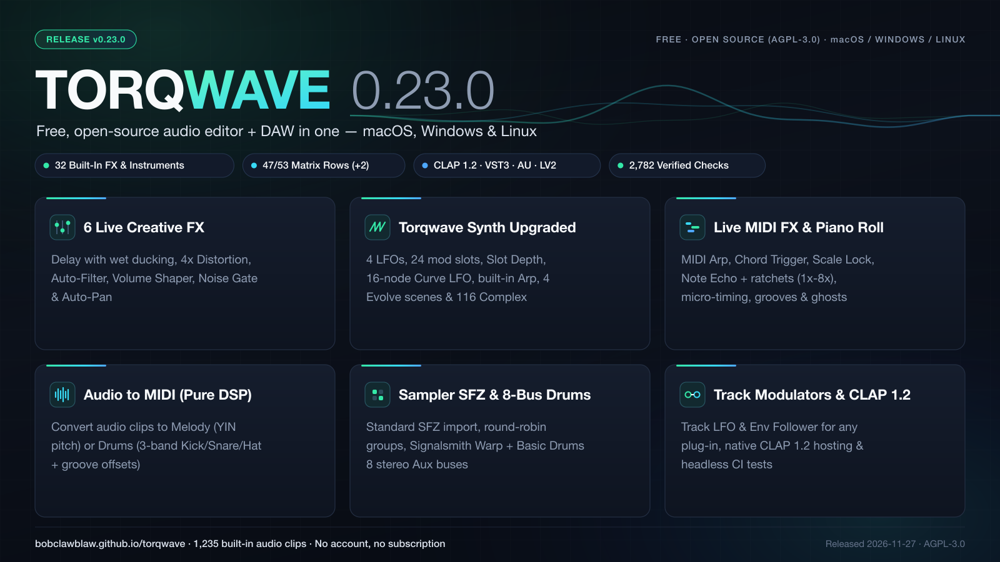
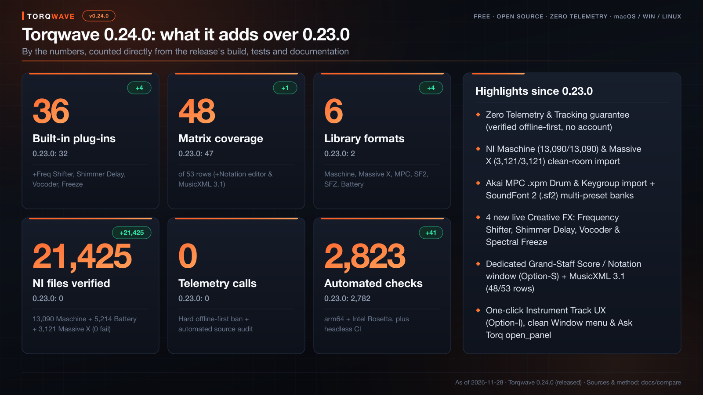
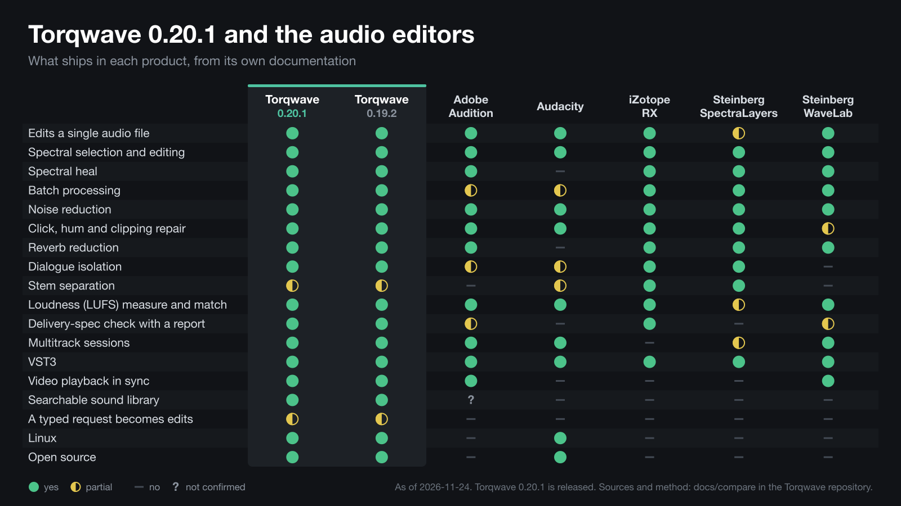
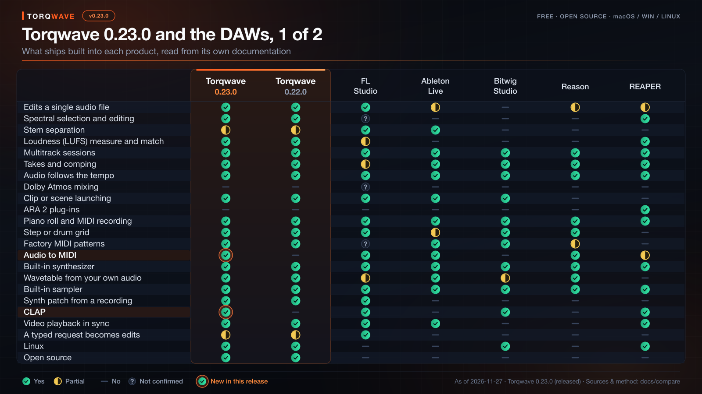
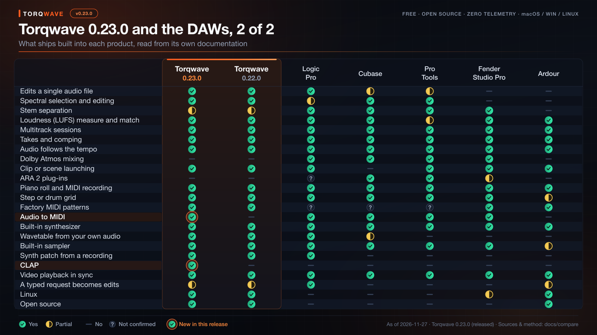
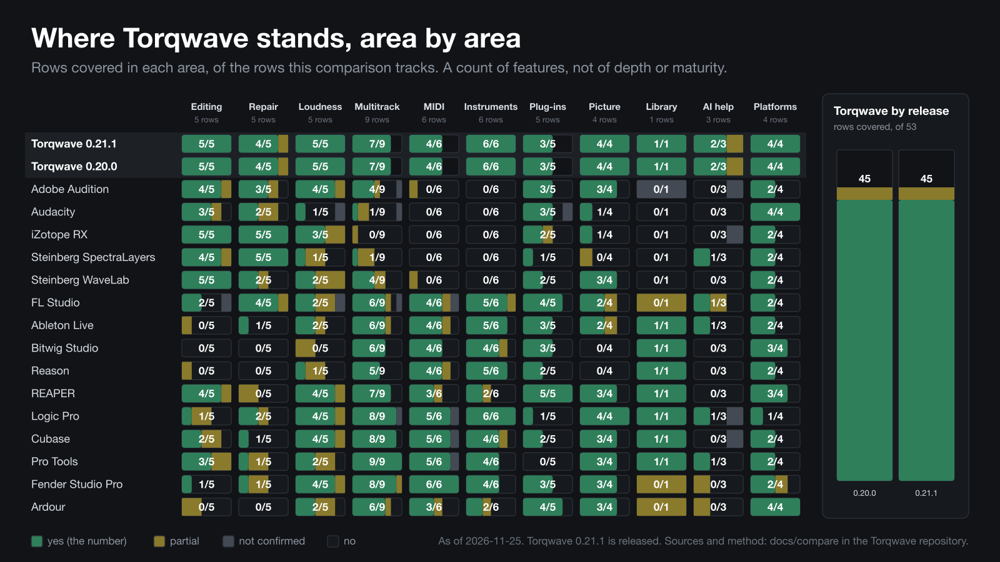
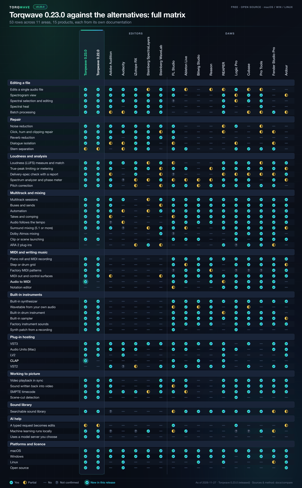

# Torqwave 0.24.0 Comparison Graphics

All seven comparison and release graphics generated from [comparison.json](../data/comparison.json) and the [0.24.0 snapshot](../data/snapshots/0.24.0.json) at 1600 × 900 (`6-the-whole-matrix` at full height), in both PNG and SVG.

Back to [Comparison overview](../README.md) · [Full MATRIX.md](../MATRIX.md)

---

## 0. Release Hero
Download: [PNG](0-release-hero.png) · [SVG](0-release-hero.svg)

## 1. Release by the Numbers
Download: [PNG](1-release-by-the-numbers.png) · [SVG](1-release-by-the-numbers.svg)

## 2. Against the Audio Editors
Download: [PNG](2-against-the-editors.png) · [SVG](2-against-the-editors.svg)

## 3. Against the DAWs (Part 1)
Download: [PNG](3-against-the-daws-1.png) · [SVG](3-against-the-daws-1.svg)

## 4. Against the DAWs (Part 2)
Download: [PNG](4-against-the-daws-2.png) · [SVG](4-against-the-daws-2.svg)

## 5. Where Torqwave Stands
Download: [PNG](5-where-torqwave-stands.png) · [SVG](5-where-torqwave-stands.svg)

## 6. The Whole Matrix
Download: [PNG](6-the-whole-matrix.png) · [SVG](6-the-whole-matrix.svg)

