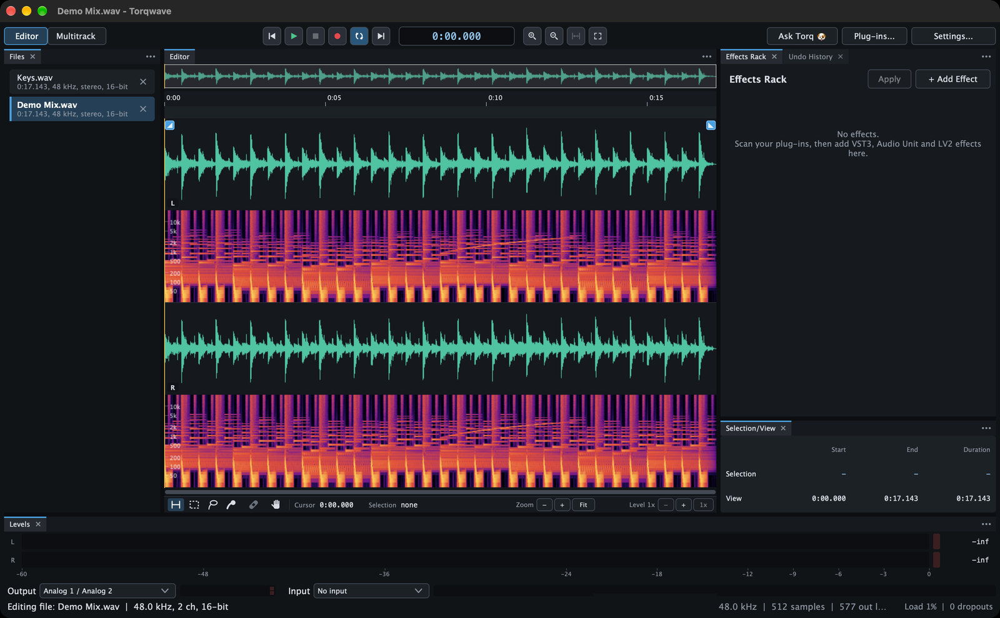
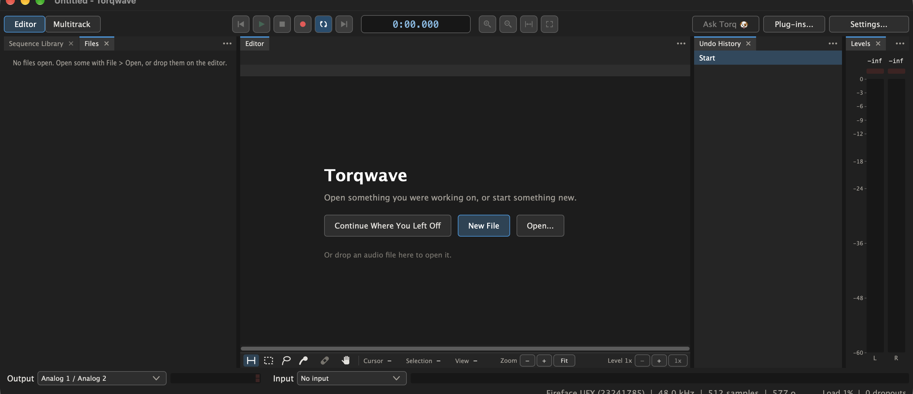
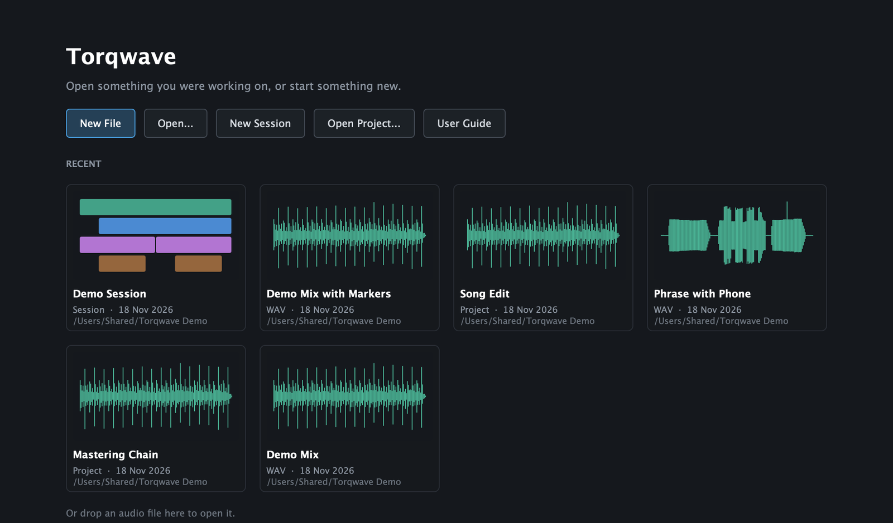

# Getting started

[Guide](README.md) › Getting started

This page gets Torqwave installed and running, takes you round the window, and shows how to open, make and save files.

## Install it

Download the newest build from [Releases > Latest](https://github.com/BobClawblaw/torqwave/releases/latest). Each file has a `.sha256` beside it, so you can check the download.

**Mac** (Apple silicon or Intel, macOS 13 or later): `Torqwave-<version>.dmg`

1. Open the disk image and drag Torqwave to Applications.
2. Open Torqwave. macOS blocks it the first time, because it is signed ad hoc rather than with a Developer ID.
3. Go to System Settings > Privacy & Security and choose **Open Anyway**. After that it opens normally.

macOS asks for microphone access the first time you choose a recording input.

**Windows** (64-bit, Windows 10 or later): `Torqwave-<version>-windows-x64-setup.exe`

1. Run the installer. It installs for you alone and needs no administrator rights (run it with `/ALLUSERS` to install for everyone).
2. The program isn't signed, so SmartScreen may stop it the first time: choose **More info > Run anyway**.

The `windows-x64.zip` is the same program without an installer, to run from any folder.

**Linux** (64-bit x86): `Torqwave-<version>-linux-x86_64.tar.gz`

1. Unpack it.
2. Run `./install.sh` to install it for you alone in `~/.local`, with an entry in the applications menu. Use `sudo ./install.sh --system` to install it in `/usr/local` for everyone, and `./install.sh --uninstall` to remove it.

Some file types and the Video panel need [ffmpeg](https://ffmpeg.org) installed. On Linux it also does AAC and M4A. See [File formats](../../README.md#file-formats) in the README.

## The first launch

Two things to do once:

1. **Choose your audio interface.** Click **Settings...** at the top right of the window and choose **Audio**. Pick the device, its outputs and inputs, the sample rate and the buffer size. MIDI inputs, for playing instruments from a keyboard, are turned on here too.
2. **Scan your plug-ins** (if you use VST3, LV2, or Audio Units on the Mac). Click **Plug-ins...** and **Scan for Plug-ins**. The scan runs in the background and the window shows how far it has got. A big collection takes a while the first time. Each plug-in is tried in a separate worker, so one that crashes or hangs is marked as not working and Torqwave keeps running.

If you used Torqwave under its old name, SpectraBlade, your settings, presets and Sound Library are copied across the first time it starts.

## The window

From the top:

- **The toolbar.**
  - On the left is the **Editor | Multitrack** switch. It moves between the file you are editing and the multitrack session, and the side in use is lit.
  - In the middle is the **transport**: Go to Start, Play, Stop, Record, Loop, Go to End. Next to it is the time of the playhead, and then the zoom buttons: Zoom In, Zoom Out, Zoom to Selection and Zoom to Fit. Hold the mouse over a button to see its key.
  - On the right are **Plug-ins...** and **Settings...** (every setting of the app: audio, look, editing, AI and the rest).
- **The panels.** Everything else is a panel docked around the editor: Files, Effects Rack, Undo History, Selection/View, Levels and more.
  - Each panel has a tab. Close a panel with the × on its tab, and bring it back from the **Window** menu.
- **The editor**, in the middle.
  - It shows the file as a waveform, a spectrogram, or both.
  - Over its ruler is the time-view strip: the whole file in miniature, with a frame around the part showing.
  - Under it is a strip with the selection tools and the Hand tool, the cursor, selection and view times, and the zoom controls.
- **The bottom bar.**
  - **Output** and **Input** choose the interface's outputs and inputs.
  - The status line says what you are working on ("Editing file: ..." or "Multitrack session: ...").
  - On the right it shows the sample rate, the buffer, the latency, the processor load and any dropouts.

### Moving panels around

- **Dock a panel somewhere else:** drag its tab onto the edge of another panel.
- **Make it a tab of another panel:** drop its tab on the middle of that panel.
- **Float it in its own window:** drag its tab out of the window.
- **Resize panels:** drag the bars between them.
- **Fill the window with one group of panels:** double-click its tab, or use **Maximize** in the ⋯ menu at the right of the tabs. Do it again to bring the others back. For the editor, use Window > Maximize Editor (Shift-Cmd-F).

### Workspaces

A workspace is a saved layout of panels. **Window > Workspace** switches between them:

| Workspace | What it is for |
|---|---|
| Classic | The editor, with the effects rack and the selection panel beside it |
| Editing | Classic, plus the Files panel on the left, Undo History as a tab beside the rack, and the levels meter along the bottom |
| Multitrack | The editor with the mixer underneath, and clip properties, the rack, markers and the clip list beside it |
| Analysis | The editor with the rack beside it, and a frequency analyzer, a phase meter and the levels meter underneath |

Each workspace remembers how you left it. **Save Workspace...** keeps the current layout under a name of your own, and **Reset Workspace** puts one back as it was saved.

A workspace can have an accent colour of its own, so you can tell at a glance which one you are in: choose it from **Window > Workspace > Accent for** *(the workspace)*. **The App's Own** goes back to the accent chosen in View > Theme. Choosing an accent in View > Theme clears the current workspace's own, so you see the one you picked.

## The home screen

With nothing open, the editor shows the home screen: buttons for **New File**, **Open...**, **New Session**, **Open Project...** and the **User Guide** (and **Continue Where You Left Off** before them, when there is something from last time), and your recent files, sessions and projects as cards. Each card has a picture of what it holds. An audio file shows its waveform. A session shows its tracks with their clips in their colours. A project shows its session, or the file it had in front. Under the name are the kind, when you last saved it and its folder. Click a card to open it again.

Torqwave starts on the home screen. **File > Settings... > Start** has two other choices: **Reopen the last file** reopens the file you had in the editor when you quit, and **Continue where you left off** brings back everything that was open.

### Continue where you left off

With this chosen, Torqwave starts with what was open when it last closed:

- every file that was open in the editor, in the same order, with the one you were on in front;
- each file's selection, cursor, zoom and scroll, and the video attached to it;
- the effects rack beside the editor, with its effects' settings;
- the multitrack session, with its cursor, time range, zoom, scroll and selected track;
- the editor or the Multitrack view in front, whichever it was, and the project they belonged to.

Whatever the setting, the same is on offer once after a start, until you use it or open something else: **File > Continue Where You Left Off**, and a button of that name at the start of the home screen's row.

**It reopens files; it does not keep unsaved work.** Torqwave notes which files were open and where you were in them, in its own data folder. It writes no audio there. So:

- A file comes back as it is on disk. If you chose **Don't Save** when you quit, those changes are gone, as that choice says.
- A file you never saved, and a session you never saved, are not brought back. Quitting asks whether to save them first, as it always has.
- Undo histories are not brought back, and neither are open instrument, plug-in or tool windows. The panels and their layout come back as they always do, with the workspace.
- To keep unsaved audio and undo steps between runs, save a [project](11-projects-and-file-types.md#projects).

**If something is no longer there** (moved, renamed, deleted, or on a drive that isn't connected), Torqwave reopens the rest and lists what it could not reopen. Those stay in its note, each with its place, and are tried again at every start: connect the drive or put the file back, and the next start reopens it, after the files that were there all along. Opening one by hand, or opening another session or project in place of a missing one, also ends the wait. For something that is gone for good, click **Forget Them** on the message (Return and Escape only close it) and Torqwave stops looking. A file that changed on disk opens as it is now.

**After a crash** it brings back what was open up to 30 seconds before (the note is refreshed that often while nothing is playing or recording), each file as it is on disk. If the session had unsaved changes, Torqwave then offers its recovery copy, as it does without this setting: one question, and **Open** puts the copy in place of the saved session. If Torqwave closed while it was reopening, the next start skips it once and says so, so that one bad file can't stop the app from starting; File > Continue Where You Left Off tries again.

The files are read while the loading screen is up, one after another, so a start takes about as long as opening them by hand. If a drive doesn't answer, **Continue** appears after three seconds: the app is usable at once and the files come in when they are read, unless you have opened or changed something by then.

The pictures are made in the background the first time and kept, so the home screen draws them at once next time. They follow the theme's colours.

## Open a file

Any of these opens a file:

- **File > Open...** (Cmd-O). Tick **Preview** in the open panel to hear files as you select them.
- Drop the file on the window.
- Click a card on the home screen, or use **File > Open Recent**.
- Open it from Finder or Explorer with Torqwave.

Files you open join the ones already open. Each file shows in the **Files** panel; click one there to show it in the editor. Each file keeps its own selection, zoom and undo history. Window > File Tabs adds tabs over the editor as well.

- **Close the file showing:** Cmd-W.
- **Step through the open files:** File > Next File and File > Previous File.

File > Open also opens multitrack sessions (`.tqsession`) and projects (`.tqproject`).

WAV, AIFF, FLAC, MP3, AAC and Ogg Vorbis open as they are. Many more types open through ffmpeg; see the [table of formats](../../README.md#file-formats).

## Start a new file

**File > New File...** (Cmd-N) makes a file of silence to record, paste or generate into. Choose its:

- sample rate;
- channels: mono, stereo, 5.1 or 7.1;
- bit depth;
- length, from 0.1 s to an hour.

It opens beside your other files, named Untitled until you save it.

**File > Paste Clipboard as New File** (Option-Cmd-N) makes a file out of what you copied: select part of a longer file, copy it, and the new file holds exactly that, at its length, sample rate and channels, with no silence to trim. The New File dialog has the same as a button, **From Clipboard**, whenever something is copied.

## Save

- **Save** (Cmd-S) writes the file back in its own format.
- **Save As...** (Shift-Cmd-S) writes a new file:
  - WAV: 8, 16 or 24-bit, or 32-bit float.
  - AIFF: 8, 16 or 24-bit.
  - FLAC: 16 or 24-bit.

  Lower bit depths are dithered. Markers, regions and tags go along where the format keeps them.
- **Export as MP3 or AAC...** and **Export with ffmpeg...** write compressed copies.

[Editing audio](02-editing-audio.md#saving-what-you-made) covers saving parts of a file, and writing a file through the effects rack.

To come back later to everything you have open (files, effects rack and session), use **File > Save Project**. See [Projects](../../README.md#getting-started) in the README for what a project keeps.

## Make it yours

- **File > Settings...** (Cmd-,) holds every setting in one window: Start, Look, Editing, Playback, Multitrack, Recording, Audio, Plug-ins, Keys and the Sound Library. Changes take effect at once.
- **View > Theme** picks one of ten themes, an accent colour and a waveform colour.
- **View > Time Format** shows every time in the app as one of:
  - minutes and seconds;
  - decimal seconds;
  - samples;
  - SMPTE timecode at 24, 25, 29.97 (drop or non-drop) or 30 fps.
- **Settings > Keys** (or **Window > Keyboard Shortcuts...**) lists every command and its keys. You can search them, change them, and export or import them. **Key Sets... > Audition-Style Keys** switches to keys like Adobe Audition's.

Next: [Editing audio](02-editing-audio.md).
