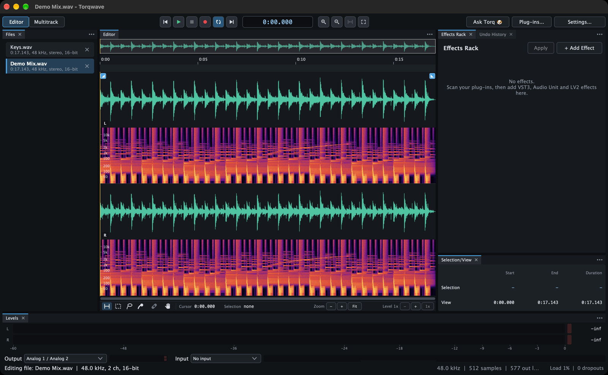
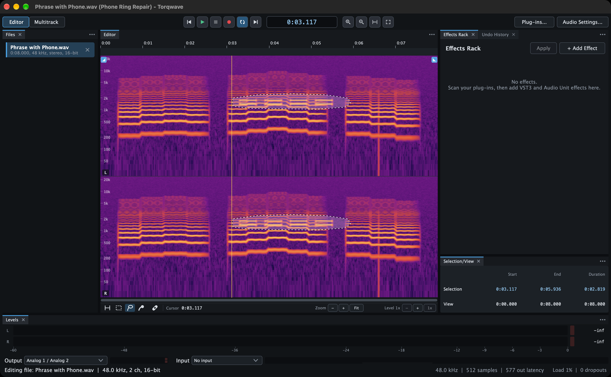
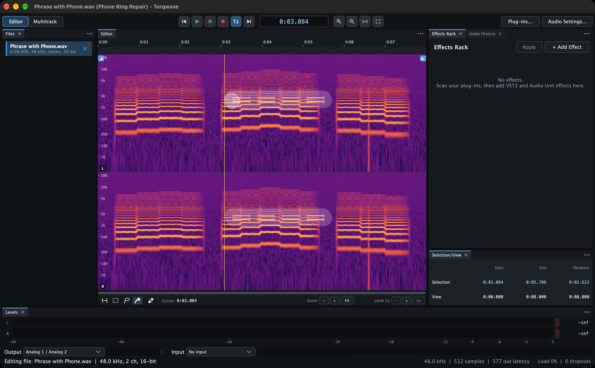
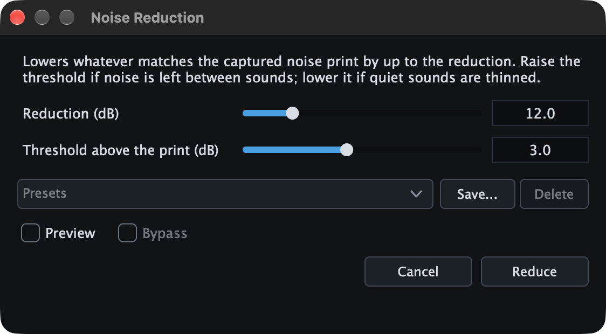

# Spectral editing and repair

[Guide](README.md) › Spectral editing and repair

The waveform shows how loud a file is. The spectrogram shows what it is made of: each frequency's strength over time, low at the bottom and high at the top. A cough, a phone ringing or a squeaky chair shows up there as a shape of its own, apart from the voice or music around it. You can select just that shape and remove it, lower it, or heal it away, and leave everything else as it was.

This page also covers Torqwave's repair effects: noise reduction, clicks, hum, clipping and the rest.

## Show the spectrogram

Choose **View > Spectrogram** (Cmd-2), or **View > Waveform and Spectrogram** (Cmd-3) to see both. With both showing, drag the line between them to give the spectrogram more room. The frequency scale is down the left edge of each channel.

## The selection tools

The tools are on the strip under the editor and in the **Edit** menu. The one in hand is lit.

| Tool | Key | What it selects |
|---|---|---|
| Time | A | A stretch of time, at every frequency: the ordinary selection. Option-drag in the spectrogram draws a box instead |
| Box | E | A box of time and frequency: drag from one corner to the other |
| Lasso | D | A freehand shape: draw round the sound |
| Brush | P | Whatever you paint over |

**Box:** drag a box's edges or corners to resize it.

**Lasso:**

- The lasso follows the mouse and shows the line so far. A faint dotted edge runs back to where you started.
- When you let go, the shape closes along that edge.

*A lasso drawn freehand round the ring. The shape is the selection, in both channels.*

**Brush:**

- **[** and **]** make the brush smaller or larger.
- **Shift-[** and **Shift-]** make it lighter or heavier, in steps of 10%. An effect applies only that much to what a light brush painted: Remove Frequencies with a 50% brush takes away only part of the sound there, not all of it.

*One stroke of the brush along the ring's tones. The circle shows the brush's size.*

**Lasso and brush, both:**

- Hold **Shift** to add to the drawing, or **Option** to take away from it.
- **Cmd-Z** takes back the last stroke while you are drawing.

**Listen before you change anything:**

- **Space** plays only what is inside the selection, so you can check you have the whole sound and nothing else.
- A new box or drawing made while it plays takes over once it is ready.

## Do something with the selection

Once the sound is selected:

| Command | Keys | What it does |
|---|---|---|
| Remove Frequencies | Option-Delete, or Delete | Removes what is inside the selection. The file keeps its length |
| Attenuate Frequencies... | | Lowers what is inside by an amount you choose, with a preview |
| Heal | Shift-Cmd-H | Replaces what is inside with the sound around it, so the gap is filled rather than left empty |

All three are in **Effects > Spectral**. After any of them, the drawing is used up and goes, and the time it covered stays selected. Undo brings the sound back if the result isn't right.

**Which to use:**

- **Heal** usually sounds most natural for a short noise over a steady background (a click over room tone, a cough over a pad), because it fills the hole with something like what was there.
- **Attenuate** suits a sound you want quieter but not gone.
- **Remove** suits a sound over silence.

### Example: remove a phone ringing under speech

1. Press **Cmd-3** to show the waveform and the spectrogram.
2. Find the ring. It shows as a few bright horizontal lines, the tone and its harmonics, above most of the voice.
3. Press **E** for the Box tool. Drag a box round the first line, from where the ring starts to where it ends.
4. Press **Space** to check that you hear the ring and not the voice.
5. To get every line at once, press **P** for the brush. Shift-drag over each line to add it, then check again with Space.
6. Press **Shift-Cmd-H** to heal it, then play the passage. If some ring is left, select what is left and heal again.

*A box round the ring's two tones, from 1.25 to 1.95 kHz and 3.2 to 5.8 seconds. Only what is inside the box is selected, so an edit leaves the voice above and below it alone.*

## Noise reduction

For a steady noise that runs through the whole recording (hiss, fan, air conditioning, a hum with a broad spread), learn the noise first and then take it out:

1. Select a stretch with **only the noise** in it, such as a pause before someone speaks. The print is the noise averaged over that stretch, so a longer stretch gives a steadier print.
2. Choose **Effects > Noise Reduction and Repair > Capture Noise Print** (Shift-P).
3. Select the part to clean, or nothing for the whole file.
4. Choose **Noise Reduction...** (Shift-Cmd-P). Press Space to preview, and set how much to take away.
5. Use **Bypass** to compare, then apply.

Taking too much away makes the voice watery or "underwater". Back off until it sounds clean.

When there is no noise alone to learn from, or the noise changes as it goes, use **Adaptive Noise Reduction...** instead. It follows the noise without a print.

**Dialogue Isolation...** goes further. It keeps the speech and lowers everything else: background, music, traffic.

## The other repair effects

They are all in **Effects > Noise Reduction and Repair**. Each one works on the selection, or on the whole file when nothing is selected, and each has a preview.

| Effect | Use it for |
|---|---|
| Reduce Reverb... | Too much room: lowers the reverberation and keeps the direct sound |
| Click and Pop Repair... | Clicks and pops, such as from vinyl or a bad edit: finds and rebuilds them |
| Mouth De-click... | The small clicks of lips and tongue in speech |
| De-crackle... | Crackle: dense tiny clicks |
| De-plosive... | The thump a "p" or a "b" puts into the microphone |
| Breath Control... | Breaths between words: finds and lowers them |
| Wind, Rustle and Bleed... | Gusts of wind, clothing rustle, and the bleed between words in a speech recording |
| Wow and Flutter... | The pitch drift of a tape or a record |
| Spectral Recovery... | Dull, band-limited audio (a phone line, an old MP3): rebuilds the missing highs from the band that is there |
| Remove Hum... | Mains hum at 50 or 60 Hz and its harmonics |
| Repair Clipping... | Flattened peaks from a recording that was too loud: rebuilds them from the audio around them |
| Repair Selection | A very short glitch: redraws the selection as a smooth curve between the samples around it |
| Remove DC Offset | A waveform that sits above or below the centre line |

**To find clipping first,** use **Edit > Find Next Clipping**, or **Markers > Add Markers at Clipping** to mark every place it happens.

### Room tone

When you cut or silence a pause in speech, the sudden total quiet can be heard. To fill it with the room's own sound:

1. Select a stretch of the room with nobody speaking.
2. Choose **Capture Room Tone**.
3. Select the gap, and choose **Ambience Match...** to lay the room tone under it.

### Rebalance

**Effects > Spectral > Rebalance...** works on a finished mix. It turns the voice, the bass, the drums and the rest up or down separately, without the original tracks.

Next: [Effects and the rack](04-effects-and-the-rack.md).
