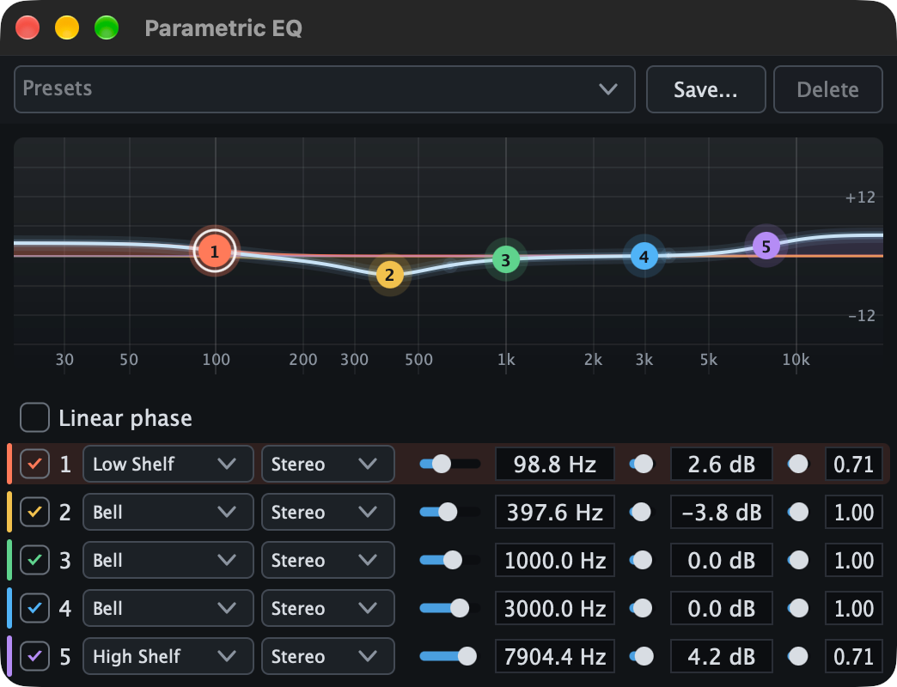
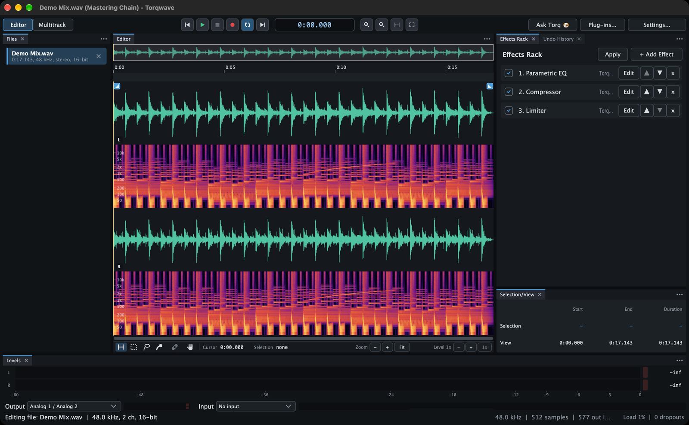

# Effects and the rack

[Guide](README.md) › Effects and the rack

There are two ways to put an effect on a file:

- **Apply it straight away from the Effects menu.** Choose the effect, set it up while you listen to a preview, and apply it. The audio changes there and then, as one step you can undo.
- **Put it in the effects rack.** The rack is live: you hear the file through it while you play, and nothing in the audio changes until you apply the rack. Use it to stack several effects and adjust them together, or to use plug-ins.

## Effects from the menu

The **Effects** menu groups the effects by what they do:

| Group | What is in it |
|---|---|
| Level and Loudness | Gain, Normalize, Match Loudness, Meet Delivery Spec, Level Speech, Loudness Statistics, Dither, Codec Preview |
| Fades | Fade In, Fade Out, Fade Selection Edges, Fade Each Region, Gain Ramp, and the Fade Shape |
| EQ | EQ Band, Parametric EQ, Dynamic EQ, Graphic EQ (10 and 31 bands), and Match EQ with its reference |
| Dynamics | Compressor, Limiter, Maximizer, Multiband Compressor, Transient Shaper, De-esser, Noise Gate |
| Saturation | Exciter |
| Modulation and Delay | Tremolo, Echo, Chorus, Flanger, Phaser |
| Reverb | Reverb, Convolution Reverb |
| Time and Pitch | Dialogue Contour, Stretch, Extreme Stretch, Shift Pitch, Pitch Correction, Reverse, Crossfade Loop |
| Stereo and Channels | Balance, Pan Ramp, Stereo Width, Multiband Stereo Width, Centre Channel, phase and azimuth correction, and the channel commands (swap, copy, mix to mono, make stereo, invert) |
| Silence | Silence, Insert Silence, Trim Silence, Shorten Pauses |
| Generate | Tones and sweeps, telephone tones, noise, and notes played on an instrument |
| Noise Reduction and Repair | See [Spectral editing and repair](03-spectral-editing-and-repair.md) |
| Spectral | Rebalance, and Attenuate, Remove and Heal for a spectral selection |

Each one works on the selection, or on the whole file when nothing is selected.

Every effect dialog works the same way, as [Editing audio](02-editing-audio.md#using-an-effect-dialog) shows:

- **Space** previews the effect.
- **Bypass** compares it with the original.
- **Return** applies it.
- **Presets** hold the factory recipes and your own.

### Presets

Most dialogs have a **Presets** list with two sections:

- **Factory** holds 201 presets for common jobs, such as dialogue cleanup, vocals, mastering to a loudness target and vinyl repair. Use them as starting points, then adjust by ear.
- **Yours** holds your own. **Save...** beside the list keeps the current settings under a name, and **Delete** removes one of yours.

### Effects that need the whole sound

Some effects can't be heard live, because they work out their result from the audio around each moment: noise reduction, stretch, pitch correction, and the repair effects. Their preview is worked out in the background before it plays.

- Most of them preview the selection's first 30 seconds.
- Those whose result depends on all of the audio, such as Normalize and Match Loudness, work out the whole selection first.

## The effects rack

The rack is the **Effects Rack** panel beside the editor. Window > Effects Rack (Option-Cmd-E) shows or hides it. In a multitrack session the same panel is the **Master Bus Effects**: the session's whole mix plays through it, and Mix Down writes through it (see [Master bus effects](06-multitrack-sessions.md#master-bus-effects)).

### Build a chain

1. Click **+ Add Effect**. The menu lists effects by format, then by maker:
   - **Torqwave**: the built-in effects. These are Parametric EQ, Dynamic EQ, both Graphic EQs, Compressor, Multiband Compressor, Limiter, Maximizer, De-esser, Transient Shaper, Exciter, Multiband Stereo Width, Chorus, Flanger, Phaser, Reverb, Convolution Reverb and Hardware Insert (outboard gear through the interface; see [Hardware inserts](06-multitrack-sessions.md#hardware-inserts)).
   - **VST3**, **Audio Units** on the Mac and **LV2** on the Mac and Linux: the plug-ins your scan found.
2. The new effect's window opens in front. Set it up while you play the file.
3. Add more effects. They run from top to bottom.

*The Parametric EQ's window. Drag a band's point on the curve, or type its values in the list.*

Each effect has a row of controls:

| Control | What it does |
|---|---|
| The switch at the left | Turns the effect on or off (bypass), to compare |
| **Edit** | Opens its window again |
| **▲** and **▼** | Move it up or down the chain |
| **x** | Removes it |

*A mastering chain of three built-in effects. Each row has its bypass switch, Edit, the arrows to reorder it, and x.*

### Apply it, or keep it live

- **Apply** on the panel, or **Effects > Apply Effects Rack** (Cmd-R), writes the chain into the selection, or into the whole file. The rack then empties, so you don't hear the effects twice. Undo brings back both the audio and the rack as they were.
- **Leave it live** and save through it instead. With an effect on in the rack, these all have a switch, on to start with, that writes the new file through the rack:
  - Save As...
  - Save Selection As...
  - Export as MP3 or AAC...
  - Export with ffmpeg...

  Your open audio is left as it was.

### Save a chain for later

- **Window > Save Rack...** writes the chain, with every setting, to a `.tqrack` file.
- **Window > Load Rack...** brings it back, onto this file or any other.
- A project saves the rack too (see [Getting started](01-getting-started.md#save)).

**Batch Process...** in the File menu can run the current rack over a whole folder of files.

## Plug-ins

Torqwave hosts VST3 plug-ins everywhere, Audio Units (v2 and v3) on the Mac, and LV2 plug-ins on the Mac and Linux. VST2 isn't supported, because Steinberg no longer licenses it.

1. Click **Plug-ins...** in the toolbar (or Window > Plug-ins...), then **Scan for Plug-ins**.
2. Each plug-in is loaded in a separate worker while it is checked. One that crashes, or hangs for more than 60 seconds, is marked as not working, and Torqwave keeps running.
3. Effects then appear under **+ Add Effect** in the rack, and in a track's **FX** menu in a session. Instruments go on instrument tracks; see [Instruments and MIDI](07-instruments-and-midi.md).

Where Torqwave looks for plug-ins:

| Format | Folders |
|---|---|
| Audio Units (Mac) | `/Library/Audio/Plug-Ins/Components`, `~/Library/Audio/Plug-Ins/Components`, and AUv3 app extensions |
| VST3 (Mac) | `/Library/Audio/Plug-Ins/VST3`, `~/Library/Audio/Plug-Ins/VST3` |
| VST3 (Windows) | `C:\Program Files\Common Files\VST3` |
| VST3 (Linux) | `~/.vst3`, `/usr/lib/vst3`, `/usr/local/lib/vst3` |
| LV2 (Mac) | `~/Library/Audio/Plug-Ins/LV2`, `~/.lv2`, `/Library/Audio/Plug-Ins/LV2`, `/usr/local/lib/lv2`, `/usr/lib/lv2`, and the folders in `LV2_PATH` |
| LV2 (Linux) | `~/.lv2`, `/usr/local/lib/lv2`, `/usr/lib/lv2` (`lib64` where the system has it), and the folders in `LV2_PATH` |

## Recorded sequences

To use the same steps on many files, record them once:

1. Choose **Effects > Record Sequence**.
2. Apply the effects you want, in order, with their settings.
3. Choose **Stop Recording Sequence...** in the same place, and give the sequence a name.

**Effects > Play Sequence...** plays it back on the selection or the whole file, as one step to undo. Batch Process can play it on every file in a batch.

Most effects can be recorded, including Gain, Normalize, Match Loudness, the EQs and dynamics, the reverbs, Stretch, Shift Pitch, Pitch Correction, Convert Sample Rate and Apply Effects Rack. When you stop recording, Torqwave lists any edits made in the meantime that it could not record.

Next: [Loudness and mastering](05-loudness-and-mastering.md).
