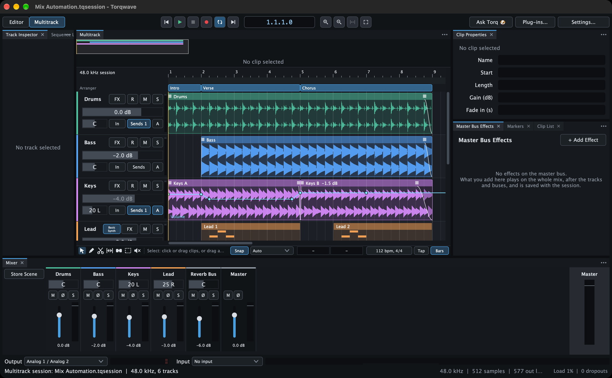

# Multitrack sessions

[Guide](README.md) › Multitrack sessions

A session lays audio files out as clips on tracks, mixes them through buses and effects, and writes the result to a file. It doesn't change the audio files it uses: clips point to them.

Switch between the editor and the session with the **Editor | Multitrack** switch at the top left, or **View > Multitrack Session** (Cmd-4). The **Multitrack** workspace (Window > Workspace > Multitrack) puts the mixer underneath and the clip panels beside the lanes.

## Start a session

- **File > New Session** (Shift-Cmd-N) starts an empty one, and **File > Open Session...** (Shift-Cmd-O) opens a saved `.tqsession`.
- **Bring audio in:**
  - **Multitrack > Import Audio...** (Cmd-I) puts each file on a new track at the cursor.
  - Drag files from Finder, from the Files panel, or from the Sound Library onto the lanes.
  - Dropping below the last track makes a new track.
- **Bring MIDI in:** **Multitrack > Import MIDI File...** adds a Standard MIDI File's tracks as note clips. See [Instruments and MIDI](07-instruments-and-midi.md).

**Right-click** works almost everywhere in the multitrack view:

- on a lane, below the tracks, on the ruler, or in the track list;
- on a track's name.

The menu offers what you can do at that spot: Add Track, Add Instrument Track, Add Bus, Paste Here, Select All Clips, and more.

## Tracks

The track list on the left holds a header for each track. Drag its right edge to make it wider.

| Control | What it does |
|---|---|
| Name | Double-click to rename it; right-click for the track's menu |
| **FX** | The track's effects, the same way as the [effects rack](04-effects-and-the-rack.md#the-effects-rack) |
| **R** | Arms the track for recording |
| **M**, **S** | Mute, and Solo (play only the soloed tracks) |
| Volume, pan | Drag them; they show a value and follow an envelope when one is drawn |
| **In** | The input the track records from |
| **Sends** | Sends to buses, the output and ducking (see below) |
| **A** | The track's automation mode and envelopes: volume, pan, and the parameters of its effects. It reads **A** in Read, **Off**, **T**, **L** or **W** in the other modes (see [Automation](#automation)), and is lit when the track has automation or writes it |

The **Multitrack > Tracks** menu adds tracks, buses, folders and VCA faders, and also:

- duplicates, deletes and moves tracks, and hides them (they still play);
- saves a track as a template and adds tracks from templates;
- clears every solo and mute at once.

Right-click a track's header, or an empty part of a lane, for the same additions, and on a header for what applies to that track: its folder, VCA fader, group, colour, note, hiding and deleting it.

### VCA faders

A **VCA fader** controls the level of a set of tracks and buses without mixing them together, as on a large console. It has no audio, clips or effects of its own: only a volume, mute and solo, and a volume envelope.

- **Add one:** **Multitrack > Tracks > Add VCA Fader** adds one with the selected track in it. Right-click any track's or bus's header and choose **VCA** to put it in a VCA fader, take it out, or make a **New VCA Fader** for it. A track or bus is in at most one, and folders and VCA faders can't join one.
- **Its volume** is added to each member's own, in dB, as they are mixed: a member at -6 dB in a VCA fader at -3 dB plays at -9 dB, as its own fader would set it. Post-fader sends follow it; pre-fader sends don't. Its volume envelope moves its members in the same way, and plays and is written like any other (see [Automation](#automation)).
- **Its mute and solo** act on its members as if they were their own.
- Bouncing, freezing and exporting a stem keep a member at the level the VCA fader gives it.
- A folder and a VCA fader can both act on one track: the folder's volume and the VCA fader's are both added.

Drag a track's header to move the track. Where it lands also decides its folder: dropped on a folder's header, it goes into that folder; dropped on a track, it takes that track's folder, or none. Drop it on its own folder's header to take it out, just above the folder.

**Up** and **Down** select the track above or below.

## Clips

- **Move a clip:** drag it, onto another track if you like.
- **Copy a clip:** Option-drag it. The clip stays where it was and a copy goes where you drop it; with several clips selected, they are all copied. The cursor shows a plus while Option is held over a clip, and you can press Option during the drag too. The copies are left selected, and one undo removes them.
- **Trim it:** drag its left or right edge.
- **Fade it:** drag the small squares at its top corners.
- **Crossfade two clips:** with **Crossfade Overlaps** on (X), a clip dragged over part of another crossfades with it.
- **Layer clips:** where clips overlap on a track you hear both, mixed. Turn on **Layer Overlapping Clips** (in Multitrack > Editing and Recording) and you hear only the clip on top, as the lanes show it; over a crossfade you still hear both. Right-click a clip and choose **Bring to Front** or **Send to Back** to change which is on top. The setting is kept with the session.
- **Edit its audio:** double-click it. See [Sound design in the session](#sound-design-in-the-session).
- **Line things up:** **Snapping** (S) lines dragged clips, edges, fades and points up with clip edges, the cursor and the ruler.

Select several clips with Shift-click, or drag across empty lane space with the Select tool. They then move, nudge, copy, mute or delete together.

### Closing the gap when you delete (ripple)

**Multitrack > Editing and Recording** has three Ripple choices that set what deleting or cutting clips does to the time they played over:

| Setting | What happens |
|---|---|
| No Ripple | The gap stays where the clip was |
| Ripple Track | The later clips on the same track move back to close it, with that track's envelopes; other tracks and markers stay |
| Ripple All Tracks | The time comes out of the whole session: every track's later clips, the envelopes and the markers move back together, so they stay in sync |

Ripple All Tracks takes out only time that is empty on every track: if another track still plays over it, nothing moves. Locked clips stay where they are. The same choice is in **Settings > Multitrack**. Torqwave starts with No Ripple, and keeps the choice you make.

The setting covers a time range too. Draw one with the Range tool (6), or across the marker lane under the ruler, and **Delete** or **Cut** (Cmd-X) acts on the range instead of the selected clips, on each track with something in it:

| Setting | Delete or Cut on a time range |
|---|---|
| No Ripple | The range is cleared and the time stays empty; clips across its edges are cut back |
| Ripple Track | The range is cleared and the later clips on those tracks move back to close it; other tracks and markers stay |
| Ripple All Tracks | The time comes out of the whole session, as Delete Time does |

Cut copies what was in the range, so **Paste** (Cmd-V) puts those clips at the cursor. **Copy** (Cmd-C) copies them without taking anything out. The Edit menu says which it will do: Delete Range or Delete Clip. A click on a clip, a point or an empty lane turns Delete, Cut and Copy back to the selected clips.

### The tools

The toolbar under the lanes holds the tools. Each has a number key:

| Tool | Key | What a click or drag does |
|---|---|---|
| Select | 1 | Selects and moves clips; a drag across empty lane space selects the clips it crosses |
| Draw | 2 | On an instrument track, drags out a note clip |
| Split | 3 | Cuts a clip where you click; with Shift, every track's clips there |
| Stretch | 4 | Drags a clip's edge to make it longer or shorter, pitch kept (Option-drag does this with the Select tool) |
| Glue | 5 | Joins a note clip with the next one |
| Range | 6 | Selects a stretch of time across every track, leaving the clips as they are |
| Mute | 7 | Silences a clip, or lets it be heard again |

Beside the tools are the tempo (click it to set it) and the **Bars** switch, which counts the ruler in bars and beats.

### Clip commands

**Multitrack > Clips** has:

- Split Clip (Cmd-K: every selected clip the cursor crosses), Split All Tracks (Shift-Cmd-K: every clip under the cursor, on every track), Duplicate Clip (Cmd-D) and Repeat Clip to Range End;
- Reverse Clip, Stretch Clip... and Shift Clip Pitch...;
- Show Takes and Flatten Comp, for [comping](08-recording.md#comping-takes) a clip's takes;
- Edit Clip in Place (Option-E), Clip Effects..., Combine to New Sound and Add to Library..., for [sound design](#sound-design-in-the-session);
- Lock Clip, Mute Clip, and Group and Ungroup Clips.

**Clip Gain Lines** shows a gain line on each clip:

- Click the line to add a point.
- Drag a point to move it.
- Click a point to select it (Shift-click adds or removes more), then press Delete or Backspace to remove them.
- Option-click a point to remove it. With Option held, the pointer over a point turns into a dot with a red minus; over the line, Option-click adds nothing.

**Clip Properties** (Shift-Cmd-I) shows the selected clip's name, start, length, gain and fades, for reading and typing.

**Multitrack > Arrange** has:

- **Nudge Earlier and Nudge Later** (comma and full stop) move the selected clips to the grid point before or after.
- **Move Clips to Cursor** moves them together, so the earliest one starts at the cursor.
- **Trim Start to Cursor and Trim End to Cursor** (Option-[ and Option-]) cut the selected clips at the cursor.
- **Close Gaps** moves a track's clips back until each starts where the one before ends.
- **Quantize Clips to Grid** moves each selected clip to start on the nearest grid line.

## Editing time across every track

Select a time range with the Range tool (6), or drag along the marker lane under the ruler. Then **Multitrack > Time Range** can:

| Command | What it does |
|---|---|
| Clear Range | Empties the range on every track and leaves the time |
| Delete Time | Takes the range out and moves everything after it back |
| Insert Time | Adds as much empty time as the range is long |
| Cut Time, Copy Time, Paste Time | Move a whole section (clips, envelopes and markers) somewhere else |
| Duplicate Time | Repeats the range straight after it (Option-Cmd-D) |

This is how you take out a verse, or repeat a chorus, in every track at once.

When the edges fall on bar lines, these commands carry the tempo too: deleting bars takes their tempo and time-signature changes with them, and pasted bars bring theirs, with the tempo after them put back as it was. Time that isn't whole bars leaves the tempo alone.

## The arranger: sections across every track

The **Arranger** strip, under the marker lane, holds the song's sections (Intro, Verse, Chorus...) as named, coloured spans across every track. A section is a handle on everything in its time: clips, notes, automation, markers, and its tempo and time-signature changes when it is whole bars.

- **Make a section:** drag along an empty part of the strip, or select a time range and choose **Multitrack > Arrange > Add Section from Range**. With snapping on, its ends go onto the grid. Sections can't overlap.
- **Rename it:** double-click it, or right-click it and choose **Rename**. **Colour** is in the same menu.
- **Move it:** drag it along the strip. Everything in its time moves with it: the gap it leaves closes, and room opens where it lands. Locked clips stay where they are. A clip across the section's edge is split there, and the part inside moves.
- **Copy it:** Option-drag (Alt on Windows and Linux), or right-click it and choose **Duplicate**, which puts the copy straight after it ("double the chorus").
- **Size it:** drag its start or end edge. This changes only the section, not what is in its time.
- **Make it longer or shorter:** **Insert Bars Before...** puts empty bars in before it, at the tempo there, and moves the rest of the session later. **Delete Section and Its Time** takes it out with everything in it, and the rest moves back. **Remove from Arranger** drops only the section and leaves its time.
- **The arrangement chain:** a play order for the sections, such as Intro, Verse, Chorus, Verse, Chorus, where a section can come more than once. Right-click a section and choose **Add to Chain**; the strip's menu (right-click an empty part) lists the chain, where you can take an entry out or clear it. The header beside the strip shows the chain.
  - **Play Arrangement** (in the strip's menu and **Multitrack > Arrange**) makes playback follow the chain: at the end of each section it jumps to the next entry's. Play from inside a section in the chain to follow it from there (from its first entry); after the last entry, playback goes on through the session.
  - **Flatten Arrangement** lays the session out in the chain's order, as one undo step: each entry becomes a copy of its section, one after another, and playback goes back to plain time.
- Every section edit is one undo step, and the session file keeps the sections and the chain.
- The loop stays where it is through these edits, as it does through undo: it isn't an edit of the session.

## Buses, sends and routing

A **bus** mixes what is sent to it, through its own effects. A reverb bus is the classic use: send several tracks to one reverb, instead of putting a reverb on each.

1. **Multitrack > Tracks > Add Bus** (Shift-Cmd-B), then put the effect on the bus with its **FX** button.
2. On each track, click **Sends**:
   - Turn on the send to that bus and set its level.
   - **Pre** sends before the track's volume, so the send doesn't follow the fader.
   - **New Bus** makes a bus from there.

The same **Sends** panel holds the rest of a track's routing:

- **Output:** a track or bus can play into the mix, into a bus in its place, or out of another pair of the interface's outputs. A pair of outputs plays past the rack and is left out of mixdowns.
- **Duck under:** the track comes down while another track is heard. Use it to keep music under a voice.

**Sidechain:** a plug-in with a sidechain input can take a key track, chosen in the track's **FX** menu. For example, a compressor on the bass can be keyed from the kick.
- **Folders:** **Add Folder** puts the selected track into a new folder (from a track's right-click menu, that track). A folder's mute and solo act on all its tracks, and it can be collapsed. A track leaves its folder by **Take Out of Folder** (in the Tracks menu and its right-click menu) or by dragging, as above. Deleting a folder keeps its tracks, out of it; its right-click menu can also delete them with it. **Export Folder Stems...** writes each folder as one file.

## The mixer

**Window > Mixer** (Shift-Cmd-M) shows a strip for each track and bus, with:

- pan;
- mute, polarity and solo;
- the fader and the meter.

A folder's or VCA fader's strip has only its fader, mute and solo. The master meter is on the right. In a track's Touch, Latch or Write mode, its fader and pan write automation while the session plays, as its header's controls do.

## Control surfaces and MIDI learn

**A Mackie Control surface.** **Multitrack > Controllers > Control Surface...** takes a Mackie Control Universal, or any surface in its Mackie Control (MCU) mode: choose the MIDI port it sends on and the one it listens on. The choice is kept with Torqwave's settings. HUI mode is not supported. The surface's input is turned off among the MIDI inputs that play instruments, so its buttons don't play notes. If you stop using the surface, turn that input back on in Settings to play through it.

- **Faders** set the volume of the tracks and buses on their strips, in the mixer's order, on the mixer fader's scale. They are motorised: they follow the volume, and its envelope as the session plays, except while you hold one.
- **V-pots** pan, and pushing one centres it. Its ring shows the pan.
- **Mute, Solo, Select and Rec** act on the strip's track. Their lights follow the session.
- **Bank** moves the strips eight tracks along, and **Channel** one.
- **Play, Stop and Record** run the transport. **Rewind** and **Fast Forward** go to the start and the end.
- **The scribble strips** show each track's name and its volume, or its pan while you turn its V-pot.

The surface has no master fader here: the session has no master volume to move.

**MIDI learn for any controller.** Any knob, fader or button that sends a MIDI controller (CC) can move a track's volume, pan, mute or solo, or play, stop and record:

- For a track, right-click its header (or its strip in the mixer) and choose **MIDI Learn > Volume...** (or Pan, Mute, Solo), then move the control. **MIDI Learn > Forget** unbinds the track's controls.
- For the transport, choose **Multitrack > Controllers > MIDI Learn Play** (or Stop, or Record), then press the button.
- **Forget All MIDI Learn** unbinds every one.

Each control takes one CC, and each CC moves one control: learning again replaces the old binding. A knob covers the fader's whole scale, and pan from hard left to hard right with 64 the centre. A button acts each time it sends 64 or more. The bindings are saved with the session, and each one learned is an undo step. A learned CC no longer reaches the instruments. Knobs that send relative values (endless encoders) are not supported.

Both the surface and learned knobs write automation as the mixer's controls do. In Touch, Latch or Write, a fader writes while you hold it. A knob, which can't tell when you let go, ends its pass half a second after it stops moving.

## Automation

An envelope makes volume, pan, an effect parameter or, on an instrument track, an instrument parameter change over time.

- **See it:** a track with automation shows its envelope over its lane: volume first, else pan, else the first effect parameter that has one. To see another, or none, click the track's **A** button and choose it, or **Hide Envelope**. A track you hide stays hidden.
- **Draw it:** click the **A** button and choose the envelope to show: volume, pan, a parameter of the track's instrument (**Show <instrument> Envelope**, on an instrument track), or a parameter of one of its effects (**Show 1. <effect> Envelope** and on, numbered as in the FX menu). Click the line to add a point and drag points to shape it.
- **Remove points:** click a point to select it (Shift-click adds more), then press Delete or Backspace. Or Option-click a point: with Option held, the pointer over a point shows a red minus, and an Option-click on the line adds nothing.
- **Write it while playing:** put the track in Touch, Latch or Write (below), or turn on **Write Automation** (W) to put every track in Touch, and play. Moving the track's volume or pan, in its header or the mixer, or a control in its instrument's or an effect's own window, then writes into that envelope, and the envelope shows as it is written, unless you hid it. Several tracks can write at once. Each pass that starts is an undo step.

**Automation modes.** Each track and bus has its own mode, chosen from its **A** button's menu, or for all of them at once from **Multitrack > Automation**:

| Mode | The A button | What it does |
|---|---|---|
| Off | Off | The envelopes don't play: the controls set the track's settings, and nothing is written |
| Read | A | The envelopes play, and automated controls follow them. New tracks start in Read |
| Touch | T | As Read, but a control moved while playing writes until you let it go, then goes back to the envelope over 0.1 s |
| Latch | L | As Touch, but once moved a control goes on writing its last value until playback stops |
| Write | W | From where playback starts to where it stops, the volume and pan are written as their controls stand, moved or not, over whatever was there |

The modes are saved with the session but are not undo steps: an undo leaves every track in the mode it is in, as Cubase does. **Write Automation** (W) puts every track and bus in Touch, or those that write back to Read.

*The Keys track's volume envelope, from -4 dB down to -11 dB for the verse and up to -2 dB for the chorus. The A button is lit because the track has automation.*

A parameter that has an envelope is marked "(automated)" in the menu.

## Tempo and bars

- **Set the tempo:**
  - **Multitrack > Tempo > Tempo...** sets the tempo and the beats in a bar.
  - **Tap Tempo** (T) sets it from your taps.
  - **Tempo Change at Cursor...** changes it from the bar the cursor is in.
- **Count in bars:** **Bars and Beats** (B; in **Multitrack > Tempo** and **View > Time Format**) counts the ruler in bars and beats. With snapping on, a time range and the loop then go onto the grid as you drag: the nearest line of the ruler's grid (beats, or bars when zoomed out) however far the mouse is, or a clip edge or marker close by. Clips still snap only near a line. **Time with Bars** shows the time underneath as well. The session keeps the choice: it opens in bars next time.
- **The track inspector:** a panel (**Window > Track Inspector**, on the left in the Multitrack workspace) for the selected track, as Cubase's inspector: its name (type a new one), what kind of track it is, its volume, pan, mute and solo, its output (the master or a bus), its instrument, its inserts and its sends with their levels and pre-fader switches. Each change is an undo step and follows the track's group. Click the instrument or an insert to open its window; add and order effects in the Effects Rack.
- **The info line:** a strip over the tracks shows the selected clip's name, start, length, gain, fades and note (a note clip's name, start, length and loop), as Cubase's info line does. Type into a field and press Return to change it, as one undo step. Counting bars (Bars and Beats), the start is a place in bars (`5.2.1.0`: bar, beat, sixteenth, tick) and the length and loop are bars long (`2.1.0.0`: two bars and a beat), typed the same way; the fades stay in seconds. **Window > Info Line** shows or hides it; the **Clip Properties** panel has the same fields a row each.
- **The grid:** the toolbar under the tracks has **Snap** (snapping on or off) and a **Grid** box, also in **Multitrack > Grid**: Auto follows the zoom (beats, or bars zoomed out); Bar, 1/4, 1/8, 1/16, 1/32, 1/8 Triplet and 1/16 Triplet hold at any zoom, as Cubase's grid does. It applies in bars and beats, and the lanes draw it (bar lines strongest) while its lines are far enough apart to see. The choice is kept for next time.
- **Bars in the transport:** in bars and beats the clock reads bar, beat, sixteenth and ticks (120 to a sixteenth), e.g. `5.2.3.60`. **Tap**, beside the tempo in the toolbar, sets the tempo from your taps (Tap Tempo, T).
- **Loop a stretch of time:** a session has a loop of its own, as a cycle between locators, apart from what is selected.
  - Drag along the top half of the time ruler to draw it, as in Cubase (the lower half scrubs). In bars and beats its ends go onto the grid wherever you let go. It shows as a band.
  - Drag inside the band to move it, or at an end to size it.
  - Or type it: the two locator fields in the toolbar show its start and end (in bars while counting bars, else in the time format). Double-click one and type a place, such as `9` or `9.1.1.0`. With no loop yet, the other end goes a bar away.
  - The loop is lit down every lane as well as in the ruler, so what will go round shows on every track.
  - **Transport > Loop to Selection** (Option-P) makes it the time range or the selected clips; **Clear Loop** removes it. Right-click the strip for both.
  - **Loop Playback** (Cmd-L, or the loop button in the transport) goes round it. The band is brighter while it is on. Playing from before the loop runs into it, then goes round. Playing from after it plays on.
  - The session keeps the loop. Setting it is not an undo step, and an undo leaves it where it is.
- **Choose how each track follows the tempo:** right-click a track and choose **Musical Timebase**.
  - On a musical track, clips keep their place in bars and beats when the tempo changes. An audio clip still plays at its own speed unless it follows the tempo (below).
  - On a track in time, clips stay where they are.
- **Hear the beat:** the **Metronome** (C) clicks on each beat while the session plays.

## Audio that follows the tempo

An audio clip can follow the session's tempo: a drum loop at 100 BPM, in a session at 120, then plays at 120 and stays on the beat through tempo changes, at its own pitch.

- **Give it its tempo:** right-click the clip and open **Tempo**.
  - **Follow Tempo at 120 BPM (from its name)** shows when the file's name carries one, such as `loop 120bpm` or `drums_92_BPM`.
  - **Follow Tempo...** asks for its tempo. It offers the clip's tempo from its name, else the one detected in its audio (from its attacks), else the session's. It also tells you what it detected.
  - The clip then keeps its start and plays the same part of its audio, stretched so its beats land on the session's. Its length changes with the stretch. The clip's name shows its tempo, and its track becomes musical.
- **The tempo changes:** clips that follow it keep their beats and are stretched again, through tempo changes inside a clip too. The stretching runs in the background: the clip's name shows "(stretching...)" until it is done, a few seconds for a long clip. Mix Down, Bounce, Freeze, and exporting stems or regions wait for it.
- **Warp markers** pin a moment of the audio to a beat, to tighten a performance. They show as handles under a clip's title bar.
  - **Tempo > Warp Markers at Transients** puts one on each attack, where it plays now, so nothing changes yet.
  - Drag a handle to the beat its sound should play on. It goes onto the grid while snapping is on, and the audio between it and the markers either side (or the clip's start) stretches to fit; past the last marker the clip plays at its own tempo. So to move one hit alone, put markers on the hits either side of it first, as Warp Markers at Transients does. Option-click a handle to remove it.
  - **Quantize Warp Markers** moves every marker onto the nearest line of the grid. **Add Warp Marker at Cursor** and **Clear Warp Markers** do what they say.
- **Play at Its Own Speed** turns following off: the clip plays its file as it is again, the same part of it from the same start.
- **Slice at Transients** splits a clip at each attack, a clip for each hit of a drum loop, followed or not.

Each of these is an undo step. Undo a tempo change and the clips are back as they were at once. The clips' tempos and markers are saved with the session; the stretched audio isn't, and is made again on opening.

A clip with takes can't follow the tempo: flatten its comp first. Reversing, stretching or replacing a following clip's audio keeps what was heard, which then plays at its own speed.

## Sound design in the session

A clip's sound can be worked on where it sits, without leaving the session or changing its file.

### Edit a clip in place

Double-click a clip, or right-click it and choose **Edit in Place** (Option-E). The part of its audio it plays opens in the editor as a file of its own, named after the clip with "(Clip)". Every editor tool works on it: the effects, the spectral tools, repair, the rack.

- **Save** (Cmd-S), which reads **Save to Clip** here, puts the edit back. It is written as a new file in the session's recordings folder and becomes a new take of the clip, in use. What the clip played before stays a take, so right-click the clip and choose the take before (**Take 1** for a clip that had no takes) to hear the original again. Undo in the session takes the edit out in one step.
- Other clips that use the same file are left alone: only this clip changes.
- What opens is the clip's audio before its [clip effects](#clip-effects), fades and gain, which stay on the clip and apply to the edit.
- The edit can be longer or shorter than the clip was. The clip keeps its start and takes the edit's length.
- **Back to Clip** (Option-B, in the File menu, or the **Back to Clip** button on the toolbar) returns to the session with the clip selected and in view. The edit stays open among the files, and double-clicking the clip again goes back to it.
- Closing the edit with changes asks whether to put them into the clip first.

A few kinds of clip work differently:

- **A clip with a comp** opens as it plays, comp and all. Saving makes the edit a new take, in use throughout, so the comp ends. Its takes stay.
- **A clip that follows the tempo** opens the part of its original audio it plays, before stretching, because its warp markers and its place are frames of that audio. Saving puts the edit into the original, and the clip is stretched again. The edit must keep its length, so trim nothing out; to change the length, choose **Play at Its Own Speed** first.
- A locked clip, or one on a frozen track, isn't opened: unlock it or unfreeze the track first.

To open the whole file a clip comes from instead, right-click the clip and choose **Open Source File**.

### Clip effects

**Clip Effects...**, in a clip's menu or Multitrack > Clips, gives one clip its own pitch shift and chain of effects, as Cubase's clip effects do. They change that clip alone, and never its file.

- **Pitch** shifts the clip up to an octave either way, keeping its length.
- **Add Effect...** adds any effect plug-in, or a built-in one, at the end of the chain. Each row has **Edit** (its window), **On** (to bypass it), **Up** and **Down**, and **Remove**. What you change in an effect's window goes into the chain a moment after you stop.
- Every change is an undo step, and the effects are saved with the session. Sessions from before open as they were.

The clip is rendered with its effects in the background, a fraction of a second for a short clip, and then plays the render. Until the render is ready the clip plays without its effects, and its title shows "(rendering...)". The title shows what is on it ("FX: -3 st, Reverb"). Mix Down, Bounce, Freeze, exporting stems, Combine to New Sound and Add to Library wait for the render, so what they write is what you hear.

The effects come before the clip's fades, gain line and gain, so those still shape the result. A reverb or delay tail stops at the clip's end: lengthen the clip, or use the track's effects, to let it ring.

If an effect can't be loaded (a plug-in that has been removed, say), Torqwave says so once, and the clip plays without its effects.

### Combine to New Sound

Select clips stacked across tracks (Shift-click them) and choose **Combine to New Sound** (Multitrack > Clips, or a clip's menu). Torqwave renders those clips alone as they play together: each with its pitch shift and effects, fades and gain, through its track's volume, pan, automation and effects. Other clips, sends and buses are left out.

The result is written to a new file in the recordings folder and placed on a new track under the layers, from where the first one starts. The layers are muted, not deleted, so you can unmute them and change them. One undo takes it all back.

### Add to Library

**Add to Library...** in a clip's menu files the clip's sound, as it plays (with its effects, fades and gain), in the [Sound Library](10-sound-library.md). Give it a name, a UCS category (guessed from the clip's name where it can be) and tags separated by commas, and choose the folder. The sound is written there as a 24-bit WAV file with its category and tags in the file, and is in the library at once, with them. A folder the library doesn't watch yet is added to it. To file a layered sound, combine the layers first and add the combined clip.

Ask Torq can set a clip's pitch shift and add effects to it (`set_clip_effects`). It doesn't edit in place, combine or file sounds, since those write new files.

## Getting the mix out

**Multitrack > Render and Export** has:

| Command | What it writes |
|---|---|
| Mix Down... (Shift-Cmd-E) | The session, or its time range, to one file. It can be delivered to a [loudness spec](05-loudness-and-mastering.md#meet-delivery-spec) |
| Export Stems... | One file for each track, through its own effects |
| Export Folder Stems... | One file for each folder |
| Export Regions... | One mixed file for each region |
| Bounce Track | Renders a track through its effects onto a new track, and mutes the original |
| Freeze Track | Renders a track's effects so they stop using the processor while you work |

A session can also be mixed in 5.1 or 7.1 (**Multitrack > Surround**). See [Video and surround](09-video-and-surround.md#surround-sessions).

## Saving

- In the multitrack view, **File > Save** becomes **Save Session** (Cmd-S), and Save As becomes **Save Session As...**. A session is saved as a `.tqsession` file. It points to the audio files, so keep them where they are.
- **File > Save a Copy with Audio...** writes a copy of the session with every audio file it uses in a folder beside it, to move it or hand it on.
- **A project** keeps the session together with the files open in the editor.
- **After a crash,** Torqwave offers to recover the session the next time it starts.

Next: [Instruments and MIDI](07-instruments-and-midi.md).
