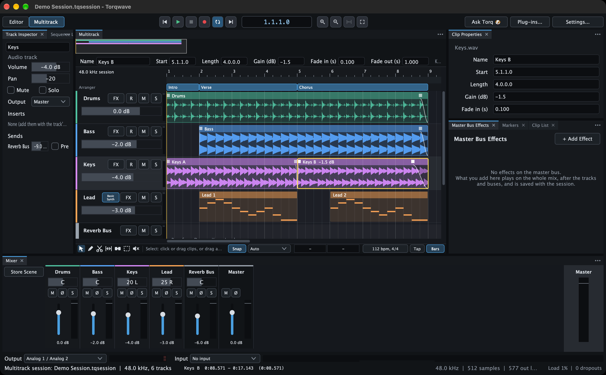

# Multitrack sessions

[Guide](README.md) › Multitrack sessions

A session lays audio files out as clips on tracks, mixes them through buses and effects, and writes the result to a file. It doesn't change the audio files it uses: clips point to them.

Switch between the editor and the session with the **Editor | Multitrack** switch at the top left, or **View > Multitrack Session** (Cmd-4). The **Multitrack** workspace (Window > Workspace > Multitrack) puts the mixer underneath and the clip panels beside the lanes.

## Start a session

- **File > New Session** (Shift-Cmd-N) starts an empty one, and **File > Open Session...** (Shift-Cmd-O) opens a saved `.tqsession`.
- **Bring audio in:**
  - **Multitrack > Import Audio...** (Cmd-I) puts each file on a new track at the cursor.
  - Drag files from Finder, from the Files panel, or from the Sound Library onto the lanes.
  - Dropping below the last track makes a new track.
- **Bring MIDI in:** **Multitrack > Import MIDI File...** adds a Standard MIDI File's tracks as note clips. See [Instruments and MIDI](07-instruments-and-midi.md).

**Right-click** works almost everywhere in the multitrack view:

- on a lane, below the tracks, on the ruler, or in the track list;
- on a track's name.

The menu offers what you can do at that spot: Add Track, Add Instrument Track, Add Bus, Paste Here, Select All Clips, and more.

## Tracks

The track list on the left holds a header for each track. Drag its right edge to make it wider.

| Control | What it does |
|---|---|
| Name | Double-click to rename it; right-click for the track's menu |
| **FX** | The track's effects, the same way as the [effects rack](04-effects-and-the-rack.md#the-effects-rack) |
| **R** | Arms the track for recording |
| **M**, **S** | Mute, and Solo (play only the soloed tracks) |
| Volume, pan | Drag them; they show a value and follow an envelope when one is drawn |
| **In** | The input the track records from |
| **Sends** | Sends to buses, the output and ducking (see below) |
| **A** | The track's envelopes: volume, pan, and the parameters of its effects |

The **Multitrack > Tracks** menu adds tracks, buses and folders, and also:

- duplicates, deletes and moves tracks, and hides them (they still play);
- saves a track as a template and adds tracks from templates;
- clears every solo and mute at once.

**Up** and **Down** select the track above or below.

## Clips

- **Move a clip:** drag it, onto another track if you like.
- **Trim it:** drag its left or right edge.
- **Fade it:** drag the small squares at its top corners.
- **Crossfade two clips:** with **Crossfade Overlaps** on (X), a clip dragged over part of another crossfades with it.
- **Line things up:** **Snapping** (S) lines dragged clips, edges, fades and points up with clip edges, the cursor and the ruler.

Select several clips with Shift-click, or drag across empty lane space with the Select tool. They then move, nudge, copy, mute or delete together.

### Closing the gap when you delete (ripple)

**Multitrack > Editing and Recording** has three Ripple choices that set what deleting or cutting clips does to the time they played over:

| Setting | What happens |
|---|---|
| No Ripple | The gap stays where the clip was |
| Ripple Track | The later clips on the same track move back to close it, with that track's envelopes; other tracks and markers stay |
| Ripple All Tracks | The time comes out of the whole session: every track's later clips, the envelopes and the markers move back together, so they stay in sync |

Ripple All Tracks takes out only time that is empty on every track: if another track still plays over it, nothing moves. Locked clips stay where they are. The same choice is in **Settings > Multitrack**.

### The tools

The toolbar under the lanes holds the tools. Each has a number key:

| Tool | Key | What a click or drag does |
|---|---|---|
| Select | 1 | Selects and moves clips; a drag across empty lane space selects the clips it crosses |
| Draw | 2 | On an instrument track, drags out a note clip |
| Split | 3 | Cuts a clip where you click; with Shift, every track's clips there |
| Stretch | 4 | Drags a clip's edge to make it longer or shorter, pitch kept (Option-drag does this with the Select tool) |
| Glue | 5 | Joins a note clip with the next one |
| Range | 6 | Selects a stretch of time across every track, leaving the clips as they are |
| Mute | 7 | Silences a clip, or lets it be heard again |

Beside the tools are the tempo (click it to set it) and the **Bars** switch, which counts the ruler in bars and beats.

### Clip commands

**Multitrack > Clips** has:

- Split Clip (Cmd-K: every selected clip the cursor crosses), Split All Tracks (Shift-Cmd-K: every clip under the cursor, on every track), Duplicate Clip (Cmd-D) and Repeat Clip to Range End;
- Reverse Clip, Stretch Clip... and Shift Clip Pitch...;
- Lock Clip, Mute Clip, and Group and Ungroup Clips.

**Clip Gain Lines** shows a gain line on each clip:

- Click the line to add a point.
- Drag a point to move it.
- Option-click a point to remove it.

**Clip Properties** (Shift-Cmd-I) shows the selected clip's name, start, length, gain and fades, for reading and typing.

**Multitrack > Arrange** has:

- **Nudge Earlier and Nudge Later** (comma and full stop) move the selected clips to the grid point before or after.
- **Move Clips to Cursor** moves them together, so the earliest one starts at the cursor.
- **Trim Start to Cursor and Trim End to Cursor** (Option-[ and Option-]) cut the selected clips at the cursor.
- **Close Gaps** moves a track's clips back until each starts where the one before ends.
- **Quantize Clips to Grid** moves each selected clip to start on the nearest grid line.

## Editing time across every track

Select a time range with the Range tool (6), or drag along the marker lane under the ruler. Then **Multitrack > Time Range** can:

| Command | What it does |
|---|---|
| Clear Range | Empties the range on every track and leaves the time |
| Delete Time | Takes the range out and moves everything after it back |
| Insert Time | Adds as much empty time as the range is long |
| Cut Time, Copy Time, Paste Time | Move a whole section (clips, envelopes and markers) somewhere else |
| Duplicate Time | Repeats the range straight after it (Option-Cmd-D) |

This is how you take out a verse, or repeat a chorus, in every track at once.

## Buses, sends and routing

A **bus** mixes what is sent to it, through its own effects. A reverb bus is the classic use: send several tracks to one reverb, instead of putting a reverb on each.

1. **Multitrack > Tracks > Add Bus** (Shift-Cmd-B), then put the effect on the bus with its **FX** button.
2. On each track, click **Sends**:
   - Turn on the send to that bus and set its level.
   - **Pre** sends before the track's volume, so the send doesn't follow the fader.
   - **New Bus** makes a bus from there.

The same **Sends** panel holds the rest of a track's routing:

- **Output:** a track or bus can play into the mix, into a bus in its place, or out of another pair of the interface's outputs. A pair of outputs plays past the rack and is left out of mixdowns.
- **Duck under:** the track comes down while another track is heard. Use it to keep music under a voice.

**Sidechain:** a plug-in with a sidechain input can take a key track, chosen in the track's **FX** menu. For example, a compressor on the bass can be keyed from the kick.
- **Folders:** **Add Folder** puts the selected track into a folder. A folder's mute and solo act on all its tracks, and it can be collapsed. **Export Folder Stems...** writes each folder as one file.

## The mixer

**Window > Mixer** (Shift-Cmd-M) shows a strip for each track and bus, with:

- pan;
- mute, polarity and solo;
- the fader and the meter.

The master meter is on the right.

## Automation

An envelope makes volume, pan or an effect parameter change over time.

- **Draw it:** click a track's **A** button and choose the envelope to show: volume, pan, or a parameter of one of the track's effects. Click the line to add a point, drag points to shape it, and Option-click a point to remove it.
- **Write it while playing:** turn on **Write Automation** (W) and play. Moving the track's volume or pan then writes into its envelope.

*The Keys track's volume envelope, from -4 dB down to -11 dB for the verse and up to -2 dB for the chorus. The A button is lit while an envelope shows.*

A parameter that has an envelope is marked "(automated)" in the menu.

## Tempo and bars

- **Set the tempo:**
  - **Multitrack > Tempo > Tempo...** sets the tempo and the beats in a bar.
  - **Tap Tempo** (T) sets it from your taps.
  - **Tempo Change at Cursor...** changes it from the bar the cursor is in.
- **Count in bars:** **Bars and Beats** (B) counts the ruler in bars and beats and snaps to the beats. **Time with Bars** shows the time underneath as well.
- **Choose how each track follows the tempo:** right-click a track and choose **Musical Timebase**.
  - On a musical track, clips keep their place in bars and beats when the tempo changes.
  - On a track in time, clips stay where they are.
- **Hear the beat:** the **Metronome** (C) clicks on each beat while the session plays.

## Getting the mix out

**Multitrack > Render and Export** has:

| Command | What it writes |
|---|---|
| Mix Down... (Shift-Cmd-E) | The session, or its time range, to one file. It can be delivered to a [loudness spec](05-loudness-and-mastering.md#meet-delivery-spec) |
| Export Stems... | One file for each track, through its own effects |
| Export Folder Stems... | One file for each folder |
| Export Regions... | One mixed file for each region |
| Bounce Track | Renders a track through its effects onto a new track, and mutes the original |
| Freeze Track | Renders a track's effects so they stop using the processor while you work |

A session can also be mixed in 5.1 or 7.1 (**Multitrack > Surround**). See [Video and surround](09-video-and-surround.md#surround-sessions).

## Saving

- In the multitrack view, **File > Save** becomes **Save Session** (Cmd-S), and Save As becomes **Save Session As...**. A session is saved as a `.tqsession` file. It points to the audio files, so keep them where they are.
- **File > Save a Copy with Audio...** writes a copy of the session with every audio file it uses in a folder beside it, to move it or hand it on.
- **A project** keeps the session together with the files open in the editor.
- **After a crash,** Torqwave offers to recover the session the next time it starts.

Next: [Instruments and MIDI](07-instruments-and-midi.md).
