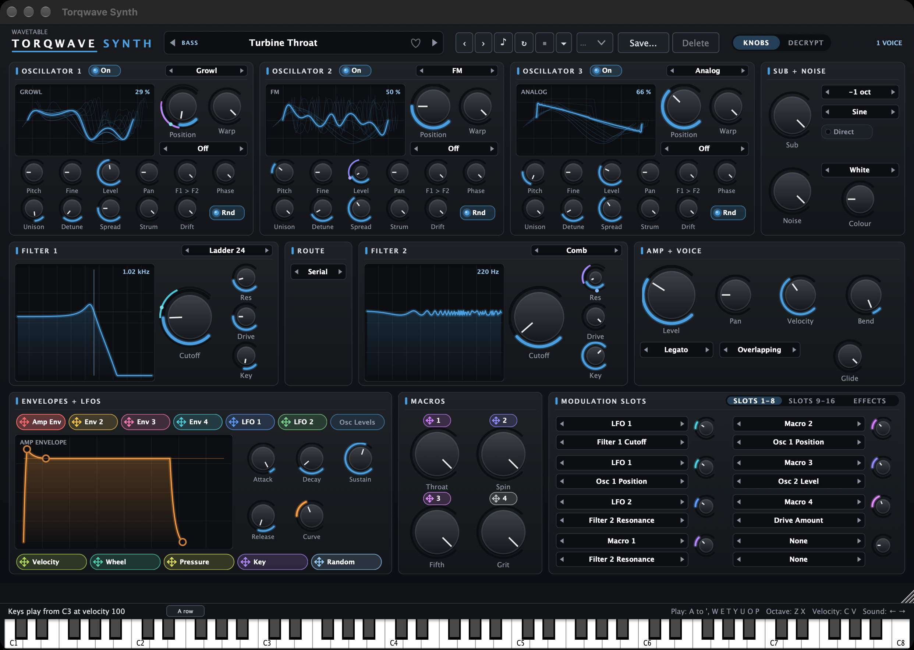

# Instruments and MIDI

[Guide](README.md) › Instruments and MIDI

An **instrument track** plays a synthesizer: Torqwave's built-in Basic Synth, or any VST3 instrument (Audio Unit too on the Mac, and LV2 on the Mac and Linux) that your [plug-in scan](04-effects-and-the-rack.md#plug-ins) found. It holds **note clips**, not audio. You put the notes in by drawing them, typing them, playing them on a MIDI keyboard, or importing a MIDI file.

## Make an instrument track

- **Multitrack > Tracks > Add Instrument Track...**, or right-click the lanes or the track list and choose **Add Instrument Track**. Pick the instrument from the menu; the track is named after it.
- **Turn an empty audio track into an instrument track:** right-click its header and choose **Instrument Track**. Choose it again to turn it back.

The header's instrument button, which shows the instrument's name (or **Inst** when there is none), chooses, swaps or opens the instrument. It takes the place of the record button. Effects added with **FX** run after the instrument, as on any track.

New instrument tracks follow the tempo ([musical timebase](06-multitrack-sessions.md#tempo-and-bars)), so their clips keep their place in bars and beats when the tempo changes.

## Put notes in

| Way | How |
|---|---|
| Draw a clip | The **Draw** tool (2): drag along the instrument track's lane. Below the last track, the same drag makes a new track |
| Type the notes | Right-click the track's header and choose **Add Notes...**. Type note names (C4, F#3, Bb2; C4 is middle C) or MIDI numbers (60), separated by commas. Choose whether they play together or one after another, how long each is held, and whether the pattern repeats |
| A single hit | **Add Trigger** in the same menu puts a one-note clip (C4, a tenth of a second) at the cursor. Use it for a sampler or drum instrument |
| Play them in | Turn on **Record Notes** (Option-R), play, and stop: what you played becomes a note clip |
| Keep what you just played | **Capture MIDI** (Option-Shift-R, in **Multitrack > Editing and Recording**) turns the last 60 seconds of MIDI you played into a note clip, even with Record Notes off (see below) |
| Import a MIDI file | **Multitrack > Import MIDI File...** adds each track of a Standard MIDI File that has notes as a note clip on a new track, at the cursor |

Right-clicking a lane offers **Add Notes Here...** and **Add Trigger Here** at that spot.

## Play it live

The selected instrument track plays whatever comes in live:

- **A MIDI keyboard.** Turn its input on in **Settings... > Audio**.
- **Window > Keyboard**, the on-screen keyboard. Click its keys, or use your computer's keys. Its line at the top says which track it plays, or why nothing will sound.
- **The instrument's own window.** Open it from the instrument button's menu (**Instrument Window**), and its keys sound even while the session is stopped.
- **The Piano Roll's keyboard** (see below).

*The window of Basic Synth, the built-in instrument.*

## Edit the notes: the Piano Roll

Double-click a note clip, or choose **Window > Piano Roll**, to edit the clip's notes on a grid of pitch against time. A keyboard runs down the left, with middle C marked.

| To | Do |
|---|---|
| Add a note | Click empty grid. It lands on the grid line at or before the mouse, one grid step long, at the velocity the slider shows |
| Move a note | Drag it: up and down for pitch, sideways for time (snapped to the grid) |
| Change its length | Drag its right edge |
| Select notes | Click one; Shift-click adds or takes away; drag across empty grid for a box; Cmd-A for all |
| Remove notes | Option-click one, or press Delete for the selected |
| Nudge the selected notes | Up and Down move a semitone (Shift: an octave). Left and Right move a grid step (Shift: a quarter step) |
| Set velocity | Select the notes and move the velocity slider |
| Set the loop | Drag the first repeat line |
| Hear a pitch | Click a key on the keyboard at the left; drag along it to play each key you pass |
| Zoom in or out on time | Cmd-scroll or pinch, around the mouse; or **-** and **+** at the top right. **Fit** shows the whole clip |
| Move along in time | The scroll bar under the notes, a sideways scroll, or Shift-scroll |
| Make the rows taller or shorter | Option-scroll |
| Move up and down the keys | Scroll |

A clip whose pattern repeats opens on its first repeat, so a one-bar loop in a nine-bar clip fills the width; **Fit** shows all nine bars.

Notes sound as you put them in, click them or drag them. The **grid** choice divides the beat into 1, 2, 4, 8, 16 or 32 steps, or turns the grid off.

**Swing**, beside it, moves the second line of each pair later, from Straight (50 %) to 75 %. It acts on a grid of 2 or 4 steps a beat (1/8 or 1/16 notes in 4/4), for the grid lines, snapping and the drum grid's steps.

**Ch** sets the MIDI channel the clip's notes and lanes go out on, 1 to 16, for an instrument that plays a different sound on each channel.

*The Lead clip's notes in the Piano Roll. Clip Properties, at the right, shows the clip's name, start and length.*

### The drum grid

**Drums**, at the left of the top bar, shows the clip as a step grid instead: a row for each drum sound, a column for each grid step (quarter beats with the grid off). The choice is the track's, so all its clips open that way.

| To | Do |
|---|---|
| Set a step | Click it. The note is one step long, at the slider's velocity |
| Clear a step | Click it again, or Option-click it |
| Set a step's velocity | Drag up (louder) or down (softer) from it. The bar inside the step shows the velocity |
| Hear a sound | Click its name |
| Edit the map | Right-click a name: **Edit Sound...** (its name and note), **Add Sound...**, **Remove from the Map**, **Move Up**, **Move Down**, or back to the **General MIDI Map** |

The rows come from the track's drum map, General MIDI's (notes 35 to 81) unless you change it. The map is saved with the session. Notes not in the map get rows of their own at the bottom, named by pitch; **Add to the Map...** names one.

### Controller lanes

The **Lane** choice shows a controller under the notes: the mod wheel, the pitch bend, or any CC.

- Click to put a point (snapped).
- Drag a point to move it.
- Option-click a point to remove it.

The lane's values are sent to the instrument along with the notes.

## Work with note clips

Note clips act like audio clips in the lanes. They:

- drag between tracks and in time;
- trim at their edges;
- copy, paste and duplicate (Cmd-D);
- split with the **Split** tool (3) or **Split Clip** (Cmd-K);
- stretch with the **Stretch** tool (4), which scales their notes;
- join with the next clip using the **Glue** tool (5), or **Merge with Next** in a clip's menu.

**Clip Properties** shows a note clip's name, start, length and loop.

For the selected note clips, **Multitrack > Notes** has:

- **Transpose Notes...**: by semitones.
- **Note Velocity...**: set the velocity, or scale it.
- **Quantize Notes...**: move the notes to the nearest line of a grid of the beat. **Swing** (50 to 75 %, on a 1/8 or 1/16 grid) moves the off-beat lines later. **Strength** moves each note only part of the way (100 % is all the way). **Starts and ends** puts the ends of the notes on lines too, keeping each at least a step long.

### Capture MIDI

Torqwave keeps the last 60 seconds of MIDI coming in from your keyboard, whether the session plays or not. **Capture MIDI** (Option-Shift-R) turns it into a note clip named "Captured":

- **Played while the session played:** the notes land where you played them.
- **Played while stopped:** the notes start at the cursor, at the times you played them.

The clip goes on the track you played into, or on a new instrument track. What was captured is then forgotten, so a second Capture MIDI has only what you played since.

Shift-click selects several clips, note and audio together, to move, nudge, quantize, mute, copy, duplicate or delete at once.

## Automate the instrument

An instrument's parameters can be automated like any effect's:

- **Draw it:** click the track's **A** button, open **Show <instrument> Envelope** (the instrument's name, above the numbered effects) and choose a parameter. Click its line to add points.
- **Write it while playing:** turn on **Write Automation** (W), open the instrument's window (**Inst** > **Instrument Window**) and move its controls while the session plays.

The envelope is saved with the session and plays when the session is mixed down, bounced or frozen. Parameters with an envelope are marked "(automated)" in the menu. The envelope belongs to that instrument: choosing a different instrument for the track leaves the envelope unused. See [Automation](06-multitrack-sessions.md#automation).

## Hardware synths: MIDI out

A track can play a hardware synth (or another app) instead of a plug-in. In its instrument button's menu, **MIDI Out** lists the MIDI output ports. Choose one, and the track's note clips, controller lanes and what you play live into it go out of that port. The button then shows the port's name.

- **Channel:** **Each Clip's Own** sends each clip on the channel set in the Piano Roll. **Channel 1** to **16** sends everything on one.
- **Offset...:** sends the notes earlier (a negative number of milliseconds) or later than the audio, up to 500 ms either way. Use it to line the synth up with the session when its sound comes back through your interface.

The messages leave when the audio they go with is heard, allowing for the rack and the interface's output latency. Stopping, or a loop going round, ends every note left on. To record the synth's sound, give an audio track the interface input it comes back on.

MIDI out needs the session and the interface at the same sample rate: while Torqwave converts between them, nothing goes out. A port that isn't connected when the session opens is reported. Choose it again once it is.

## MIDI from another track's plug-in

An arpeggiator, chord or other MIDI plug-in can play another track's instrument. Put the MIDI plug-in on one instrument track, as its instrument. Then, on the track whose instrument should play, choose that track under **MIDI From** in the instrument button's menu. The track plays both its own notes and what the MIDI plug-in puts out.

Keep the track with the MIDI plug-in above the one it plays. Placed below, its notes arrive one block late.

## MIDI clock out

**Multitrack > MIDI Clock Out** sends MIDI clock (24 a beat, following the tempo map) and transport to a port, for drum machines, sequencers and arpeggiators to follow:

- Song Position and Start (from the top) or Continue when the session plays.
- Stop, Song Position and Continue when the loop goes round or you jump.
- Stop when it stops.

The choice is kept with Torqwave's settings, not the session.

## The Sequence Library

The Sequence Library keeps MIDI parts with the instrument that plays them, to drop into any session. A part is a **sequence**: its notes and controller lanes, kept in beats rather than seconds, and its **voice**, meaning the track's instrument with its settings, its effects, volume, pan and colour. Because the notes are in beats, a sequence lands on the same beats at whatever tempo the session is in, through tempo changes too. Nothing is stretched.

Show it with **Window > Sequence Library**. In the Multitrack workspace it is a tab beside the Track Inspector.

**Start a new one.** Click **New...** at the top of the Sequence Library. Or right-click a folder and choose **New Sequence Here...**. Give it a name, a folder (the one selected in the library is chosen for you), an instrument, a length (1, 2, 4, 8 or 16 bars) and optionally a key, then click **Make**. Torqwave adds an instrument track with that instrument and an empty clip of that length, starting at the bar the cursor is in, and opens the clip in the Piano Roll. Write the notes there, or with any of the [ways to put notes in](#put-notes-in) above, then save it with **Add to Sequence Library...**: the dialog already holds its name, folder and key. Save the same clip again with the same name and folder and it replaces the file it saved before, so you can keep working on a part and saving it. Torqwave remembers which file a clip saves to until you quit; after that, saving makes a new file.

**Save a part.** Right-click a note clip and choose **Add to Sequence Library...** (or select it and use **Multitrack > Clips > Add to Sequence Library...**). Give it a name, a folder, and optionally a key and tags. Its loop and controller lanes go with it. The track's sends, output and automation stay in the session.

**Find one.** The library is sorted into folders by role:

| Role | Sub-folders |
|---|---|
| Drums | Full Grooves, Kick, Snare & Clap, Hats & Tops, Percussion, Fills, Breaks |
| Bass | Sub, Synth Bass, Arp Bass, Picked & Played |
| Harmony | Progressions, Keys & Comping, Stabs, Strums |
| Pads | Sustained, Evolving, Swells, Drones |
| Arps | Up & Down, 16th Sequences, Plucks, Gated |
| Melody | Leads, Hooks, Counter-lines, Bells & Mallets |
| SFX | Risers, Downlifters, Impacts, Sweeps, Transitions, Hits |
| Kits | Parts meant to play together |
| Inbox | New sketches, not yet sorted |

Every folder shows, empty ones too. Make folders of your own under any role or sub-role: right-click a folder and choose **New Folder...**. The same menu has **New Sequence Here...**, **Show in Finder**, and, for your own folders, **Rename...** and **Move to Trash**. The roles and sub-roles themselves can't be renamed or removed. Your folders appear in the Folder list of the New Sequence and Add to Sequence Library dialogs. **Drag a sequence onto a folder** to move it there (hold Option to copy it instead); it takes that folder's role. Drag `.tqseq` files from the Finder onto a folder to copy them in. A name already used there gets a number (Groove 2).

Each sequence shows its length in bars and its key. Type in the search box to see only the sequences that match every word, in their names, keys, tags or folders.

The library is a folder of plain files (`.tqseq`), under Music > Torqwave > Sequences. **Folder** shows it in the Finder. Make folders of your own inside the sub-folders, and move, copy or share the files there. The panel follows what you change. Right-click a sequence to show it in the Finder, rename it or move it to the Trash.

**Hear one.** Click a sequence to hear it with its own instrument and effects at the session's tempo, looping. The first time takes a moment while it renders ("Rendering..." shows under the list); after that it plays at once. While the session plays, the sequence comes in on the session's next bar, in time with it. Press Up or Down to move through the list and hear each in turn. Click it again, or **Stop**, to stop. A sequence with no instrument of its own can't be heard here: dropped on an instrument track, it plays on that track's instrument.

**Use one.** Drag a sequence into the multitrack view:

- **onto empty space** below the tracks: a new instrument track with the sequence's instrument and effects, and the clip where you dropped it, on the grid;
- **onto an instrument track:** only the notes, played by that track's instrument. Hold **Option** to put it on a new track with its own instrument instead;
- **onto an audio track:** a new instrument track, as onto empty space.

Double-click a sequence to put it on the selected track at the cursor, the same way. A `.tqseq` file dragged from the Finder works too. Each drop is one undo step.

## The Sequencer

The Sequencer is a window for one sequence from the library, open by itself to write, hear and save. Show it with **Window > Sequencer**, or right-click a sequence in the Sequence Library and choose **Edit in Sequencer**. The **Sequencer** workspace (Window > Workspaces) puts it in front of the editor with the Sequence Library on its left.

**Edit the notes.** The middle of the window is the Piano Roll, with the drum grid and controller lanes, as in [Edit the notes](#edit-the-notes-the-piano-roll), but it edits the sequence file itself, not a clip in the session. A sequence filed under Drums opens as a drum grid. **Undo** and **Redo** (Cmd-Z and Shift-Cmd-Z while the window has the focus) step through the window's own edits, apart from the session's.

**Hear it.** **Play** (or Space while the window has the focus) plays the sequence from its start through its voice, beside whatever the session plays. With **Loop** on it goes round and round; off, it plays once. **Click** adds a click on every beat. The tempo is the window's own, starting at the tempo the sequence was written at; change it with the tempo box, or tick **Session tempo** to play at the session's tempo where its playhead is. The notes stay on their beats at any tempo, so nothing in the file changes. The clock beside it shows where it is playing, in bars and beats.

**Change the voice.** Down the right are the instrument and the effects it plays through. **Instrument...** picks another instrument, and **Edit** opens its window. **+ Effect** adds an effect after the others and opens its window; click an effect's name to open its window, or **×** to take it out. Changes to the voice are not undo steps, as with a track's effects in a session, but they are saved with the sequence. If some of the voice didn't load (a plug-in that isn't on this Mac), the window says so, and saving keeps the voice as the file had it until you change it.

**Files.**

- **New...** asks for a name, a folder, an instrument and a length, and opens an empty sequence of that many bars. Nothing is written until you save it.
- **Open...** opens a sequence file from the library.
- **Save** writes it to its file, with its voice as it is now.
- **Save As...** writes it under another name or in another folder, and goes on with that file. Its role follows the folder.
- **Duplicate** saves a copy of what is in the window beside the file, with a number on its name, and opens the copy.
- **Make Variation** does the same, naming the copy "Name Variation", and the copy says which sequence it is a variation of (the title shows "a variation of Groove").

Opening another sequence, or New, asks first whether to save changes. Duplicate and Make Variation copy what is in the window, edits included; the original file keeps what was last saved.

## Freeze, bounce and export

An instrument track freezes, bounces, mixes down and exports in stems like any other track. Bounce it when you want its sound as audio to edit further.

## A sound into a file

To make a sound with an instrument and put it straight into a file in the editor, use **Effects > Generate > Generate from Instrument...**:

1. Choose the instrument. Its window opens beside the dialog, to shape the sound.
2. Set the notes: played together or one after another.
3. Preview, then generate. The sound goes in at the cursor.

Next: [Recording](08-recording.md).
