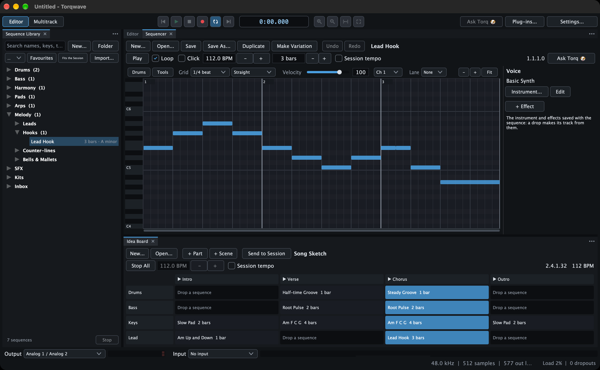

# Instruments and MIDI

[Guide](README.md) › Instruments and MIDI

An **instrument track** plays a synthesizer: Torqwave's built-in Basic Synth or Basic Drums, or any VST3 instrument (Audio Unit too on the Mac, and LV2 on the Mac and Linux) that your [plug-in scan](04-effects-and-the-rack.md#plug-ins) found. It holds **note clips**, not audio. You put the notes in by drawing them, typing them, playing them on a MIDI keyboard, or importing a MIDI file.

## Make an instrument track

- **Multitrack > Tracks > Add Instrument Track...**, or right-click the lanes or the track list and choose **Add Instrument Track**. Pick the instrument from the menu; the track is named after it. The built-in Basic Synth and Basic Drums come first; your plug-ins follow under **Audio Units** and **VST3**, each by its maker (a few of one format are listed plainly, with their format and maker in their names).
- **Turn an empty audio track into an instrument track:** right-click its header and choose **Instrument Track**. Choose it again to turn it back.

The header's instrument button, which shows the instrument's name (or **Inst** when there is none), chooses, swaps or opens the instrument. It takes the place of the record button. Effects added with **FX** run after the instrument, as on any track.

New instrument tracks follow the tempo ([musical timebase](06-multitrack-sessions.md#tempo-and-bars)), so their clips keep their place in bars and beats when the tempo changes.

## Put notes in

| Way | How |
|---|---|
| Draw a clip | The **Draw** tool (2): drag along the instrument track's lane. Below the last track, the same drag makes a new track |
| Type the notes | Right-click the track's header and choose **Add Notes...**. Type note names (C4, F#3, Bb2; C4 is middle C) or MIDI numbers (60), separated by commas. Choose whether they play together or one after another, how long each is held, and whether the pattern repeats |
| A single hit | **Add Trigger** in the same menu puts a one-note clip (C4, a tenth of a second) at the cursor. Use it for a sampler or drum instrument |
| Play them in | Turn on **Record Notes** (Option-R), play, and stop: what you played becomes a note clip |
| Keep what you just played | **Capture MIDI** (Option-Shift-R, in **Multitrack > Editing and Recording**) turns the last 60 seconds of MIDI you played into a note clip, even with Record Notes off (see below) |
| Import a MIDI file | **Multitrack > Import MIDI File...** adds each track of a Standard MIDI File that has notes as a note clip on a new track, at the cursor |

Right-clicking a lane offers **Add Notes Here...** and **Add Trigger Here** at that spot.

## Play it live

The selected instrument track plays whatever comes in live:

- **A MIDI keyboard.** Turn its input on in **Settings... > Audio**.
- **Window > Keyboard**, the on-screen keyboard. Click its keys, or use your computer's keys. Its line at the top says which track it plays, or why nothing will sound.
- **The instrument's own window.** Open it from the instrument button's menu (**Instrument Window**), and its keys sound even while the session is stopped.
- **The Piano Roll's keyboard** (see below).

*The window of Basic Synth, the built-in instrument.*

Besides its first oscillator, its filter and its envelope, Basic Synth has a few extras for basses, stabs and acid lines, each off until you turn it up:

| Setting | What it does |
|---|---|
| **Osc 2** and **Osc 3**: Wave, Octave, Detune, Level | Two more oscillators beside the first, each at its own wave, octave (two down to two up), detune (50 cents either way) and level (0 %, off, to 100 %, as loud as the first). Detuned a few cents they thicken a sawtooth; an octave down gives a sub. |
| **Filter Env** and **Filter Decay** | Opens the filter at the start of each note, by up to six octaves above the Cutoff at 100 %, and closes it again over the decay. With a low Cutoff and a short decay this is a plucked bass or a stab. |
| **Velocity to Filter** | Softer notes are darker, by up to four octaves at the softest; a note at full velocity plays the Cutoff as set. Accented notes cut through. |
| **Glide** | A note played while another is still held slides to its pitch in this time, without starting its envelopes again: the acid slide. Write a slide by overlapping the next note. With Glide on, overlapping notes play one at a time. |

Basic Synth plays the velocity of each note and answers the controllers a lane draws: **Pitch bend** (two semitones either way), **Mod wheel** (vibrato, up to half a semitone), **Volume** (CC 7) and **Expression** (CC 11), **Pan** (CC 10), **Sustain** (CC 64, holding notes while it is down), **Resonance** (CC 71, up toward the most) and **Cutoff** (CC 74, down as far as eight octaves below the Cutoff knob). Other instruments answer what their makers chose.

**Basic Drums** is the built-in drum machine: synthesised drums on the General MIDI drum map (notes 35 to 81), the notes the drum grid writes and most drum plug-ins play. Every one of the 47 notes has a sound, each note rings on its own voice (a tom fill rings over itself), and it plays in stereo.

- **Pads.** A pad for each of the 30 sounds, coloured by family (kick, snares and claps, hats, toms, cymbals, hand percussion). A pad lights as its sound plays. Click one to hear it and see its settings: nearer the top of the pad plays louder.
- **The selected sound.** A picture of one hit (its waveform, its level falling to 60 dB down, a dashed line where its decay setting ends, and a line sweeping across as it plays), and six knobs: **Tune** (semitones, two octaves either way), **Decay** (milliseconds until it has fallen 60 dB), **Tone** (darker or brighter: the kick's click, the snare's wires, the hats' filter, a drum's strike), **Level** (dB), **Pan** and **Drive** (saturation on that sound alone). The kick also has a character: **Boom** (long and round), **Punch** (909-style) or **Hard** (an overdriven industrial kick). Drag a knob, Shift-drag for fine steps, double-click it for its default.
- **The kit.** **Drive** puts the whole kit through a soft clipper, **Glue** is a bus compressor that holds it together (GR shows how far it turns the kit down), and **Level** sets its output.
- **Kits.** **Standard**, **Dark Techno**, **Industrial**, **EBM Machine**, **Electro**, **Breaks** and **Industrial Rock** set every sound at once. Move a knob and the kit shows as *edited*; save your own with **Save...**.

| Notes | Sound |
|---|---|
| 35, 36 | Kick (35 a little lower and longer) |
| 37 | Rim |
| 38, 40 | Snare (40 brighter and higher) |
| 39 | Clap |
| 42, 44, 46 | Closed, pedal and open hat |
| 41, 43 / 45, 47 / 48, 50 | Low, mid and high toms |
| 49, 57 / 51, 59 / 52 / 53 / 55 | Crash, ride, China, ride bell, splash |
| 54 / 56 / 58 / 69, 70 | Tambourine, cowbell, vibraslap, shakers |
| 60, 61 / 62 / 63, 64 / 65, 66 | Bongos, mute conga, congas, timbales |
| 67, 68 / 71, 72 / 73, 74 / 75 / 76, 77 / 78, 79 / 80, 81 | Agogo, whistle, guiro, claves, wood block, cuica, triangle |

Each sound plays to its end however long the note is, and velocity sets its level. The hats cut each other off, as do the mute and open triangle and the mute and open cuica; a sound struck again, or cut off, fades out over 3 ms rather than clicking, and stopping or looping fades everything the same way. Sessions from before 0.19.3 load with their tunings and decays carried over, though the sounds themselves are new.

## Edit the notes: the Piano Roll

Double-click a note clip, or choose **Window > Piano Roll**, to edit the clip's notes on a grid of pitch against time. A keyboard runs down the left, with middle C marked. Each bar has a bold line and its number along the top; beats have stronger lines than the grid's steps. While it plays, a line shows where the notes are playing, on each pass of a loop.

| To | Do |
|---|---|
| Add a note | Click empty grid. It lands on the grid line at or before the mouse, one grid step long, at the velocity the slider shows. Cmd-drag on empty grid draws a note and its length in one go |
| Move a note | Drag it: up and down for pitch, sideways for time (snapped to the grid) |
| Change its length | Drag its right end: the pointer becomes a left-right arrow there (a selected note shows a grip at its end). Or select notes and press Option-Right or Option-Left: a grid step longer or shorter (Shift: a quarter step) |
| Select notes | Click one; Shift-click adds or takes away; drag across empty grid for a box; Cmd-A for all |
| Notes on one another | Two notes of one pitch starting together are one note (the longest and loudest): moving, snapping or pasting notes onto one another merges them |
| Remove notes | Option-click one, or press Delete for the selected |
| Nudge the selected notes | Up and Down move a semitone (Shift: an octave). Left and Right move a grid step (Shift: a quarter step) |
| Set velocity | Select the notes and move the velocity slider, or right-click one and choose from **Velocity** |
| Let a note play only sometimes | Right-click it and choose from **Probability** (see below) |
| Set the loop | Drag the first repeat line |
| Hear a pitch | Click a key on the keyboard at the left; drag along it to play each key you pass |
| Zoom in or out on time | Cmd-scroll or pinch, around the mouse; or **-** and **+** at the top right. **Fit** shows the whole clip |
| Move along in time | The scroll bar under the notes, a sideways scroll, or Shift-scroll |
| Make the rows taller or shorter | Option-scroll |
| Move up and down the keys | Scroll (a trackpad's two-finger scroll too) |

A clip whose pattern repeats opens on its first repeat, so a one-bar loop in a nine-bar clip fills the width; **Fit** shows all nine bars.

Notes sound as you put them in, click them or drag them. The **grid** choice divides the beat into 1, 2, 4, 8, 16 or 32 steps, or turns the grid off.

**Swing**, beside it, moves the second line of each pair later, from Straight (50 %) to 75 %. It acts on a grid of 2 or 4 steps a beat (1/8 or 1/16 notes in 4/4), for the grid lines, snapping and the drum grid's steps.

**Probability** is the chance a note plays each time the pattern comes round: at 50 % it plays about every other pass, at 100 % (the usual) every time. Right-click a note, or a step in the drum grid, and choose from the **Probability** menu; it sets every selected note's. A note that may not play shows its chance on it, and in the drum grid its step is fainter. Which passes a note plays on is fixed for the clip, so playback, Mix Down and a bounce play the same ones. Probability is saved in the session and in sequences.

**Ch** sets the MIDI channel the clip's notes and lanes go out on, 1 to 16, for an instrument that plays a different sound on each channel.

*The Lead clip's notes in the Piano Roll. Clip Properties, at the right, shows the clip's name, start and length.*

### The drum grid

**Drums**, at the left of the top bar, shows the clip as a step grid instead: a row for each drum sound, a column for each grid step (quarter beats with the grid off). The choice is the track's, so all its clips open that way.

| To | Do |
|---|---|
| Set a step | Click it. The note is one step long, at the slider's velocity |
| Clear a step | Click it again, or Option-click it |
| Set a step's velocity | Drag up (louder) or down (softer) from it. The bar inside the step shows the velocity |
| Set a step's probability or velocity from a menu | Right-click it: **Probability** (100 % down to 10 %) and **Velocity**, for it or the selected steps |
| Hear a sound | Click its name |
| Edit the map | Right-click a name: **Edit Sound...** (its name and note), **Add Sound...**, **Remove from the Map**, **Move Up**, **Move Down**, or back to the **General MIDI Map** |

The rows come from the track's drum map, General MIDI's (notes 35 to 81) unless you change it. The map is saved with the session. Notes not in the map get rows of their own at the bottom, named by pitch; **Add to the Map...** names one.

With the drum grid's steps, its velocities, probability and swing, a drum clip is a step sequencer: set the grid to 1/4 beat for sixteenths, add swing, and give the ghost notes lower velocities and some steps less than 100 %.

### Writing tools

**Tools**, beside Drums, has tools that write and change notes. Each works on the selected notes, or on all of them with none selected, and each is one undo step.

- **Chords...** writes a chord progression in Roman numerals from the clip's start: upper case for major (IV), lower case for minor (ii), with 7, maj7, dim or °, ø (or m7b5), aug or +, sus2 and sus4, and b or # before a numeral for a borrowed chord (bVII). Separate them with spaces or dashes: `i–VI–III–VII`, `ii7 V7 Imaj7`. Choose how long each chord lasts (a beat, two beats, a bar or two bars), the octave of the roots, and whether they replace the notes or are added to them. The chords are built on the key's scale degrees, in root position.
- **Arpeggiate...** plays each chord (notes that start together) as an arpeggio over its length, in place of it: **Up**, **Down**, **Up and Down** or **Random**, over one to four octaves, at a rate from 1/2 to 1/8 beat, with notes from short (50 %) to legato. Draw or play the chords first, then arpeggiate them.
- **Humanize...** moves each note by a random amount up to 5, 10, 20 or 40 ms either way, and changes its velocity up to 5 to 30 %.
- **Fit to the Key** moves each note to the nearest note of the key.
- **Scale Lock** keeps notes in the key while you write: a click puts the note on the nearest note of the key, a drag moves notes only onto the key's notes, and Up and Down move a step of the scale instead of a semitone. Rows outside the key are shaded.
- **Key...** sets the key the tools use: a root and a scale (major, minor, harmonic and melodic minor, the modes, the pentatonics and blues). Until you set one, the tools use the part's key (a sequence's, or the key given when the clip was made with New Sequence), or guess one from the notes; the menu's first line says which, and "(guessed)" when it is a guess.

### Controller lanes

The **Lane** choice shows a controller under the notes: the mod wheel, the pitch bend, or any CC.

- Click to put a point (snapped).
- Drag a point to move it.
- Option-click a point to remove it.

The lane's values are sent to the instrument along with the notes, from the clip's first frame. What a controller does is up to the instrument (see [what Basic Synth answers](#play-it-live)).

## Work with note clips

Note clips act like audio clips in the lanes. They:

- drag between tracks and in time;
- trim at their edges;
- copy, paste and duplicate (Cmd-D);
- split with the **Split** tool (3) or **Split Clip** (Cmd-K);
- stretch with the **Stretch** tool (4), which scales their notes;
- join with the next clip using the **Glue** tool (5), or **Merge with Next** in a clip's menu.

**Clip Properties** shows a note clip's name, start, length and loop.

For the selected note clips, **Multitrack > Notes** has:

- **Transpose Notes...**: by semitones.
- **Note Velocity...**: set the velocity, or scale it.
- **Quantize Notes...**: move the notes to the nearest line of a grid of the beat. **Swing** (50 to 75 %, on a 1/8 or 1/16 grid) moves the off-beat lines later. **Strength** moves each note only part of the way (100 % is all the way). **Starts and ends** puts the ends of the notes on lines too, keeping each at least a step long.

### Capture MIDI

Torqwave keeps the last 60 seconds of MIDI coming in from your keyboard, whether the session plays or not. **Capture MIDI** (Option-Shift-R) turns it into a note clip named "Captured":

- **Played while the session played:** the notes land where you played them.
- **Played while stopped:** the notes start at the cursor, at the times you played them.

The clip goes on the track you played into, or on a new instrument track. What was captured is then forgotten, so a second Capture MIDI has only what you played since.

Shift-click selects several clips, note and audio together, to move, nudge, quantize, mute, copy, duplicate or delete at once.

## Automate the instrument

An instrument's parameters can be automated like any effect's:

- **Draw it:** click the track's **A** button, open **Show <instrument> Envelope** (the instrument's name, above the numbered effects) and choose a parameter. Click its line to add points.
- **Write it while playing:** turn on **Write Automation** (W), open the instrument's window (**Inst** > **Instrument Window**) and move its controls while the session plays.

The envelope is saved with the session and plays when the session is mixed down, bounced or frozen. Parameters with an envelope are marked "(automated)" in the menu. The envelope belongs to that instrument: choosing a different instrument for the track leaves the envelope unused. See [Automation](06-multitrack-sessions.md#automation).

## Hardware synths: MIDI out

A track can play a hardware synth (or another app) instead of a plug-in. In its instrument button's menu, **MIDI Out** lists the MIDI output ports. Choose one, and the track's note clips, controller lanes and what you play live into it go out of that port. The button then shows the port's name.

- **Channel:** **Each Clip's Own** sends each clip on the channel set in the Piano Roll. **Channel 1** to **16** sends everything on one.
- **Offset...:** sends the notes earlier (a negative number of milliseconds) or later than the audio, up to 500 ms either way. Use it to line the synth up with the session when its sound comes back through your interface.

The messages leave when the audio they go with is heard, allowing for the rack and the interface's output latency. Stopping, or a loop going round, ends every note left on. To record the synth's sound, give an audio track the interface input it comes back on.

MIDI out needs the session and the interface at the same sample rate: while Torqwave converts between them, nothing goes out. A port that isn't connected when the session opens is reported. Choose it again once it is.

## MIDI from another track's plug-in

An arpeggiator, chord or other MIDI plug-in can play another track's instrument. Put the MIDI plug-in on one instrument track, as its instrument. Then, on the track whose instrument should play, choose that track under **MIDI From** in the instrument button's menu. The track plays both its own notes and what the MIDI plug-in puts out.

Keep the track with the MIDI plug-in above the one it plays. Placed below, its notes arrive one block late.

## MIDI clock out

**Multitrack > MIDI Clock Out** sends MIDI clock (24 a beat, following the tempo map) and transport to a port, for drum machines, sequencers and arpeggiators to follow:

- Song Position and Start (from the top) or Continue when the session plays.
- Stop, Song Position and Continue when the loop goes round or you jump.
- Stop when it stops.

The choice is kept with Torqwave's settings, not the session.

## The Sequence Library

The Sequence Library keeps MIDI parts with the instrument that plays them, to drop into any session. A part is a **sequence**: its notes and controller lanes, kept in beats rather than seconds, and its **voice**, meaning the track's instrument with its settings, its effects, volume, pan and colour. Because the notes are in beats, a sequence lands on the same beats at whatever tempo the session is in, through tempo changes too. Nothing is stretched.

Show it with **Window > Sequence Library**. In the Multitrack workspace it is a tab beside the Track Inspector.

### Presets

Torqwave comes with 160 factory presets and 8 starter kits, under **Presets** at the top of the library, sorted by the same roles and sub-roles as your own: at least 20 for each role. They lean towards driving and peak-time techno, dark and industrial techno and EBM, with smaller sets for hypnotic, minimal, melodic, acid and hard techno, electro-industrial, futurepop, aggrotech, synth-EBM, darkwave and industrial rock. [Styles](14-styles.md) says what defines each one. Every preset is:

- in **A minor** (a few use Phrygian's B♭ or harmonic minor's G♯, and say so in their tags), so any of them plays with any other;
- on the **16th grid**, 1, 2, 4 or 8 bars long, a 4-bar one changing in its last bar;
- for drums, on the **General MIDI drum map** (kick 36, snare 38, clap 39, closed hat 42, open hat 46, ride 51 and so on), so it plays any drum plug-in or kit that follows it;
- for bass, **one note at a time**, except an acid slide, which overlaps the next note by a hair so the synth glides;
- written with a **one-line description** of what it does, shown under its name, and a **style**, an **energy** and its **character**, so the [filters](#sort-group-and-filter) find it.

Each one plays on a built-in voice so you can hear it at once: Basic Drums for drums, and Basic Synth set up for the part (a sub, a rolling bass, an acid line, a stab, a pad and so on). They are there to drive your own instruments:

| Drop it on | It plays on |
|---|---|
| A track with an instrument | that track's instrument, as with any sequence |
| Empty space or an audio track | a new instrument track with the preset's built-in voice |

Presets play, drag and drop like your own sequences, and you can rate them and mark them as favourites (those marks are kept beside the presets, not in your library). You can't change, rename or move them, so a later version of Torqwave can bring new ones without touching anything of yours:

- **Copy to My Library** (right-click a preset, or a Presets folder for all of it) copies it into your own folder of the same role and sub-role. Dragging it onto one of your folders copies it too.
- **Edit in Sequencer** opens it as a new sequence of yours, not yet saved; **Save** puts it in your folder of the same role and sub-role, under the same name.

The **kits** in Presets > Kits are one per main style (dark, peak-time, percussive, hypnotic, industrial and acid techno, EBM and darkwave). Each holds a drum groove, a bass, a stab or chords, a lead or arp, a fill and a build at one tempo, so dropping one in gives you a track's worth of parts to replace with your own instruments.

**Start a new one.** Click **New...** at the top of the Sequence Library. Or right-click a folder and choose **New Sequence Here...**. Give it a name, a folder (the one selected in the library is chosen for you), an instrument, a length (1, 2, 4, 8 or 16 bars) and optionally a key, then click **Make**. Torqwave adds an instrument track with that instrument and an empty clip of that length, starting at the bar the cursor is in, and opens the clip in the Piano Roll. Write the notes there, or with any of the [ways to put notes in](#put-notes-in) above, then save it with **Add to Sequence Library...**: the dialog already holds its name, folder and key, and whatever else you gave it. Save the same clip again with the same name and folder and it replaces the file it saved before, so you can keep working on a part and saving it. Torqwave remembers which file a clip saves to until you quit; after that, saving makes a new file.

**Save a part.** Right-click a note clip and choose **Add to Sequence Library...** (or select it and use **Multitrack > Clips > Add to Sequence Library...**). Give it a name and a folder, and if you like its [properties](#properties): a style, key, energy, character, a description and tags. Its loop and controller lanes go with it. The track's sends, output and automation stay in the session.

**Find one.** The library is sorted into folders by role:

| Role | Sub-folders |
|---|---|
| Drums | Full Grooves, Kick, Snare & Clap, Hats & Tops, Percussion, Fills, Breaks |
| Bass | Sub, Synth Bass, Arp Bass, Picked & Played |
| Harmony | Progressions, Keys & Comping, Stabs, Strums |
| Pads | Sustained, Evolving, Swells, Drones |
| Arps | Up & Down, 16th Sequences, Plucks, Gated |
| Melody | Leads, Hooks, Counter-lines, Bells & Mallets |
| SFX | Risers, Downlifters, Impacts, Sweeps, Transitions, Hits |
| Kits | Parts meant to play together |
| Inbox | New sketches, not yet sorted |

Every folder shows, empty ones too. Make folders of your own under any role or sub-role: right-click a folder and choose **New Folder...**. The same menu has **New Sequence Here...**, **Show in Finder**, and, for your own folders, **Rename...** and **Move to Trash**. The roles and sub-roles themselves can't be renamed or removed. Your folders appear in the Folder list of the New Sequence and Add to Sequence Library dialogs. **Drag a sequence onto a folder** to move it there (hold Option to copy it instead); it takes that folder's role. Drag `.tqseq` files from the Finder onto a folder to copy them in. A name already used there gets a number (Groove 2).

Each sequence shows its length in bars, its key and its energy, and its rating (★) and a ♥ when it is a favourite; its description, when it has one, is a line under its name, and its style and character show when you hold the pointer over it. Type in the search box to see only the sequences that match every word, in their names, keys, tags, folders, styles or descriptions.

#### Sort, group and filter

The two rows under the search box set what the list shows:

- **The order menu** sorts the sequences in each folder by **Name** (A to Z), **Bars** (the shortest first), **Rating** (the highest first), **Newest** (the last added first), **Tempo** (the slowest first, as written), **Key** (from C, then by scale; those with no key last) or **Energy** (the lowest first; those with none last). A sequence counts as added when it was first saved: saving a new one, importing a MIDI file, or a duplicate or variation made in the Sequencer adds one now; renaming, moving or copying it between folders, rating it or saving it again keeps its time, and so do the sequences in a pack.
- **The group menu** sets the folders. **By Role** is the library's own folders. **By Style** makes a folder for each style (Techno › Dark, Industrial › EBM, No Style) with the roles inside it, so Techno › Dark holds that style's Drums, Bass and so on, presets and your own together. **By Key** and **By Energy** do the same for keys and energies. While grouped by anything but role, the folders are for finding: dragging onto them, and their right-click menus, work only by role.
- **Filters** narrows the list. Its menu has:
  - **Style**: one style, or **All Techno** for a whole genre;
  - **Energy**: 1 (an intro tool) to 5 (peak);
  - **Bars**: 1, 2, 4 or 8;
  - **Key**: the keys in the library;
  - **Character**: Dark or Bright, Sparse or Dense, Straight or Swung, Clean or Distorted, any of them together;
  - **Show**: Presets and Mine, Presets Only, or Mine Only.

  A dot on a menu and on the button says it is narrowing, and what it narrows to shows under the list. **Clear Filters** takes them all off.
- **Favourites** shows only the favourites.
- **Fits the Session** shows only the sequences in the session's key (set in **Multitrack > Tempo > Tempo...**; see [Tempo and bars](06-multitrack-sessions.md#tempo-and-bars)) and those with no key, such as most drums and effects. Keys count as the same however they are written: `Am` is A minor. A different scale on the same note is a different key (A dorian is not A minor). When the session has no key, it shows everything and says so under the list.

The search, the filters and both buttons work together. Each folder holding a match opens.

**Saved searches.** **Filters > Save Search...** keeps the search and filters as they are now under a name. **Saved Searches**, above the folders, lists them with how many sequences each finds now; click one to show it again (or pick it under **Filters > Saved Searches**). Right-click one to save the filters as they are now in its place, or to remove it.

**Similar.** Right-click a sequence and choose **Similar** for the others of its role, style and key, those nearest its energy first. **Filters** shows what Similar chose; take any of it off there.

**Into the session's key.** With **Filters > Transpose Drops to the Session's Key** on, a sequence or kit you drop or double-click moves into the session's key: every note by the interval between its key and the session's, up or down whichever is nearer (no more than six semitones), and its key is renamed (A phrygian dropped into a D minor session becomes D phrygian). Drums, sequences with no key, and drops into a session with no key are left as they are. It is off at first and Torqwave remembers it. **Fits the Session** still shows only those already in the key.

#### Properties

A sequence's **properties** are what the library sorts, groups and filters by. Right-click one of your own sequences or kits and choose **Properties...**, or click **Properties...** in the [Sequencer](#the-sequencer), or set them when you **Add to Sequence Library**:

| Property | What it is |
|---|---|
| Style | A genre and a style, such as Techno/Dark or Industrial/EBM. Pick one from the list or type your own. |
| Key | Such as A minor or F# phrygian; none for drums. |
| Energy | 1 (an intro tool) to 5 (peak). |
| Character | Dark or Bright, Sparse or Dense, Straight or Swung, Clean or Distorted; each pair either way or neither. |
| Description | One line on what it does, such as "16ths between the kicks, octave up on beat 4". It shows under the name. |
| Tags | Words to search by, separated by commas. |

A kit has a style, key, description and tags, but no energy or character of its own. Presets can't be changed: copy one to your library first. All of these are optional, and sequences saved before Torqwave had them read and save as they were.

**Rate them.** Select sequences and press **1** to **5** to rate them, **0** to clear the rating, and **F** to mark them as favourites (or, when all of them are, unmark them). The right-click menu has the same: **Rating** and **Favourite**. Cmd-click or Shift-click selects more than one. The rating and the mark are kept in the sequence's own file, so they go wherever you copy, move or share it.

The library is a folder of plain files (`.tqseq` for a sequence, `.tqkit` for a kit), under Music > Torqwave > Sequences unless you chose another in Settings. **Folder** shows it in the Finder. Make folders of your own inside the sub-folders, and move, copy or share the files there. The panel follows what you change. Right-click a sequence to see similar ones, set its properties, edit it in the Sequencer, export it as a MIDI file, rate it, show it in the Finder, rename it or move it to the Trash.

**Choose its folder.** **Settings > Sequence Library** shows the folder the library uses. **Choose...** picks another (the panel shows it at once); **Standard** goes back to Music > Torqwave > Sequences. The sequences already saved stay where they were: copy them across in the Finder, or save the old folders as packs and open them in the new one.

**Hear one.** Click a sequence to hear it with its own instrument and effects at the session's tempo, looping. The first time takes a moment while it renders ("Rendering..." shows under the list); after that it plays at once. While the session plays, the sequence comes in on the session's next bar, in time with it. Press Up or Down to move through the list and hear each in turn. Click it again, or **Stop**, to stop. A sequence with no instrument of its own can't be heard here: dropped on an instrument track, it plays on that track's instrument.

**Hear it on your own instruments.** The button beside **Stop** (**On: Own Voice** at first) sets what a click plays on:

| Preview On | A click plays it on |
|---|---|
| Each One's Own Voice | its own instrument and effects; the built-in ones for presets |
| The Selected Track's Instrument | the instrument and effects of the track selected in the multitrack view, as they are set now, so a drum preset plays through the drum plug-in on that track. With no instrument track selected, or for a kit (several parts), each plays on its own voice. |
| A Plug-in for Each Role | the plug-in chosen for its role under **Choose the Plug-ins** (a drum plug-in for Drums, a bass synth for Bass, and so on), at its default settings; a role with none chosen plays on its own voice. A kit plays each part on its role's plug-in. |

Choosing a plug-in for a role switches to A Plug-in for Each Role. Torqwave remembers the choice and the plug-ins. What a click plays on shows under the list ("Groove at 128 BPM on Basic Drums"), and changing the choice while one plays plays it again on the new one. It is still in time with the session, at its tempo, and looping; only what it plays on changes, never the file.

**Use one.** Drag a sequence into the multitrack view:

- **onto empty space** below the tracks: a new instrument track with the sequence's instrument and effects, and the clip where you dropped it, on the grid;
- **onto an instrument track:** only the notes, played by that track's instrument. Hold **Option** to put it on a new track with its own instrument instead;
- **onto an audio track:** a new instrument track, as onto empty space.

Double-click a sequence to put it on the selected track at the cursor, the same way. A `.tqseq` file dragged from the Finder works too. Each drop is one undo step.

### Kits

A **kit** is a set of sequences meant to play together: the parts of a groove, or a bass with its chords. It is one file that holds every part whole, with its notes and its voice, so moving or sharing a kit takes all of it.

**Make one.** Either:

- select two or more sequences (Cmd-click), right-click one of them and choose **Make Kit from Selected...**; or
- right-click a folder and choose **Save as Kit...**, which takes every sequence in that folder and in the folders inside it.

Give it a name and click **Save**. The kit goes in **Kits**, with a number on its name when one of that name is there. The sequences themselves stay where they were. A kit's key is the key its parts share (a part with no key, such as drums, leaves it alone); with parts in different keys, the kit has none.

In the library a kit shows as "kit of 3 parts", with the bars of its longest part. Click it to hear every part together, each with its own instrument.

**Use one.** Drag a kit into the multitrack view, from the library or from the Finder, or double-click it, in the library or as a `.tqkit` file in the Finder (a kit opened from the Finder goes in at the cursor). Wherever you drop it, it makes a new **folder track** named for the kit at the end of the session, and a new instrument track for each part inside that folder, named for the part, each with its instrument and effects. Every part starts where you dropped it. The whole drop is one undo step.

### MIDI files

**Export one.** Right-click a sequence and choose **Export MIDI File...**, then choose where to save it. The file is a Standard MIDI File at the sequence's own resolution (960 ticks a beat), so every note keeps its place to the tick. It holds the notes as the sequence plays them (a loop written out for the sequence's whole length), its controller lanes, its channel, its name, and the tempo it was written at, its beats in a bar and its key (a major or minor key). The voice is not in it: a MIDI file holds notes, not sounds. Export a kit the same way: each part becomes a track of the file.

**Import them.** Click **Import...** at the top right of the panel and choose **MIDI Files...**, or right-click a folder and choose **Import MIDI Files Here...**. Choose one or more `.mid` files. Then choose:

- **Folder:** where the sequences go. Their role and sub-role follow the folder.
- **Instrument:** what they play on. Pick one of the instruments Torqwave knows (the built-in ones and those you have scanned), at its default settings, or **None** to have them play on the instrument of the track you drop them on.

Click **Import**. Each track of a file that has notes becomes a sequence, named for the track (or for the file when the track has no name), with the file's tempo, time signature and key, its notes on their ticks, and its controllers as lanes. It is as long as whole bars up to its last note. A file that can't be read is listed afterwards, and the rest are still imported.

### Packs

A **pack** is a folder of sequences and kits zipped into one file (`.tqpack`) to share.

**Make one.** Right-click a folder and choose **Save as Pack...**, then choose where to save it. Every sequence and kit in that folder and in the folders inside it goes in. A folder with none can't be packed.

**Open one.** Click **Import...** and choose **Pack...**, then choose a `.tqpack` file (an ordinary `.zip` of sequences works too). Or drag a pack from the Finder onto any folder in the library. Each sequence goes into the folder of its own role and sub-role (a sequence filed under Drums > Kick goes to Drums > Kick, whatever folder it was packed from), each kit into Kits, and a sequence with no role, or a role Torqwave doesn't know, into the Inbox. A name already used there gets a number (Groove 2). Anything in the pack that is not a sequence or a kit is skipped. The panel then selects the first one opened and says how many came in.

## The Sequencer

The Sequencer is a window for one sequence from the library, open by itself to write, hear and save. Show it with **Window > Sequencer**, right-click a sequence in the Sequence Library and choose **Edit in Sequencer**, or drag a sequence onto it from the library or the Finder. Double-clicking a `.tqseq` file in the Finder opens it here too (a preset as a new copy of yours). The **Sequencer** workspace (Window > Workspaces) puts it in front of the editor with the Sequence Library on its left and the [Idea Board](#the-idea-board) under it.

**Edit the notes.** The middle of the window is the Piano Roll, with the drum grid, controller lanes and [writing tools](#writing-tools), as in [Edit the notes](#edit-the-notes-the-piano-roll), but it edits the sequence file itself, not a clip in the session. A sequence filed under Drums opens as a drum grid. A key set with **Tools > Key...** is saved as the sequence's key. **Undo** and **Redo** (Cmd-Z and Shift-Cmd-Z while the window has the focus) step through the window's own edits, apart from the session's.

**Hear it.** **Play** (or Space while the window has the focus) plays the sequence from its start through its voice, beside whatever the session plays. With **Loop** on it goes round and round, and a note running past the loop's end keeps sounding into the next pass until its own end (drag a note's end past the loop's end to write one; the part carried over shows faintly at the start); off, it plays once. A sequence starting partway through its notes is cut at the loop's end instead. **Click** adds a click on every beat. The tempo is the window's own, starting at the tempo the sequence was written at; change it with the tempo box, or tick **Session tempo** to play at the session's tempo where its playhead is. The notes stay on their beats at any tempo, so nothing in the file changes. The clock beside it shows where it is playing, in bars and beats, and a line in the notes follows it. **Length** sets how long the sequence is, in bars, by the beat (an undo step); a loop as long as the sequence follows it. Notes past the end are kept but don't play, until you make it longer again.

**Its properties.** **Properties...** sets the sequence's style, key, energy, character, description and tags (see [Properties](#properties)), as one undo step; **Save** writes them with it.

**Start from a preset.** **Presets** (beside **Open...**) lists the factory presets by role and sub-role. The one you choose opens as a new sequence of yours, not yet saved, so you can change it and **Save** it into your library; the preset itself stays as it was.

**Change the voice.** Down the right are the instrument and the effects it plays through. **Instrument...** picks another instrument, from the built-in Basic Synth and your plug-ins under **Audio Units** and **VST3** by maker, and opens its window; **Edit** opens it again. **+ Effect** adds an effect after the others and opens its window; click an effect's name to open its window, or **×** to take it out. Changes to the voice are not undo steps, as with a track's effects in a session, but they are saved with the sequence. If some of the voice didn't load (a plug-in that isn't on this Mac), the window says so, and saving keeps the voice as the file had it until you change it.

**Files.**

- **New...** asks for a name, a folder, an instrument and a length, and opens an empty sequence of that many bars. Nothing is written until you save it.
- **Open...** opens a sequence file from the library.
- **Save** writes it to its file, with its voice as it is now.
- **Save As...** writes it under another name or in another folder, and goes on with that file. Its role follows the folder.
- **Duplicate** saves a copy of what is in the window beside the file, with a number on its name, and opens the copy.
- **Make Variation...** does the same, naming the copy "Name Variation", and the copy says which sequence it is a variation of (the title shows "a variation of Groove"). It can change the copy's notes as it makes it, by chance, so each time is different:
  - **Velocity**: each note's velocity changes by up to 10, 25 or 50 %;
  - **Notes in the key**: each note has a 10, 25 or 50 % chance of moving a step up or down the key;
  - **Density**: thinner leaves out a quarter or a half of the notes (one always stays); denser puts a softer copy of the note before into a quarter or a half of the empty grid steps (the grid chosen in the Piano Roll, or sixteenths with the grid off).

  Leave them at None and The same for a plain copy.

Opening another sequence, or New, asks first whether to save changes. Duplicate and Make Variation copy what is in the window, edits included; the original file keeps what was last saved.

**Ask Torq about it (experimental).** The **Ask Torq 🐶** button at the right of the transport row opens [Ask Torq](13-ask-torq.md#in-the-sequencer) on the sequence in this window (or Settings > AI, while Ask Torq isn't set up). Ask it to write a part ("two bars of broken-beat hats in A minor") or to look at the one here ("how could this groove more?"). It knows the sequence's role, key and length, the voice's instrument and, when a session is open, the session's tempo and key.

- What it writes is shown as a plan; **Apply** puts the notes and lanes into this window as one undo step, exactly as written. **Undo** here takes it back.
- A review lists suggestions, each with its own **Apply**, and **Apply All**. Each Apply is one undo step in this window, and Apply All is one step for all of them. A suggestion that adds an effect to the voice is an undo step too, unlike an effect you add with **+ Effect**: Undo takes the effect out again, and Redo puts it back.
- Suggestions to automate the instrument's parameters are advice only, since a sequence can't keep automation yet: draw them on the track once the sequence is in a session (see [Automate the instrument](#automate-the-instrument)).

## The Idea Board

The Idea Board is a grid for trying sequences together before arranging them: **parts** down the side (drums, bass, pads...) and **scenes** across the top (verse, chorus...), each cell a sequence from the library. Show it with **Window > Idea Board**; the **Sequencer** workspace puts it under the Sequencer.

**Fill it.** Drag a sequence from the Sequence Library, or a `.tqseq` file from the Finder, onto a cell (several files from the Finder fill the part's cells from that one on). Click an empty cell, or right-click one and choose **Choose Sequence...**, to pick a file. Right-click a filled cell to **Edit in Sequencer** (or double-click it) or **Clear** it. **+ Part** and **+ Scene** add up to eight of each; right-click a part's or a scene's name to rename or remove it. The board holds only the names of the files, so a sequence changed in the Sequencer plays as it is now.

**Launch.** Click a cell to start it. With nothing playing it starts at once; while the board plays, it starts on the next bar, in place of whatever its part was playing, which stops there. A cell waiting for the bar is outlined and says "(next bar)". Click a playing cell to stop it on the next bar. Click a scene's name to launch the whole scene (its parts with nothing in that scene stop on the bar), and a part's name to stop that part. **Stop All** stops everything at once. Each sequence repeats: with its own loop when it has one, or the whole of it from its start. It plays through its own voice, beside whatever the session plays.

**Tempo.** With **Session tempo** ticked the board plays at the session's tempo and time signature where its playhead is; untick it to set the board's own tempo (in 4/4) with the box beside it. The tempo is taken when the board starts and kept while it plays. The clock on the right shows the board's bars and beats.

**Send to Session** lays the board out in the session, from the bar at or after the cursor: each scene that has sequences becomes an arranger section named for the scene, as many whole bars as its longest sequence, one after another. Each part becomes a track named for it, made from its first sequence's voice (a sequence with a different voice gets a track of its own beside it, named for the part and the sequence), and each sequence is a clip filling its scene's section, repeating. It is one undo step. Sequences that couldn't be read are left out and listed.

**Boards** are saved as you change them, in the Boards folder beside the Sequence Library's folder. The board you used last opens when the Idea Board is first shown. **New...** makes an empty board with a name, and **Open...** opens another.

## Freeze, bounce and export

An instrument track freezes, bounces, mixes down and exports in stems like any other track. Bounce it when you want its sound as audio to edit further.

## A sound into a file

To make a sound with an instrument and put it straight into a file in the editor, use **Effects > Generate > Generate from Instrument...**:

1. Choose the instrument. Its window opens beside the dialog, to shape the sound.
2. Set the notes: played together or one after another.
3. Preview, then generate. The sound goes in at the cursor.

Next: [Recording](08-recording.md).
