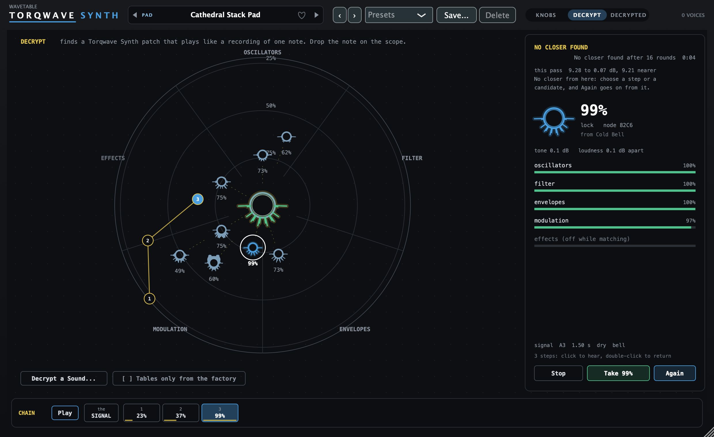
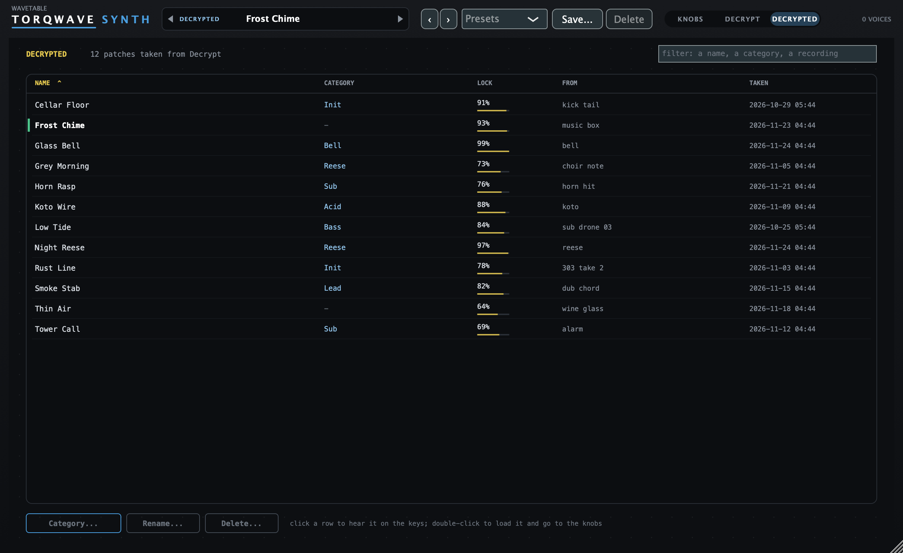
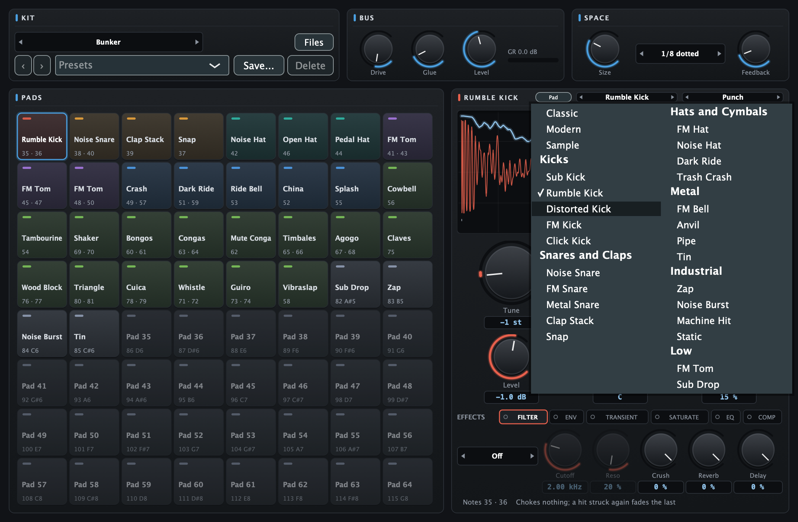
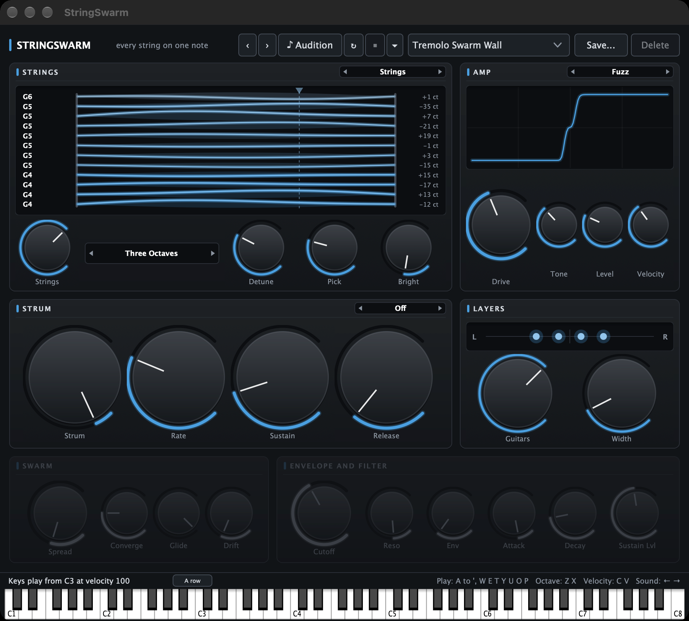
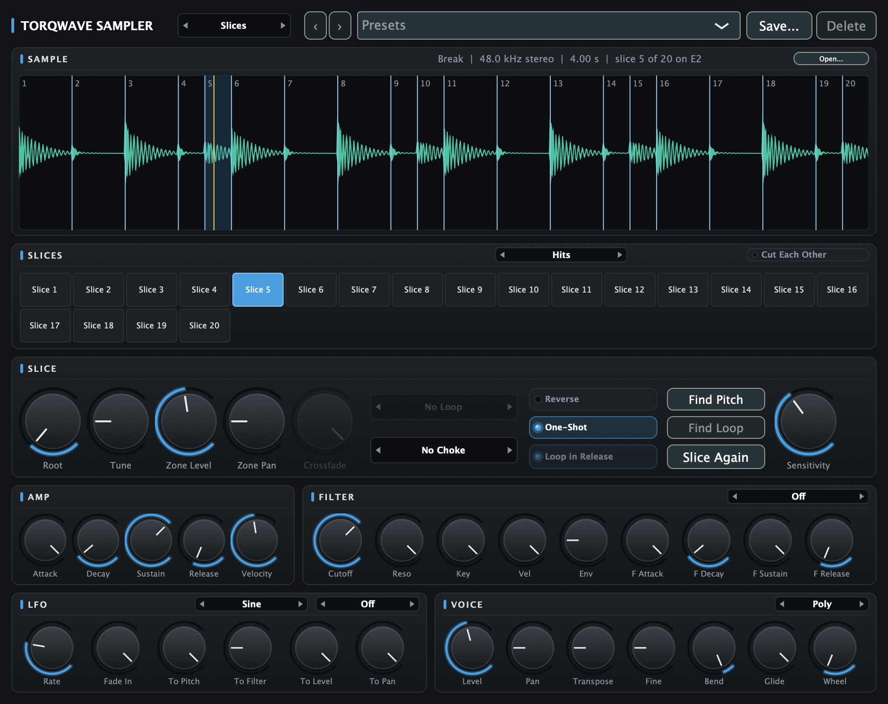
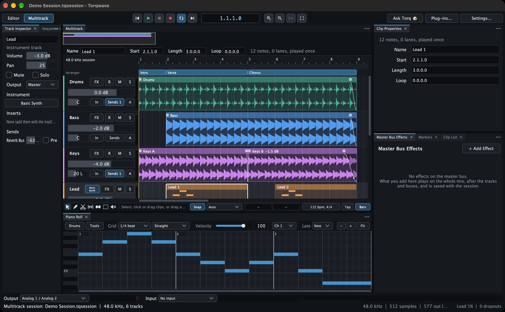

# Instruments and MIDI

[Guide](README.md) › Instruments and MIDI

An **instrument track** plays an instrument: Torqwave's built-in Torqwave Synth, Basic Drums, StringSwarm or Torqwave Sampler, or any VST3 instrument (Audio Unit too on the Mac, and LV2 on the Mac and Linux) that your [plug-in scan](04-effects-and-the-rack.md#plug-ins) found. It holds **note clips**, not audio. You put the notes in by drawing them, typing them, playing them on a MIDI keyboard, or importing a MIDI file.

## Make an instrument track

- **Multitrack > Tracks > Add Instrument Track...**, or right-click the lanes or the track list and choose **Add Instrument Track**. Pick the instrument from the menu; the track is named after it. The built-in Torqwave Synth, Basic Drums, StringSwarm and Torqwave Sampler come first; your plug-ins follow under **Audio Units** and **VST3**, each by its maker (a few of one format are listed plainly, with their format and maker in their names).
- **Turn an empty audio track into an instrument track:** right-click its header and choose **Instrument Track**. Choose it again to turn it back.

The header's instrument button, which shows the instrument's name (or **Inst** when there is none), chooses, swaps or opens the instrument. It takes the place of the record button. Effects added with **FX** run after the instrument, as on any track.

New instrument tracks follow the tempo ([musical timebase](06-multitrack-sessions.md#tempo-and-bars)), so their clips keep their place in bars and beats when the tempo changes.

## Put notes in

| Way | How |
|---|---|
| Draw a clip | The **Draw** tool (2): drag along the instrument track's lane. Below the last track, the same drag makes a new track |
| Type the notes | Right-click the track's header and choose **Add Notes...**. Type note names (C4, F#3, Bb2; C4 is middle C) or MIDI numbers (60), separated by commas. Choose whether they play together or one after another, how long each is held, and whether the pattern repeats |
| A single hit | **Add Trigger** in the same menu puts a one-note clip (C4, a tenth of a second) at the cursor. Use it for a sampler or drum instrument |
| Play them in | Turn on **Record Notes** (Option-R), play, and stop: what you played becomes a note clip |
| Keep what you just played | **Capture MIDI** (Option-Shift-R, in **Multitrack > Editing and Recording**) turns the last 60 seconds of MIDI you played into a note clip, even with Record Notes off (see below) |
| Import a MIDI file | **Multitrack > Import MIDI File...** adds each track of a Standard MIDI File that has notes as a note clip on a new track, at the cursor |

Right-clicking a lane offers **Add Notes Here...** and **Add Trigger Here** at that spot.

## Play it live

The selected instrument track plays whatever comes in live:

- **A MIDI keyboard.** Turn its input on in **Settings... > Audio**.
- **Window > On-Screen Keyboard** (Option-K). While it shows, docked or floating, your computer's keys play from any of Torqwave's windows, in place of the shortcuts on those keys: **Q W E R T Y U I O P** are the white keys from C and **2 3 5 6 7 9 0** the black ones. **Z** and **X** move the octave down and up, **C** and **V** the velocity. The button on the keyboard switches to the A row (**A S D F G H J K L ; '**, with **W E T Y U O P** for the black keys), and the choice is kept. The keys play nothing while you type in a text box, or with Command, Control or Option held. You can click its keys too. Its line at the top says which track it plays, or why nothing will sound.
- **The instrument's own window.** Open it from the instrument button's menu (**Instrument Window**). The same keys play that instrument without the keyboard panel, a strip of keys along the bottom of the window plays by the mouse, and the **left and right arrows** load the previous and the next sound, so you can go through sounds while playing. A plug-in's own keys sound too, even while the session is stopped.
- **Audition** (the ♪ button after the arrows in the presets row, on to begin with). With it on, each sound you choose in an instrument's window plays at once: a low line for a bass, a held chord for a pad, a rising figure for a lead, hits for percussion, a beat on Basic Drums. Torqwave Sampler gets a beat when it plays slices, hits when its zones are one-shots, a held chord when a zone loops, and a rising figure otherwise. Play a key and it stops. It keeps quiet while the session plays, so you hear your own part on each sound. Turn it off for silence while you browse. **Loop** (↻), right after it, makes the phrase go round until you press **Stop** (■, beside Loop) or choose another sound, so you can turn knobs or play along while it repeats. It plays in the keys' octave: press Z or X and it moves down or up with them, even while it loops (a drum kit's stays on its drums). It plays at the session's tempo where the playhead stands, and follows it when the tempo changes; with no session it plays at 125 BPM. The **▾** after Stop (it shows the pattern's name where the row is wide) chooses what the audition plays: a dozen patterns for basses, leads, chords and stabs (rolling 16ths, an EBM gallop, an acid line with slides, long notes so wobbles have time to move, chord progressions and more), twenty for drum kits (four on the floor and the like, then eight that play more of a kit, with ghost notes and accents: Warehouse Roller, Body Beat, Hammer Works, Two-Step Break, Hypnotic Threes, Peak Time, Machine Disco and Ghost Kicks), eight for drones, hits and StringSwarm. Each kind of sound keeps its own choice, so basses can roll while pads swell.
- **A note that won't stop.** **Transport > Silence All Instruments (Panic)** (Shift-Cmd-.) stops every note an instrument or a plug-in is still sounding, and the audition with it: each instrument gets its notes' offs, then All Notes Off and All Sound Off.
- **The Piano Roll's keyboard** (see below).

*The window of Torqwave Synth, the built-in instrument, playing Turbine Throat, one of the layered basses.*

Torqwave Synth is a wavetable synth made for dark techno, industrial and EBM. Its window is laid out the way the sound flows, left to right and top to bottom:

| Section | What it does |
|---|---|
| **Oscillators 1 to 3** | Each plays a **wavetable** (Analog, Pulse, Vowel, FM, Metal, Sub, Additive, Sync, Growl, String or Sampled) at a **Position** through its frames, drawn in depth with the frame it plays in front. A **Warp** bends the wave (Sync, Bend, Squeeze, Mirror, FM from the oscillator before, Crush or Fold). **Unison** stacks up to 8 copies, **Detune**d apart and **Spread** across the stereo field; **Strum** starts them up to 60 ms apart, like a pick across strings, and **Drift** lets each wander slowly in pitch. **F1 > F2** sends the oscillator to filter 1, filter 2 or between. |
| **String** | The String table is a plucked string rather than a wave: each unison voice is a string, all tuned to the note. Its Position reads as **Bright** (the pluck) and its Warp as **Decay** (how long it rings). Strings ringing over a sustained wave, fuzzed and played one note at a time with long slides, are Wailing Fuzz Lead. For the harsher synth guitar of early-90s EBM, Body Riff Power Chord and Palm Mute Chug play a root, fifth and octave from one key through hard clipping. |
| **Sampled** | A table made from a sound of your own. **Drop an audio file on an oscillator's display** (or double-click the display to choose one): Torqwave takes the sound's spectrum at up to 64 steps from its start to its end and makes each a frame, so **Position** plays through the sound's tone, and an envelope or LFO on Position replays how it changed. It takes the tone, not the recording: the pitch comes from the keys, and each frame keeps how strong the harmonics are, not the sound's own timing. A sound with a clear pitch is measured at that pitch, so the table played at the same note has its spectrum; one without (noise, a drum) keeps its spectrum when played low. The table is saved with the session and the instrument's state, and in a preset saved from the presets bar. |
| **Sub + Noise** | A sub an octave or two down (sine, triangle or round square), straight to the output with **Direct** or through the filters, and noise (white, pink, crackle or digital), tilted dark or bright. |
| **Filters 1 and 2** | Ladder (24 and 12 dB low-pass, high-pass, band-pass), SVF (low, band, high, notch) or Comb, each with Cutoff, Resonance, Drive and Key tracking; in series or side by side (**Route**). The curve shows the filter as it is now, modulation included. |
| **Amp + Voice** | Level, pan, how much velocity matters, Poly, Mono or Legato, Glide (on overlapping notes, or always) and the pitch bend range. |
| **Envelopes and LFOs** | Four envelopes (the first is the amp's) with a curve; drag their points. Two LFOs, free or synced to the tempo, eight shapes including Drift and 16 Steps you draw; retriggered, free or one-shot, with a fade-in. **Osc Levels**, the last tab, gives each oscillator a level envelope of its own (**Attack**, **Hold**, **Decay**, **Sustain**), off until you switch it on: a layer can swell in late, or strike and fall away under the others, without using a modulation slot. |
| **Macros** | Four knobs a patch names (Cutoff, Grit, Space...), each routed to whatever the patch needs. |
| **Modulation** | Sixteen slots, eight to a page (**Slots 1-8**, **Slots 9-16**): a source, a destination and an amount. |
| **Effects** | Drive (Soft, Hard, Tube, Fuzz, Fold, Crush), Chorus, Phaser, a tempo-synced ping-pong Delay and Reverb, in that order. |

**To modulate anything**, drag a source (an envelope or LFO tab, a macro's number, or Velocity, Wheel, Pressure, Key or Random) onto a knob. A coloured ring shows how far it moves the knob; drag on the ring to change the depth, and right-click the knob to remove it. While a note plays, a dot on the ring shows where the knob is now. Knobs turn with a drag (Shift for fine), reset on a double-click or Alt-click, and take a typed value from their right-click menu; each reads in its unit.

**Patches**: the name at the top steps through 3,743 factory patches with its arrows, or lists them by category with a click. The list opens with your **Favourites**, then a **Decrypted** folder: the patches you took from Decrypt and named, under the categories you gave them (those with none directly in the folder), so a decrypted bass is two clicks away. Choosing one puts the arrows on the Decrypted patches alone, in the folder's order, as with the favourites; right-click the name (or use the end of the folder) to **Rename** or **Delete** the one you are on. They are your own presets, so the presets bar lists them too; the factory patches can't be renamed. A category with more than 40 patches opens as pages by name ("Ab - Co"); a smaller one lists its patches as the arrows step through them. The arrows go through a category's hand-made patches first, then the first bank by name, then the second. Every category opens with patches that move as they are held, 40 in most (42 leads, 20 subs): growls and wobbles, sync attacks, pumping unison stacks and talking formants, each made the category's own way (Hydraulic Maw and Mouth Of Iron among the basses, Voltage Scream among the leads, Slag Heaven among the pads). Each has four macros that change its character. The last of the other hand-made patches in a category are the ones built on all three oscillators, each layer on its own table with its own level envelope (Three Stage Bass, Triple Reese, Layer Pluck, Cathedral Stack Pad and 37 more): a good place to see what the layers do. Beside the name, the presets bar saves your own: the knobs, any Sampled table and the macros' names, all of which a preset puts back when it is loaded.

**Favourites**: click the **heart** beside a patch's name to mark it as a favourite (it fills in), and again to unmark it. **Favourites**, the first entry of the patch list, holds the ones you have marked under their categories (Bass, Reese and so on, in the tree's order), so you can see what kind of sound each is. Choose a patch from there and the arrows, and the left and right arrow keys, step through your favourites alone, in that order; choose one from a category and they go through every patch again. Favourites are kept by name in Torqwave's application data, so they are the same in every session.

### Decrypt: a patch from a recording

**Decrypt**, the second page of the synth's window (the **Knobs / Decrypt / Decrypted** switch at the top right), finds a Torqwave Synth patch that plays like a recording of one note. Drop the note on the scope, or click **Decrypt a Sound...** to choose a file.

*Decrypt after a search on a bell note from a factory patch. The picture is drawn by Torqwave's tests.*

- **What it takes:** one note, held or plucked, up to 4 seconds (a longer one is cut 4 seconds after the sound starts). Its pitch is found, silence is trimmed from both ends and it is levelled. A silent clip, a note shorter than a tenth of a second and a file it cannot read are refused, with the reason.
- **A chord** (a pad or a stab of several notes at once) is matched as a chord. Decrypt finds its notes, the signal line names them ("chord C#4 E4 B4 D#5"), and every candidate is played on those keys, so what you hear in the window is the chord. The patch you take plays one note for each key, as any patch does: play the same chord to hear the sound. A chord is taken as one when notes of three or more different names are found; two notes, a bell and a short pluck are often read as one note, and a note may be found an octave off. The lock does not tell notes apart (its bands are wider than a semitone), so a chord's lock says how near the tone and the loudness are, not whether the notes are right.
- **A sound that dies away by itself** (a stab, a pluck, a hit: the signal line says "dies away") is matched with the key held all the way, so its patch falls silent as the sound does while you hold a key. A note that holds its level and is then let go, one that beats or is gated, and one still sounding at the clip's end are matched held for their loud part, and their patches sustain while a key is down.
- **What it does:** it plays every factory patch at the note and compares each with the recording by their spectra over time (at three window sizes, so both the attack and the tone count) and by their loudness over time. It keeps the nearest 48, then grows variations of the best, round after round, each round nudging the knobs a little less: some variations move a whole part of the patch, others only one to three of its settings, which is how a patch with many moving parts is closed in on. The search runs in the background, so the session keeps playing.
- **The scope:** up to eight patches sit on the rings, nearer the middle the closer they are (rings at 25, 50 and 75 %), each in the sector of the part where it differs most from the best: oscillators, filter, envelopes or modulation. They are choices, not copies: the nearest patch found, and beside it the nearest others that sound different from it and from each other (3 dB or more apart as Decrypt measures sounds), each grown from a different factory patch where it can be. One of the others is further from your recording than the best, and its lock says by how much; it is there because it is another answer, to hear and to go on from. Each has room of its own for its shape and the lock under it. The recording's spectrum is drawn in the middle with the chosen patch's over it. Click a patch to hear it, click the middle to hear the recording, and double-click a patch to put it on the keys at once, while the search goes on.
- **The panel:** the lock of the best patch, its node address, the factory patch it grew from, how far apart the tone and the loudness are, and for each part how settled the search is (how much its twelve nearest patches, which are mostly close variations of the best, agree).
- **Take** keeps the patch on the keys and stops the search, then asks for a name under **Keep It**, with the patch's "Node" name there to type over and, beside Save, the category it will be filed under: a guess from the factory patch it grew from, which you can change (or set to none) from its menu. **Save** (or Return) keeps it as one of your own presets under that name and lists it on the **Decrypted** page; a name one of your presets has asks before replacing it, and a factory patch's name is refused. **Not Now** (or Escape) leaves it on the keys, unsaved. With Ask Torq on, the name your model offers shows as a line under the box with **Use**, which puts it (and its category) into the prompt. **Stop** stops the search and puts back the patch you had before. **A new sound** dropped on the page at any time takes the place of the one there (the scope says so as you drag over it) and starts from nothing; a sound that can't be matched says why, and the page stays as it was. A patch Decrypt puts on the keys (a double-click, a step or Take, and the patch Ask Torq's decrypt gives a track) has its **Amp Level** set so the note plays at velocity 100 about as loud as you heard it in Decrypt, its effects included: the search matches sounds at their loudest, so a patch's own level is otherwise whatever it happens to be. If the knob's range cannot get there, the panel says how far off it is.
- **The search goes on until it comes no closer.** It ends when six rounds in a row have not raised the lock, or after 64 rounds at most, and says "NO CLOSER FOUND" with the round it ended on. A sound the synth made settles in seconds; a recording of something else takes longer.
- **The chain** is how the sound came along, from a rough first match to the nearest found. It is the strip across the bottom of the page: **Play**, the signal, then a tile for each link with its number and lock; and the same links are a numbered path on the scope. The first links are the nearest of a first look at a few of the factory patches, then of a closer look, then of them all; after that a new link lands only when the nearest patch is clearly closer to the signal (0.5 dB, about four points of lock) and sounds different enough from the last link to hear (3 dB or more as Decrypt measures sounds), so a chain is a few links that each sound different: two to five on most sounds, and one where the first rough match was already close to where the search ended. The last link is always the nearest found. With the synth's **Audition** switch on, each link plays as it lands. Click a tile or a node to hear the link: the panel then shows its lock, its tone and loudness figures, which parts moved most since the link before ("from step 2: filter and envelopes moved most") and a bar for how far each part's settings moved. Click the signal's tile to hear the recording, or **Play** to hear the signal and then every link in turn, each marked as it plays. Double-click a tile or node to go back to that link: it goes on the keys, the links after it are dropped, Take keeps it, and Again goes on from there, its links following on the same chain. Under the panel's heading, a line counts how far this pass has come as it goes ("this pass 3.49 to 2.19 dB, 1.30 nearer"), and when it comes no closer it says so.
- **Again** searches on. Choose the candidate nearest to what you hear (double-click it onto the keys, or Take it) and press **Again**: the search goes on from that one alone, in smaller steps, and what it shows are closer versions of it (often only one or two, since versions of one patch sound alike). With none chosen it goes on from all those shown, each kept as an answer of its own. A search never ends further from the signal than it began.
- A sound can be dropped on the scope from the Finder, the Sound Library, or the **Files** panel (an open file, saved or not); the same goes for dropping a sound on an oscillator to make a table from it.
- **Tables only from the factory:** off to begin with, so the search also tries the recording's own spectrum as a **Sampled** table (see the table above) on an oscillator. On, the patch is built from the synth's own waves alone.
- **The effects are off while it matches**: the recording is matched dry, and a taken patch has its effects off. Turn them on afterwards to taste.

**The Decrypted page** (the third choice beside Knobs and Decrypt) lists every patch you took and named: its name, its category, the lock it was taken at, the recording it came from and when. Click a row to put the patch on the keys (it plays when Audition is on), double-click it or press Return to load it and go to the knobs, and step through the rows with the up and down arrows. Click a heading to sort by it, and type in the box at the top right to filter by name, category or recording. Command- and Shift-click select several rows: **Category** files them under one of the synth's categories (or none), **Rename** renames the one selected (an empty or taken name is refused) and **Delete** deletes them after asking; a right-click on a row offers the same. The list is kept in Torqwave's application data, so it is the same in every session.

*The Decrypted page. The picture is drawn by Torqwave's tests, with made-up patches.*

**What a lock means.** The lock is how near the patch sounds: 100 % is the same spectrum and loudness over time, 0 % is 12 dB or more apart. Detail more than 40 dB under the loudest part of each moment is left out, as you would not hear it under the rest. A recording of Torqwave Synth itself is found again, usually to within a few dB (see below). Anything else gives a patch in its spirit, not a copy: close for other synths and simple tones, loose for voices, acoustic instruments, drums and samples, which a wavetable synth can only suggest. A lock says the two measure alike, not that they sound alike to you: listen before you trust it. One note only: a chord, a melody or a loop is matched as one sound, badly. Decrypt never sees the sound's effects, room or processing as separate from its source.

**How long it takes, and how near it gets.** Measured on a Mac Studio with an M5 Ultra (18 of its 36 cores, which Decrypt uses by default), on notes of 1.2 to 1.5 seconds recorded from twenty factory patches, each decrypted without its own patch to start from, running until it came no closer as the window does:

| Recordings of | Furthest | Mean lock | Rounds | Time a note |
|---|---|---|---|---|
| Ten simpler patches (one or two layers, few modulation routes) | 2.0 dB | 92.8 % | 16 to 40 | 3.9 s on average, 5.6 s at most |
| Ten complex patches (three layers with level envelopes, step gates, 6 to 16 modulation routes) | 2.7 dB | 85.3 % | 16 to 49 | 4.7 s on average, 7.5 s at most |

Recordings from elsewhere have further to go. On seven of them (two instrument notes, three of the Mac's alert sounds and two of the synth's patches through their own effects), the first patch came 2.5 to 4.3 dB from the signal and the search ended 1.4 to 3.1 dB from it, after 20 to 40 rounds and 2 to 7 seconds. On four of them and four sounds with no pitch to find (bursts and sweeps of noise, claps), the chains ran to one to six links, the first rough match at a lock anywhere from 0 to 65 % and the nearest at 77 to 96 %; eight patches were shown each time, from eight factory patches, the second of them 9 to 27 points of lock under the best. How much nearer the search gets after the best factory patch depends on the sound: for some it is most of the way, for others the best factory patch is nearly all there is.

A longer note takes longer in proportion, and a computer with fewer cores takes longer. The session plays on meanwhile: in the tests a synth playing a chord beside a search never came near missing a block. For scale, changes at the edge of hearing (3 cents of pitch, the filters 3 % higher, the envelopes 5 % longer) measure under 1 dB, and a low-pass at 2 kHz on a dark note 0.7 to 1.1 dB. The 3 dB that the patches shown and the chain's links keep from each other is about what a low-pass at 2 kHz or a high-pass at 300 Hz does to a bright note (2.4 to 4.4 dB); a shift of 5 ms, which nobody hears, can measure 1.6 dB.

**Which key.** A sound with a sub an octave below it is heard at the sub's pitch, so Decrypt plays its candidates an octave below the key that made the recording (nine of the twenty above). The patch it finds plays the recording's pitch from that key: play it an octave up, or raise its oscillators, to play it from the original key.

**With Ask Torq.** When [Ask Torq](13-ask-torq.md) is turned on, a box for words shows under the scope, for what the sound is ("a reese", "match the body, not the click"), and your model helps: it suggests factory categories and patches to start from and changes of structure (a table, a filter type, a layer an octave up) as the search goes on, and offers a name, category, description and macro names for a patch you take. Each change it suggests is played and scored like any other patch and kept only if it comes closer, and the panel lists the last things it tried, each with how it went (kept or dropped, and the lock), as many as it has room for: fewer while a name is asked for. It makes the search take several seconds longer, and on a recording of the synth's own sounds it made little difference (see [Decrypt with a model](13-ask-torq.md#decrypt-with-a-model)).

| Categories | What is in them |
|---|---|
| **Bass, Sub, Reese, Acid** | The low end: sequencer and FM basses, pure and driven subs, detuned reeses, resonant acid lines. Mostly one note at a time. |
| **Lead, Stab, Chord, Pluck** | Leads, short hits and plucks. A **Chord** patch plays a whole chord from one key (minor, suspended, fifths, stacked fourths). |
| **Arp, Sequence** | Movement from one held note, in time with the song. An **Arp** steps through notes; a **Sequence** cuts the note into a rhythm, pumps it, or steps its filter or its wave. |
| **Keys, Organ, Guitar, Brass, Strings** | Electric pianos, clavs, plucked-string pianos and harpsichords; drawbar, pipe and combo organs; the plucked String table's guitars; synth brass; string machines, pizzicato and bowed strings. They are synthesised, not sampled: a string machine, not an orchestra. |
| **Pad, Drone, Bell, Vox, Texture** | Sounds to hold: pads, drones for a minute at a time, bells and gongs, formant voices and choirs, beds of noise. |
| **Riser, Impact, Cinematic, FX** | For transitions and for picture: risers and falls, hits, braams, pulses, tension beds and stingers, alarms, zaps and fly-bys. |
| **Perc, Drum** | Metal and found percussion, and kicks, snares, claps, hats, toms and cymbals made from the oscillators. C3 is each drum's own pitch; other keys tune it. |
| **Glitch, Game, Chip** | Faults and stutters; game sounds (pickups, jumps, menus, fanfares that play a short tune from one key press); and the pulse, triangle and noise voices of old sound chips. |

Every patch of the second bank has four macros that do something, named for what they do.

Torqwave Synth plays the velocity of each note and answers the controllers a lane draws: **Pitch bend** (two semitones either way, or the patch's Bend range), **Mod wheel**, **Aftertouch** (channel and poly) and the macros, each moving whatever a patch routes it to, **Volume** (CC 7) and **Expression** (CC 11), **Pan** (CC 10), **Sustain** (CC 64, holding notes while it is down), **Resonance** (CC 71, up toward the most) and **Cutoff** (CC 74, down as far as eight octaves below the Cutoff knob). Other instruments answer what their makers chose.

The built-in instruments' tempo-synced settings run at the session's tempo, through tempo changes too: Torqwave Synth's delay, synced LFOs and step patterns, Basic Drums' delay, StringSwarm's Strum Sync and Torqwave Sampler's LFO Sync. Stopped, they read the tempo where the playhead stands, so a tempo you type in is heard at once. Plug-ins are given the same (see [Tempo and bars](06-multitrack-sessions.md#tempo-and-bars)).

A session saved before 0.20.0 opens with its synth settings (from Basic Synth, as it was called then) mapped to the nearest new ones (its wave as oscillator 1's position, its oscillators 2 and 3, its filter as an SVF, its filter envelope and velocity to filter as modulation slots, glide as legato). It sounds close, but not the same.

### Basic Drums

**Basic Drums** is the built-in drum machine. It is a synthesizer and a sampler in one window:

- **64 pads.** The first 30 are the **sounds**, which cover every General MIDI drum note (35 to 81), the notes the drum grid writes and most drum plug-ins play. The 34 after them are **user pads**, on notes of your choosing.
- **54 synthesized sources.** The 30 sounds, 21 of them in two types (Classic and Modern), and 24 more that belong to no note and that any pad can play: 75 models in all. Nothing here is a recording.
- **Your own samples** on any pad, in up to 16 layers by velocity, with round robin. No samples come with Torqwave.
- **On every pad:** tune, decay, tone, level, pan and drive; a filter, a crusher and two sends; its own envelope, transient shaper, saturator, EQ and compressor; and a place in one of eight choke groups, beside the three built in.
- **Fifteen factory kits,** your own as presets or as kit files that carry their samples, and imports of a folder of sounds or of a Battery 4 kit.

Each note rings on its own voice (a tom fill rings over itself), it plays in stereo, and nothing in it stops dead: a hit struck again or cut off fades over 3 ms.

![The Basic Drums window in the Bunker kit, drawn by the tests: along the top the kit selector with Files beside it and the presets row, the bus's Drive, Glue and Level, and the space's reverb Size, delay time and Feedback; on the left the 64 pads, eight across, the 30 sounds coloured by family (several named after the sources this kit puts on them: Rumble Kick, Noise Snare, Clap Stack, Snap, Noise Hat, FM Tom, Dark Ride) and after them the user pads, four of them lit with a Sub Drop, a Zap, a Noise Burst and a Tin; on the right the kick's pad selected, reading Rumble Kick in its selector beside Pad and the kick's character, a picture of one hit with its level falling, its Tune, Decay, Tone, Level, Pan and Drive knobs with their values, and the Effects' six tabs on the FILTER page](../screenshots/guide-drums.png)

#### The window

- **Along the top:** the **kit** (the factory kits, **Files**, and your own presets), the **bus** and the **space**, all described below.
- **On the left, the pads,** eight across. The 30 sounds are coloured by family (kick, snares and claps, hats, toms, cymbals, hand percussion). **Pad 31** to **Pad 64** are the user pads, drawn fainter until they have samples or a source. A pad lights as it plays. Click one to hear it alone and see its settings. A click plays at the velocity the keys under the window play at ("Keys play from C3 at velocity 100"; **C** and **V** change it), wherever on the pad you click. Right-click a pad for its menu.
- **On the right, the selected pad:** in its header **Pad** (the same menu) and the selector for what it plays; a picture of one hit (its waveform, its level falling to 60 dB down, a dashed line where its decay setting ends, and a line sweeping across as it plays); its knobs; and its **Effects**. The line along the bottom says its notes and what it chokes.
- **Knobs:** drag one, Shift-drag for fine steps, double-click it for its default.

#### What a pad plays

The selector at the top of the pad's panel chooses what the pad plays: the sound's own types, **Sample**, or one of the sources.

- **A sound's own types.** Twenty-one of the 30 sounds come in two: **Classic**, the sound as it has always been, and **Modern**, a second model of it with more to it. They are the kick, snare, clap, the three hats, the three toms, crash, ride, china, splash, shaker, tambourine, bongos, both congas, agogo, whistle and triangle. A Classic sound struck softer is the same hit, quieter. A Modern one is also duller the softer it is struck; a kick's pitch sweeps less and its beater fades, and a hat gets shorter, so ghost notes sit under the accents. The other nine (rim, cowbell, ride bell, vibraslap, timbales, guiro, claves, wood block and cuica) have Classic alone. The kick also has a character, beside the selector: **Boom** (long and round), **Punch** (909-style) or **Hard** (an overdriven industrial kick).
- **A source.** Beside the 30 sounds there are 24 more synthesized ones, the **sources**, which belong to no drum note. Any pad can play one in place of its own sound or its samples. They are listed in the selector after the pad's own choices, under their families:
  - **Kicks:** Sub Kick, Rumble Kick (a short kick with a rumble swelling up under it), Distorted Kick, FM Kick, Click Kick.
  - **Snares and Claps:** Noise Snare, FM Snare, Metal Snare, Clap Stack (seven bursts, wide), Snap.
  - **Hats and Cymbals:** FM Hat, Noise Hat, Dark Ride, Trash Crash.
  - **Metal:** FM Bell, Anvil, Pipe, Tin.
  - **Industrial:** Zap, Noise Burst (held, then shut like a gate), Machine Hit, Static (a crackle).
  - **Low:** FM Tom, Sub Drop.
- **Sample.** The pad plays recordings you give it: see [Samples on a pad](#samples-on-a-pad).
- **On a sound's pad** the selector has the sound's types, Sample and the sources. A Rumble Kick on the kick's pad plays on the kick's notes, so every pattern and preset written for a kick plays it. Choosing the sound's own type again takes the source off.
- **On a user pad** it has Sample and the sources: choose a source and the pad plays it on its note, with no samples needed.
- **A source plays through everything the pad has.** Choosing one sets the pad's Decay to the source's own. The pad is called by the source's name until you rename it. Giving the pad samples takes its source off.

| Notes | Sound |
|---|---|
| 35, 36 | Kick (35 a little lower and longer) |
| 37 | Rim |
| 38, 40 | Snare (40 brighter and higher) |
| 39 | Clap |
| 42, 44, 46 | Closed, pedal and open hat |
| 41, 43 / 45, 47 / 48, 50 | Low, mid and high toms |
| 49, 57 / 51, 59 / 52 / 53 / 55 | Crash, ride, China, ride bell, splash |
| 54 / 56 / 58 / 69, 70 | Tambourine, cowbell, vibraslap, shakers |
| 60, 61 / 62 / 63, 64 / 65, 66 | Bongos, mute conga, congas, timbales |
| 67, 68 / 71, 72 / 73, 74 / 75 / 76, 77 / 78, 79 / 80, 81 | Agogo, whistle, guiro, claves, wood block, cuica, triangle |

Each sound plays to its end however long the note is, and velocity sets its level.

#### The pad's knobs

**Tune** (semitones, two octaves either way), **Decay** (milliseconds until it has fallen 60 dB), **Tone** (darker or brighter: the kick's click, the snare's wires, the hats' filter, a drum's strike), **Level** (dB), **Pan** and **Drive** (saturation on that pad alone). They work on a sound, a source and a sample alike; what each does to a sample is said below.

#### Samples on a pad

Drop sounds on a pad, or on the selected pad's panel: files from Finder, an open file from the Files panel, a sound from the Sound Library, or an editor selection. The pad's type becomes Sample, each sound becomes a **layer**, and a small waveform appears in the pad's corner. A pad takes up to 16 layers, and a kit up to 1 GB of samples, held in memory.

![A pad that plays samples, drawn by the tests with sounds made for the picture: the snare's pad selected with its type reading Sample and Reverse beside it, a shorter picture of the hit, and under it the layer list, "3 of 16" and "hit 100: layer 3", with the rows Snare Medium (43 to 84) and Snare Hard (85 to 127), the one that played lit, and Add, remove, the arrows and Spread; then Tune, Decay and Tone, and Level, Pan, Drive, Start and Bend; a user pad named Kick Layer on note 36 and one playing a Zap among the pads; and along the bottom "Choke group 2 with Clap"](../screenshots/guide-drums-sample.png)

- **Layers.** Under a shorter picture, the list shows each layer's waveform, its name and the two velocities (1 to 127) between which it plays. Drag either number up or down to change it; double-click one to give the layer every velocity again. **Add...** chooses files, **-** removes the selected layer, the arrows move it up or down, and **Spread** shares the velocities evenly among the layers, the first the softest, so soft and hard hits play different recordings.
- **Which layer a hit played.** Beside the count, the list says the selected pad's last hit and the layer it played ("hit 52: layer 1"), and that layer's row lights and stays outlined until the next hit; "no layer" means no layer takes that velocity, and the hit was silent. It reads the same for a click on the pad, the playing keys, a controller and a sequence. A click plays at the keys' velocity, so set that low (**C**) to hear a pad's soft layers.
- **Round robin.** Layers whose ranges both hold a hit's velocity take turns, in the list's order, one for each hit of the pad, so a repeated hit is not the same recording twice. Sounds dropped together start over every velocity, so they take turns until you spread them. The turn starts again each time playback is prepared, so a pattern renders the same each time and at any block size.
- **The knobs on a sample.** **Tune** repitches it. **Decay** fades it to nothing by that time, over the last two fifths of it; with the decay at its top (5,000 ms), or longer than the sample, the sample plays to its own end. When you give a pad a sample longer than its decay, the decay is lengthened so the sample plays whole, and it stays that long if you go back to Classic or Modern. **Tone** tilts the top end above 2 kHz. A sample plays at the level it was recorded at, times the velocity. Three more appear for a Sample: **Start** (where in the sample a hit begins, up to 95 % in), **Bend** (a pitch envelope: how many semitones off pitch the hit starts, coming to pitch over about a tenth of a second) and **Reverse**.
- **No clicks.** A sample that is cut, struck again or stopped fades over 3 ms; one that starts off zero rises over a quarter of a millisecond, and its own end is faded over half a millisecond.
- **Keeping a kit's samples.** The session keeps each layer by its file, and a preset you save keeps them too. If a file has moved, the window says how many samples are missing: **Files > Find Missing Samples...** takes one of them, or the folder they are in now. **Files > Save Kit with Samples...** writes the kit and a copy of every sample into one folder you can move to another computer; **Files > Open Kit File...** opens it.

#### User pads, names, colours and notes

- **The 34 user pads** play samples or a source, through the same knobs, effects and layers as a sound's pad, with the decay at the top to start with so a sample plays whole. Pad 31 starts on note 82 and each pad after it on the next note, up to 115, outside the notes the sounds use. A user pad shows its note's number and name, named as the keys under the window name them (middle C, note 60, is C4).
- **The pad's menu** (right-click the pad, or **Pad** at the top of its panel) **renames** a user pad, moves it to another **note** (any of 0 to 127; the menu says what is already on each), gives it a **colour**, puts it in a **choke group**, or **empties** it.
- **Sharing a note.** A user pad on a note a sound has plays with that sound, so a sample can be layered under the kick on 36; several user pads can share a note too.
- **A sound's pad** can be renamed and coloured the same way while it plays samples or a source (so a sampled Clap can read Metal Hit). Its note stays its own, the name and colour show only while it does, and **Use the sound's Own Name and Colour** in its menu takes them off.
- Names, colours and notes are kept in the session, in presets and in kit files.

#### Choke groups

- **Three are built in,** and always were: the three hats cut each other, as do the mute and open triangle and the mute and open cuica. They go by note, so they work whatever those pads play: a sampled open hat is cut by a synthesized closed one.
- **Eight are yours.** In a pad's menu choose **Choke Group**, then **Group 1** to **Group 8**; the menu says who is in each already, and **None** takes the pad out. Any of the 64 pads can be in one.
- **Pads in one group cut each other:** a hit of one fades whatever of the others is sounding, over 3 ms. A sound with two notes (the toms' pairs, say) that is in a group also has one note cut the other. A hat can be in a group of yours and still chokes the other hats.
- **Pads struck by one note never cut each other,** so a user pad layered on the kick's note plays with the kick whatever groups they are in.
- The line under the knobs says the selected pad's group and who shares it.

#### The pad's effects

Under its knobs, **Effects** has six pages, chosen by the tabs along its top. Every one of the 64 pads has all six for itself, whatever it plays. A tab's dot is lit while that effect is on for the selected pad.

- **FILTER.** The pad's **filter** (off, low-pass, band-pass or high-pass, with **Cutoff** in Hz and **Reso**, how far it rings at the cutoff), **Crush** (fewer bits and a lower sample rate, from grit to a broken toy), and two sends: **Reverb** and **Delay**, how much of it goes to the kit's reverb and delay.
- **ENV**, a volume envelope: **Attack** (0 to 500 ms), **Hold** (0 to 2 s) and **Decay** (5 ms to 5 s), with **Curve** for the shape of the fall: at 0 a straight line, above it a fast drop that lingers, below it a level that stays up and drops at the end. The picture is the shape. It works with the Decay knob above, not in place of it: the sound still dies away as that knob says, the envelope is laid over it, and the hit ends when either does.
- **TRANSIENT**, a transient shaper: **Attack** makes the start of the hit louder or softer and leaves the rest, **Sustain** brings what follows the start up or down and leaves the start. Each moves its part by up to 12 dB. The picture is the pad's hit, grey before the shaper and in the pad's colour after.
- **SATURATE**, with a choice of curve: **Tape** (soft and even), **Tube** (lopsided, which adds even harmonics), **Clip** (flat at full scale) and **Fold** (the top folded back over). **Amount** is how hard the curve is driven, **Mix** how much of the result against the sound as it came in. The picture is the curve, output against input. It is a second colour beside the **Drive** knob, not the same one: Drive acts on the sound at its source, before its tone, filter and crusher, so the filter can tame what it adds; Saturate comes after them, so it bites on the filtered and crushed sound.
- **EQ**, four bands: a **low shelf**, two **bells** and a **high shelf**, each up to 18 dB up or down. Drag a band's point in the picture (across for its frequency, up and down for its gain), or choose the band and use the knobs; the wheel over the picture sets a bell's **Width** (0.1 to 4 octaves), and a double click on a point puts its band back to 0 dB, where it does nothing.
- **COMP**, a compressor: **Thresh**, **Ratio** (1:1 to 20:1), **Attack**, **Release** and **Gain** to make up what it took. The picture is its curve, and **GR** beside it says how far it turned the pad's last hit down.
- **Each is off until you switch it on** with the page's **On**, and a pad with all of them off plays exactly as it did before there were any.
- **The order** a hit goes through is fixed: what the pad plays, **Drive**, **Tone**, the **filter**, **Crush**, then **ENV**, **TRANSIENT**, **SATURATE**, **EQ** and **COMP**, then **Level** and **Pan**, and last the sends. The sends come after its level and pan, so a hat panned right echoes from the right.
- **They belong to each hit.** A hit takes the pad's settings as they are when it is struck, and its compressor and shaper start afresh with it. So a change is heard from the next hit, a switch never clicks a hit that is sounding, and one pad's compressor is not moved by another pad or by its own last hit.

#### The bus and the space

- **The bus.** **Drive** puts the whole kit through a soft clipper, **Glue** is a bus compressor that holds it together (GR shows how far it turns the kit down), and **Level** sets its output. The reverb and delay go through them too.
- **The space.** The reverb and delay the pads send to, shared by the kit. **Size** takes the reverb from a small room to a hall. The delay's time is in beats of the session's tempo (1/16, 1/8 triplet, 1/8, dotted 1/8, 1/4, dotted 1/4), and it ping-pongs: the first echo on the left, the next on the right, each darker. **Feedback** sets how many come round.

#### Kits

A factory kit sets every pad at once, with the bus and the space. There are fifteen:

- **Seven of the Classic sounds:** **Standard**, **Dark Techno**, **Industrial**, **EBM Machine**, **Electro**, **Breaks** and **Industrial Rock**: Dark Techno's clap in a big room and its rim in dotted eighths, Industrial's crushed snares and hats, EBM Machine's big snare reverb, Breaks' crunch.
- **Five of the Modern sounds:** **Modern** (every Modern sound, clean), **Warehouse** (dark techno), **Body Music** (EBM), **Foundry** (industrial) and **Broken Beat** (breaks).
- **Three made with the sources,** on the sounds' pads and on a few user pads (notes 82 on):
  - **Bunker** (dark techno): a Rumble Kick, a Noise Snare, a Clap Stack, a Noise Hat, a Dark Ride and FM Toms, with a Sub Drop, a Zap, a Noise Burst and a Tin on pads 31 to 34.
  - **Machine Shop** (industrial): a Distorted Kick, a Metal Snare, an FM Hat, a Trash Crash and a Machine Hit, with an Anvil, a Pipe, Static, a Zap, a low Machine Hit and a Sub Drop on pads 31 to 36.
  - **Voltage** (EBM): an FM Kick, an FM Snare, an FM Hat, an FM Bell and FM Toms, with a Zap, a high bell, a Noise Burst and a Sub Kick on pads 31 to 34.
  - In those three the open hat is the sound's own, so the hats still choke.
- **A factory kit is a clean start.** No factory kit uses samples, the five effects or a choke group of yours, and choosing one takes those away, with every pad's name and colour, as it resets the knobs.
- **Your own.** Move a knob and the kit shows as *edited*; save it with **Save...** in the presets row. A preset keeps everything: what each pad plays, its layers by their files, its effects, its choke group, its name, colour and note. **Files > Save Kit with Samples...** makes a folder you can move to another computer.

#### Importing a folder of sounds

**Files > Import Folder of Sounds...** lays a folder's sound files (and those in the folders inside it) on the pads by their names, in place of the kit that was there. A folder dropped on the window does the same. The files are read where they are, not copied.

- **A drum note's number** at the front or the end of a name (`36 Thud`, `Thud 038`, for the notes 35 to 81) puts the file on that note. Where a folder's files are numbered from below 35 (`01`, `02`, ...), the numbers are taken as a count and not as notes.
- **An instrument's name** or its usual short form (Kick or BD, Snare or SD, Rim, Clap, ClosedHH, Open Hat, Pedal Hat, Low, Mid and High Tom, Crash, Ride, Ride Bell, China, Splash, Cowbell, Shaker, Tambourine, Vibraslap, Bongo, Conga, Timbale, Agogo, Whistle, Guiro, Claves, Wood Block, Cuica, Triangle) puts it on that sound's pad. The plainest name gets the pad: of `Kick`, `Kick Sub` and `BD 2`, it is `Kick`; the others get pads and notes of their own.
- **A note's name** at the front or the end (`Thud D7`), with middle C as C4, puts a file with no instrument in its name on that note.
- **Anything else** gets a user pad on a note of its own, from 82 up.
- **Layers.** Files alike but for a mark become one pad's layers: `v1`, `v2`, `v3` (or `vel1`...) split the velocities between them in that order, softest first, and `rr1`, `rr2` take turns.
- Names are a guess at what a file is, so check the pads by ear; the report after the import says how many pads were chosen each way. An import looks at up to 2,000 sound files and fills up to 64 pads.

#### Importing a Battery kit

**Files > Import Battery Kit...** reads a Battery 4 kit file (`.nbkt`) or cell file (`.nbcl`) of yours and puts its cells on the pads, in place of the kit that was there. A kit file dropped on the window does the same.

- **What comes over:** each cell's name, its samples with their velocity ranges, the note it is on, its level, pan and tune, where its sample starts, and reverse. A cell on a note that is one of the 30 sounds' own takes that sound's pad, whose type becomes Sample. The others take the user pads and keep their notes. Sounds no cell took stay as the Standard kit's.
- **The samples stay where they are.** They are read from the kit's library, where the kit points, and are never copied; only your own **Save Kit with Samples** makes copies. If they are not where the kit says (the library has moved, or its drive is not connected), the import asks for the folder the library is in now.
- **What is approximated:** a crossfade between layers by velocity becomes a split in its middle; several samples on one range of velocities take turns, one a hit; a cell that plays over several keys goes on its lowest; a kit with more than 64 cells keeps the first 64, and a cell with more than 16 layers keeps 16 spread evenly through them.
- **What does not come over:** Battery's effects, envelopes, modulation, time-stretching, articulations and buses; cell colours; REX loops; and which cells cut each other off. The import puts no pad in a choke group: the hats on 42, 44 and 46 choke as they always do, and the rest ring until you give them a [choke group](#choke-groups) yourself.
- **The report.** After an import a window lists each of these with how many cells it touched, so you know what to set by hand.
- **Which kits.** Kit files saved by Battery 4. Kits from Battery 3 and earlier are other file types and are not read. A kit whose layout this does not know is refused by name, not guessed at.

#### What is kept, and what can be automated

- **Kept with the kit** (the session, a preset, a kit file): every knob, what each pad plays, its layers by their files, its five effects, its choke group, and its name, colour and note.
- **Automation.** Each pad's Tune, Decay, Tone, Level, Pan, Drive, filter, Crush, sends and a Sample's Start, Bend and Reverse, a sound's type, and the bus and space are settings a lane or a plug-in host sees. A pad's source, its five effects, its choke group and its layers are not, so they cannot be automated.
- **In the drum grid** a user pad that has samples or a source gets a row of its own: see [the drum grid](#the-drum-grid).
- **Older sessions.** A session saved before any of this plays as it did: every sound Classic, no samples, no sources, the effects off, no choke groups of yours. Sessions from before 0.20.0 load with their tunings and decays carried over, though the sounds themselves are new.
- **Stopping.** Stop, a loop's turn and a seek fade everything over 3 ms, the reverb and delay too.

### StringSwarm

**StringSwarm** is a guitar with every string tuned to the note you play, through a fuzz: one note becomes a wall of strings beating against each other. Play single notes and slow lines; each note is a whole guitar. It is only in Torqwave.

Each string is modelled (it is plucked, rings and dies away as a string does), so nothing is a sample and every part renders the same each time.

*StringSwarm playing Tremolo Swarm Wall: twelve strings on one note, four guitars wide.*

**Source**, at the top of the Strings panel, swaps the strings for a **Swarm**: a sawtooth oscillator in place of each string, fanned evenly across Spread around the note, for the gliding, beating swarm of an eight-oscillator instrument. In a swarm the Strings knob counts **Oscillators**, Tuning and Detune place them as they place strings, and the Swarm and Envelope and Filter panels along the bottom come alive (Pick and Sustain, which only strings use, dim). Strum Rate fires the swarm's envelope and filter again and again while a key is down: hold a note for a pulsing swarm, or play a sequence through one of the Swarm Sequences presets.

**Presets**: the menu at the top right holds 296 factory presets in sub-menus by category (Walls, Riffs, Strums, Clean and Drones for the strings; Swarm Sequences, Swarm Pads, Swarm Leads, Swarm Basses, Swarm Risers and Swarm Fuzz for the swarm), then your own. Each sets every setting. **Tremolo Swarm Wall** is the classic wall: twelve strings over three octaves of one note, picked 14 times a second through the fuzz.

Its window draws the guitar: the strings with the lowest at the bottom, each named by the note it is tuned to (once you have played one) with how many cents off it sits, swinging as it rings, and a mark where the pick is. The knobs turn by dragging up and down (hold Shift for fine steps), by the mouse wheel, and go back to their setting as it comes with a double-click; hover over one to read its value.

| Setting | What it does |
|---|---|
| **Strings** | 1 to 12 strings on each guitar (6 as it comes). |
| **Tuning** | **Unison**: every string on the note. **Low Octave**: the lowest third of the strings an octave down. **Three Octaves** (as it comes): the lowest third an octave down and the top string an octave up. **Fifths**: root, fifth and octave, a power chord from one key. |
| **Detune** | How far apart the strings sit, up to 50 cents. More is a thicker, slower-turning swarm. |
| **Strum** | The time between one string and the next in a strum, up to 80 ms. |
| **Strum Rate** | Strums again and again while the key is down, down and up strokes in turn, up to 24 times a second. At 0 a note is strummed once. |
| **Strum Sync** | **Off** (as it comes): Strum Rate sets the repeats. **1/4** to **1/32** (and **1/8T**, **1/16T**): the repeats in note values at the session's tempo, counted from each note's start, so a part played on the grid strums (or pulses) on it. |
| **Layers** | 1 to 4 guitars at once, each tuned and timed a little apart and through its own amp, like takes recorded one over another. |
| **Width** | How far the guitars are spread left and right. |
| **Pick Position** | Where along the string it is picked: near the bridge (5 %) is thin and bright, the middle (50 %) hollow. |
| **Brightness** | How bright the strings are and how hard the pick sounds. |
| **Sustain** | How long a held note rings, 0.3 to 20 seconds. |
| **Release** | How quickly a note is damped when you let go. |
| **Amp** | **Fuzz** (two stages), **Crunch** (one) or **None** (the strings alone, for your own amp plug-in after it). Fuzz and Crunch go through a cabinet. |
| **Drive** | How hard the amp is driven. |
| **Tone** | The cabinet's top, 800 Hz to 12 kHz. |
| **Level** | The output level. |
| **Velocity** | How much a note's velocity sets how loud it comes out of the Fuzz or Crunch amp, 0 to 100 % (70 % as it comes). A fuzz evens a soft note out to nearly the level of a hard one; at 0 % it does, as a pedal would. With **None** velocity always sets the level. |
| **Source** | **Strings** (as it comes) or **Swarm**: a sawtooth oscillator in place of each string. The settings below are the swarm's. |
| **Spread** | How far apart the swarm's oscillators are fanned, evenly around the note, up to an octave: a few cents beat slowly, an octave is a cloud. |
| **Converge** | The fan closing to one pitch over this time (up to 5 s); below 0, opening from one pitch to the full Spread. |
| **Glide** | Each oscillator sliding from the last note played to the new one over about this time, each at its own speed. |
| **Drift** | Each oscillator wandering on its own slow course, up to 30 cents either way. |
| **Cutoff**, **Reso**, **Env** | The swarm's resonant low-pass (it follows the note by half), how much it rings, and how far its envelope opens it on each note and each Strum Rate pulse. |
| **Attack**, **Decay**, **Sustain Lvl** | The swarm's envelope: how long a note swells in, how long it falls to the sustain level (and the filter closes), and the level a held note stays at. Release lets it go. |

Six notes can sound at once; a seventh takes the oldest's place. It answers pitch bend (2 semitones), volume, expression and the sustain pedal. Nothing stops dead: a note let go is damped, and stopping playback fades it over 20 ms. Its settings can be automated and saved as presets like any effect's.

### Torqwave Sampler

**Torqwave Sampler** plays recordings: a sound of your own across the keys, or cut into slices with each piece on its own key. It is new in 0.20.0.

*Torqwave Sampler playing a looped note. The picture is drawn by Torqwave's tests, without the strip of playing keys the window has in the app.*

**Give it a sound.** Drop an audio file on the window, click **Open...**, or double-click the empty waveform. Any type Torqwave opens will do. A file can come from the Finder, from the **Sound Library** (a whole sound, or the part you dragged out of its preview), or from the **Files** panel: an open file that is saved is sampled where it is, and one with unsaved changes, or never saved, is written into Music > Torqwave > Samples first. The sampler goes on playing with the editor in front, from its window's keys and pads or the computer's keys, while the file in the editor is not playing. The sound becomes a **zone** over every key, and Torqwave measures its pitch to set the key that plays it as it was recorded (the **root**) and its tuning. A sound with no clear pitch gets C4. A WAV file that carries its own root note and loop (many sample libraries' files do) keeps those.

**Straight from the editor or a clip**, without opening the window first:

- In the editor, **File > New Sampler Track from Selection** makes the selection (the whole file with none) the sound of a new sampler track in the session, with its pitch found, and opens the window. Markers inside the selection go with it, so Slices can cut at them.
- In a session, right-click an audio clip: **New Sampler Track from Clip** plays the clip's sound across the keys, and **Slice to Sampler Track** cuts it at its hits (or at the markers its file has there), writes the notes that play the slices where the clip is, and mutes the clip, so the session sounds the same and every hit is a note. The new track shows the drum grid, with a row named for each slice.

**Zones.** A zone is a sample with the keys and velocities that play it. One sampler holds up to 128.

- Drop **several files at once**: when each has a clear pitch they become zones around their own notes, sharing the keys between them; otherwise each goes on a key of its own, as a one-shot, from the key they land on (or from C2).

- Drop another sound **on the key map** and it becomes a new zone over the octave from the key it lands on. Dropped anywhere else, a sound replaces the selected zone's sample and keeps its keys.
- In the **Keys** panel each zone is drawn over its keys, and from bottom to top over the velocities that play it. Click a zone to select it. Drag its left or right edge to set its keys, and its top or bottom edge to set its velocities. Zones that overlap play together, so layers, and soft and hard samples of one sound, are zones.
- The dot on the keys is the zone's root. Click the keys to hear a key.

**The waveform** shows the selected zone's sample. The two white lines are where the part played **starts** and **ends**: drag them. Scroll to move along, and Cmd-scroll or pinch to zoom. A line shows where each sounding note is.

**The zone's settings:**

| Setting | What it does |
|---|---|
| **Root**, **Tune** | The key that plays the sample at its own pitch, and its tuning in cents. **Find Pitch** measures them again from the part played. |
| **Zone Level**, **Zone Pan** | The zone's own level and place. |
| **Loop** | **No Loop**, **Loop** (round and round between the two loop lines) or **Loop Back and Forth**. Drag the loop lines in the waveform. |
| **Crossfade** | For a forward loop: how much of the loop's end fades into what comes before its start, so the turn can't be heard. Drag the dot along the top of the waveform, or turn the knob. The file is not changed. |
| **Find Loop** | Looks for a loop in the held part of the sound, with a short crossfade. It is a suggestion: move the lines afterwards if you hear the turn. For a sound without a pitch it loops the later part under a long crossfade. |
| **Loop in Release** | On: the loop goes on while the note dies away. Off: a note let go plays on from the loop to the sample's end. |
| **Reverse** | Plays the part backwards. |
| **One-Shot** | The sample plays to its end whatever the note's length, as a drum hit should. A one-shot doesn't loop. |
| **Choke** | Zones in one choke group cut each other off, as a closed hat cuts an open one. |

**The sound's settings** are for every zone: **Amp** (Attack, Decay, Sustain, Release, and how much Velocity sets the level), **Filter** (a low-pass at 12 or 24 dB an octave, a band-pass or a high-pass, with Cutoff, Reso, Key tracking, Vel for velocity to cutoff, and an envelope of its own: Env is how far it opens the filter), **LFO** (five shapes, a Rate in Hz or, with Sync, in note values at the session's tempo, a Fade In, and how far it moves the pitch, filter, level and pan) and **Voice** (Level, Pan, Transpose, Fine, the Bend range, Glide, the vibrato the mod Wheel adds, and Poly or Mono). These can be automated like any instrument's settings.

#### Slices

*A drum loop cut at its hits: twenty slices, each a pad and a key.*

Switch **Keys** to **Slices** at the top, and the sample is cut into pieces, each on its own key from C2 (where a kick sits) upward, up to 64. A break becomes a kit; a field recording becomes a set of hits.

- **Where the cuts come from:** the choice in the Slices panel. **Hits** finds the attacks in the sound; **Markers** cuts at the file's markers; **Regions** makes a slice of each region; **Equal Parts** cuts it into 2 to 64 pieces of one length. Mark a file in the editor first and Markers or Regions cuts exactly where you chose. A file with no markers is cut at its hits.
- **Sensitivity** is for hits: at 100 % every attack found is a cut, and lower only the louder ones. **Slice Again** cuts with the settings as they are now. It starts again from the whole sample, so cuts you moved or added by hand are lost.
- **Move a cut** by dragging its line in the waveform. **Add** one with a double-click. **Remove** one with an Option-click: its two slices become one. The slices after it move to the next keys.
- **The pads** play the slices: click one (nearer the top is louder). A pad lights while its slice plays, from a click or from the session.
- **Cut Each Other** makes each slice stop the one before, as playing a break by hand needs.
- Each slice has the zone's settings: its own level, pan, tuning and Reverse. Slices are one-shots to begin with.

**Nothing stops dead.** A note taken over by a new one, a choked zone and everything on stop or loop fade over 4 ms; a note's start and a sample's end are faded over a fraction of a millisecond. At its own pitch a sample plays exactly as recorded. Up to 32 notes sound at once. It answers pitch bend, the mod wheel (vibrato), volume, pan, expression and the sustain pedal.

**Everywhere an instrument goes.** Generate from Instrument, freeze, bounce and Mix Down play it as they play any instrument; a sequence saved with a sampler as its voice brings the sampler back with its samples; its settings can be drawn and written as automation.

**Factory presets.** The presets row lists eleven, and the set is small on purpose: Torqwave Sampler is for your own sounds. Every sample in them was rendered by Torqwave from its own instruments, 26 samples and 8.6 MB in all.

| Category | Presets | What they are |
|---|---|---|
| Keys, Pad, Strings, Bell, Bass, Pluck | Hammer Tine, Concrete Pad, Iron Cello, Cold Bell, Warehouse Sub, Dark Kalimba | Notes of the Torqwave Synth patches of those names, sampled at three or four keys an octave apart (a bass at E1, C2 and G2). The pad, the cello and the sub are looped; the others ring out. |
| Guitar | One Note Guitar | StringSwarm's Every String One Note, at E2 and E3. |
| Sliced Kits | Dark Techno Break, Industrial Break, EBM Machine Break, Breaks Break | Two bars of a Basic Drums kit each, at 120 to 135 BPM, cut at their hits: 19 to 31 slices from C2. They are there to show slices; any drum loop of yours does the same. |

They play in the octave their source does: the sub and the cello sound an octave under the key, the kalimba an octave over. A session that uses one finds its samples on any computer with Torqwave.

**Presets.** A preset saved from the presets row keeps the knobs and the zones. It names each sample's file where it is; it does not hold the audio. Move or rename the files and the preset's zones come up missing (see below).

**What it holds, and what it doesn't do.** Samples are held whole in memory, not played from disk: one sample can be up to 10 minutes long, and one sampler holds up to 1 GB of samples (about 46 minutes of 48 kHz stereo). A file past either is refused, and the status line says why. Two samplers playing the same file hold it once. There is no import of sample libraries (SFZ, SF2 or others), no round robins, one stereo output, and a sample played higher is shorter, as on any sampler that plays by resampling.

**In a session.** The session keeps the sampler's settings and zones, and names each sample by where it is beside the session as well as by its full path, as it does for clips' audio: move the session's folder with its audio and it still opens. **Save a Copy with Audio** copies the samples into the copy's Audio/Samples folder. A sample that can't be found leaves its zone silent and red in the key map, the rest playing; the session says which files are missing, and **Locate...** in the window finds one where it is now, and looks in the same folder for the others.

## Edit the notes: the Piano Roll

Double-click a note clip, or choose **Window > Piano Roll**, to edit the clip's notes on a grid of pitch against time. A keyboard runs down the left, with middle C marked. Each bar has a bold line and its number along the top; beats have stronger lines than the grid's steps. While it plays, a line shows where the notes are playing, on each pass of a loop.

| To | Do |
|---|---|
| Add a note | Click empty grid. It lands on the grid line at or before the mouse, one grid step long, at the velocity the slider shows. Cmd-drag on empty grid draws a note and its length in one go |
| Move a note | Drag it: up and down for pitch, sideways for time (snapped to the grid) |
| Change its length | Drag its right end: the pointer becomes a left-right arrow there (a selected note shows a grip at its end). Or select notes and press Option-Right or Option-Left: a grid step longer or shorter (Shift: a quarter step) |
| Select notes | Click one; Shift-click adds or takes away; drag across empty grid for a box; Cmd-A for all |
| Notes on one another | Two notes of one pitch starting together are one note (the longest and loudest): moving, snapping or pasting notes onto one another merges them |
| Remove notes | Option-click one, or press Delete for the selected |
| Nudge the selected notes | Up and Down move a semitone (Shift: an octave). Left and Right move a grid step (Shift: a quarter step) |
| Set velocity | Select the notes and move the velocity slider, or right-click one and choose from **Velocity** |
| Let a note play only sometimes | Right-click it and choose from **Probability** (see below) |
| Set the loop | Drag the first repeat line |
| Hear a pitch | Click a key on the keyboard at the left; drag along it to play each key you pass |
| Zoom in or out on time | Cmd-scroll or pinch, around the mouse; or **-** and **+** at the top right. **Fit** shows the whole clip |
| Move along in time | The scroll bar under the notes, a sideways scroll, or Shift-scroll |
| Make the rows taller or shorter | Option-scroll |
| Move up and down the keys | Scroll (a trackpad's two-finger scroll too) |

A clip whose pattern repeats opens on its first repeat, so a one-bar loop in a nine-bar clip fills the width; **Fit** shows all nine bars.

Notes sound as you put them in, click them or drag them. The **grid** choice divides the beat into 1, 2, 4, 8, 16 or 32 steps, or turns the grid off.

**Swing**, beside it, moves the second line of each pair later, from Straight (50 %) to 75 %. It acts on a grid of 2 or 4 steps a beat (1/8 or 1/16 notes in 4/4), for the grid lines, snapping and the drum grid's steps.

**Probability** is the chance a note plays each time the pattern comes round: at 50 % it plays about every other pass, at 100 % (the usual) every time. Right-click a note, or a step in the drum grid, and choose from the **Probability** menu; it sets every selected note's. A note that may not play shows its chance on it, and in the drum grid its step is fainter. Which passes a note plays on is fixed for the clip, so playback, Mix Down and a bounce play the same ones. Probability is saved in the session and in sequences.

**Ch** sets the MIDI channel the clip's notes and lanes go out on, 1 to 16, for an instrument that plays a different sound on each channel.

*The Lead clip's notes in the Piano Roll. Clip Properties, at the right, shows the clip's name, start and length.*

### The drum grid

**Drums**, at the left of the top bar, shows the clip as a step grid instead: a row for each drum sound, a column for each grid step (quarter beats with the grid off). The choice is the track's, so all its clips open that way.

| To | Do |
|---|---|
| Set a step | Click it. The note is one step long, at the slider's velocity |
| Clear a step | Click it again, or Option-click it |
| Set a step's velocity | Drag up (louder) or down (softer) from it. The bar inside the step shows the velocity |
| Set a step's probability or velocity from a menu | Right-click it: **Probability** (100 % down to 10 %) and **Velocity**, for it or the selected steps |
| Hear a sound | Click its name |
| Edit the map | Right-click a name: **Edit Sound...** (its name and note), **Add Sound...**, **Remove from the Map**, **Move Up**, **Move Down**, or back to the **General MIDI Map** |

The rows come from the track's drum map, General MIDI's (notes 35 to 81) unless you change it. The map is saved with the session. Notes not in the map get rows of their own at the bottom, named by pitch; **Add to the Map...** names one.

**A Basic Drums track lists its kit.** While the track has no map of its own, the grid follows the kit in Basic Drums: each user pad that has samples or a source gets a row on its note under its name, after the 47 (a user pad on a note that has a row already is added to that row's name, "Bass Drum 1 + Kick Layer"), and a sound's pad that plays samples or a source under a name you gave it is listed by that name. Rename a pad, move it to another note or give it samples and the rows follow. Once you change the map in the grid (move a row, edit one, save or load a map) it is the track's own and stops following; **General MIDI Map** in the row menu gives the track back to the kit. To play a General MIDI pattern's snares on a user pad, edit that pad's row to stand for the snare and use **Remap Notes to This Map**, as for any kit below.

#### A kit that isn't laid out as General MIDI is

Drum presets and the drum grid write General MIDI notes: kick 36, snare 38 and so on. A kit in a drum plug-in (a Battery kit, for one) often has its sounds on other keys. Tell the map where the kit's sounds are, and patterns follow:

1. Put the plug-in on an instrument track, open a note clip on it and switch to **Drums**.
2. For each sound the kit has, right-click its row and choose **Learn Its Note from MIDI**, then play that sound's key on your MIDI keyboard or pads. The row moves to that key and remembers which General MIDI drum it **stands for**. Without a MIDI input, use **Edit Sound...**: type the key in **Note**, and pick the drum in **Stands for**.
3. Right-click any row and choose **Save Map As...** to keep the map by name ("Battery: Dark Kit"). **Maps** puts a saved map on any other track, in any session.

Then:

- **Remap Notes to This Map** moves the clip's General MIDI notes to the kit's keys, as one undo step. The menu says how many notes it will move.
- **Remap Notes to General MIDI** moves them back.
- **A drum preset dropped on the track** lands on the kit's keys by itself. Other parts dropped there, and presets dropped on empty space, keep their notes.

Learning listens to MIDI inputs; clicking a pad in the plug-in's own window doesn't send a note Torqwave can hear.

With the drum grid's steps, its velocities, probability and swing, a drum clip is a step sequencer: set the grid to 1/4 beat for sixteenths, add swing, and give the ghost notes lower velocities and some steps less than 100 %.

### Writing tools

**Tools**, beside Drums, has tools that write and change notes. Each works on the selected notes, or on all of them with none selected, and each is one undo step.

- **Chords...** writes a chord progression in Roman numerals from the clip's start: upper case for major (IV), lower case for minor (ii), with 7, maj7, dim or °, ø (or m7b5), aug or +, sus2 and sus4, and b or # before a numeral for a borrowed chord (bVII). Separate them with spaces or dashes: `i–VI–III–VII`, `ii7 V7 Imaj7`. Choose how long each chord lasts (a beat, two beats, a bar or two bars), the octave of the roots, and whether they replace the notes or are added to them. The chords are built on the key's scale degrees, in root position.
- **Arpeggiate...** plays each chord (notes that start together) as an arpeggio over its length, in place of it: **Up**, **Down**, **Up and Down** or **Random**, over one to four octaves, at a rate from 1/2 to 1/8 beat, with notes from short (50 %) to legato. Draw or play the chords first, then arpeggiate them.
- **Humanize...** moves each note by a random amount up to 5, 10, 20 or 40 ms either way, and changes its velocity up to 5 to 30 %.
- **Fit to the Key** moves each note to the nearest note of the key.
- **Scale Lock** keeps notes in the key while you write: a click puts the note on the nearest note of the key, a drag moves notes only onto the key's notes, and Up and Down move a step of the scale instead of a semitone. Rows outside the key are shaded.
- **Key...** sets the key the tools use: a root and a scale (major, minor, harmonic and melodic minor, the modes, the pentatonics and blues). Until you set one, the tools use the part's key (a sequence's, or the key given when the clip was made with New Sequence), or guess one from the notes; the menu's first line says which, and "(guessed)" when it is a guess.

### Controller lanes

The **Lane** choice shows a controller under the notes: the mod wheel, the pitch bend, or any CC.

- Click to put a point (snapped).
- Drag a point to move it.
- Option-click a point to remove it.

The lane's values are sent to the instrument along with the notes, from the clip's first frame. What a controller does is up to the instrument (see [what Torqwave Synth answers](#play-it-live)).

## Work with note clips

Note clips act like audio clips in the lanes. They:

- drag between tracks and in time;
- trim at their edges;
- copy, paste and duplicate (Cmd-D);
- split with the **Split** tool (3) or **Split Clip** (Cmd-K);
- stretch with the **Stretch** tool (4), which scales their notes;
- join with the next clip using the **Glue** tool (5), or **Merge with Next** in a clip's menu.

**Clip Properties** shows a note clip's name, start, length and loop.

For the selected note clips, **Multitrack > Notes** has:

- **Transpose Notes...**: by semitones.
- **Note Velocity...**: set the velocity, or scale it.
- **Quantize Notes...**: move the notes to the nearest line of a grid of the beat. **Swing** (50 to 75 %, on a 1/8 or 1/16 grid) moves the off-beat lines later. **Strength** moves each note only part of the way (100 % is all the way). **Starts and ends** puts the ends of the notes on lines too, keeping each at least a step long.

### Capture MIDI

Torqwave keeps the last 60 seconds of MIDI coming in from your keyboard, whether the session plays or not. **Capture MIDI** (Option-Shift-R) turns it into a note clip named "Captured":

- **Played while the session played:** the notes land where you played them.
- **Played while stopped:** the notes start at the cursor, at the times you played them.

The clip goes on the track you played into, or on a new instrument track. What was captured is then forgotten, so a second Capture MIDI has only what you played since.

Shift-click selects several clips, note and audio together, to move, nudge, quantize, mute, copy, duplicate or delete at once.

## Automate the instrument

An instrument's parameters can be automated like any effect's:

- **Draw it:** click the track's **A** button, open **Show <instrument> Envelope** (the instrument's name, above the numbered effects) and choose a parameter. Click its line to add points.
- **Write it while playing:** turn on **Write Automation** (W), open the instrument's window (**Inst** > **Instrument Window**) and move its controls while the session plays.

The envelope is saved with the session and plays when the session is mixed down, bounced or frozen. Parameters with an envelope are marked "(automated)" in the menu. The envelope belongs to that instrument: choosing a different instrument for the track leaves the envelope unused. See [Automation](06-multitrack-sessions.md#automation).

## Hardware synths: MIDI out

A track can play a hardware synth (or another app) instead of a plug-in. In its instrument button's menu, **MIDI Out** lists the MIDI output ports. Choose one, and the track's note clips, controller lanes and what you play live into it go out of that port. The button then shows the port's name.

- **Channel:** **Each Clip's Own** sends each clip on the channel set in the Piano Roll. **Channel 1** to **16** sends everything on one.
- **Offset...:** sends the notes earlier (a negative number of milliseconds) or later than the audio, up to 500 ms either way. Use it to line the synth up with the session when its sound comes back through your interface.

The messages leave when the audio they go with is heard, allowing for the rack and the interface's output latency. Stopping, or a loop going round, ends every note left on. To record the synth's sound, give an audio track the interface input it comes back on.

MIDI out needs the session and the interface at the same sample rate: while Torqwave converts between them, nothing goes out. A port that isn't connected when the session opens is reported. Choose it again once it is.

## MIDI from another track's plug-in

An arpeggiator, chord or other MIDI plug-in can play another track's instrument. Put the MIDI plug-in on one instrument track, as its instrument. Then, on the track whose instrument should play, choose that track under **MIDI From** in the instrument button's menu. The track plays both its own notes and what the MIDI plug-in puts out.

Keep the track with the MIDI plug-in above the one it plays. Placed below, its notes arrive one block late.

## MIDI clock out

**Multitrack > MIDI Clock Out** sends MIDI clock (24 a beat, following the tempo map) and transport to a port, for drum machines, sequencers and arpeggiators to follow:

- Song Position and Start (from the top) or Continue when the session plays.
- Stop, Song Position and Continue when the loop goes round or you jump.
- Stop when it stops.

The choice is kept with Torqwave's settings, not the session.

## The Sequence Library

The Sequence Library keeps MIDI parts with the instrument that plays them, to drop into any session. A part is a **sequence**: its notes and controller lanes, kept in beats rather than seconds, and its **voice**, meaning the track's instrument with its settings, its effects, volume, pan and colour. Because the notes are in beats, a sequence lands on the same beats at whatever tempo the session is in, through tempo changes too. Nothing is stretched.

Show it with **Window > Sequence Library**. In the Multitrack workspace it is a tab beside the Track Inspector.

### Presets

Torqwave comes with 1,032 factory presets and 116 starter kits, under **Presets** at the top of the library, sorted by the same roles and sub-roles as your own. They lean towards techno (driving, peak-time, dark, industrial, hypnotic, minimal, melodic, acid, hard) and industrial and EBM (electro-industrial, futurepop, aggrotech, synth-EBM, darkwave, industrial rock), and reach into electro, breakbeat, drum and bass, ambient, deep house, darksynth and psytrance, with a set for game audio: loops, **UI Sounds** and **Stingers** under SFX. [Styles](14-styles.md) says what defines the techno and industrial ones. Each preset plays on a factory patch of Torqwave Synth or a kit of Basic Drums, named on its track when you drop it, at a level set so none is quiet or clips. Every preset is:

- in **A minor** (a few use Phrygian's B♭ or harmonic minor's G♯, and say so in their tags), so any of them plays with any other;
- on the **16th grid**, 1, 2, 4 or 8 bars long, a 4-bar one changing in its last bar;
- for drums, on the **General MIDI drum map** (kick 36, snare 38, clap 39, closed hat 42, open hat 46, ride 51 and so on), so it plays any drum plug-in or kit that follows it;
- for bass, **one note at a time**, except an acid slide, which overlaps the next note by a hair so the synth glides;
- written with a **one-line description** of what it does, shown under its name, and a **style**, an **energy** and its **character**, so the [filters](#sort-group-and-filter) find it.

Each one plays on a built-in voice so you can hear it at once: a Basic Drums kit for drums, and a Torqwave Synth patch that suits the part (a sub, a rolling bass, an acid line, a stab, a pad and so on). They are there to drive your own instruments:

| Drop it on | It plays on |
|---|---|
| A track with an instrument | that track's instrument, as with any sequence |
| Empty space or an audio track | a new instrument track with the preset's built-in voice |

Presets play, drag and drop like your own sequences, and you can rate them and mark them as favourites (those marks are kept beside the presets, not in your library). You can't change, rename or move them, so a later version of Torqwave can bring new ones without touching anything of yours:

- **Copy to My Library** (right-click a preset, or a Presets folder for all of it) copies it into your own folder of the same role and sub-role. Dragging it onto one of your folders copies it too.
- **Edit in Sequencer** opens it as a new sequence of yours, not yet saved; **Save** puts it in your folder of the same role and sub-role, under the same name.

The 116 **kits** in Presets > Kits are named for their style or their mood (Dark Techno Kit, EBM Kit, Boss Game Kit, Basement Kit). Each holds six parts at one key and tempo: a drum groove, a bass, a stab or chords, a lead or arp, a fill, and a build or another effect, so dropping one in gives you a track's worth of parts to replace with your own instruments.

**Start a new one.** Click **New...** at the top of the Sequence Library. Or right-click a folder and choose **New Sequence Here...**. Give it a name, a folder (the one selected in the library is chosen for you), an instrument, a length (1, 2, 4, 8 or 16 bars) and optionally a key, then click **Make**. Torqwave adds an instrument track with that instrument and an empty clip of that length, starting at the bar the cursor is in, and opens the clip in the Piano Roll. Write the notes there, or with any of the [ways to put notes in](#put-notes-in) above, then save it with **Add to Sequence Library...**: the dialog already holds its name, folder and key, and whatever else you gave it. Save the same clip again with the same name and folder and it replaces the file it saved before, so you can keep working on a part and saving it. Torqwave remembers which file a clip saves to until you quit; after that, saving makes a new file.

**Save a part.** Right-click a note clip and choose **Add to Sequence Library...** (or select it and use **Multitrack > Clips > Add to Sequence Library...**). Give it a name and a folder, and if you like its [properties](#properties): a style, key, energy, character, a description and tags. Its loop and controller lanes go with it. The track's sends, output and automation stay in the session.

**Find one.** The library is sorted into folders by role:

| Role | Sub-folders |
|---|---|
| Drums | Full Grooves, Kick, Snare & Clap, Hats & Tops, Percussion, Fills, Breaks |
| Bass | Sub, Synth Bass, Arp Bass, Picked & Played |
| Harmony | Progressions, Keys & Comping, Stabs, Strums |
| Pads | Sustained, Evolving, Swells, Drones |
| Arps | Up & Down, 16th Sequences, Plucks, Gated |
| Melody | Leads, Hooks, Counter-lines, Bells & Mallets |
| SFX | Risers, Downlifters, Impacts, Sweeps, Transitions, Hits, UI Sounds, Stingers |
| Kits | Parts meant to play together |
| Inbox | New sketches, not yet sorted |

Every folder shows, empty ones too. Make folders of your own under any role or sub-role: right-click a folder and choose **New Folder...**. The same menu has **New Sequence Here...**, **Show in Finder**, and, for your own folders, **Rename...** and **Move to Trash**. The roles and sub-roles themselves can't be renamed or removed. Your folders appear in the Folder list of the New Sequence and Add to Sequence Library dialogs. **Drag a sequence onto a folder** to move it there (hold Option to copy it instead); it takes that folder's role. Drag `.tqseq` files from the Finder onto a folder to copy them in. A name already used there gets a number (Groove 2).

Each sequence shows its length in bars, its key and its energy, and its rating (★) and a ♥ when it is a favourite; its description, when it has one, is a line under its name, and its style and character show when you hold the pointer over it. Type in the search box to see only the sequences that match every word, in their names, keys, tags, folders, styles or descriptions.

#### Sort, group and filter

The two rows under the search box set what the list shows:

- **The order menu** sorts the sequences in each folder by **Name** (A to Z), **Bars** (the shortest first), **Rating** (the highest first), **Newest** (the last added first), **Tempo** (the slowest first, as written), **Key** (from C, then by scale; those with no key last) or **Energy** (the lowest first; those with none last). A sequence counts as added when it was first saved: saving a new one, importing a MIDI file, or a duplicate or variation made in the Sequencer adds one now; renaming, moving or copying it between folders, rating it or saving it again keeps its time, and so do the sequences in a pack.
- **The group menu** sets the folders. **By Role** is the library's own folders. **By Style** makes a folder for each style (Techno › Dark, Industrial › EBM, No Style) with the roles inside it, so Techno › Dark holds that style's Drums, Bass and so on, presets and your own together. **By Key** and **By Energy** do the same for keys and energies. While grouped by anything but role, the folders are for finding: dragging onto them, and their right-click menus, work only by role.
- **Filters** narrows the list. Its menu has:
  - **Style**: one style, or **All Techno** for a whole genre;
  - **Energy**: 1 (an intro tool) to 5 (peak);
  - **Bars**: 1, 2, 4 or 8;
  - **Key**: the keys in the library;
  - **Character**: Dark or Bright, Sparse or Dense, Straight or Swung, Clean or Distorted, any of them together;
  - **Show**: Presets and Mine, Presets Only, or Mine Only.

  A dot on a menu and on the button says it is narrowing, and what it narrows to shows under the list. **Clear Filters** takes them all off.
- **Favourites** shows only the favourites.
- **Fits the Session** shows only the sequences in the session's key (set in **Multitrack > Tempo > Tempo...**; see [Tempo and bars](06-multitrack-sessions.md#tempo-and-bars)) and those with no key, such as most drums and effects. Keys count as the same however they are written: `Am` is A minor. A different scale on the same note is a different key (A dorian is not A minor). When the session has no key, it shows everything and says so under the list.

The search, the filters and both buttons work together. Each folder holding a match opens.

**Saved searches.** **Filters > Save Search...** keeps the search and filters as they are now under a name. **Saved Searches**, above the folders, lists them with how many sequences each finds now; click one to show it again (or pick it under **Filters > Saved Searches**). Right-click one to save the filters as they are now in its place, or to remove it.

**Similar.** Right-click a sequence and choose **Similar** for the others of its role, style and key, those nearest its energy first. **Filters** shows what Similar chose; take any of it off there.

**Into the session's key.** With **Filters > Transpose Drops to the Session's Key** on, a sequence or kit you drop or double-click moves into the session's key: every note by the interval between its key and the session's, up or down whichever is nearer (no more than six semitones), and its key is renamed (A phrygian dropped into a D minor session becomes D phrygian). Drums, sequences with no key, and drops into a session with no key are left as they are. It is off at first and Torqwave remembers it. **Fits the Session** still shows only those already in the key.

#### Properties

A sequence's **properties** are what the library sorts, groups and filters by. Right-click one of your own sequences or kits and choose **Properties...**, or click **Properties...** in the [Sequencer](#the-sequencer), or set them when you **Add to Sequence Library**:

| Property | What it is |
|---|---|
| Style | A genre and a style, such as Techno/Dark or Industrial/EBM. Pick one from the list or type your own. |
| Key | Such as A minor or F# phrygian; none for drums. |
| Energy | 1 (an intro tool) to 5 (peak). |
| Character | Dark or Bright, Sparse or Dense, Straight or Swung, Clean or Distorted; each pair either way or neither. |
| Description | One line on what it does, such as "16ths between the kicks, octave up on beat 4". It shows under the name. |
| Tags | Words to search by, separated by commas. |

A kit has a style, key, description and tags, but no energy or character of its own. Presets can't be changed: copy one to your library first. All of these are optional, and sequences saved before Torqwave had them read and save as they were.

**Rate them.** Select sequences and press **1** to **5** to rate them, **0** to clear the rating, and **F** to mark them as favourites (or, when all of them are, unmark them). The right-click menu has the same: **Rating** and **Favourite**. Cmd-click or Shift-click selects more than one. The rating and the mark are kept in the sequence's own file, so they go wherever you copy, move or share it.

The library is a folder of plain files (`.tqseq` for a sequence, `.tqkit` for a kit), under Music > Torqwave > Sequences unless you chose another in Settings. **Folder** shows it in the Finder. Make folders of your own inside the sub-folders, and move, copy or share the files there. The panel follows what you change. Right-click a sequence to see similar ones, set its properties, edit it in the Sequencer, export it as a MIDI file, rate it, show it in the Finder, rename it or move it to the Trash.

**Choose its folder.** **Settings > Sequence Library** shows the folder the library uses. **Choose...** picks another (the panel shows it at once); **Standard** goes back to Music > Torqwave > Sequences. The sequences already saved stay where they were: copy them across in the Finder, or save the old folders as packs and open them in the new one.

**Hear one.** Click a sequence to hear it with its own instrument and effects at the session's tempo, looping. The first time takes a moment while it renders ("Rendering..." shows under the list); after that it plays at once. While the session plays, the sequence comes in on the session's next bar, in time with it. Press Up or Down to move through the list and hear each in turn. Click it again, or **Stop**, to stop. A sequence with no instrument of its own can't be heard here: dropped on an instrument track, it plays on that track's instrument.

**Hear it on your own instruments.** The button beside **Stop** (**On: Own Voice** at first) sets what a click plays on:

| Preview On | A click plays it on |
|---|---|
| Each One's Own Voice | its own instrument and effects; the built-in ones for presets |
| The Selected Track's Instrument | the instrument and effects of the track selected in the multitrack view, as they are set now, so a drum preset plays through the drum plug-in on that track. With no instrument track selected, or for a kit (several parts), each plays on its own voice. |
| A Plug-in for Each Role | the plug-in chosen for its role under **Choose the Plug-ins** (a drum plug-in for Drums, a bass synth for Bass, and so on), at its default settings; a role with none chosen plays on its own voice. A kit plays each part on its role's plug-in. |

Choosing a plug-in for a role switches to A Plug-in for Each Role. Torqwave remembers the choice and the plug-ins. What a click plays on shows under the list ("Groove at 128 BPM on Basic Drums"), and changing the choice while one plays plays it again on the new one. It is still in time with the session, at its tempo, and looping; only what it plays on changes, never the file.

**Use one.** Drag a sequence into the multitrack view:

- **onto empty space** below the tracks: a new instrument track with the sequence's instrument and effects, and the clip where you dropped it, on the grid;
- **onto an instrument track:** only the notes, played by that track's instrument. Hold **Option** to put it on a new track with its own instrument instead;
- **onto an audio track:** a new instrument track, as onto empty space.

Double-click a sequence to put it on the selected track at the cursor, the same way. A `.tqseq` file dragged from the Finder works too. Each drop is one undo step.

### Kits

A **kit** is a set of sequences meant to play together: the parts of a groove, or a bass with its chords. It is one file that holds every part whole, with its notes and its voice, so moving or sharing a kit takes all of it.

**Make one.** Either:

- select two or more sequences (Cmd-click), right-click one of them and choose **Make Kit from Selected...**; or
- right-click a folder and choose **Save as Kit...**, which takes every sequence in that folder and in the folders inside it.

Give it a name and click **Save**. The kit goes in **Kits**, with a number on its name when one of that name is there. The sequences themselves stay where they were. A kit's key is the key its parts share (a part with no key, such as drums, leaves it alone); with parts in different keys, the kit has none.

In the library a kit shows as "kit of 3 parts", with the bars of its longest part. Click it to hear every part together, each with its own instrument.

**Use one.** Drag a kit into the multitrack view, from the library or from the Finder, or double-click it, in the library or as a `.tqkit` file in the Finder (a kit opened from the Finder goes in at the cursor). Wherever you drop it, it makes a new **folder track** named for the kit at the end of the session, and a new instrument track for each part inside that folder, named for the part, each with its instrument and effects. Every part starts where you dropped it. The whole drop is one undo step.

### MIDI files

**Export one.** Right-click a sequence and choose **Export MIDI File...**, then choose where to save it. The file is a Standard MIDI File at the sequence's own resolution (960 ticks a beat), so every note keeps its place to the tick. It holds the notes as the sequence plays them (a loop written out for the sequence's whole length), its controller lanes, its channel, its name, and the tempo it was written at, its beats in a bar and its key (a major or minor key). The voice is not in it: a MIDI file holds notes, not sounds. Export a kit the same way: each part becomes a track of the file.

**Import them.** Click **Import...** at the top right of the panel and choose **MIDI Files...**, or right-click a folder and choose **Import MIDI Files Here...**. Choose one or more `.mid` files. Then choose:

- **Folder:** where the sequences go. Their role and sub-role follow the folder.
- **Instrument:** what they play on. Pick one of the instruments Torqwave knows (the built-in ones and those you have scanned), at its default settings, or **None** to have them play on the instrument of the track you drop them on.

Click **Import**. Each track of a file that has notes becomes a sequence, named for the track (or for the file when the track has no name), with the file's tempo, time signature and key, its notes on their ticks, and its controllers as lanes. It is as long as whole bars up to its last note. A file that can't be read is listed afterwards, and the rest are still imported.

### Packs

A **pack** is a folder of sequences and kits zipped into one file (`.tqpack`) to share.

**Make one.** Right-click a folder and choose **Save as Pack...**, then choose where to save it. Every sequence and kit in that folder and in the folders inside it goes in. A folder with none can't be packed.

**Open one.** Click **Import...** and choose **Pack...**, then choose a `.tqpack` file (an ordinary `.zip` of sequences works too). Or drag a pack from the Finder onto any folder in the library. Each sequence goes into the folder of its own role and sub-role (a sequence filed under Drums > Kick goes to Drums > Kick, whatever folder it was packed from), each kit into Kits, and a sequence with no role, or a role Torqwave doesn't know, into the Inbox. A name already used there gets a number (Groove 2). Anything in the pack that is not a sequence or a kit is skipped. The panel then selects the first one opened and says how many came in.

## The Sequencer

The Sequencer is a window for one sequence from the library, open by itself to write, hear and save. Show it with **Window > Sequencer**, right-click a sequence in the Sequence Library and choose **Edit in Sequencer**, or drag a sequence onto it from the library or the Finder. Double-clicking a `.tqseq` file in the Finder opens it here too (a preset as a new copy of yours). The **Sequencer** workspace (Window > Workspaces) puts it in front of the editor with the Sequence Library on its left and the [Idea Board](#the-idea-board) under it.

**Edit the notes.** The middle of the window is the Piano Roll, with the drum grid, controller lanes and [writing tools](#writing-tools), as in [Edit the notes](#edit-the-notes-the-piano-roll), but it edits the sequence file itself, not a clip in the session. A sequence filed under Drums opens as a drum grid. A key set with **Tools > Key...** is saved as the sequence's key. **Undo** and **Redo** (Cmd-Z and Shift-Cmd-Z while the window has the focus) step through the window's own edits, apart from the session's.

**Hear it.** **Play** (or Space while the window has the focus) plays the sequence from its start through its voice, beside whatever the session plays. With **Loop** on it goes round and round, and a note running past the loop's end keeps sounding into the next pass until its own end (drag a note's end past the loop's end to write one; the part carried over shows faintly at the start); off, it plays once. A sequence starting partway through its notes is cut at the loop's end instead. **Click** adds a click on every beat. The tempo is the window's own, starting at the tempo the sequence was written at; change it with the tempo box, or tick **Session tempo** to play at the session's tempo where its playhead is. The notes stay on their beats at any tempo, so nothing in the file changes. The clock beside it shows where it is playing, in bars and beats, and a line in the notes follows it. **Length** sets how long the sequence is, in bars, by the beat (an undo step); a loop as long as the sequence follows it. Notes past the end are kept but don't play, until you make it longer again.

**Its properties.** **Properties...** sets the sequence's style, key, energy, character, description and tags (see [Properties](#properties)), as one undo step; **Save** writes them with it.

**Start from a preset.** **Presets** (beside **Open...**) lists the factory presets by role and sub-role. The one you choose opens as a new sequence of yours, not yet saved, so you can change it and **Save** it into your library; the preset itself stays as it was.

**Change the voice.** Down the right are the instrument and the effects it plays through. **Instrument...** picks another instrument, from the built-in Torqwave Synth and your plug-ins under **Audio Units** and **VST3** by maker, and opens its window; **Edit** opens it again. **+ Effect** adds an effect after the others and opens its window; click an effect's name to open its window, or **×** to take it out. Changes to the voice are not undo steps, as with a track's effects in a session, but they are saved with the sequence. If some of the voice didn't load (a plug-in that isn't on this Mac), the window says so, and saving keeps the voice as the file had it until you change it.

**Files.**

- **New...** asks for a name, a folder, an instrument and a length, and opens an empty sequence of that many bars. Nothing is written until you save it.
- **Open...** opens a sequence file from the library.
- **Save** writes it to its file, with its voice as it is now.
- **Save As...** writes it under another name or in another folder, and goes on with that file. Its role follows the folder.
- **Duplicate** saves a copy of what is in the window beside the file, with a number on its name, and opens the copy.
- **Make Variation...** does the same, naming the copy "Name Variation", and the copy says which sequence it is a variation of (the title shows "a variation of Groove"). It can change the copy's notes as it makes it, by chance, so each time is different:
  - **Velocity**: each note's velocity changes by up to 10, 25 or 50 %;
  - **Notes in the key**: each note has a 10, 25 or 50 % chance of moving a step up or down the key;
  - **Density**: thinner leaves out a quarter or a half of the notes (one always stays); denser puts a softer copy of the note before into a quarter or a half of the empty grid steps (the grid chosen in the Piano Roll, or sixteenths with the grid off).

  Leave them at None and The same for a plain copy.

Opening another sequence, or New, asks first whether to save changes. Duplicate and Make Variation copy what is in the window, edits included; the original file keeps what was last saved.

**Ask Torq about it (experimental).** The **Ask Torq 🐶** button at the right of the transport row opens [Ask Torq](13-ask-torq.md#in-the-sequencer) on the sequence in this window (or Settings > AI, while Ask Torq isn't set up). Ask it to write a part ("two bars of broken-beat hats in A minor") or to look at the one here ("how could this groove more?"). It knows the sequence's role, key and length, the voice's instrument and, when a session is open, the session's tempo and key.

- What it writes is shown as a plan; **Apply** puts the notes and lanes into this window as one undo step, exactly as written. **Undo** here takes it back.
- A review lists suggestions, each with its own **Apply**, and **Apply All**. Each Apply is one undo step in this window, and Apply All is one step for all of them. A suggestion that adds an effect to the voice is an undo step too, unlike an effect you add with **+ Effect**: Undo takes the effect out again, and Redo puts it back.
- Suggestions to automate the instrument's parameters are advice only, since a sequence can't keep automation yet: draw them on the track once the sequence is in a session (see [Automate the instrument](#automate-the-instrument)).

## The Idea Board

The Idea Board is a grid for trying sequences together before arranging them: **parts** down the side (drums, bass, pads...) and **scenes** across the top (verse, chorus...), each cell a sequence from the library. Show it with **Window > Idea Board**; the **Sequencer** workspace puts it under the Sequencer.

**Fill it.** Drag a sequence from the Sequence Library, or a `.tqseq` file from the Finder, onto a cell (several files from the Finder fill the part's cells from that one on). Click an empty cell, or right-click one and choose **Choose Sequence...**, to pick a file. Right-click a filled cell to **Edit in Sequencer** (or double-click it) or **Clear** it. **+ Part** and **+ Scene** add up to eight of each; right-click a part's or a scene's name to rename or remove it. The board holds only the names of the files, so a sequence changed in the Sequencer plays as it is now.

**Launch.** Click a cell to start it. With nothing playing it starts at once; while the board plays, it starts on the next bar, in place of whatever its part was playing, which stops there. A cell waiting for the bar is outlined and says "(next bar)". Click a playing cell to stop it on the next bar. Click a scene's name to launch the whole scene (its parts with nothing in that scene stop on the bar), and a part's name to stop that part. **Stop All** stops everything at once. Each sequence repeats: with its own loop when it has one, or the whole of it from its start. It plays through its own voice, beside whatever the session plays.

**Tempo.** With **Session tempo** ticked the board plays at the session's tempo and time signature where its playhead is; untick it to set the board's own tempo (in 4/4) with the box beside it. The tempo is taken when the board starts and kept while it plays. The clock on the right shows the board's bars and beats.

**Send to Session** lays the board out in the session, from the bar at or after the cursor: each scene that has sequences becomes an arranger section named for the scene, as many whole bars as its longest sequence, one after another. Each part becomes a track named for it, made from its first sequence's voice (a sequence with a different voice gets a track of its own beside it, named for the part and the sequence), and each sequence is a clip filling its scene's section, repeating. It is one undo step. Sequences that couldn't be read are left out and listed.

**Boards** are saved as you change them, in the Boards folder beside the Sequence Library's folder. The board you used last opens when the Idea Board is first shown. **New...** makes an empty board with a name, and **Open...** opens another.

## Freeze, bounce and export

An instrument track freezes, bounces, mixes down and exports in stems like any other track. Bounce it when you want its sound as audio to edit further.

## A sound into a file

To make a sound with an instrument and put it straight into a file in the editor, use **Effects > Generate > Generate from Instrument...**:

1. Choose the instrument. Its window opens beside the dialog, to shape the sound.
2. Set the notes: played together or one after another.
3. Preview, then generate. The sound goes in at the cursor.

Next: [Recording](08-recording.md).
