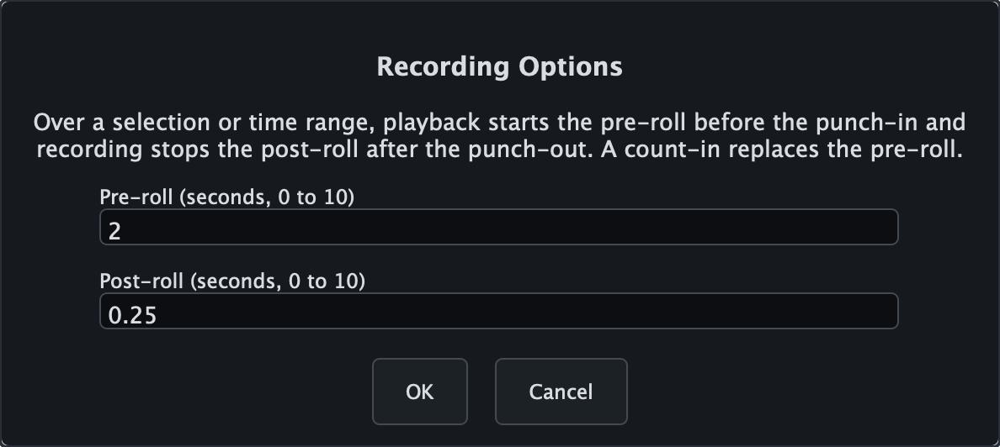

# Recording

[Guide](README.md) › Recording

Torqwave records into a file in the editor, or onto tracks in a session.

## Before you start

1. **Choose the interface** in **Audio Settings...**, and choose the **Input** at the bottom of the window.
   - On the Mac, macOS asks for microphone access the first time you do this.
2. **Match the sample rate.** A recording has to run at the rate of the file or session it goes into.
   - If the file or session is at another rate, Torqwave says so. Set the interface to that rate in Audio Settings, or convert the file (Edit > Convert Sample Rate...).
   - A new, empty file or session simply takes the interface's rate.
3. **Set the pre-roll and post-roll:** how long playback runs before a punch-in and after a punch-out. Use **Transport > Recording Options...**, or the Recording page of **File > Settings...**.

**Record** is Shift-Space, or the red button on the transport. Press it again to stop.

## Into a file

- **In an empty file**, Record simply records. Use **File > New File...** (Cmd-N) for a fresh one.
- **Over existing audio:**
  - With **no selection**, the recording starts at the cursor and replaces what was there for as long as you record.
  - With a **selection**, it punches in. Playback starts the pre-roll before the selection, so you hear what comes before. The recording replaces just the selection, and stops by itself once the selection and the post-roll have passed.

Each recording is one step to undo. The take is lined up to allow for the interface's own delay (its round-trip latency), so it lands where you played it.

If the computer can't keep up and some audio is lost, Torqwave says how much, so you can listen to the take before keeping it.

## Onto tracks in a session

1. **Arm** each track to record on: its **R** button. Choose each track's input with its **In** button.
   - With no track armed, the take goes onto a new track from the recording input at the bottom of the window.
2. Put the cursor where to start, or select a time range to punch in over.
3. Press **Record**. Every armed track records at once, each from its own input.

### Hearing yourself

**Input Monitoring** (I) plays each armed track's input through the track's own effects, volume and pan, so the performer hears the finished sound.

- Turn it off if your interface has its own direct monitoring, so you don't hear yourself twice.

### Metronome and count-in

- **Metronome** (C) clicks on each beat of the session's tempo while it plays and records.
- **Count-In** records after one bar of clicks instead of the pre-roll.

Both are in **Multitrack > Tempo**. Set the tempo first; see [Tempo and bars](06-multitrack-sessions.md#tempo-and-bars).

### Loop recording and takes

To try a part several times in a row:

1. Turn on **Loop Recording** (L).
2. Select the time range with the Range tool (6).
3. Press Record. Torqwave records over the range again and again, and keeps each pass as a **take**.
4. Stop when you have a good one.

The clip then shows "(take 2 of 5)", or wherever it stands. Right-click it and choose **Take 1**, **Take 2** and so on to hear each one. The last take is chosen to begin with.

### Comping takes

A **comp** builds one performance from the best parts of several takes: the first verse line from take 2, the second from take 4, and so on.

1. Select the track and choose **Multitrack > Clips > Show Takes**, or right-click the clip and choose **Show Takes**. A lane opens under the track for each take, its waveform drawn across the clip. The parts the clip plays are lit.
2. Drag across a take's lane over the part you want. The clip plays that take there and the rest as it was. Each drag is one undo step.
3. Go on, take by take, until the clip plays the parts you want.

- The clip's title shows "(comp of 5 takes)", and a tick marks each join.
- Each join is crossfaded over 10 ms, equal power, so the cut doesn't click. Where two joins are closer than that, the crossfades shorten so they don't meet.
- Click a take's name at the left of its lane, or choose it from the clip's right-click menu, to play that take throughout. That ends the comp.
- The comp stays with the sound when the clip is moved, trimmed, split or reversed, stretched or pitched, and when another take is chosen from the menu. It is saved with the session.
- **Flatten Comp** (in **Multitrack > Clips** and the clip's menu) renders the comp into a new take, from a new file, and plays it. The other takes stay, so you can still go back to them.
- Ask Torq can comp takes too: "use take 2 from 4 to 6 seconds".

### Recording notes

On an instrument track, **Record Notes** (Option-R) records what you play on a MIDI keyboard or the on-screen keyboard as a note clip. See [Instruments and MIDI](07-instruments-and-midi.md#put-notes-in).

Next: [Video and surround](09-video-and-surround.md).
