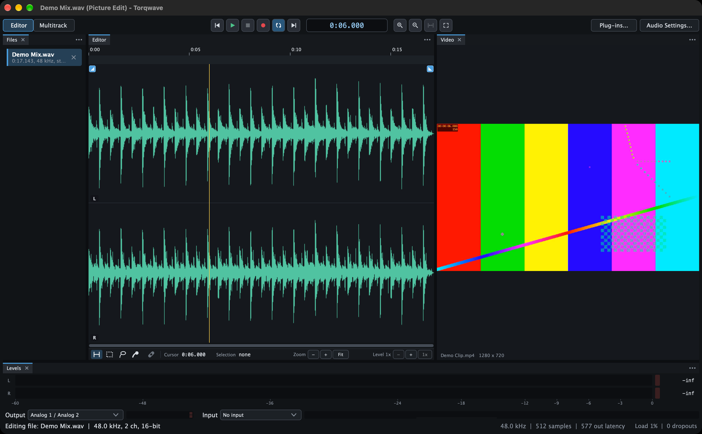

# Video and surround

[Guide](README.md) › Video and surround

## Working to picture

Torqwave edits the sound of a video while you watch its picture, then writes the new sound back into a copy of the video. Most of this needs [ffmpeg](https://ffmpeg.org) installed (see [Getting started](01-getting-started.md#install-it)).

### A video's sound in the editor

1. **Open the video** with File > Open, as you would an audio file. Its sound opens in the editor. ffmpeg reads the first audio stream from MP4, M4V, MOV, MKV, WebM or AVI.
2. **Show the picture:** **Window > Video**. The picture follows the cursor and plays along.
3. **Edit the sound.** The picture keeps up with edits that change the length:
   - a cut jumps the picture;
   - audio pasted from elsewhere in the file brings its picture with it;
   - inserted silence or generated audio shows black.
4. **Write it back:** **File > Save Sound into Video...** writes a copy of the video with your sound in place of its own.
   - If the length is unchanged, the picture is copied exactly as it was.
   - If the length changed, the picture is cut to match and encoded again: H.264, or VP9 for WebM and MPEG-4 for AVI.

*The Video panel shows the frame at the cursor (the test picture's own clock reads 00:00:06.000). Its foot names the video and its size.*

To give an audio file a video to go with it, use **File > Attach Video...**. **Detach Video** removes it.

### A video in a session

1. In the multitrack view, **File > Attach Video...** gives the session a video.
2. **File > Video Start...** sets where in the session its first frame plays. Type the time, or use the cursor.
3. The Video panel follows the session's playhead, and shows black before the video starts.
4. **File > Save Mix into Video...** writes a copy of the video with the session's mix, from that start, for the video's length. The picture is copied as it is.

To bring the video's own sound into the session, import the video as you would an audio file. The video and its start are saved in the session file.

### What shows the picture

| System | How the picture is shown |
|---|---|
| Mac | macOS shows MP4, M4V and MOV (and some AVI) itself. For MKV, WebM and the rest, ffmpeg makes a preview, labelled "preview" in the panel |
| Windows | Windows shows AVI itself. Everything else goes through a preview |
| Linux | ffmpeg decodes every picture itself, so the panel needs ffmpeg |

## Surround files

Files with more than two channels open and edit like any other. Each lane is named:

- **5.1:** L R C LFE Ls Rs
- **7.1:** L R C LFE Lrs Rrs Lss Rss

**Listening:** the **Transport** menu has two ways to play surround.

- **Play Surround Folded Down** plays it on two speakers. The centre and surrounds are at -3 dB, and the LFE is left out.
- **Play Surround to Separate Outputs** sends L and R to your output pair, and each other channel to the outputs after it, up to 8 channels.
- Both play through the effects rack. Its built-in compressor and limiter hear every channel at once; other effects run on each pair.

**Splitting and joining:**

- **File > Save Channels as Mono Files...** writes one mono WAV for each channel.
- **File > New File from Mono Files...** puts mono files back together as one. Files named ... L, R, C, LFE, Ls, Rs go in 5.1 order, and ... L, R, C, LFE, Lrs, Rrs, Lss, Rss in 7.1 order.
- **Effects > Stereo and Channels > Make Stereo** folds 5.1 or 7.1 down to stereo for good.

A 7.1 WAV is saved with its speakers marked.

## Surround sessions

A session mixes in stereo unless you choose **Multitrack > Surround > 5.1 Master** or **7.1 Master**.

**Placing tracks:**

- Each track and bus is placed with the **surround pad** on its mixer strip. The pad also sets a width and how much goes to the LFE.
- The surround pan can be automated like volume and pan: Left-Right, Front-Back, Width and LFE.

**Surround tracks:**

- **A 5.1 track** plays 5.1 clips straight to the speakers. Make one from a track's right-click menu.
  - Its effects run as three stereo pairs (L R, C LFE, Ls Rs).
  - The built-in compressor and limiter link all six channels.
  - It freezes to six channels.
- **A 7.1 track** does the same for 7.1 clips, as four pairs, with the compressor and limiter linking all eight.

**Mixing between formats:**

- In a 7.1 master, a 5.1 track's surrounds play from the side surrounds.
- In a 5.1 master, a 7.1 track's rear and side surrounds both go to Ls and Rs at -3 dB.

**Listening and output:**

- The master plays folded down or to separate outputs, as a surround file does, through the effects rack on every pair.
- A mixdown writes six or eight channels.

Next: [The Sound Library](10-sound-library.md).
