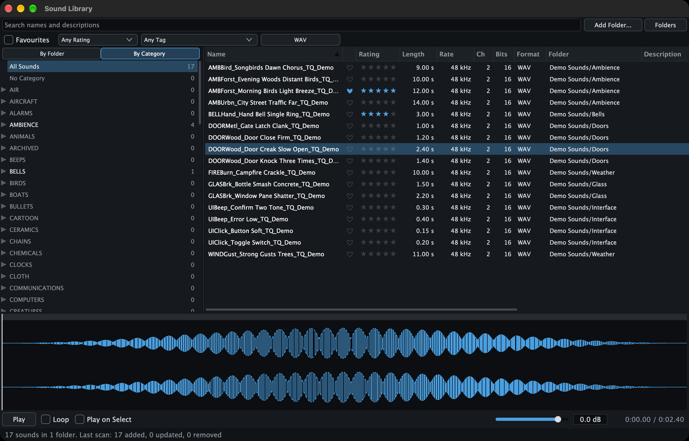

# The Sound Library

[Guide](README.md) › The Sound Library

The Sound Library is a browser for a large collection of sound effects or samples. It indexes the folders you choose, so you can search them by name, browse them by category, audition them, and drop them into your work.

Open it with **Window > Sound Library**, or **F5**, which shows it and hides it again. It is a window of its own.

*A small library browsed by category. The UCS file names put each sound in its category. One sound is a favourite with five stars, and the selected one shows in the preview.*

## Add your folders

Nothing is scanned until you add a folder.

1. Click **Add Folder...** and choose the top folder of your library. Only the folders you choose are indexed, together with the folders inside them.
2. The scan runs in the background. The list fills in as it goes, and a line under the table says how far it has got.
3. Add more folders the same way.

Sounds you make in a session go in from there: right-click a clip and choose **Add to Library...** to file what it plays, with its category and tags (see [Sound design in the session](06-multitrack-sessions.md#add-to-library)).

The **Folders** menu lists your folders. Each one can be shown in Finder or removed from the Sound Library. **Rescan All Folders** at the top of the menu brings every folder up to date after you add or change files.

## Find a sound

- **Search:** type in the search box. It matches the words of file names and descriptions.
- **Sort:** click a column header.
- **Browse:** the pane on the left switches between:
  - **By Folder:** your folders as a tree.
  - **By Category:** UCS categories, read from UCS file names or iXML, or set by hand.

  Drag the bar beside the pane to size it.
- **File types:** the list shows WAV files to start with, so the AIFF copies of your WAVs don't fill it twice. The **Formats** menu above the list adds AIFF, FLAC, Ogg Vorbis and the rest.
- **Leave folders out:** to hide a folder from the list, use its menu in the tree or a row's right-click menu. Your choices are kept, and they are also on the Sound Library page of **File > Settings...**.

## Listen

Select a sound to see its whole waveform in the preview.

- **Space**, or **Play/Stop**, plays or stops it, with a moving playhead.
- Click the waveform to play from there. Drag along the strip at its top to scrub.
- Drag across the waveform to select a part; the part then plays (and loops) alone.
- Turn on **Loop** to hear it over and over, and **Play on Select** to hear each sound as you select it.
- The slider sets the preview's volume.

## Use it

- **Return** inserts the selected sound at the cursor in the editor.
- **Drag** it into the multitrack view as a clip, into the editor, to Finder, or into another app.
- **Spot it:** drop it on a marker in the multitrack view and its sync point lands on the marker (see [Spotting sounds](09-video-and-surround.md#spotting-sounds)).
- **Use only part of it:** select that part in the preview first, then drag. Only that part goes.

## Organise it

- **Rate** the selected sounds with the keys **1** to **5** (**0** clears the rating), or with the stars.
- **Mark favourites** with the heart. The **Favourites** switch shows only those.
- **Tag** them, and set their **category** by hand from the right-click menu.
- **Write it into the files:** categories and tags can be written into WAV files' iXML, so other apps can read them. They are only written when you ask, and written safely.

Next: [Projects and file types](11-projects-and-file-types.md).
