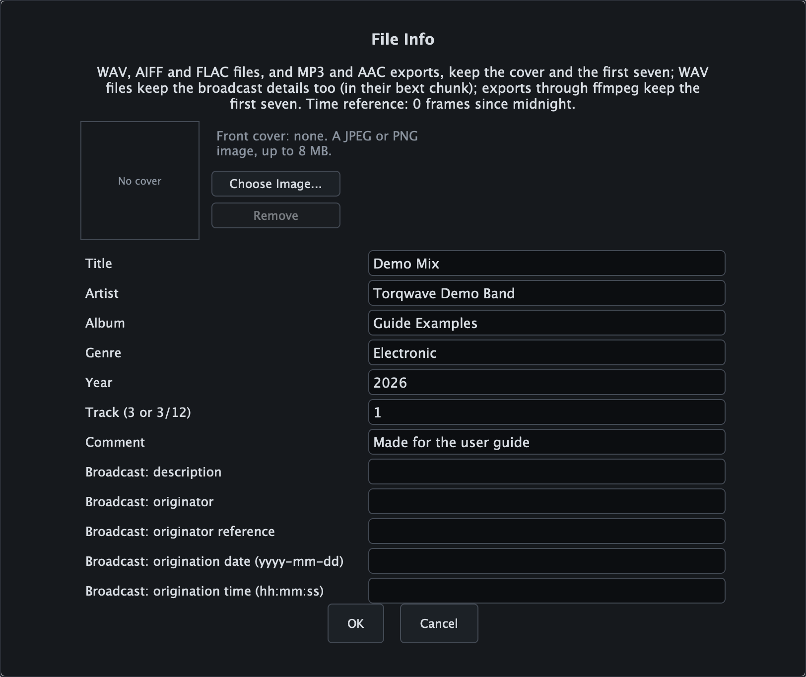

# Projects and file types

[Guide](README.md) › Projects and file types

## Torqwave's own files

| File | What it holds | Made by |
|---|---|---|
| `.tqproject` | Everything open: the files in the editor (with each one's selection, cursor, zoom and video), which one was showing, the effects rack and its settings, the multitrack session, and whether the editor or the session was in front | File > Save Project |
| `.tqsession` | A multitrack session: tracks, clips, buses, sends, effects, automation, markers, tempo and its video | File > Save Session (in the multitrack view) |
| `.tqrack` | An effects rack chain with every setting | Window > Save Rack... |

**From SpectraBlade:** Torqwave also opens the old name's files (`.sbproject`, `.sbsession` and `.sbrack`) and its presets.

None of them hold audio. They point to your audio files.

## Projects

A project brings everything back as you left it. Use **File > Save Project** and **File > Open Project...**, or open a `.tqproject` with File > Open.

**What happens to your audio:**

- Saving a project doesn't change the files you opened.
- A file with unsaved changes, or one that was never saved, is written as a 32-bit float WAV into a folder beside the project, named "<project> Files". The open file then becomes that copy.
- An untitled session with tracks is saved into the same folder.
- **Keep the folder with the project.** Paths inside the project's own folder are stored relative to it, so you can move or copy the folder as a whole.

**Undo history:**

- Each file's undo history is kept too, so undo and redo carry on after you reopen the project.
- The audio of every step is written to "<project> Files/History", once for each block the steps share. That can take a lot of room: every version of the audio the history holds.
- Turn it off with **File > Keep Undo History in Projects**.

## Sessions and their audio

A session refers to the audio files its clips play. If you move or delete those files, the session can't find them.

To move a session to another computer, or hand it on, use **File > Save a Copy with Audio...**. It writes a copy of the session with every audio file it uses in a folder beside it.

While a session has unsaved changes, Torqwave writes a copy of it every two minutes. If the app closes without saving, from a crash or a power cut, it offers to recover the session the next time it starts. Saving the session, or quitting normally, removes the copy.

## Other things Torqwave keeps

| What | How to keep or share it |
|---|---|
| Effect presets | **Save...** beside a dialog's Presets list |
| Track templates | **Multitrack > Tracks > Save Track as Template...**, used with **Add Track from Template...** |
| Instrument presets (a drum kit, a sound) | **Multitrack > Tracks > Save Instrument Preset...** with the instrument track selected; one `.tqinstrument` file each in `Instrument Presets` in the Torqwave folder of your user library (on the Mac, `~/Library/Torqwave`): copy them. Ask Torq chooses among them by name |
| Workspaces | **Window > Workspace > Save Workspace As...** |
| Keyboard shortcuts | **Settings > Keys** (or **Window > Keyboard Shortcuts...**): export and import |
| Plug-in catalogue (Ask Torq) | `Plug-in Catalogue.json` in the Torqwave folder of your user library (on the Mac, `~/Library/Torqwave`): copy it |
| Recorded sequences | **Effects > Record Sequence**, played with **Play Sequence...** |
| Markers and regions | **File > Export Markers as CSV...** and **Import Markers from CSV...** |

## Audio file types

| Format | Opens | Writes |
|---|---|---|
| WAV (RF64 too) | Yes, with markers and regions | 8, 16 or 24-bit, or 32-bit float, with markers and regions |
| AIFF | Yes, with markers and tags | 8, 16 or 24-bit, with markers and tags |
| FLAC | Yes, with tags | 16 or 24-bit, with tags |
| MP3 | Yes | Export as MP3 or AAC: constant 96 to 320 kbps, or variable V0, V2 or V4 |
| AAC (.m4a) | Yes | Export as MP3 or AAC: 96 to 320 kbps |
| Ogg Vorbis | Yes | No |
| Opus | Yes, with tags | Export with ffmpeg |
| Apple Lossless, WavPack, AC-3 | Through ffmpeg | Export with ffmpeg |
| WMA, E-AC-3, Monkey's Audio, TTA, MKA, MP2, AMR, DTS | Through ffmpeg | No |
| The sound of a video | Through ffmpeg | Save Sound into Video... |

The [README](../../README.md#file-formats) has the details: which tags each type keeps, and how ffmpeg is found on each system.

### Tags and file info

**File > File Info** shows and changes a file's details:

- the title, artist, album, genre, year, track and comment;
- a front cover: a JPEG or PNG image of up to 8 MB;
- the broadcast-wave (BWF) details.

WAV keeps all of them. AIFF, FLAC, MP3 and AAC keep the tags and the cover.

Next: [Customising and troubleshooting](12-customising-and-troubleshooting.md).
